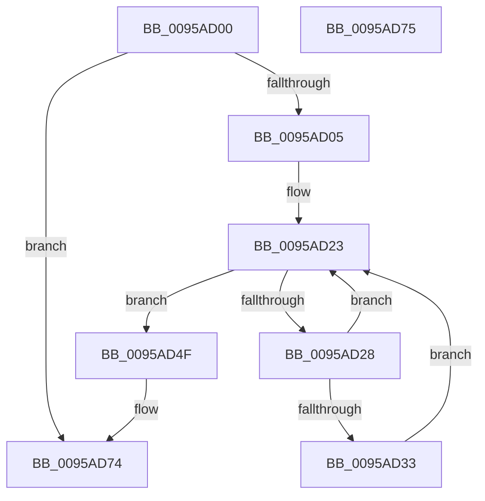

# KsepCacheDeviceFree

- RVA: `0x0095AD00`–`0x0095AD76` (길이 `118` bytes)
- VA: `0x000000014095AD00`
- 실행 섹션: `PAGE`
- PDB 이름 있음: `예`; PDB Function 태그: `아니요`
- unwind 정보 RVA: `0x000926AC`
- 디코드: `34`개 명령, `118/118` bytes 표시
- 미해석 바이트: `0` (있으면 어셈블리에 `.byte`로 보존)

> 이 문서는 커널 이미지의 기계어와 PDB 기호를 분석해 생성했습니다. 4번과 5번은 함수 원형과 자료형을 바이너리 사용 방식에서 추정한 C 해석이며 원본 소스 복구 결과는 아닙니다.

## 1. Dependencies

- 직접 호출 지점: **5**; 고유 호출 대상: **2**
- 직접 호출자로 확인된 함수: **3**
- RIP 상대 이미지 참조: **0**

### Outgoing calls
- `0x0095AD37` → [KsepStringFree](KsepStringFree_function_0095A1B8.md) (function, `0x0095A1B8`)
- `0x0095AD40` → [KsepPoolFreePaged](../../text/4B/KsepPoolFreePaged_function_004B0E10.md) (function, `0x004B0E10`)
- `0x0095AD48` → [KsepPoolFreePaged](../../text/4B/KsepPoolFreePaged_function_004B0E10.md) (function, `0x004B0E10`)
- `0x0095AD53` → [KsepStringFree](KsepStringFree_function_0095A1B8.md) (function, `0x0095A1B8`)
- `0x0095AD5B` → [KsepPoolFreePaged](../../text/4B/KsepPoolFreePaged_function_004B0E10.md) (function, `0x004B0E10`)

### Direct callers
- [KseQueryDeviceDataList](KseQueryDeviceDataList_function_00959390.md) at `0x009594C7`
- [KsepDbCacheReadDevice](KsepDbCacheReadDevice_function_0095AAC8.md) at `0x0095AB76`
- [KseQueryDeviceData](KseQueryDeviceData_function_0095AFB0.md) at `0x0095B0E1`

### Static image references
- 디코드된 RIP-relative 메모리 참조가 없습니다.

## 2. Other-region calls and transfers

- 다른 실행 섹션으로 향하는 call: **3**
  - `0x0095AD40` → [KsepPoolFreePaged](../../text/4B/KsepPoolFreePaged_function_004B0E10.md) (`PAGE` → `.text`)
  - `0x0095AD48` → [KsepPoolFreePaged](../../text/4B/KsepPoolFreePaged_function_004B0E10.md) (`PAGE` → `.text`)
  - `0x0095AD5B` → [KsepPoolFreePaged](../../text/4B/KsepPoolFreePaged_function_004B0E10.md) (`PAGE` → `.text`)
- 별도 외부 분기/꼬리 이동을 확인하지 못했습니다.

## 3. Assembly (complete function range)

```asm
0095AD00  48 85 C9                        test rcx, rcx
0095AD03  74 6F                           je 0x14095ad74
0095AD05  48 89 5C 24 08                  mov qword ptr [rsp + 8], rbx
0095AD0A  48 89 6C 24 10                  mov qword ptr [rsp + 0x10], rbp
0095AD0F  48 89 74 24 18                  mov qword ptr [rsp + 0x18], rsi
0095AD14  57                              push rdi
0095AD15  48 83 EC 20                     sub rsp, 0x20
0095AD19  48 8D 71 38                     lea rsi, [rcx + 0x38]
0095AD1D  48 8B F9                        mov rdi, rcx
0095AD20  48 8B 1E                        mov rbx, qword ptr [rsi]
0095AD23  48 3B DE                        cmp rbx, rsi
0095AD26  74 27                           je 0x14095ad4f
0095AD28  48 8B EB                        mov rbp, rbx
0095AD2B  48 8B 1B                        mov rbx, qword ptr [rbx]
0095AD2E  48 85 ED                        test rbp, rbp
0095AD31  74 F0                           je 0x14095ad23
0095AD33  48 8D 4D 10                     lea rcx, [rbp + 0x10]
0095AD37  E8 7C F4 FF FF                  call 0x14095a1b8
0095AD3C  48 8B 4D 28                     mov rcx, qword ptr [rbp + 0x28]
0095AD40  E8 CB 60 B5 FF                  call 0x1404b0e10
0095AD45  48 8B CD                        mov rcx, rbp
0095AD48  E8 C3 60 B5 FF                  call 0x1404b0e10
0095AD4D  EB D4                           jmp 0x14095ad23
0095AD4F  48 8D 4F 28                     lea rcx, [rdi + 0x28]
0095AD53  E8 60 F4 FF FF                  call 0x14095a1b8
0095AD58  48 8B CF                        mov rcx, rdi
0095AD5B  E8 B0 60 B5 FF                  call 0x1404b0e10
0095AD60  48 8B 5C 24 30                  mov rbx, qword ptr [rsp + 0x30]
0095AD65  48 8B 6C 24 38                  mov rbp, qword ptr [rsp + 0x38]
0095AD6A  48 8B 74 24 40                  mov rsi, qword ptr [rsp + 0x40]
0095AD6F  48 83 C4 20                     add rsp, 0x20
0095AD73  5F                              pop rdi
0095AD74  C3                              ret
0095AD75  CC                              int3
```

## 4. C-style interpretation (structured pseudocode)

```c
__int64 __fastcall KsepCacheDeviceFree(__int64 a1)
{
    __int64 result;
    __int64 v_rsp;
    unsigned __int64 v_stack_p10;
    unsigned __int64 v_stack_p18;
    unsigned __int64 v_stack_p8;

    if (a1 == 0) goto loc_0095AD74;
    v_stack_p8 = v_rbx;
    v_stack_p10 = v_rbp;
    v_stack_p18 = v_rsi;
    v_rsp = (v_rsp) - (32);
loc_0095AD23:
    if ((*(unsigned __int64 *)(a1 + 56)) == (a1 + 56)) goto loc_0095AD4F;
    if (*(unsigned __int64 *)(a1 + 56) == 0) goto loc_0095AD23;
    result = KsepStringFree(*(unsigned __int64 *)(a1 + 56) + 16, a2, a3, a4);
    result = KsepPoolFreePaged(*(unsigned __int64 *)(*(unsigned __int64 *)(a1 + 56) + 40), a2, a3, a4);
    result = KsepPoolFreePaged(*(unsigned __int64 *)(a1 + 56), a2, a3, a4);
    goto loc_0095AD23;
loc_0095AD4F:
    result = KsepStringFree(a1 + 40, a2, a3, a4);
    result = KsepPoolFreePaged(a1, a2, a3, a4);
    v_rsp = (v_rsp) + (32);
loc_0095AD74:
    return result;
}
```

## 5. (Beta) C Style

```c
int64_t KsepCacheDeviceFree(int64_t Arg1)
{
    int64_t result;
    int64_t local_rsp;
    uint64_t v_stack_p10;
    uint64_t v_stack_p18;
    uint64_t v_stack_p8;

    if (Arg1 == 0) goto loc_0095AD74;
    v_stack_p8 = local_rbx;
    v_stack_p10 = local_rbp;
    v_stack_p18 = local_rsi;
    local_rsp = (local_rsp) - (32);
loc_0095AD23:
    if ((*(uint64_t *)(Arg1 + 0x38)) == (Arg1 + 56)) goto loc_0095AD4F;
    if (*(uint64_t *)(Arg1 + 0x38) == 0) goto loc_0095AD23;
    result = KsepStringFree(*(uint64_t *)(Arg1 + 0x38) + 16, a2, a3, a4);
    result = KsepPoolFreePaged(*(uint64_t *)(*(uint64_t *)(Arg1 + 0x38) + 0x28), a2, a3, a4);
    result = KsepPoolFreePaged(*(uint64_t *)(Arg1 + 0x38), a2, a3, a4);
    goto loc_0095AD23;
loc_0095AD4F:
    result = KsepStringFree(Arg1 + 40, a2, a3, a4);
    result = KsepPoolFreePaged(Arg1, a2, a3, a4);
    local_rsp = (local_rsp) + (32);
loc_0095AD74:
    return result;
}
```

## 6. Execution-region graph

[열기: 2D/3D 그래프와 함수 탐색 컨트롤 패널](../../../control-panel.html?section=page&rva=0x0095AD00&view=graph)

- 2D 그래프는 위에서 아래로 흐르고, 3D 그래프는 빈 공간을 드래그해 회전합니다. Shift+드래그는 이동, 휠은 확대·축소, 함수 노드 선택은 대상 보고서 이동입니다.

### Static fallback


