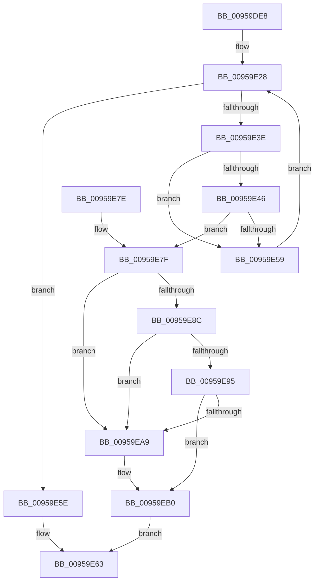

# KsepCacheLookup

- RVA: `0x00959DE8`–`0x00959EC6` (길이 `222` bytes)
- VA: `0x0000000140959DE8`
- 실행 섹션: `PAGE`
- PDB 이름 있음: `예`; PDB Function 태그: `아니요`
- unwind 정보 RVA: `0x000928D4`
- 디코드: `70`개 명령, `222/222` bytes 표시
- 미해석 바이트: `0` (있으면 어셈블리에 `.byte`로 보존)

> 이 문서는 커널 이미지의 기계어와 PDB 기호를 분석해 생성했습니다. 4번과 5번은 함수 원형과 자료형을 바이너리 사용 방식에서 추정한 C 해석이며 원본 소스 복구 결과는 아닙니다.

## 1. Dependencies

- 직접 호출 지점: **2**; 고유 호출 대상: **1**
- 직접 호출자로 확인된 함수: **5**
- RIP 상대 이미지 참조: **0**

### Outgoing calls
- `0x00959E0E` → [guard_dispatch_icall](../../text/6B/guard_dispatch_icall_function_006BAAD0.md) (function, `0x006BAAD0`)
- `0x00959E50` → [guard_dispatch_icall](../../text/6B/guard_dispatch_icall_function_006BAAD0.md) (function, `0x006BAAD0`)

### Direct callers
- [KsepDbCacheInsertDevice](../74/KsepDbCacheInsertDevice_function_00748C64.md) at `0x00748CB9`
- [KseLookupHardwareId](../74/KseLookupHardwareId_function_0074A62C.md) at `0x0074A6FA`
- [KseAddHardwareId](KseAddHardwareId_function_00959254.md) at `0x009592C5`
- [KseQueryDeviceDataList](KseQueryDeviceDataList_function_00959390.md) at `0x00959454`
- [KsepDbCacheQueryDevice](KsepDbCacheQueryDevice_function_00959D20.md) at `0x00959D87`

### Static image references
- 디코드된 RIP-relative 메모리 참조가 없습니다.

## 2. Other-region calls and transfers

- 다른 실행 섹션으로 향하는 call: **2**
  - `0x00959E0E` → [guard_dispatch_icall](../../text/6B/guard_dispatch_icall_function_006BAAD0.md) (`PAGE` → `.text`)
  - `0x00959E50` → [guard_dispatch_icall](../../text/6B/guard_dispatch_icall_function_006BAAD0.md) (`PAGE` → `.text`)
- 별도 외부 분기/꼬리 이동을 확인하지 못했습니다.

## 3. Assembly (complete function range)

```asm
00959DE8  48 8B C4                        mov rax, rsp
00959DEB  48 89 58 08                     mov qword ptr [rax + 8], rbx
00959DEF  48 89 68 10                     mov qword ptr [rax + 0x10], rbp
00959DF3  48 89 70 18                     mov qword ptr [rax + 0x18], rsi
00959DF7  48 89 78 20                     mov qword ptr [rax + 0x20], rdi
00959DFB  41 56                           push r14
00959DFD  48 83 EC 20                     sub rsp, 0x20
00959E01  48 8B 41 50                     mov rax, qword ptr [rcx + 0x50]
00959E05  48 8B D9                        mov rbx, rcx
00959E08  48 8B CA                        mov rcx, rdx
00959E0B  4C 8B F2                        mov r14, rdx
00959E0E  E8 BD 0C D6 FF                  call 0x1406baad0
00959E13  48 8B 4B 10                     mov rcx, qword ptr [rbx + 0x10]
00959E17  33 D2                           xor edx, edx
00959E19  8B E8                           mov ebp, eax
00959E1B  F7 73 0C                        div dword ptr [rbx + 0xc]
00959E1E  44 8B C2                        mov r8d, edx
00959E21  4D 03 C0                        add r8, r8
00959E24  4A 8B 34 C1                     mov rsi, qword ptr [rcx + r8*8]
00959E28  33 D2                           xor edx, edx
00959E2A  8B C5                           mov eax, ebp
00959E2C  F7 73 0C                        div dword ptr [rbx + 0xc]
00959E2F  8B CA                           mov ecx, edx
00959E31  48 C1 E1 04                     shl rcx, 4
00959E35  48 03 4B 10                     add rcx, qword ptr [rbx + 0x10]
00959E39  48 3B F1                        cmp rsi, rcx
00959E3C  74 20                           je 0x140959e5e
00959E3E  48 8D 7E F8                     lea rdi, [rsi - 8]
00959E42  3B 2F                           cmp ebp, dword ptr [rdi]
00959E44  75 13                           jne 0x140959e59
00959E46  48 8B 43 48                     mov rax, qword ptr [rbx + 0x48]
00959E4A  48 8B D7                        mov rdx, rdi
00959E4D  49 8B CE                        mov rcx, r14
00959E50  E8 7B 0C D6 FF                  call 0x1406baad0
00959E55  85 C0                           test eax, eax
00959E57  75 26                           jne 0x140959e7f
00959E59  48 8B 36                        mov rsi, qword ptr [rsi]
00959E5C  EB CA                           jmp 0x140959e28
00959E5E  FF 43 34                        inc dword ptr [rbx + 0x34]
00959E61  33 C0                           xor eax, eax
00959E63  48 8B 5C 24 30                  mov rbx, qword ptr [rsp + 0x30]
00959E68  48 8B 6C 24 38                  mov rbp, qword ptr [rsp + 0x38]
00959E6D  48 8B 74 24 40                  mov rsi, qword ptr [rsp + 0x40]
00959E72  48 8B 7C 24 48                  mov rdi, qword ptr [rsp + 0x48]
00959E77  48 83 C4 20                     add rsp, 0x20
00959E7B  41 5E                           pop r14
00959E7D  C3                              ret
00959E7E  CC                              int3
00959E7F  48 8D 4F 18                     lea rcx, [rdi + 0x18]
00959E83  48 8B 01                        mov rax, qword ptr [rcx]
00959E86  48 39 48 08                     cmp qword ptr [rax + 8], rcx
00959E8A  75 1D                           jne 0x140959ea9
00959E8C  48 8B 51 08                     mov rdx, qword ptr [rcx + 8]
00959E90  48 39 0A                        cmp qword ptr [rdx], rcx
00959E93  75 14                           jne 0x140959ea9
00959E95  48 89 02                        mov qword ptr [rdx], rax
00959E98  48 89 50 08                     mov qword ptr [rax + 8], rdx
00959E9C  48 8D 43 20                     lea rax, [rbx + 0x20]
00959EA0  48 8B 50 08                     mov rdx, qword ptr [rax + 8]
00959EA4  48 39 02                        cmp qword ptr [rdx], rax
00959EA7  74 07                           je 0x140959eb0
00959EA9  B9 03 00 00 00                  mov ecx, 3
00959EAE  CD 29                           int 0x29
00959EB0  48 89 01                        mov qword ptr [rcx], rax
00959EB3  48 89 51 08                     mov qword ptr [rcx + 8], rdx
00959EB7  48 89 0A                        mov qword ptr [rdx], rcx
00959EBA  48 89 48 08                     mov qword ptr [rax + 8], rcx
00959EBE  48 8B C7                        mov rax, rdi
00959EC1  FF 43 30                        inc dword ptr [rbx + 0x30]
00959EC4  EB 9D                           jmp 0x140959e63
```

## 4. C-style interpretation (structured pseudocode)

```c
__int64 __fastcall KsepCacheLookup(__int64 a1, __int64 a2)
{
    __int64 result;
    __int64 v_rsp;
    unsigned __int64 v_stack_p10;
    unsigned __int64 v_stack_p18;
    unsigned __int64 v_stack_p20;
    unsigned __int64 v_stack_p8;

    *(unsigned __int64 *)(v_rsp + 8) = v_rbx;
    *(unsigned __int64 *)(v_rsp + 16) = v_rbp;
    *(unsigned __int64 *)(v_rsp + 24) = v_rsi;
    *(unsigned __int64 *)(v_rsp + 32) = v_rdi;
    v_rsp = (v_rsp) - (32);
    result = guard_dispatch_icall(a2, a2, a3, a4);
    a2 = 0;
    a3 = (0) + (0);
loc_00959E28:
    a2 = 0;
    a1 = (0) << (4);
    a1 = (a1) + (*(unsigned __int64 *)(a1 + 16));
    if ((*(unsigned __int64 *)(*(unsigned __int64 *)(a1 + 16) + a3 * 8)) == a1) goto loc_00959E5E;
    if (((unsigned int)((unsigned int)((unsigned int)(result)))) != (*(unsigned int *)(*(unsigned __int64 *)(*(unsigned __int64 *)(a1 + 16) + a3 * 8) - 8))) goto loc_00959E59;
    result = guard_dispatch_icall(0, *(unsigned __int64 *)(*(unsigned __int64 *)(a1 + 16) + a3 * 8) - 8, a3, a4);
    if ((unsigned int)(result) != 0) goto loc_00959E7F;
loc_00959E59:
    goto loc_00959E28;
loc_00959E5E:
    result = 0;
loc_00959E63:
    v_rsp = (v_rsp) + (32);
    return result;
loc_00959E7F:
    if ((*(unsigned __int64 *)(*(unsigned __int64 *)(v_stack_p20 + 24) + 8)) != (v_stack_p20 + 24)) goto loc_00959EA9;
    if ((*(unsigned __int64 *)(*(unsigned __int64 *)(v_stack_p20 + 24 + 8))) != (v_stack_p20 + 24)) goto loc_00959EA9;
    *(unsigned __int64 *)(*(unsigned __int64 *)(v_stack_p20 + 24 + 8)) = *(unsigned __int64 *)(v_stack_p20 + 24);
    *(unsigned __int64 *)(*(unsigned __int64 *)(v_stack_p20 + 24) + 8) = *(unsigned __int64 *)(v_stack_p20 + 24 + 8);
    if ((*(unsigned __int64 *)(*(unsigned __int64 *)(v_stack_p8 + 32 + 8))) != (v_stack_p8 + 32)) {
        a1 = 3;
    }
    *(unsigned __int64 *)(a1) = v_stack_p8 + 32;
    *(unsigned __int64 *)(a1 + 8) = *(unsigned __int64 *)(v_stack_p8 + 32 + 8);
    *(unsigned __int64 *)(*(unsigned __int64 *)(v_stack_p8 + 32 + 8)) = a1;
    *(unsigned __int64 *)(v_stack_p8 + 32 + 8) = a1;
    goto loc_00959E63;
}
```

## 5. (Beta) C Style

```c
int64_t KsepCacheLookup(void *Arg1, int64_t Arg2)
{
    uint8_t *arg1 = (uint8_t *)Arg1;

    int64_t result;
    int64_t local_rsp;
    uint64_t v_stack_p10;
    uint64_t v_stack_p18;
    uint64_t v_stack_p20;
    uint64_t v_stack_p8;

    *(uint64_t *)(local_rsp + 0x8) = local_rbx;
    *(uint64_t *)(local_rsp + 0x10) = local_rbp;
    *(uint64_t *)(local_rsp + 0x18) = local_rsi;
    *(uint64_t *)(local_rsp + 0x20) = local_rdi;
    local_rsp = (local_rsp) - (32);
    result = guard_dispatch_icall(Arg2, Arg2, a3, a4);
    Arg2 = 0;
    a3 = (0) + (0);
loc_00959E28:
    Arg2 = 0;
    Arg1 = (0) << (4);
    Arg1 = (Arg1) + (*(uint64_t *)(arg1 + 0x10));
    if ((*(uint64_t *)(*(uint64_t *)(arg1 + 0x10) + a3 * 8)) == Arg1) goto loc_00959E5E;
    if (((uint32_t)((uint32_t)((uint32_t)(result)))) != (*(uint32_t *)(*(uint64_t *)(*(uint64_t *)(arg1 + 0x10) + a3 * 8) - 0x8))) goto loc_00959E59;
    result = guard_dispatch_icall(0, *(uint64_t *)(*(uint64_t *)(arg1 + 0x10) + a3 * 8) - 8, a3, a4);
    if ((uint32_t)(result) != 0) goto loc_00959E7F;
loc_00959E59:
    goto loc_00959E28;
loc_00959E5E:
    result = 0;
loc_00959E63:
    local_rsp = (local_rsp) + (32);
    return result;
loc_00959E7F:
    if ((*(uint64_t *)(*(uint64_t *)(v_stack_p20 + 0x18) + 0x8)) != (v_stack_p20 + 24)) goto loc_00959EA9;
    if ((*(uint64_t *)(*(uint64_t *)(v_stack_p20 + 0x18 + 0x8))) != (v_stack_p20 + 24)) goto loc_00959EA9;
    *(uint64_t *)(*(uint64_t *)(v_stack_p20 + 0x18 + 0x8)) = *(uint64_t *)(v_stack_p20 + 0x18);
    *(uint64_t *)(*(uint64_t *)(v_stack_p20 + 0x18) + 0x8) = *(uint64_t *)(v_stack_p20 + 0x18 + 0x8);
    if ((*(uint64_t *)(*(uint64_t *)(v_stack_p8 + 0x20 + 0x8))) != (v_stack_p8 + 32)) {
        Arg1 = 3;
    }
    *(uint64_t *)(arg1) = v_stack_p8 + 32;
    *(uint64_t *)(arg1 + 0x8) = *(uint64_t *)(v_stack_p8 + 0x20 + 0x8);
    *(void **)(*(uint64_t *)(v_stack_p8 + 0x20 + 0x8)) = Arg1;
    *(void **)(v_stack_p8 + 0x20 + 0x8) = Arg1;
    goto loc_00959E63;
}
```

### 관측된 메모리 오프셋

구조체 형식이 확인되지 않은 접근은 인자 기준의 오프셋으로만 기록했습니다.

| 기준 인자 | 오프셋 표현 | 폭 (bit) | 접근 |
|---|---:|---:|---|
| `Arg1` | `+ 0x8` | `64` | `R` |
| `Arg1` | `+ 0xC` | `32` | `R` |
| `Arg1` | `+ 0x10` | `64` | `R` |
| `Arg1` | `+ 0x20` | `64` | `R` |
| `Arg1` | `+ 0x30` | `32` | `R/W` |
| `Arg1` | `+ 0x34` | `32` | `R/W` |
| `Arg1` | `+ 0x48` | `64` | `R` |
| `Arg1` | `+ 0x50` | `64` | `R` |

## 6. Execution-region graph

[열기: 2D/3D 그래프와 함수 탐색 컨트롤 패널](../../../control-panel.html?section=page&rva=0x00959DE8&view=graph)

- 2D 그래프는 위에서 아래로 흐르고, 3D 그래프는 빈 공간을 드래그해 회전합니다. Shift+드래그는 이동, 휠은 확대·축소, 함수 노드 선택은 대상 보고서 이동입니다.

### Static fallback


