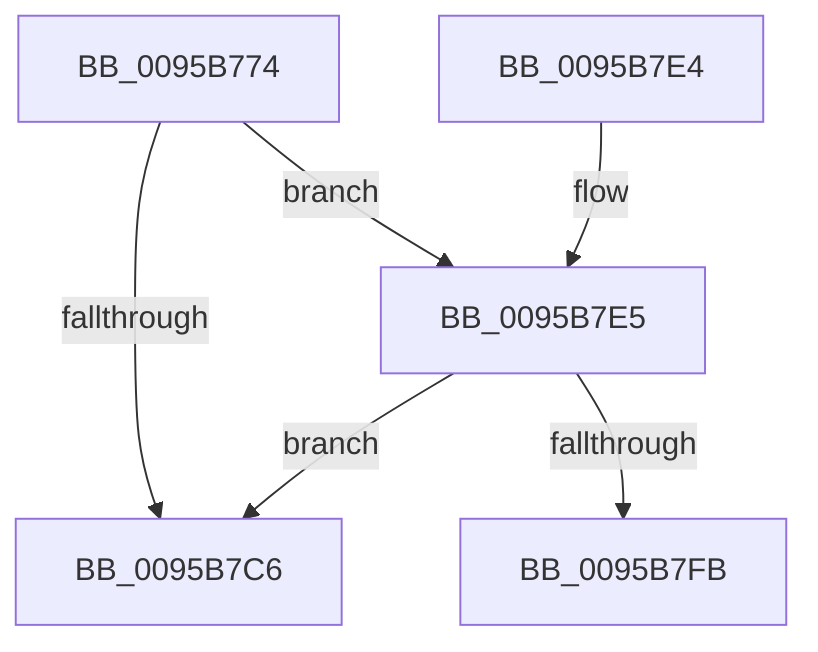

# KsepDbCacheReadDeviceInternal

- RVA: `0x0095B774`–`0x0095B816` (길이 `162` bytes)
- VA: `0x000000014095B774`
- 실행 섹션: `PAGE`
- PDB 이름 있음: `예`; PDB Function 태그: `예`
- unwind 정보 RVA: `0x00092BA0`
- 디코드: `46`개 명령, `162/162` bytes 표시
- 미해석 바이트: `0` (있으면 어셈블리에 `.byte`로 보존)

> 이 문서는 커널 이미지의 기계어와 PDB 기호를 분석해 생성했습니다. 4번과 5번은 함수 원형과 자료형을 바이너리 사용 방식에서 추정한 C 해석이며 원본 소스 복구 결과는 아닙니다.

## 1. Dependencies

- 직접 호출 지점: **3**; 고유 호출 대상: **3**
- 직접 호출자로 확인된 함수: **1**
- RIP 상대 이미지 참조: **0**

### Outgoing calls
- `0x0095B7BD` → [SdbGetDatabaseMatchEx](SdbGetDatabaseMatchEx_function_0095BD7C.md) (function, `0x0095BD7C`)
- `0x0095B7F2` → [SdbTagRefToTagID](../81/SdbTagRefToTagID_function_0081717C.md) (function, `0x0081717C`)
- `0x0095B80B` → [SdbFindFirstTag](SdbFindFirstTag_function_0095E34C.md) (function, `0x0095E34C`)

### Direct callers
- [KsepDbCacheReadDevice](KsepDbCacheReadDevice_function_0095AAC8.md) at `0x0095AB42`
- [KsepDbCacheReadDevice](KsepDbCacheReadDevice_function_0095AAC8.md) at `0x0095ABAF`

### Static image references
- 디코드된 RIP-relative 메모리 참조가 없습니다.

## 2. Other-region calls and transfers

- 다른 실행 섹션으로 향하는 call: **0**
- call이 아닌 외부 분기/꼬리 이동: **1**
  - `0x0095B811` → [sub_00B2789A](../B2/Unknown_function_00B2789A.md) (`tail-transfer`)

## 3. Assembly (complete function range)

```asm
0095B774  4C 8B DC                        mov r11, rsp
0095B777  49 89 5B 08                     mov qword ptr [r11 + 8], rbx
0095B77B  49 89 7B 10                     mov qword ptr [r11 + 0x10], rdi
0095B77F  4D 89 73 18                     mov qword ptr [r11 + 0x18], r14
0095B783  55                              push rbp
0095B784  48 8B EC                        mov rbp, rsp
0095B787  48 81 EC 80 00 00 00            sub rsp, 0x80
0095B78E  83 65 C0 00                     and dword ptr [rbp - 0x40], 0
0095B792  33 C0                           xor eax, eax
0095B794  48 83 65 C8 00                  and qword ptr [rbp - 0x38], 0
0095B799  0F 57 C0                        xorps xmm0, xmm0
0095B79C  49 89 53 A8                     mov qword ptr [r11 - 0x58], rdx
0095B7A0  4D 8B F1                        mov r14, r9
0095B7A3  49 21 43 A0                     and qword ptr [r11 - 0x60], rax
0095B7A7  48 8B D9                        mov rbx, rcx
0095B7AA  49 21 43 98                     and qword ptr [r11 - 0x68], rax
0095B7AE  8D 50 01                        lea edx, [rax + 1]
0095B7B1  0F 11 45 D0                     movups xmmword ptr [rbp - 0x30], xmm0
0095B7B5  48 89 45 F0                     mov qword ptr [rbp - 0x10], rax
0095B7B9  0F 11 45 E0                     movups xmmword ptr [rbp - 0x20], xmm0
0095B7BD  E8 BA 05 00 00                  call 0x14095bd7c
0095B7C2  85 C0                           test eax, eax
0095B7C4  75 1F                           jne 0x14095b7e5
0095B7C6  B8 25 02 00 C0                  mov eax, 0xc0000225
0095B7CB  4C 8D 9C 24 80 00 00 00         lea r11, [rsp + 0x80]
0095B7D3  49 8B 5B 10                     mov rbx, qword ptr [r11 + 0x10]
0095B7D7  49 8B 7B 18                     mov rdi, qword ptr [r11 + 0x18]
0095B7DB  4D 8B 73 20                     mov r14, qword ptr [r11 + 0x20]
0095B7DF  49 8B E3                        mov rsp, r11
0095B7E2  5D                              pop rbp
0095B7E3  C3                              ret
0095B7E4  CC                              int3
0095B7E5  4C 8D 4D C0                     lea r9, [rbp - 0x40]
0095B7E9  8B D0                           mov edx, eax
0095B7EB  4C 8D 45 C8                     lea r8, [rbp - 0x38]
0095B7EF  48 8B CB                        mov rcx, rbx
0095B7F2  E8 85 B9 EB FF                  call 0x14081717c
0095B7F7  85 C0                           test eax, eax
0095B7F9  74 CB                           je 0x14095b7c6
0095B7FB  48 8B 5D C8                     mov rbx, qword ptr [rbp - 0x38]
0095B7FF  41 B8 13 70 00 00               mov r8d, 0x7013
0095B805  8B 55 C0                        mov edx, dword ptr [rbp - 0x40]
0095B808  48 8B CB                        mov rcx, rbx
0095B80B  E8 3C 2B 00 00                  call 0x14095e34c
0095B810  90                              nop
0095B811  E9 84 C0 1C 00                  jmp 0x140b2789a
```

## 4. C-style interpretation (structured pseudocode)

```c
__int64 __fastcall KsepDbCacheReadDeviceInternal(__int64 a1, __int64 a2, __int64 a3, __int64 a4)
{
    __int64 result;
    __int64 v_rsp;
    unsigned __int64 v_stack_m18;
    unsigned __int64 v_stack_m28;
    unsigned __int64 v_stack_m38;
    unsigned __int64 v_stack_m40;
    unsigned int v_stack_m48;
    unsigned __int64 v_stack_m8;

    *(unsigned __int64 *)(v_rsp + 8) = v_rbx;
    *(unsigned __int64 *)(v_rsp + 16) = v_rdi;
    *(unsigned __int64 *)(v_rsp + 24) = v_r14;
    v_rsp = (v_rsp) - (128);
    result = 0;
    *(unsigned __int64 *)(v_rsp - 88) = a2;
    v_stack_m38 = v_xmm0;
    v_stack_m18 = 0;
    v_stack_m28 = v_xmm0;
    result = SdbGetDatabaseMatchEx(a1, result + 1, a3, a4);
    if ((unsigned int)(result) != 0) goto loc_0095B7E5;
loc_0095B7C6:
    return (unsigned int)(0xC0000225ULL);
loc_0095B7E5:
    result = SdbTagRefToTagID(*(unsigned __int64 *)(v_stack_m8 + 16), (unsigned int)((unsigned int)((unsigned int)(0xC0000225ULL))), v_stack_m40, v_stack_m48);
    if ((unsigned int)(result) == 0) goto loc_0095B7C6;
    result = SdbFindFirstTag(v_stack_m40, (unsigned int)(v_stack_m48), (unsigned int)(0x7013ULL), v_stack_m48);
}
```

## 5. (Beta) C Style

```c
int64_t KsepDbCacheReadDeviceInternal(int64_t Arg1, int64_t Arg2, int64_t Arg3, int64_t Arg4)
{
    int64_t result;
    int64_t local_rsp;
    uint64_t v_stack_m18;
    uint64_t v_stack_m28;
    uint64_t v_stack_m38;
    uint64_t v_stack_m40;
    uint32_t v_stack_m48;
    uint64_t v_stack_m8;

    *(uint64_t *)(local_rsp + 0x8) = local_rbx;
    *(uint64_t *)(local_rsp + 0x10) = local_rdi;
    *(uint64_t *)(local_rsp + 0x18) = local_r14;
    local_rsp = (local_rsp) - (128);
    result = 0;
    *(uint64_t *)(local_rsp - 0x58) = Arg2;
    v_stack_m38 = v_xmm0;
    v_stack_m18 = 0;
    v_stack_m28 = v_xmm0;
    result = SdbGetDatabaseMatchEx(Arg1, result + 1, Arg3, Arg4);
    if ((uint32_t)(result) != 0) goto loc_0095B7E5;
loc_0095B7C6:
    return (uint32_t)(0xC0000225ULL);
loc_0095B7E5:
    result = SdbTagRefToTagID(*(uint64_t *)(v_stack_m8 + 0x10), (uint32_t)((uint32_t)((uint32_t)(0xC0000225ULL))), v_stack_m40, v_stack_m48);
    if ((uint32_t)(result) == 0) goto loc_0095B7C6;
    result = SdbFindFirstTag(v_stack_m40, (uint32_t)(v_stack_m48), (uint32_t)(0x7013ULL), v_stack_m48);
}
```

## 6. Execution-region graph

[열기: 2D/3D 그래프와 함수 탐색 컨트롤 패널](../../../control-panel.html?section=page&rva=0x0095B774&view=graph)

- 2D 그래프는 위에서 아래로 흐르고, 3D 그래프는 빈 공간을 드래그해 회전합니다. Shift+드래그는 이동, 휠은 확대·축소, 함수 노드 선택은 대상 보고서 이동입니다.

### Static fallback


