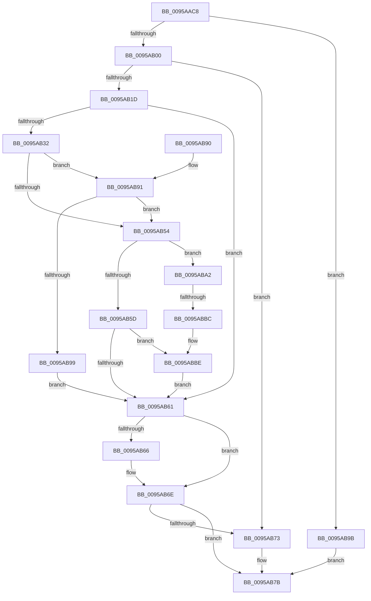

# KsepDbCacheReadDevice

- RVA: `0x0095AAC8`–`0x0095ABC5` (길이 `253` bytes)
- VA: `0x000000014095AAC8`
- 실행 섹션: `PAGE`
- PDB 이름 있음: `예`; PDB Function 태그: `예`
- unwind 정보 RVA: `0x00092A1C`
- 디코드: `77`개 명령, `253/253` bytes 표시
- 미해석 바이트: `0` (있으면 어셈블리에 `.byte`로 보존)

> 이 문서는 커널 이미지의 기계어와 PDB 기호를 분석해 생성했습니다. 4번과 5번은 함수 원형과 자료형을 바이너리 사용 방식에서 추정한 C 해석이며 원본 소스 복구 결과는 아닙니다.

## 1. Dependencies

- 직접 호출 지점: **7**; 고유 호출 대상: **6**
- 직접 호출자로 확인된 함수: **2**
- RIP 상대 이미지 참조: **1**

### Outgoing calls
- `0x0095AAEF` → [KsepPoolAllocatePaged](../../text/4A/KsepPoolAllocatePaged_function_004A9EFC.md) (function, `0x004A9EFC`)
- `0x0095AB12` → [KsepStringDuplicate](KsepStringDuplicate_function_0095B454.md) (function, `0x0095B454`)
- `0x0095AB22` → [KseShimDatabaseOpen](KseShimDatabaseOpen_function_0095AD7C.md) (function, `0x0095AD7C`)
- `0x0095AB42` → [KsepDbCacheReadDeviceInternal](KsepDbCacheReadDeviceInternal_function_0095B774.md) (function, `0x0095B774`)
- `0x0095AB69` → [KseShimDatabaseClose](KseShimDatabaseClose_function_0095ABCC.md) (function, `0x0095ABCC`)
- `0x0095AB76` → [KsepCacheDeviceFree](KsepCacheDeviceFree_function_0095AD00.md) (function, `0x0095AD00`)
- `0x0095ABAF` → [KsepDbCacheReadDeviceInternal](KsepDbCacheReadDeviceInternal_function_0095B774.md) (function, `0x0095B774`)

### Direct callers
- [KseQueryDeviceDataList](KseQueryDeviceDataList_function_00959390.md) at `0x00959492`
- [KseQueryDeviceData](KseQueryDeviceData_function_0095AFB0.md) at `0x0095B0A3`

### Static image references
- `0x0095AB35` → RVA `0x00F10680` (`.data`; read)

## 2. Other-region calls and transfers

- 다른 실행 섹션으로 향하는 call: **1**
  - `0x0095AAEF` → [KsepPoolAllocatePaged](../../text/4A/KsepPoolAllocatePaged_function_004A9EFC.md) (`PAGE` → `.text`)
- call이 아닌 외부 분기/꼬리 이동: **1**
  - `0x0095ABB6` → [sub_00B2773A](../B2/Unknown_function_00B2773A.md) (`tail-transfer`)

## 3. Assembly (complete function range)

```asm
0095AAC8  48 89 5C 24 08                  mov qword ptr [rsp + 8], rbx
0095AACD  48 89 6C 24 18                  mov qword ptr [rsp + 0x18], rbp
0095AAD2  56                              push rsi
0095AAD3  57                              push rdi
0095AAD4  41 56                           push r14
0095AAD6  48 83 EC 20                     sub rsp, 0x20
0095AADA  48 83 64 24 48 00               and qword ptr [rsp + 0x48], 0
0095AAE0  48 8B E9                        mov rbp, rcx
0095AAE3  48 83 22 00                     and qword ptr [rdx], 0
0095AAE7  B9 48 00 00 00                  mov ecx, 0x48
0095AAEC  4C 8B F2                        mov r14, rdx
0095AAEF  E8 08 F4 B4 FF                  call 0x1404a9efc
0095AAF4  48 8B F8                        mov rdi, rax
0095AAF7  48 85 C0                        test rax, rax
0095AAFA  0F 84 9B 00 00 00               je 0x14095ab9b
0095AB00  48 83 C0 38                     add rax, 0x38
0095AB04  48 8D 4F 28                     lea rcx, [rdi + 0x28]
0095AB08  48 8B D5                        mov rdx, rbp
0095AB0B  48 89 40 08                     mov qword ptr [rax + 8], rax
0095AB0F  48 89 00                        mov qword ptr [rax], rax
0095AB12  E8 3D 09 00 00                  call 0x14095b454
0095AB17  8B D8                           mov ebx, eax
0095AB19  85 C0                           test eax, eax
0095AB1B  78 56                           js 0x14095ab73
0095AB1D  48 8D 4C 24 48                  lea rcx, [rsp + 0x48]
0095AB22  E8 55 02 00 00                  call 0x14095ad7c
0095AB27  48 8B 74 24 48                  mov rsi, qword ptr [rsp + 0x48]
0095AB2C  8B D8                           mov ebx, eax
0095AB2E  85 C0                           test eax, eax
0095AB30  78 2F                           js 0x14095ab61
0095AB32  48 8B 0E                        mov rcx, qword ptr [rsi]
0095AB35  48 8D 15 44 5B 5B 00            lea rdx, [rip + 0x5b5b44]
0095AB3C  4C 8B CF                        mov r9, rdi
0095AB3F  4C 8B C5                        mov r8, rbp
0095AB42  E8 2D 0C 00 00                  call 0x14095b774
0095AB47  B9 00 00 00 80                  mov ecx, 0x80000000
0095AB4C  8B D8                           mov ebx, eax
0095AB4E  03 C1                           add eax, ecx
0095AB50  85 C1                           test ecx, eax
0095AB52  74 3D                           je 0x14095ab91
0095AB54  48 8B 4E 38                     mov rcx, qword ptr [rsi + 0x38]
0095AB58  48 85 C9                        test rcx, rcx
0095AB5B  75 45                           jne 0x14095aba2
0095AB5D  85 DB                           test ebx, ebx
0095AB5F  79 5D                           jns 0x14095abbe
0095AB61  48 85 F6                        test rsi, rsi
0095AB64  74 08                           je 0x14095ab6e
0095AB66  48 8B CE                        mov rcx, rsi
0095AB69  E8 5E 00 00 00                  call 0x14095abcc
0095AB6E  48 85 FF                        test rdi, rdi
0095AB71  74 08                           je 0x14095ab7b
0095AB73  48 8B CF                        mov rcx, rdi
0095AB76  E8 85 01 00 00                  call 0x14095ad00
0095AB7B  48 8B 6C 24 50                  mov rbp, qword ptr [rsp + 0x50]
0095AB80  8B C3                           mov eax, ebx
0095AB82  48 8B 5C 24 40                  mov rbx, qword ptr [rsp + 0x40]
0095AB87  48 83 C4 20                     add rsp, 0x20
0095AB8B  41 5E                           pop r14
0095AB8D  5F                              pop rdi
0095AB8E  5E                              pop rsi
0095AB8F  C3                              ret
0095AB90  CC                              int3
0095AB91  81 FB 25 02 00 C0               cmp ebx, 0xc0000225
0095AB97  74 BB                           je 0x14095ab54
0095AB99  EB C6                           jmp 0x14095ab61
0095AB9B  BB 17 00 00 C0                  mov ebx, 0xc0000017
0095ABA0  EB D9                           jmp 0x14095ab7b
0095ABA2  4C 8B CF                        mov r9, rdi
0095ABA5  48 8D 15 D4 5A 5B 00            lea rdx, [rip + 0x5b5ad4]
0095ABAC  4C 8B C5                        mov r8, rbp
0095ABAF  E8 C0 0B 00 00                  call 0x14095b774
0095ABB4  85 C0                           test eax, eax
0095ABB6  0F 88 7E CB 1C 00               js 0x140b2773a
0095ABBC  33 DB                           xor ebx, ebx
0095ABBE  49 89 3E                        mov qword ptr [r14], rdi
0095ABC1  33 FF                           xor edi, edi
0095ABC3  EB 9C                           jmp 0x14095ab61
```

## 4. C-style interpretation (structured pseudocode)

```c
__int64 __fastcall KsepDbCacheReadDevice(__int64 a1, __int64 a2)
{
    __int64 result;
    __int64 v_rbx;
    __int64 v_rdi;
    __int64 v_rsp;
    unsigned __int64 v_stack_p10;
    unsigned __int64 v_stack_p18;
    unsigned __int64 v_stack_p8;

    v_stack_p8 = v_rbx;
    v_stack_p18 = v_rbp;
    v_rsp = (v_rsp) - (32);
    result = KsepPoolAllocatePaged(72, a2, a3, a4);
    if (result == 0) goto loc_0095AB9B;
    result = (result) + (56);
    *(unsigned __int64 *)(result + 8) = result;
    *(unsigned __int64 *)(result) = result;
    result = KsepStringDuplicate(result + 40, a1, a3, a4);
    if (sign_flag) goto loc_0095AB73;
    result = KseShimDatabaseOpen(v_stack_p10, a1, a3, a4);
    if (sign_flag) goto loc_0095AB61;
    result = KsepDbCacheReadDeviceInternal(*(unsigned __int64 *)(v_stack_p10), v_rip + 5987140, a1, result);
    result = (unsigned int)((result) + ((unsigned int)((unsigned int)(0x80000000ULL))));
    if ((((unsigned int)((unsigned int)(0x80000000ULL))) & ((unsigned int)(result))) == 0) goto loc_0095AB91;
loc_0095AB54:
    if (*(unsigned __int64 *)(v_stack_p10 + 56) != 0) goto loc_0095ABA2;
    if (!sign_flag) goto loc_0095ABBE;
loc_0095AB61:
    if (v_stack_p10 != 0) {
        a1 = v_stack_p10;
        result = KseShimDatabaseClose(a1, v_rip + 5987140, a1, result);
    }
    if (result != 0) {
        a1 = result;
        result = KsepCacheDeviceFree(a1, v_rip + 5987140, a1, result);
    }
    v_rsp = (v_rsp) + (32);
    return (unsigned int)((unsigned int)((unsigned int)((unsigned int)(result))));
loc_0095AB91:
    if (((unsigned int)(v_stack_p8)) == 0xC0000225ULL) goto loc_0095AB54;
    goto loc_0095AB61;
loc_0095AB9B:
    goto loc_0095AB7B;
loc_0095ABA2:
    result = KsepDbCacheReadDeviceInternal(a1, v_rip + 5987028, v_stack_p18, result);
    v_rbx = 0;
loc_0095ABBE:
    *(unsigned __int64 *)(a2) = result;
    v_rdi = 0;
    goto loc_0095AB61;
}
```

## 5. (Beta) C Style

```c
int64_t KsepDbCacheReadDevice(int64_t Arg1, void *Arg2)
{
    uint8_t *arg2 = (uint8_t *)Arg2;

    int64_t result;
    int64_t local_rbx;
    int64_t local_rdi;
    int64_t local_rsp;
    uint64_t v_stack_p10;
    uint64_t v_stack_p18;
    uint64_t v_stack_p8;

    v_stack_p8 = local_rbx;
    v_stack_p18 = local_rbp;
    local_rsp = (local_rsp) - (32);
    result = KsepPoolAllocatePaged(72, Arg2, a3, a4);
    if (result == 0) goto loc_0095AB9B;
    result = (result) + (56);
    *(uint64_t *)(result + 0x8) = result;
    *(uint64_t *)(result) = result;
    result = KsepStringDuplicate(result + 40, Arg1, a3, a4);
    if (sign_flag) goto loc_0095AB73;
    result = KseShimDatabaseOpen(v_stack_p10, Arg1, a3, a4);
    if (sign_flag) goto loc_0095AB61;
    result = KsepDbCacheReadDeviceInternal(*(uint64_t *)(v_stack_p10), v_rip + 5987140, Arg1, result);
    result = (uint32_t)((result) + ((uint32_t)((uint32_t)(0x80000000ULL))));
    if ((((uint32_t)((uint32_t)(0x80000000ULL))) & ((uint32_t)(result))) == 0) goto loc_0095AB91;
loc_0095AB54:
    if (*(uint64_t *)(v_stack_p10 + 0x38) != 0) goto loc_0095ABA2;
    if (!sign_flag) goto loc_0095ABBE;
loc_0095AB61:
    if (v_stack_p10 != 0) {
        Arg1 = v_stack_p10;
        result = KseShimDatabaseClose(Arg1, v_rip + 5987140, Arg1, result);
    }
    if (result != 0) {
        Arg1 = result;
        result = KsepCacheDeviceFree(Arg1, v_rip + 5987140, Arg1, result);
    }
    local_rsp = (local_rsp) + (32);
    return (uint32_t)((uint32_t)((uint32_t)((uint32_t)(result))));
loc_0095AB91:
    if (((uint32_t)(v_stack_p8)) == 0xC0000225ULL) goto loc_0095AB54;
    goto loc_0095AB61;
loc_0095AB9B:
    goto loc_0095AB7B;
loc_0095ABA2:
    result = KsepDbCacheReadDeviceInternal(Arg1, v_rip + 5987028, v_stack_p18, result);
    local_rbx = 0;
loc_0095ABBE:
    *(uint64_t *)(arg2) = result;
    local_rdi = 0;
    goto loc_0095AB61;
}
```

### 관측된 메모리 오프셋

구조체 형식이 확인되지 않은 접근은 인자 기준의 오프셋으로만 기록했습니다.

| 기준 인자 | 오프셋 표현 | 폭 (bit) | 접근 |
|---|---:|---:|---|
| `Arg2` | `+ 0x0` | `64` | `R/W` |
| `Arg2` | `+ 0x0` | `64` | `W` |

## 6. Execution-region graph

[열기: 2D/3D 그래프와 함수 탐색 컨트롤 패널](../../../control-panel.html?section=page&rva=0x0095AAC8&view=graph)

- 2D 그래프는 위에서 아래로 흐르고, 3D 그래프는 빈 공간을 드래그해 회전합니다. Shift+드래그는 이동, 휠은 확대·축소, 함수 노드 선택은 대상 보고서 이동입니다.

### Static fallback


