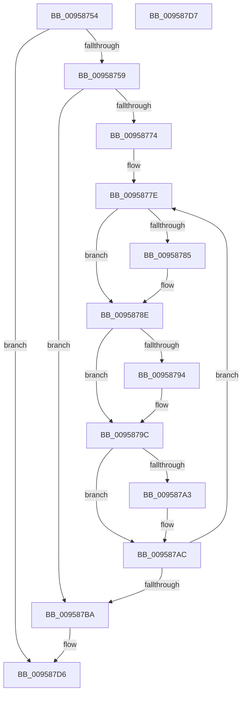

# KsepDbFreeDriverShims

- RVA: `0x00958754`–`0x009587D8` (길이 `132` bytes)
- VA: `0x0000000140958754`
- 실행 섹션: `PAGE`
- PDB 이름 있음: `예`; PDB Function 태그: `아니요`
- unwind 정보 RVA: `0x000926AC`
- 디코드: `38`개 명령, `132/132` bytes 표시
- 미해석 바이트: `0` (있으면 어셈블리에 `.byte`로 보존)

> 이 문서는 커널 이미지의 기계어와 PDB 기호를 분석해 생성했습니다. 4번과 5번은 함수 원형과 자료형을 바이너리 사용 방식에서 추정한 C 해석이며 원본 소스 복구 결과는 아닙니다.

## 1. Dependencies

- 직접 호출 지점: **4**; 고유 호출 대상: **2**
- 직접 호출자로 확인된 함수: **5**
- RIP 상대 이미지 참조: **0**

### Outgoing calls
- `0x00958789` → [KsepStringFree](KsepStringFree_function_0095A1B8.md) (function, `0x0095A1B8`)
- `0x00958797` → [KsepStringFree](KsepStringFree_function_0095A1B8.md) (function, `0x0095A1B8`)
- `0x009587A7` → [KsepStringFree](KsepStringFree_function_0095A1B8.md) (function, `0x0095A1B8`)
- `0x009587BD` → [KsepPoolFreePaged](../../text/4B/KsepPoolFreePaged_function_004B0E10.md) (function, `0x004B0E10`)

### Direct callers
- [KsepDbGetShimInfo](../74/KsepDbGetShimInfo_function_00748E94.md) at `0x0074907D`
- [KsepDbGetDriverShimsInternal](KsepDbGetDriverShimsInternal_function_009597C4.md) at `0x00959838`
- [KsepDbGetDriverShims](KsepDbGetDriverShims_function_00959A58.md) at `0x00959BCF`
- [KsepDbGetDriverShims](KsepDbGetDriverShims_function_00959A58.md) at `0x00959BDB`
- [sub_00B26BF6](../B2/Unknown_function_00B26BF6.md) at `0x00B26E1F`
- [sub_00B26EEC](../B2/Unknown_function_00B26EEC.md) at `0x00B26FC5`

### Static image references
- 디코드된 RIP-relative 메모리 참조가 없습니다.

## 2. Other-region calls and transfers

- 다른 실행 섹션으로 향하는 call: **1**
  - `0x009587BD` → [KsepPoolFreePaged](../../text/4B/KsepPoolFreePaged_function_004B0E10.md) (`PAGE` → `.text`)
- 별도 외부 분기/꼬리 이동을 확인하지 못했습니다.

## 3. Assembly (complete function range)

```asm
00958754  48 85 C9                        test rcx, rcx
00958757  74 7D                           je 0x1409587d6
00958759  48 89 5C 24 08                  mov qword ptr [rsp + 8], rbx
0095875E  48 89 6C 24 10                  mov qword ptr [rsp + 0x10], rbp
00958763  48 89 74 24 18                  mov qword ptr [rsp + 0x18], rsi
00958768  57                              push rdi
00958769  48 83 EC 20                     sub rsp, 0x20
0095876D  48 8B F1                        mov rsi, rcx
00958770  85 D2                           test edx, edx
00958772  74 46                           je 0x1409587ba
00958774  48 8D 59 18                     lea rbx, [rcx + 0x18]
00958778  8B EA                           mov ebp, edx
0095877A  48 8D 79 10                     lea rdi, [rcx + 0x10]
0095877E  48 83 7B 10 00                  cmp qword ptr [rbx + 0x10], 0
00958783  74 09                           je 0x14095878e
00958785  48 8D 4F 10                     lea rcx, [rdi + 0x10]
00958789  E8 2A 1A 00 00                  call 0x14095a1b8
0095878E  48 83 3B 00                     cmp qword ptr [rbx], 0
00958792  74 08                           je 0x14095879c
00958794  48 8B CF                        mov rcx, rdi
00958797  E8 1C 1A 00 00                  call 0x14095a1b8
0095879C  48 83 7B 20 00                  cmp qword ptr [rbx + 0x20], 0
009587A1  74 09                           je 0x1409587ac
009587A3  48 8D 4F 20                     lea rcx, [rdi + 0x20]
009587A7  E8 0C 1A 00 00                  call 0x14095a1b8
009587AC  48 83 C7 50                     add rdi, 0x50
009587B0  48 83 C3 50                     add rbx, 0x50
009587B4  48 83 ED 01                     sub rbp, 1
009587B8  75 C4                           jne 0x14095877e
009587BA  48 8B CE                        mov rcx, rsi
009587BD  E8 4E 86 B5 FF                  call 0x1404b0e10
009587C2  48 8B 5C 24 30                  mov rbx, qword ptr [rsp + 0x30]
009587C7  48 8B 6C 24 38                  mov rbp, qword ptr [rsp + 0x38]
009587CC  48 8B 74 24 40                  mov rsi, qword ptr [rsp + 0x40]
009587D1  48 83 C4 20                     add rsp, 0x20
009587D5  5F                              pop rdi
009587D6  C3                              ret
009587D7  CC                              int3
```

## 4. C-style interpretation (structured pseudocode)

```c
__int64 __fastcall KsepDbFreeDriverShims(__int64 a1, int a2)
{
    __int64 result;
    __int64 v_rbp;
    __int64 v_rbx;
    __int64 v_rdi;
    __int64 v_rsp;
    unsigned __int64 v_stack_p10;
    unsigned __int64 v_stack_p18;
    unsigned __int64 v_stack_p8;

    if (a1 == 0) goto loc_009587D6;
    v_stack_p8 = v_rbx;
    v_stack_p10 = v_rbp;
    v_stack_p18 = v_rsi;
    v_rsp = (v_rsp) - (32);
    if (a2 == 0) goto loc_009587BA;
loc_0095877E:
    if ((*(unsigned __int64 *)(a1 + 24 + 16)) != 0) {
        a1 = a1 + 16 + 16;
        result = KsepStringFree(a1, a2, a3, a4);
    }
    if ((*(unsigned __int64 *)(a1 + 24)) != 0) {
        a1 = a1 + 16;
        result = KsepStringFree(a1, a2, a3, a4);
    }
    if ((*(unsigned __int64 *)(a1 + 24 + 32)) != 0) {
        a1 = a1 + 16 + 32;
        result = KsepStringFree(a1, a2, a3, a4);
    }
    v_rdi = (a1 + 16) + (80);
    v_rbx = (a1 + 24) + (80);
    v_rbp = ((unsigned int)(a2)) - (1);
    if (condition_is_not_equal) goto loc_0095877E;
loc_009587BA:
    result = KsepPoolFreePaged(a1, a2, a3, a4);
    v_rsp = (v_rsp) + (32);
loc_009587D6:
    return result;
}
```

## 5. (Beta) C Style

```c
int64_t KsepDbFreeDriverShims(int64_t Arg1, int32_t Arg2)
{
    int64_t result;
    int64_t local_rbp;
    int64_t local_rbx;
    int64_t local_rdi;
    int64_t local_rsp;
    uint64_t v_stack_p10;
    uint64_t v_stack_p18;
    uint64_t v_stack_p8;

    if (Arg1 == 0) goto loc_009587D6;
    v_stack_p8 = local_rbx;
    v_stack_p10 = local_rbp;
    v_stack_p18 = local_rsi;
    local_rsp = (local_rsp) - (32);
    if (Arg2 == 0) goto loc_009587BA;
loc_0095877E:
    if ((*(uint64_t *)(Arg1 + 0x18 + 0x10)) != 0) {
        Arg1 = Arg1 + 16 + 16;
        result = KsepStringFree(Arg1, Arg2, a3, a4);
    }
    if ((*(uint64_t *)(Arg1 + 0x18)) != 0) {
        Arg1 = Arg1 + 16;
        result = KsepStringFree(Arg1, Arg2, a3, a4);
    }
    if ((*(uint64_t *)(Arg1 + 0x18 + 0x20)) != 0) {
        Arg1 = Arg1 + 16 + 32;
        result = KsepStringFree(Arg1, Arg2, a3, a4);
    }
    local_rdi = (Arg1 + 16) + (80);
    local_rbx = (Arg1 + 24) + (80);
    local_rbp = ((uint32_t)(Arg2)) - (1);
    if (condition_is_not_equal) goto loc_0095877E;
loc_009587BA:
    result = KsepPoolFreePaged(Arg1, Arg2, a3, a4);
    local_rsp = (local_rsp) + (32);
loc_009587D6:
    return result;
}
```

## 6. Execution-region graph

[열기: 2D/3D 그래프와 함수 탐색 컨트롤 패널](../../../control-panel.html?section=page&rva=0x00958754&view=graph)

- 2D 그래프는 위에서 아래로 흐르고, 3D 그래프는 빈 공간을 드래그해 회전합니다. Shift+드래그는 이동, 휠은 확대·축소, 함수 노드 선택은 대상 보고서 이동입니다.

### Static fallback


