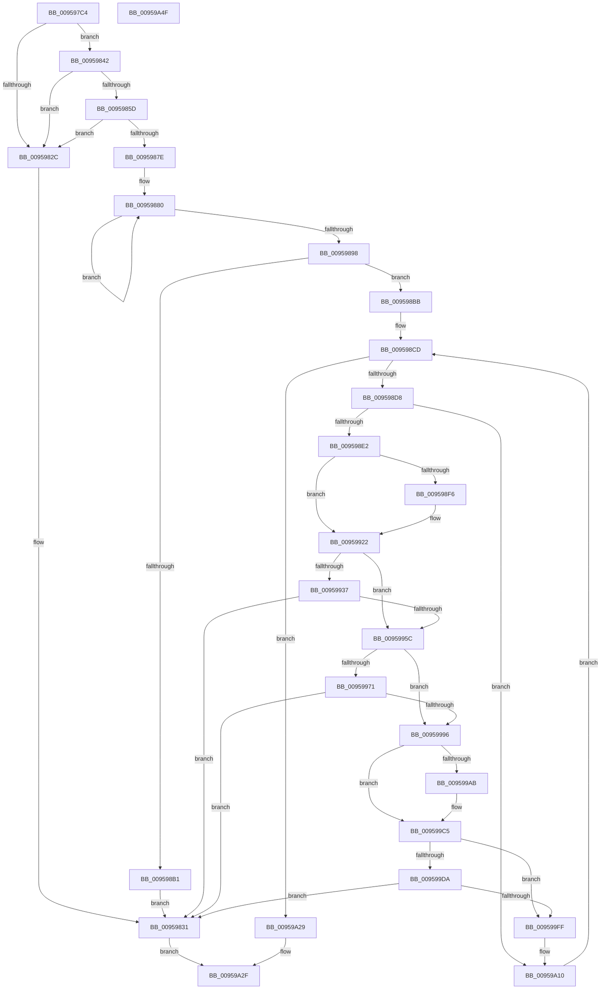

# KsepDbGetDriverShimsInternal

- RVA: `0x009597C4`–`0x00959A50` (길이 `652` bytes)
- VA: `0x00000001409597C4`
- 실행 섹션: `PAGE`
- PDB 이름 있음: `예`; PDB Function 태그: `아니요`
- unwind 정보 RVA: `0x0009283C`
- 디코드: `182`개 명령, `652/652` bytes 표시
- 미해석 바이트: `0` (있으면 어셈블리에 `.byte`로 보존)

> 이 문서는 커널 이미지의 기계어와 PDB 기호를 분석해 생성했습니다. 4번과 5번은 함수 원형과 자료형을 바이너리 사용 방식에서 추정한 C 해석이며 원본 소스 복구 결과는 아닙니다.

## 1. Dependencies

- 직접 호출 지점: **18**; 고유 호출 대상: **9**
- 직접 호출자로 확인된 함수: **1**
- RIP 상대 이미지 참조: **0**

### Outgoing calls
- `0x00959823` → [SdbGetDatabaseMatchEx](SdbGetDatabaseMatchEx_function_0095BD7C.md) (function, `0x0095BD7C`)
- `0x00959838` → [KsepDbFreeDriverShims](KsepDbFreeDriverShims_function_00958754.md) (function, `0x00958754`)
- `0x00959854` → [SdbTagRefToTagID](../81/SdbTagRefToTagID_function_0081717C.md) (function, `0x0081717C`)
- `0x00959875` → [SdbFindFirstTag](SdbFindFirstTag_function_0095E34C.md) (function, `0x0095E34C`)
- `0x0095988D` → [SdbFindNextTag](SdbFindNextTag_function_0095D7F4.md) (function, `0x0095D7F4`)
- `0x009598A4` → [KsepPoolAllocatePaged](../../text/4A/KsepPoolAllocatePaged_function_004A9EFC.md) (function, `0x004A9EFC`)
- `0x009598C8` → [SdbFindFirstTag](SdbFindFirstTag_function_0095E34C.md) (function, `0x0095E34C`)
- `0x009598ED` → [SdbFindFirstTag](SdbFindFirstTag_function_0095E34C.md) (function, `0x0095E34C`)
- `0x0095990C` → [SdbReadGUIDTag](../81/SdbReadGUIDTag_function_00817000.md) (function, `0x00817000`)
- `0x0095992E` → [SdbFindFirstTag](SdbFindFirstTag_function_0095E34C.md) (function, `0x0095E34C`)
- `0x0095994D` → [KsepDbGetSdbString](../74/KsepDbGetSdbString_function_00748E60.md) (function, `0x00748E60`)
- `0x00959968` → [SdbFindFirstTag](SdbFindFirstTag_function_0095E34C.md) (function, `0x0095E34C`)
- `0x00959987` → [KsepDbGetSdbString](../74/KsepDbGetSdbString_function_00748E60.md) (function, `0x00748E60`)
- `0x009599A2` → [SdbFindFirstTag](SdbFindFirstTag_function_0095E34C.md) (function, `0x0095E34C`)
- `0x009599B3` → [SdbReadDWORDTag](SdbReadDWORDTag_function_0095D408.md) (function, `0x0095D408`)
- `0x009599D1` → [SdbFindFirstTag](SdbFindFirstTag_function_0095E34C.md) (function, `0x0095E34C`)
- `0x009599F0` → [KsepDbGetSdbString](../74/KsepDbGetSdbString_function_00748E60.md) (function, `0x00748E60`)
- `0x00959A1D` → [SdbFindNextTag](SdbFindNextTag_function_0095D7F4.md) (function, `0x0095D7F4`)

### Direct callers
- [KsepDbGetDriverShims](KsepDbGetDriverShims_function_00959A58.md) at `0x00959AFA`
- [KsepDbGetDriverShims](KsepDbGetDriverShims_function_00959A58.md) at `0x00959B49`

### Static image references
- 디코드된 RIP-relative 메모리 참조가 없습니다.

## 2. Other-region calls and transfers

- 다른 실행 섹션으로 향하는 call: **1**
  - `0x009598A4` → [KsepPoolAllocatePaged](../../text/4A/KsepPoolAllocatePaged_function_004A9EFC.md) (`PAGE` → `.text`)
- 별도 외부 분기/꼬리 이동을 확인하지 못했습니다.

## 3. Assembly (complete function range)

```asm
009597C4  4C 8B DC                        mov r11, rsp
009597C7  49 89 5B 08                     mov qword ptr [r11 + 8], rbx
009597CB  49 89 6B 10                     mov qword ptr [r11 + 0x10], rbp
009597CF  56                              push rsi
009597D0  57                              push rdi
009597D1  41 54                           push r12
009597D3  41 55                           push r13
009597D5  41 56                           push r14
009597D7  48 83 EC 70                     sub rsp, 0x70
009597DB  8B 84 24 C0 00 00 00            mov eax, dword ptr [rsp + 0xc0]
009597E2  33 ED                           xor ebp, ebp
009597E4  4C 8B A4 24 D0 00 00 00         mov r12, qword ptr [rsp + 0xd0]
009597EC  48 8B D9                        mov rbx, rcx
009597EF  4C 8B AC 24 C8 00 00 00         mov r13, qword ptr [rsp + 0xc8]
009597F7  8B F5                           mov esi, ebp
009597F9  4D 8B 40 08                     mov r8, qword ptr [r8 + 8]
009597FD  49 89 53 98                     mov qword ptr [r11 - 0x68], rdx
00959801  33 D2                           xor edx, edx
00959803  0F 29 74 24 60                  movaps xmmword ptr [rsp + 0x60], xmm6
00959808  0F 57 F6                        xorps xmm6, xmm6
0095980B  49 89 43 90                     mov qword ptr [r11 - 0x70], rax
0095980F  41 89 2C 24                     mov dword ptr [r12], ebp
00959813  49 89 6D 00                     mov qword ptr [r13], rbp
00959817  49 89 6B A8                     mov qword ptr [r11 - 0x58], rbp
0095981B  41 89 6B 18                     mov dword ptr [r11 + 0x18], ebp
0095981F  4D 89 4B 88                     mov qword ptr [r11 - 0x78], r9
00959823  E8 54 25 00 00                  call 0x14095bd7c
00959828  85 C0                           test eax, eax
0095982A  75 16                           jne 0x140959842
0095982C  BB 25 02 00 C0                  mov ebx, 0xc0000225
00959831  41 8B 14 24                     mov edx, dword ptr [r12]
00959835  48 8B CE                        mov rcx, rsi
00959838  E8 17 EF FF FF                  call 0x140958754
0095983D  E9 ED 01 00 00                  jmp 0x140959a2f
00959842  4C 8D 8C 24 B0 00 00 00         lea r9, [rsp + 0xb0]
0095984A  8B D0                           mov edx, eax
0095984C  4C 8D 44 24 40                  lea r8, [rsp + 0x40]
00959851  48 8B CB                        mov rcx, rbx
00959854  E8 23 D9 EB FF                  call 0x14081717c
00959859  85 C0                           test eax, eax
0095985B  74 CF                           je 0x14095982c
0095985D  48 8B 7C 24 40                  mov rdi, qword ptr [rsp + 0x40]
00959862  41 BE 26 70 00 00               mov r14d, 0x7026
00959868  8B 94 24 B0 00 00 00            mov edx, dword ptr [rsp + 0xb0]
0095986F  45 8B C6                        mov r8d, r14d
00959872  48 8B CF                        mov rcx, rdi
00959875  E8 D2 4A 00 00                  call 0x14095e34c
0095987A  85 C0                           test eax, eax
0095987C  74 AE                           je 0x14095982c
0095987E  8B DD                           mov ebx, ebp
00959880  8B 94 24 B0 00 00 00            mov edx, dword ptr [rsp + 0xb0]
00959887  44 8B C0                        mov r8d, eax
0095988A  48 8B CF                        mov rcx, rdi
0095988D  E8 62 3F 00 00                  call 0x14095d7f4
00959892  FF C3                           inc ebx
00959894  85 C0                           test eax, eax
00959896  75 E8                           jne 0x140959880
00959898  48 8D 0C 9B                     lea rcx, [rbx + rbx*4]
0095989C  41 89 1C 24                     mov dword ptr [r12], ebx
009598A0  48 C1 E1 04                     shl rcx, 4
009598A4  E8 53 06 B5 FF                  call 0x1404a9efc
009598A9  48 8B F0                        mov rsi, rax
009598AC  48 85 C0                        test rax, rax
009598AF  75 0A                           jne 0x1409598bb
009598B1  BB 17 00 00 C0                  mov ebx, 0xc0000017
009598B6  E9 76 FF FF FF                  jmp 0x140959831
009598BB  8B 94 24 B0 00 00 00            mov edx, dword ptr [rsp + 0xb0]
009598C2  45 8B C6                        mov r8d, r14d
009598C5  48 8B CF                        mov rcx, rdi
009598C8  E8 7F 4A 00 00                  call 0x14095e34c
009598CD  44 8B F0                        mov r14d, eax
009598D0  85 C0                           test eax, eax
009598D2  0F 84 51 01 00 00               je 0x140959a29
009598D8  41 3B 2C 24                     cmp ebp, dword ptr [r12]
009598DC  0F 83 2E 01 00 00               jae 0x140959a10
009598E2  41 B8 10 90 00 00               mov r8d, 0x9010
009598E8  8B D0                           mov edx, eax
009598EA  48 8B CF                        mov rcx, rdi
009598ED  E8 5A 4A 00 00                  call 0x14095e34c
009598F2  85 C0                           test eax, eax
009598F4  74 2C                           je 0x140959922
009598F6  4C 8D 4C 24 40                  lea r9, [rsp + 0x40]
009598FB  66 0F 7F 74 24 40               movdqa xmmword ptr [rsp + 0x40], xmm6
00959901  44 8B C0                        mov r8d, eax
00959904  48 8D 4C 24 50                  lea rcx, [rsp + 0x50]
00959909  48 8B D7                        mov rdx, rdi
0095990C  E8 EF D6 EB FF                  call 0x140817000
00959911  8B CD                           mov ecx, ebp
00959913  0F 10 00                        movups xmm0, xmmword ptr [rax]
00959916  48 8D 14 89                     lea rdx, [rcx + rcx*4]
0095991A  48 03 D2                        add rdx, rdx
0095991D  F3 0F 7F 04 D6                  movdqu xmmword ptr [rsi + rdx*8], xmm0
00959922  41 B8 01 60 00 00               mov r8d, 0x6001
00959928  41 8B D6                        mov edx, r14d
0095992B  48 8B CF                        mov rcx, rdi
0095992E  E8 19 4A 00 00                  call 0x14095e34c
00959933  85 C0                           test eax, eax
00959935  74 25                           je 0x14095995c
00959937  8B CD                           mov ecx, ebp
00959939  8B D0                           mov edx, eax
0095993B  4C 8D 04 89                     lea r8, [rcx + rcx*4]
0095993F  48 8B CF                        mov rcx, rdi
00959942  49 C1 E0 04                     shl r8, 4
00959946  49 83 C0 10                     add r8, 0x10
0095994A  4C 03 C6                        add r8, rsi
0095994D  E8 0E F5 DE FF                  call 0x140748e60
00959952  8B D8                           mov ebx, eax
00959954  85 C0                           test eax, eax
00959956  0F 88 D5 FE FF FF               js 0x140959831
0095995C  41 B8 03 60 00 00               mov r8d, 0x6003
00959962  41 8B D6                        mov edx, r14d
00959965  48 8B CF                        mov rcx, rdi
00959968  E8 DF 49 00 00                  call 0x14095e34c
0095996D  85 C0                           test eax, eax
0095996F  74 25                           je 0x140959996
00959971  8B CD                           mov ecx, ebp
00959973  8B D0                           mov edx, eax
00959975  4C 8D 04 89                     lea r8, [rcx + rcx*4]
00959979  48 8B CF                        mov rcx, rdi
0095997C  49 C1 E0 04                     shl r8, 4
00959980  49 83 C0 20                     add r8, 0x20
00959984  4C 03 C6                        add r8, rsi
00959987  E8 D4 F4 DE FF                  call 0x140748e60
0095998C  8B D8                           mov ebx, eax
0095998E  85 C0                           test eax, eax
00959990  0F 88 9B FE FF FF               js 0x140959831
00959996  41 B8 17 40 00 00               mov r8d, 0x4017
0095999C  41 8B D6                        mov edx, r14d
0095999F  48 8B CF                        mov rcx, rdi
009599A2  E8 A5 49 00 00                  call 0x14095e34c
009599A7  85 C0                           test eax, eax
009599A9  74 1A                           je 0x1409599c5
009599AB  45 33 C0                        xor r8d, r8d
009599AE  8B D0                           mov edx, eax
009599B0  48 8B CF                        mov rcx, rdi
009599B3  E8 50 3A 00 00                  call 0x14095d408
009599B8  8B CD                           mov ecx, ebp
009599BA  48 8D 14 89                     lea rdx, [rcx + rcx*4]
009599BE  48 03 D2                        add rdx, rdx
009599C1  89 44 D6 40                     mov dword ptr [rsi + rdx*8 + 0x40], eax
009599C5  41 B8 08 60 00 00               mov r8d, 0x6008
009599CB  41 8B D6                        mov edx, r14d
009599CE  48 8B CF                        mov rcx, rdi
009599D1  E8 76 49 00 00                  call 0x14095e34c
009599D6  85 C0                           test eax, eax
009599D8  74 25                           je 0x1409599ff
009599DA  8B CD                           mov ecx, ebp
009599DC  8B D0                           mov edx, eax
009599DE  4C 8D 04 89                     lea r8, [rcx + rcx*4]
009599E2  48 8B CF                        mov rcx, rdi
009599E5  49 C1 E0 04                     shl r8, 4
009599E9  49 83 C0 30                     add r8, 0x30
009599ED  4C 03 C6                        add r8, rsi
009599F0  E8 6B F4 DE FF                  call 0x140748e60
009599F5  8B D8                           mov ebx, eax
009599F7  85 C0                           test eax, eax
009599F9  0F 88 32 FE FF FF               js 0x140959831
009599FF  8B C5                           mov eax, ebp
00959A01  48 8D 0C 80                     lea rcx, [rax + rax*4]
00959A05  48 03 C9                        add rcx, rcx
00959A08  C7 44 CE 44 01 00 00 00         mov dword ptr [rsi + rcx*8 + 0x44], 1
00959A10  8B 94 24 B0 00 00 00            mov edx, dword ptr [rsp + 0xb0]
00959A17  45 8B C6                        mov r8d, r14d
00959A1A  48 8B CF                        mov rcx, rdi
00959A1D  E8 D2 3D 00 00                  call 0x14095d7f4
00959A22  FF C5                           inc ebp
00959A24  E9 A4 FE FF FF                  jmp 0x1409598cd
00959A29  49 89 75 00                     mov qword ptr [r13], rsi
00959A2D  33 DB                           xor ebx, ebx
00959A2F  0F 28 74 24 60                  movaps xmm6, xmmword ptr [rsp + 0x60]
00959A34  4C 8D 5C 24 70                  lea r11, [rsp + 0x70]
00959A39  49 8B 6B 38                     mov rbp, qword ptr [r11 + 0x38]
00959A3D  8B C3                           mov eax, ebx
00959A3F  49 8B 5B 30                     mov rbx, qword ptr [r11 + 0x30]
00959A43  49 8B E3                        mov rsp, r11
00959A46  41 5E                           pop r14
00959A48  41 5D                           pop r13
00959A4A  41 5C                           pop r12
00959A4C  5F                              pop rdi
00959A4D  5E                              pop rsi
00959A4E  C3                              ret
00959A4F  CC                              int3
```

## 4. C-style interpretation (structured pseudocode)

```c
__int64 __fastcall KsepDbGetDriverShimsInternal(__int64 a1, __int64 a2, __int64 a3, __int64 a4, unsigned int a5, __int64 a6, __int64 a7)
{
    __int64 result;
    __int64 v_rbp;
    __int64 v_rbx;
    __int64 v_rsp;
    unsigned __int64 v_stack_m28;
    unsigned __int64 v_stack_m38;
    unsigned __int64 v_stack_m48;
    unsigned __int64 v_stack_m58;
    unsigned __int64 v_stack_p18;

    *(unsigned __int64 *)(v_rsp + 8) = v_rbx;
    *(unsigned __int64 *)(v_rsp + 16) = v_rbp;
    v_rsp = (v_rsp) - (112);
    v_rbp = 0;
    *(unsigned __int64 *)(v_rsp - 104) = a2;
    a2 = 0;
    v_stack_m38 = v_xmm6;
    *(unsigned __int64 *)(v_rsp - 112) = (unsigned int)(a5);
    *(unsigned int *)(a7) = 0;
    *(unsigned __int64 *)(a6) = 0;
    *(unsigned __int64 *)(v_rsp - 88) = 0;
    *(unsigned int *)(v_rsp + 24) = 0;
    *(unsigned __int64 *)(v_rsp - 120) = a4;
    result = SdbGetDatabaseMatchEx(a1, a2, *(unsigned __int64 *)(a3 + 8), a4);
    if ((unsigned int)(result) != 0) goto loc_00959842;
loc_0095982C:
loc_00959831:
    result = KsepDbFreeDriverShims(0, (unsigned int)(*(unsigned int *)(a7)), *(unsigned __int64 *)(a3 + 8), a4);
    goto loc_00959A2F;
loc_00959842:
    result = SdbTagRefToTagID((unsigned int)(0xC0000225ULL), (unsigned int)((unsigned int)(result)), v_stack_m58, v_stack_p18);
    if ((unsigned int)(result) == 0) goto loc_0095982C;
    result = SdbFindFirstTag(v_stack_m58, (unsigned int)(v_stack_p18), (unsigned int)((unsigned int)((unsigned int)(0x7026ULL))), v_stack_p18);
    if ((unsigned int)(result) == 0) goto loc_0095982C;
loc_00959880:
    result = SdbFindNextTag(v_stack_m58, (unsigned int)(v_stack_p18), (unsigned int)((unsigned int)(result)), v_stack_p18);
    v_rbx = (unsigned int)((0) + 1);
    if ((unsigned int)(result) != 0) goto loc_00959880;
    *(unsigned int *)(a7) = (unsigned int)(v_rbx);
    a1 = (v_rbx + v_rbx * 4) << (4);
    result = KsepPoolAllocatePaged(a1, (unsigned int)(v_stack_p18), (unsigned int)((unsigned int)(result)), v_stack_p18);
    if (result != 0) goto loc_009598BB;
    goto loc_00959831;
loc_009598BB:
    result = SdbFindFirstTag(v_stack_m58, (unsigned int)(v_stack_p18), (unsigned int)((unsigned int)((unsigned int)(0x7026ULL))), v_stack_p18);
loc_009598CD:
    if ((unsigned int)(result) == 0) goto loc_00959A29;
    if (0 >= (*(unsigned int *)(a7))) goto loc_00959A10;
    result = SdbFindFirstTag(v_stack_m58, (unsigned int)((unsigned int)(result)), (unsigned int)(0x9010ULL), v_stack_p18);
    if ((unsigned int)(result) != 0) {
        a4 = v_stack_m58;
        v_stack_m58 = v_xmm6;
        a3 = (unsigned int)(result);
        a1 = v_stack_m48;
        a2 = v_stack_m58;
        result = SdbReadGUIDTag(a1, a2, a3, a4);
        a1 = 0;
        a2 = a1 + a1 * 4;
        a2 = (a2) + (a2);
        *(unsigned __int64 *)(result + a2 * 8) = v_xmm0;
    }
    result = SdbFindFirstTag(v_stack_m58, (unsigned int)((unsigned int)((unsigned int)((unsigned int)(result)))), (unsigned int)(0x6001ULL), a4);
    if ((unsigned int)(result) == 0) goto loc_0095995C;
    a3 = (0 + 0 * 4) << (4);
    a3 = (a3) + (16);
    a3 = (a3) + (result);
    result = KsepDbGetSdbString(v_stack_m58, (unsigned int)((unsigned int)(result)), a3, a4);
    if (sign_flag) goto loc_00959831;
loc_0095995C:
    result = SdbFindFirstTag(v_stack_m58, (unsigned int)((unsigned int)((unsigned int)((unsigned int)(result)))), (unsigned int)(0x6003ULL), a4);
    if ((unsigned int)(result) == 0) goto loc_00959996;
    a3 = (0 + 0 * 4) << (4);
    a3 = (a3) + (32);
    a3 = (a3) + (result);
    result = KsepDbGetSdbString(v_stack_m58, (unsigned int)((unsigned int)(result)), a3, a4);
    if (sign_flag) goto loc_00959831;
loc_00959996:
    result = SdbFindFirstTag(v_stack_m58, (unsigned int)((unsigned int)((unsigned int)((unsigned int)(result)))), (unsigned int)(0x4017ULL), a4);
    if ((unsigned int)(result) != 0) {
        a3 = 0;
        a2 = (unsigned int)(result);
        a1 = v_stack_m58;
        result = SdbReadDWORDTag(a1, a2, a3, a4);
        a1 = 0;
        a2 = a1 + a1 * 4;
        a2 = (a2) + (a2);
        *(unsigned int *)(result + a2 * 8 + 64) = (unsigned int)(result);
    }
    result = SdbFindFirstTag(v_stack_m58, (unsigned int)((unsigned int)((unsigned int)((unsigned int)(result)))), (unsigned int)(0x6008ULL), a4);
    if ((unsigned int)(result) == 0) goto loc_009599FF;
    a3 = (0 + 0 * 4) << (4);
    a3 = (a3) + (48);
    a3 = (a3) + (result);
    result = KsepDbGetSdbString(v_stack_m58, (unsigned int)((unsigned int)(result)), a3, a4);
    if (sign_flag) goto loc_00959831;
loc_009599FF:
    a1 = (0 + 0 * 4) + (0 + 0 * 4);
    *(unsigned int *)(result + a1 * 8 + 68) = 1;
loc_00959A10:
    result = SdbFindNextTag(v_stack_m58, (unsigned int)(v_stack_p18), (unsigned int)((unsigned int)((unsigned int)((unsigned int)(result)))), a4);
    v_rbp = (unsigned int)((v_rbp) + 1);
    goto loc_009598CD;
loc_00959A29:
    *(unsigned __int64 *)(a6) = result;
    v_rbx = 0;
loc_00959A2F:
    return 0;
}
```

## 5. (Beta) C Style

```c
int64_t KsepDbGetDriverShimsInternal(int64_t Arg1, int64_t Arg2, void *Arg3, int64_t Arg4, uint32_t Arg5, void *Arg6, void *Arg7)
{
    uint8_t *arg3 = (uint8_t *)Arg3;
    uint8_t *arg6 = (uint8_t *)Arg6;
    uint8_t *arg7 = (uint8_t *)Arg7;

    int64_t result;
    int64_t local_rbp;
    int64_t local_rbx;
    int64_t local_rsp;
    uint64_t v_stack_m28;
    uint64_t v_stack_m38;
    uint64_t v_stack_m48;
    uint64_t v_stack_m58;
    uint64_t v_stack_p18;

    *(uint64_t *)(local_rsp + 0x8) = local_rbx;
    *(uint64_t *)(local_rsp + 0x10) = local_rbp;
    local_rsp = (local_rsp) - (112);
    local_rbp = 0;
    *(uint64_t *)(local_rsp - 0x68) = Arg2;
    Arg2 = 0;
    v_stack_m38 = v_xmm6;
    *(uint64_t *)(local_rsp - 0x70) = (uint32_t)(Arg5);
    *(uint32_t *)(arg7) = 0;
    *(uint64_t *)(arg6) = 0;
    *(uint64_t *)(local_rsp - 0x58) = 0;
    *(uint32_t *)(local_rsp + 0x18) = 0;
    *(uint64_t *)(local_rsp - 0x78) = Arg4;
    result = SdbGetDatabaseMatchEx(Arg1, Arg2, *(uint64_t *)(arg3 + 0x8), Arg4);
    if ((uint32_t)(result) != 0) goto loc_00959842;
loc_0095982C:
loc_00959831:
    result = KsepDbFreeDriverShims(0, (uint32_t)(*(uint32_t *)(arg7)), *(uint64_t *)(arg3 + 0x8), Arg4);
    goto loc_00959A2F;
loc_00959842:
    result = SdbTagRefToTagID((uint32_t)(0xC0000225ULL), (uint32_t)((uint32_t)(result)), v_stack_m58, v_stack_p18);
    if ((uint32_t)(result) == 0) goto loc_0095982C;
    result = SdbFindFirstTag(v_stack_m58, (uint32_t)(v_stack_p18), (uint32_t)((uint32_t)((uint32_t)(0x7026ULL))), v_stack_p18);
    if ((uint32_t)(result) == 0) goto loc_0095982C;
loc_00959880:
    result = SdbFindNextTag(v_stack_m58, (uint32_t)(v_stack_p18), (uint32_t)((uint32_t)(result)), v_stack_p18);
    local_rbx = (uint32_t)((0) + 1);
    if ((uint32_t)(result) != 0) goto loc_00959880;
    *(uint32_t *)(arg7) = (uint32_t)(local_rbx);
    Arg1 = (local_rbx + local_rbx * 4) << (4);
    result = KsepPoolAllocatePaged(Arg1, (uint32_t)(v_stack_p18), (uint32_t)((uint32_t)(result)), v_stack_p18);
    if (result != 0) goto loc_009598BB;
    goto loc_00959831;
loc_009598BB:
    result = SdbFindFirstTag(v_stack_m58, (uint32_t)(v_stack_p18), (uint32_t)((uint32_t)((uint32_t)(0x7026ULL))), v_stack_p18);
loc_009598CD:
    if ((uint32_t)(result) == 0) goto loc_00959A29;
    if (0 >= (*(uint32_t *)(arg7))) goto loc_00959A10;
    result = SdbFindFirstTag(v_stack_m58, (uint32_t)((uint32_t)(result)), (uint32_t)(0x9010ULL), v_stack_p18);
    if ((uint32_t)(result) != 0) {
        Arg4 = v_stack_m58;
        v_stack_m58 = v_xmm6;
        Arg3 = (uint32_t)(result);
        Arg1 = v_stack_m48;
        Arg2 = v_stack_m58;
        result = SdbReadGUIDTag(Arg1, Arg2, Arg3, Arg4);
        Arg1 = 0;
        Arg2 = Arg1 + Arg1 * 4;
        Arg2 = (Arg2) + (Arg2);
        *(uint64_t *)(result + Arg2 * 8) = v_xmm0;
    }
    result = SdbFindFirstTag(v_stack_m58, (uint32_t)((uint32_t)((uint32_t)((uint32_t)(result)))), (uint32_t)(0x6001ULL), Arg4);
    if ((uint32_t)(result) == 0) goto loc_0095995C;
    Arg3 = (0 + 0 * 4) << (4);
    Arg3 = (Arg3) + (16);
    Arg3 = (Arg3) + (result);
    result = KsepDbGetSdbString(v_stack_m58, (uint32_t)((uint32_t)(result)), Arg3, Arg4);
    if (sign_flag) goto loc_00959831;
loc_0095995C:
    result = SdbFindFirstTag(v_stack_m58, (uint32_t)((uint32_t)((uint32_t)((uint32_t)(result)))), (uint32_t)(0x6003ULL), Arg4);
    if ((uint32_t)(result) == 0) goto loc_00959996;
    Arg3 = (0 + 0 * 4) << (4);
    Arg3 = (Arg3) + (32);
    Arg3 = (Arg3) + (result);
    result = KsepDbGetSdbString(v_stack_m58, (uint32_t)((uint32_t)(result)), Arg3, Arg4);
    if (sign_flag) goto loc_00959831;
loc_00959996:
    result = SdbFindFirstTag(v_stack_m58, (uint32_t)((uint32_t)((uint32_t)((uint32_t)(result)))), (uint32_t)(0x4017ULL), Arg4);
    if ((uint32_t)(result) != 0) {
        Arg3 = 0;
        Arg2 = (uint32_t)(result);
        Arg1 = v_stack_m58;
        result = SdbReadDWORDTag(Arg1, Arg2, Arg3, Arg4);
        Arg1 = 0;
        Arg2 = Arg1 + Arg1 * 4;
        Arg2 = (Arg2) + (Arg2);
        *(uint32_t *)(result + Arg2 * 8 + 0x40) = (uint32_t)(result);
    }
    result = SdbFindFirstTag(v_stack_m58, (uint32_t)((uint32_t)((uint32_t)((uint32_t)(result)))), (uint32_t)(0x6008ULL), Arg4);
    if ((uint32_t)(result) == 0) goto loc_009599FF;
    Arg3 = (0 + 0 * 4) << (4);
    Arg3 = (Arg3) + (48);
    Arg3 = (Arg3) + (result);
    result = KsepDbGetSdbString(v_stack_m58, (uint32_t)((uint32_t)(result)), Arg3, Arg4);
    if (sign_flag) goto loc_00959831;
loc_009599FF:
    Arg1 = (0 + 0 * 4) + (0 + 0 * 4);
    *(uint32_t *)(result + Arg1 * 8 + 0x44) = 1;
loc_00959A10:
    result = SdbFindNextTag(v_stack_m58, (uint32_t)(v_stack_p18), (uint32_t)((uint32_t)((uint32_t)((uint32_t)(result)))), Arg4);
    local_rbp = (uint32_t)((local_rbp) + 1);
    goto loc_009598CD;
loc_00959A29:
    *(uint64_t *)(arg6) = result;
    local_rbx = 0;
loc_00959A2F:
    return 0;
}
```

### 관측된 메모리 오프셋

구조체 형식이 확인되지 않은 접근은 인자 기준의 오프셋으로만 기록했습니다.

| 기준 인자 | 오프셋 표현 | 폭 (bit) | 접근 |
|---|---:|---:|---|
| `Arg3` | `+ 0x8` | `64` | `R` |
| `Arg6` | `+ 0x0` | `64` | `W` |
| `Arg7` | `+ 0x0` | `32` | `R` |
| `Arg7` | `+ 0x0` | `32` | `W` |

## 6. Execution-region graph

[열기: 2D/3D 그래프와 함수 탐색 컨트롤 패널](../../../control-panel.html?section=page&rva=0x009597C4&view=graph)

- 2D 그래프는 위에서 아래로 흐르고, 3D 그래프는 빈 공간을 드래그해 회전합니다. Shift+드래그는 이동, 휠은 확대·축소, 함수 노드 선택은 대상 보고서 이동입니다.

### Static fallback


