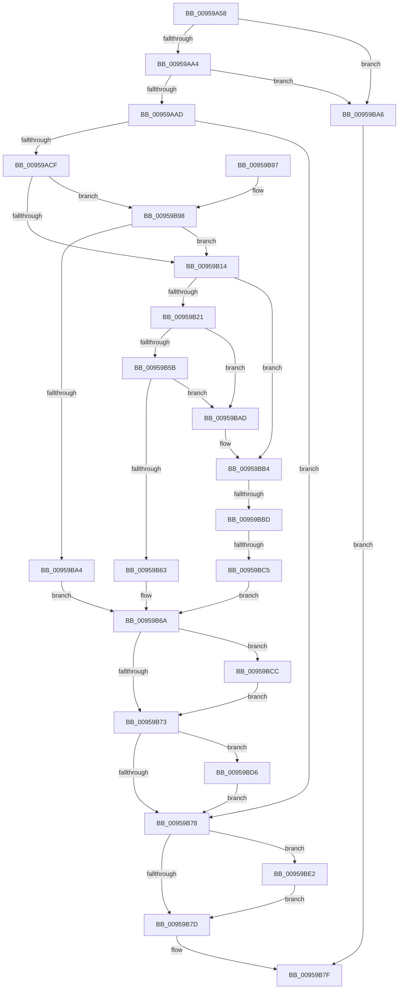

# KsepDbGetDriverShims

- RVA: `0x00959A58`–`0x00959BEC` (길이 `404` bytes)
- VA: `0x0000000140959A58`
- 실행 섹션: `PAGE`
- PDB 이름 있음: `예`; PDB Function 태그: `예`
- unwind 정보 RVA: `0x0009285C`
- 디코드: `118`개 명령, `404/404` bytes 표시
- 미해석 바이트: `0` (있으면 어셈블리에 `.byte`로 보존)

> 이 문서는 커널 이미지의 기계어와 PDB 기호를 분석해 생성했습니다. 4번과 5번은 함수 원형과 자료형을 바이너리 사용 방식에서 추정한 C 해석이며 원본 소스 복구 결과는 아닙니다.

## 1. Dependencies

- 직접 호출 지점: **6**; 고유 호출 대상: **4**
- 직접 호출자로 확인된 함수: **1**
- RIP 상대 이미지 참조: **1**

### Outgoing calls
- `0x00959ABC` → [KseShimDatabaseOpen](KseShimDatabaseOpen_function_0095AD7C.md) (function, `0x0095AD7C`)
- `0x00959AFA` → [KsepDbGetDriverShimsInternal](KsepDbGetDriverShimsInternal_function_009597C4.md) (function, `0x009597C4`)
- `0x00959B49` → [KsepDbGetDriverShimsInternal](KsepDbGetDriverShimsInternal_function_009597C4.md) (function, `0x009597C4`)
- `0x00959BCF` → [KsepDbFreeDriverShims](KsepDbFreeDriverShims_function_00958754.md) (function, `0x00958754`)
- `0x00959BDB` → [KsepDbFreeDriverShims](KsepDbFreeDriverShims_function_00958754.md) (function, `0x00958754`)
- `0x00959BE5` → [KseShimDatabaseClose](KseShimDatabaseClose_function_0095ABCC.md) (function, `0x0095ABCC`)

### Direct callers
- [KsepGetShimsForDriver](KsepGetShimsForDriver_function_00958A78.md) at `0x00958B61`

### Static image references
- `0x00959ADB` → RVA `0x00F10680` (`.data`; read)

## 2. Other-region calls and transfers

- 다른 실행 섹션으로 향하는 call: **0**
- call이 아닌 외부 분기/꼬리 이동: **2**
  - `0x00959BB7` → [sub_00B2755C + 0xB](../B2/Unknown_function_00B2755C.md) (`tail-transfer`)
  - `0x00959BBF` → [sub_00B2755C](../B2/Unknown_function_00B2755C.md) (`tail-transfer`)

## 3. Assembly (complete function range)

```asm
00959A58  48 8B C4                        mov rax, rsp
00959A5B  48 89 58 20                     mov qword ptr [rax + 0x20], rbx
00959A5F  44 89 40 18                     mov dword ptr [rax + 0x18], r8d
00959A63  48 89 50 10                     mov qword ptr [rax + 0x10], rdx
00959A67  48 89 48 08                     mov qword ptr [rax + 8], rcx
00959A6B  55                              push rbp
00959A6C  56                              push rsi
00959A6D  57                              push rdi
00959A6E  41 54                           push r12
00959A70  41 55                           push r13
00959A72  41 56                           push r14
00959A74  41 57                           push r15
00959A76  48 8B EC                        mov rbp, rsp
00959A79  48 83 EC 60                     sub rsp, 0x60
00959A7D  33 C0                           xor eax, eax
00959A7F  4D 8B F9                        mov r15, r9
00959A82  48 89 45 E8                     mov qword ptr [rbp - 0x18], rax
00959A86  4C 8B F1                        mov r14, rcx
00959A89  48 89 45 F0                     mov qword ptr [rbp - 0x10], rax
00959A8D  8B F0                           mov esi, eax
00959A8F  89 45 E4                        mov dword ptr [rbp - 0x1c], eax
00959A92  8B F8                           mov edi, eax
00959A94  89 45 E0                        mov dword ptr [rbp - 0x20], eax
00959A97  48 89 45 F8                     mov qword ptr [rbp - 8], rax
00959A9B  48 85 C9                        test rcx, rcx
00959A9E  0F 84 02 01 00 00               je 0x140959ba6
00959AA4  4D 85 C9                        test r9, r9
00959AA7  0F 84 F9 00 00 00               je 0x140959ba6
00959AAD  4C 8B 65 60                     mov r12, qword ptr [rbp + 0x60]
00959AB1  48 8D 4D F8                     lea rcx, [rbp - 8]
00959AB5  49 89 01                        mov qword ptr [r9], rax
00959AB8  41 89 04 24                     mov dword ptr [r12], eax
00959ABC  E8 BB 12 00 00                  call 0x14095ad7c
00959AC1  4C 8B 6D F8                     mov r13, qword ptr [rbp - 8]
00959AC5  8B D8                           mov ebx, eax
00959AC7  85 C0                           test eax, eax
00959AC9  0F 88 A9 00 00 00               js 0x140959b78
00959ACF  4C 8B 4D 48                     mov r9, qword ptr [rbp + 0x48]
00959AD3  48 8D 45 E4                     lea rax, [rbp - 0x1c]
00959AD7  49 8B 4D 00                     mov rcx, qword ptr [r13]
00959ADB  48 8D 15 9E 6B 5B 00            lea rdx, [rip + 0x5b6b9e]
00959AE2  48 89 44 24 30                  mov qword ptr [rsp + 0x30], rax
00959AE7  4D 8B C6                        mov r8, r14
00959AEA  48 8D 45 E8                     lea rax, [rbp - 0x18]
00959AEE  48 89 44 24 28                  mov qword ptr [rsp + 0x28], rax
00959AF3  8B 45 50                        mov eax, dword ptr [rbp + 0x50]
00959AF6  89 44 24 20                     mov dword ptr [rsp + 0x20], eax
00959AFA  E8 C5 FC FF FF                  call 0x1409597c4
00959AFF  44 8B 75 E4                     mov r14d, dword ptr [rbp - 0x1c]
00959B03  B9 00 00 00 80                  mov ecx, 0x80000000
00959B08  8B D8                           mov ebx, eax
00959B0A  03 C1                           add eax, ecx
00959B0C  85 C1                           test ecx, eax
00959B0E  0F 84 84 00 00 00               je 0x140959b98
00959B14  49 8B 4D 38                     mov rcx, qword ptr [r13 + 0x38]
00959B18  48 85 C9                        test rcx, rcx
00959B1B  0F 84 93 00 00 00               je 0x140959bb4
00959B21  4C 8B 4D 48                     mov r9, qword ptr [rbp + 0x48]
00959B25  48 8D 45 E0                     lea rax, [rbp - 0x20]
00959B29  4C 8B 45 40                     mov r8, qword ptr [rbp + 0x40]
00959B2D  48 8D 15 4C 6B 5B 00            lea rdx, [rip + 0x5b6b4c]
00959B34  48 89 44 24 30                  mov qword ptr [rsp + 0x30], rax
00959B39  48 8D 45 F0                     lea rax, [rbp - 0x10]
00959B3D  48 89 44 24 28                  mov qword ptr [rsp + 0x28], rax
00959B42  8B 45 50                        mov eax, dword ptr [rbp + 0x50]
00959B45  89 44 24 20                     mov dword ptr [rsp + 0x20], eax
00959B49  E8 76 FC FF FF                  call 0x1409597c4
00959B4E  B9 00 00 00 80                  mov ecx, 0x80000000
00959B53  8B D8                           mov ebx, eax
00959B55  03 C1                           add eax, ecx
00959B57  85 C1                           test ecx, eax
00959B59  75 52                           jne 0x140959bad
00959B5B  81 FB 25 02 00 C0               cmp ebx, 0xc0000225
00959B61  74 4A                           je 0x140959bad
00959B63  48 8B 75 F0                     mov rsi, qword ptr [rbp - 0x10]
00959B67  8B 7D E0                        mov edi, dword ptr [rbp - 0x20]
00959B6A  48 8B 4D E8                     mov rcx, qword ptr [rbp - 0x18]
00959B6E  48 85 C9                        test rcx, rcx
00959B71  75 59                           jne 0x140959bcc
00959B73  48 85 F6                        test rsi, rsi
00959B76  75 5E                           jne 0x140959bd6
00959B78  4D 85 ED                        test r13, r13
00959B7B  75 65                           jne 0x140959be2
00959B7D  8B C3                           mov eax, ebx
00959B7F  48 8B 9C 24 B8 00 00 00         mov rbx, qword ptr [rsp + 0xb8]
00959B87  48 83 C4 60                     add rsp, 0x60
00959B8B  41 5F                           pop r15
00959B8D  41 5E                           pop r14
00959B8F  41 5D                           pop r13
00959B91  41 5C                           pop r12
00959B93  5F                              pop rdi
00959B94  5E                              pop rsi
00959B95  5D                              pop rbp
00959B96  C3                              ret
00959B97  CC                              int3
00959B98  81 FB 25 02 00 C0               cmp ebx, 0xc0000225
00959B9E  0F 84 70 FF FF FF               je 0x140959b14
00959BA4  EB C4                           jmp 0x140959b6a
00959BA6  B8 0D 00 00 C0                  mov eax, 0xc000000d
00959BAB  EB D2                           jmp 0x140959b7f
00959BAD  48 8B 75 F0                     mov rsi, qword ptr [rbp - 0x10]
00959BB1  8B 7D E0                        mov edi, dword ptr [rbp - 0x20]
00959BB4  45 85 F6                        test r14d, r14d
00959BB7  0F 85 AA D9 1C 00               jne 0x140b27567
00959BBD  85 FF                           test edi, edi
00959BBF  0F 85 97 D9 1C 00               jne 0x140b2755c
00959BC5  BB 25 02 00 C0                  mov ebx, 0xc0000225
00959BCA  EB 9E                           jmp 0x140959b6a
00959BCC  41 8B D6                        mov edx, r14d
00959BCF  E8 80 EB FF FF                  call 0x140958754
00959BD4  EB 9D                           jmp 0x140959b73
00959BD6  8B D7                           mov edx, edi
00959BD8  48 8B CE                        mov rcx, rsi
00959BDB  E8 74 EB FF FF                  call 0x140958754
00959BE0  EB 96                           jmp 0x140959b78
00959BE2  49 8B CD                        mov rcx, r13
00959BE5  E8 E2 0F 00 00                  call 0x14095abcc
00959BEA  EB 91                           jmp 0x140959b7d
```

## 4. C-style interpretation (structured pseudocode)

```c
__int64 __fastcall KsepDbGetDriverShims(__int64 a1, __int64 a2, int a3, __int64 a4, __int64 a5)
{
    __int64 result;
    __int64 v_rsp;
    unsigned __int64 v_stack_m40;
    unsigned __int64 v_stack_m48;
    unsigned __int64 v_stack_m50;
    unsigned int v_stack_m54;
    unsigned int v_stack_m58;
    unsigned __int64 v_stack_m68;
    unsigned __int64 v_stack_m70;
    unsigned int v_stack_m78;
    unsigned __int64 v_stack_p10;
    unsigned int v_stack_p18;
    unsigned __int64 v_stack_p20;
    unsigned __int64 v_stack_p8;

    *(unsigned __int64 *)(v_rsp + 32) = v_rbx;
    *(unsigned int *)(v_rsp + 24) = a3;
    *(unsigned __int64 *)(v_rsp + 16) = a2;
    *(unsigned __int64 *)(v_rsp + 8) = a1;
    v_rsp = (v_rsp) - (96);
    result = 0;
    v_stack_m50 = 0;
    v_stack_m48 = 0;
    v_stack_m54 = 0;
    v_stack_m58 = 0;
    v_stack_m40 = 0;
    if (a1 == 0) goto loc_00959BA6;
    if (a4 == 0) goto loc_00959BA6;
    *(unsigned __int64 *)(a4) = 0;
    *(unsigned int *)(a5) = 0;
    result = KseShimDatabaseOpen(v_stack_m40, a2, a3, a4);
    if (sign_flag) goto loc_00959B78;
    v_stack_m68 = v_stack_m54;
    v_stack_m70 = v_stack_m50;
    v_stack_m78 = (unsigned int)((unsigned int)(v_stack_p18));
    result = KsepDbGetDriverShimsInternal(*(unsigned __int64 *)(v_stack_m40), v_rip + 5991326, a1, v_stack_p10);
    result = (unsigned int)((result) + ((unsigned int)((unsigned int)(0x80000000ULL))));
    if ((((unsigned int)((unsigned int)(0x80000000ULL))) & ((unsigned int)(result))) == 0) goto loc_00959B98;
loc_00959B14:
    if (*(unsigned __int64 *)(v_stack_m40 + 56) == 0) goto loc_00959BB4;
    v_stack_m68 = v_stack_m58;
    v_stack_m70 = v_stack_m48;
    v_stack_m78 = (unsigned int)((unsigned int)(v_stack_p18));
    result = KsepDbGetDriverShimsInternal(*(unsigned __int64 *)(v_stack_m40 + 56), v_rip + 5991244, v_stack_p8, v_stack_p10);
    result = (unsigned int)((result) + ((unsigned int)((unsigned int)(0x80000000ULL))));
    if ((((unsigned int)((unsigned int)(0x80000000ULL))) & ((unsigned int)(result))) != 0) goto loc_00959BAD;
    if (((unsigned int)((unsigned int)((unsigned int)(result)))) == 0xC0000225ULL) goto loc_00959BAD;
loc_00959B6A:
    if (v_stack_m50 != 0) goto loc_00959BCC;
loc_00959B73:
    if (v_stack_m48 != 0) goto loc_00959BD6;
loc_00959B78:
    if (v_stack_m40 != 0) goto loc_00959BE2;
loc_00959B7D:
loc_00959B7F:
    v_rsp = (v_rsp) + (96);
    return (unsigned int)((unsigned int)((unsigned int)((unsigned int)(result))));
loc_00959B98:
    if (((unsigned int)(v_stack_p20)) == 0xC0000225ULL) goto loc_00959B14;
    goto loc_00959B6A;
loc_00959BA6:
    goto loc_00959B7F;
loc_00959BAD:
loc_00959BB4:
    goto loc_00959B6A;
loc_00959BCC:
    result = KsepDbFreeDriverShims(v_stack_m50, (unsigned int)((unsigned int)((unsigned int)(v_stack_m54))), v_stack_p8, v_stack_p10);
    goto loc_00959B73;
loc_00959BD6:
    result = KsepDbFreeDriverShims(v_stack_m48, (unsigned int)((unsigned int)((unsigned int)(v_stack_m58))), v_stack_p8, v_stack_p10);
    goto loc_00959B78;
loc_00959BE2:
    result = KseShimDatabaseClose(v_stack_m40, (unsigned int)((unsigned int)((unsigned int)(v_stack_m58))), v_stack_p8, v_stack_p10);
    goto loc_00959B7D;
}
```

## 5. (Beta) C Style

```c
int64_t KsepDbGetDriverShims(int64_t Arg1, int64_t Arg2, int32_t Arg3, int64_t Arg4, void *Arg5)
{
    uint8_t *arg5 = (uint8_t *)Arg5;

    int64_t result;
    int64_t local_rsp;
    uint64_t v_stack_m40;
    uint64_t v_stack_m48;
    uint64_t v_stack_m50;
    uint32_t v_stack_m54;
    uint32_t v_stack_m58;
    uint64_t v_stack_m68;
    uint64_t v_stack_m70;
    uint32_t v_stack_m78;
    uint64_t v_stack_p10;
    uint32_t v_stack_p18;
    uint64_t v_stack_p20;
    uint64_t v_stack_p8;

    *(uint64_t *)(local_rsp + 0x20) = local_rbx;
    *(uint32_t *)(local_rsp + 0x18) = Arg3;
    *(uint64_t *)(local_rsp + 0x10) = Arg2;
    *(uint64_t *)(local_rsp + 0x8) = Arg1;
    local_rsp = (local_rsp) - (96);
    result = 0;
    v_stack_m50 = 0;
    v_stack_m48 = 0;
    v_stack_m54 = 0;
    v_stack_m58 = 0;
    v_stack_m40 = 0;
    if (Arg1 == 0) goto loc_00959BA6;
    if (Arg4 == 0) goto loc_00959BA6;
    *(uint64_t *)(Arg4) = 0;
    *(uint32_t *)(arg5) = 0;
    result = KseShimDatabaseOpen(v_stack_m40, Arg2, Arg3, Arg4);
    if (sign_flag) goto loc_00959B78;
    v_stack_m68 = v_stack_m54;
    v_stack_m70 = v_stack_m50;
    v_stack_m78 = (uint32_t)((uint32_t)(v_stack_p18));
    result = KsepDbGetDriverShimsInternal(*(uint64_t *)(v_stack_m40), v_rip + 5991326, Arg1, v_stack_p10);
    result = (uint32_t)((result) + ((uint32_t)((uint32_t)(0x80000000ULL))));
    if ((((uint32_t)((uint32_t)(0x80000000ULL))) & ((uint32_t)(result))) == 0) goto loc_00959B98;
loc_00959B14:
    if (*(uint64_t *)(v_stack_m40 + 0x38) == 0) goto loc_00959BB4;
    v_stack_m68 = v_stack_m58;
    v_stack_m70 = v_stack_m48;
    v_stack_m78 = (uint32_t)((uint32_t)(v_stack_p18));
    result = KsepDbGetDriverShimsInternal(*(uint64_t *)(v_stack_m40 + 0x38), v_rip + 5991244, v_stack_p8, v_stack_p10);
    result = (uint32_t)((result) + ((uint32_t)((uint32_t)(0x80000000ULL))));
    if ((((uint32_t)((uint32_t)(0x80000000ULL))) & ((uint32_t)(result))) != 0) goto loc_00959BAD;
    if (((uint32_t)((uint32_t)((uint32_t)(result)))) == 0xC0000225ULL) goto loc_00959BAD;
loc_00959B6A:
    if (v_stack_m50 != 0) goto loc_00959BCC;
loc_00959B73:
    if (v_stack_m48 != 0) goto loc_00959BD6;
loc_00959B78:
    if (v_stack_m40 != 0) goto loc_00959BE2;
loc_00959B7D:
loc_00959B7F:
    local_rsp = (local_rsp) + (96);
    return (uint32_t)((uint32_t)((uint32_t)((uint32_t)(result))));
loc_00959B98:
    if (((uint32_t)(v_stack_p20)) == 0xC0000225ULL) goto loc_00959B14;
    goto loc_00959B6A;
loc_00959BA6:
    goto loc_00959B7F;
loc_00959BAD:
loc_00959BB4:
    goto loc_00959B6A;
loc_00959BCC:
    result = KsepDbFreeDriverShims(v_stack_m50, (uint32_t)((uint32_t)((uint32_t)(v_stack_m54))), v_stack_p8, v_stack_p10);
    goto loc_00959B73;
loc_00959BD6:
    result = KsepDbFreeDriverShims(v_stack_m48, (uint32_t)((uint32_t)((uint32_t)(v_stack_m58))), v_stack_p8, v_stack_p10);
    goto loc_00959B78;
loc_00959BE2:
    result = KseShimDatabaseClose(v_stack_m40, (uint32_t)((uint32_t)((uint32_t)(v_stack_m58))), v_stack_p8, v_stack_p10);
    goto loc_00959B7D;
}
```

### 관측된 메모리 오프셋

구조체 형식이 확인되지 않은 접근은 인자 기준의 오프셋으로만 기록했습니다.

| 기준 인자 | 오프셋 표현 | 폭 (bit) | 접근 |
|---|---:|---:|---|
| `Arg5` | `+ 0x0` | `32` | `W` |

## 6. Execution-region graph

[열기: 2D/3D 그래프와 함수 탐색 컨트롤 패널](../../../control-panel.html?section=page&rva=0x00959A58&view=graph)

- 2D 그래프는 위에서 아래로 흐르고, 3D 그래프는 빈 공간을 드래그해 회전합니다. Shift+드래그는 이동, 휠은 확대·축소, 함수 노드 선택은 대상 보고서 이동입니다.

### Static fallback


