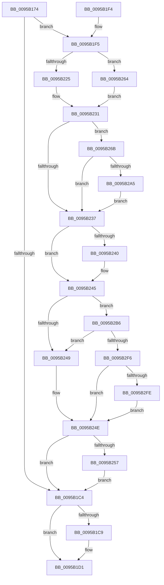

# KsepDbQueryRegistryDeviceData

- RVA: `0x0095B174`–`0x0095B310` (길이 `412` bytes)
- VA: `0x000000014095B174`
- 실행 섹션: `PAGE`
- PDB 이름 있음: `예`; PDB Function 태그: `아니요`
- unwind 정보 RVA: `0x00092ACC`
- 디코드: `116`개 명령, `412/412` bytes 표시
- 미해석 바이트: `0` (있으면 어셈블리에 `.byte`로 보존)

> 이 문서는 커널 이미지의 기계어와 PDB 기호를 분석해 생성했습니다. 4번과 5번은 함수 원형과 자료형을 바이너리 사용 방식에서 추정한 C 해석이며 원본 소스 복구 결과는 아닙니다.

## 1. Dependencies

- 직접 호출 지점: **8**; 고유 호출 대상: **7**
- 직접 호출자로 확인된 함수: **1**
- RIP 상대 이미지 참조: **2**

### Outgoing calls
- `0x0095B1B5` → [KsepStringTransform](KsepStringTransform_function_0095B318.md) (function, `0x0095B318`)
- `0x0095B1CC` → [KsepPoolFreePaged](../../text/4B/KsepPoolFreePaged_function_004B0E10.md) (function, `0x004B0E10`)
- `0x0095B22C` → [KsepStringConcatenate](KsepStringConcatenate_function_0095A8A0.md) (function, `0x0095A8A0`)
- `0x0095B240` → [KsepPoolFreePaged](../../text/4B/KsepPoolFreePaged_function_004B0E10.md) (function, `0x004B0E10`)
- `0x0095B25A` → [KsepRegistryCloseKey](KsepRegistryCloseKey_function_00959500.md) (function, `0x00959500`)
- `0x0095B264` → [KsepStringDuplicate](KsepStringDuplicate_function_0095B454.md) (function, `0x0095B454`)
- `0x0095B29A` → [ZwOpenKey](../../text/6A/ZwOpenKey_function_006AD310.md) (function, `0x006AD310`)
- `0x0095B2DD` → [KsepRegistryQueryValue](../74/KsepRegistryQueryValue_function_0074B7F8.md) (function, `0x0074B7F8`)

### Direct callers
- [KseQueryDeviceData](KseQueryDeviceData_function_0095AFB0.md) at `0x0095B031`

### Static image references
- `0x0095B206` → RVA `0x00B006E0` (` ?? ::NNGAKEGL::`string'`; read)
- `0x0095B2A9` → RVA `0x00F10178` (`.data`; read/write)

## 2. Other-region calls and transfers

- 다른 실행 섹션으로 향하는 call: **3**
  - `0x0095B1CC` → [KsepPoolFreePaged](../../text/4B/KsepPoolFreePaged_function_004B0E10.md) (`PAGE` → `.text`)
  - `0x0095B240` → [KsepPoolFreePaged](../../text/4B/KsepPoolFreePaged_function_004B0E10.md) (`PAGE` → `.text`)
  - `0x0095B29A` → [ZwOpenKey](../../text/6A/ZwOpenKey_function_006AD310.md) (`PAGE` → `.text`)
- 별도 외부 분기/꼬리 이동을 확인하지 못했습니다.

## 3. Assembly (complete function range)

```asm
0095B174  48 8B C4                        mov rax, rsp
0095B177  48 89 58 08                     mov qword ptr [rax + 8], rbx
0095B17B  48 89 70 10                     mov qword ptr [rax + 0x10], rsi
0095B17F  48 89 78 18                     mov qword ptr [rax + 0x18], rdi
0095B183  55                              push rbp
0095B184  41 54                           push r12
0095B186  41 55                           push r13
0095B188  41 56                           push r14
0095B18A  41 57                           push r15
0095B18C  48 8D 68 A9                     lea rbp, [rax - 0x57]
0095B190  48 81 EC 90 00 00 00            sub rsp, 0x90
0095B197  45 33 ED                        xor r13d, r13d
0095B19A  4C 8B E2                        mov r12, rdx
0095B19D  48 8B D1                        mov rdx, rcx
0095B1A0  4C 89 6D EF                     mov qword ptr [rbp - 0x11], r13
0095B1A4  48 8D 4D EF                     lea rcx, [rbp - 0x11]
0095B1A8  4C 89 6D F7                     mov qword ptr [rbp - 9], r13
0095B1AC  4D 8B F9                        mov r15, r9
0095B1AF  4D 8B F0                        mov r14, r8
0095B1B2  41 8B F5                        mov esi, r13d
0095B1B5  E8 5E 01 00 00                  call 0x14095b318
0095B1BA  48 8B 7D F7                     mov rdi, qword ptr [rbp - 9]
0095B1BE  8B D8                           mov ebx, eax
0095B1C0  85 C0                           test eax, eax
0095B1C2  79 31                           jns 0x14095b1f5
0095B1C4  48 85 FF                        test rdi, rdi
0095B1C7  74 08                           je 0x14095b1d1
0095B1C9  48 8B CF                        mov rcx, rdi
0095B1CC  E8 3F 5C B5 FF                  call 0x1404b0e10
0095B1D1  4C 8D 9C 24 90 00 00 00         lea r11, [rsp + 0x90]
0095B1D9  8B C3                           mov eax, ebx
0095B1DB  49 8B 5B 30                     mov rbx, qword ptr [r11 + 0x30]
0095B1DF  49 8B 73 38                     mov rsi, qword ptr [r11 + 0x38]
0095B1E3  49 8B 7B 40                     mov rdi, qword ptr [r11 + 0x40]
0095B1E7  49 8B E3                        mov rsp, r11
0095B1EA  41 5F                           pop r15
0095B1EC  41 5E                           pop r14
0095B1EE  41 5D                           pop r13
0095B1F0  41 5C                           pop r12
0095B1F2  5D                              pop rbp
0095B1F3  C3                              ret
0095B1F4  CC                              int3
0095B1F5  33 C0                           xor eax, eax
0095B1F7  4C 89 6D DF                     mov qword ptr [rbp - 0x21], r13
0095B1FB  4C 89 6D E7                     mov qword ptr [rbp - 0x19], r13
0095B1FF  0F 57 C0                        xorps xmm0, xmm0
0095B202  48 89 45 1F                     mov qword ptr [rbp + 0x1f], rax
0095B206  48 8D 15 D3 54 1A 00            lea rdx, [rip + 0x1a54d3]
0095B20D  89 45 27                        mov dword ptr [rbp + 0x27], eax
0095B210  48 8D 4D DF                     lea rcx, [rbp - 0x21]
0095B214  4C 89 6D CF                     mov qword ptr [rbp - 0x31], r13
0095B218  0F 11 45 FF                     movups xmmword ptr [rbp - 1], xmm0
0095B21C  0F 11 45 0F                     movups xmmword ptr [rbp + 0xf], xmm0
0095B220  48 85 FF                        test rdi, rdi
0095B223  74 3F                           je 0x14095b264
0095B225  44 8D 48 01                     lea r9d, [rax + 1]
0095B229  4C 8B C7                        mov r8, rdi
0095B22C  E8 6F F6 FF FF                  call 0x14095a8a0
0095B231  8B D8                           mov ebx, eax
0095B233  85 C0                           test eax, eax
0095B235  79 34                           jns 0x14095b26b
0095B237  48 8B 4D E7                     mov rcx, qword ptr [rbp - 0x19]
0095B23B  48 85 C9                        test rcx, rcx
0095B23E  74 05                           je 0x14095b245
0095B240  E8 CB 5B B5 FF                  call 0x1404b0e10
0095B245  85 DB                           test ebx, ebx
0095B247  79 6D                           jns 0x14095b2b6
0095B249  BB 25 02 00 C0                  mov ebx, 0xc0000225
0095B24E  48 85 F6                        test rsi, rsi
0095B251  0F 84 6D FF FF FF               je 0x14095b1c4
0095B257  48 8B CE                        mov rcx, rsi
0095B25A  E8 A1 E2 FF FF                  call 0x140959500
0095B25F  E9 60 FF FF FF                  jmp 0x14095b1c4
0095B264  E8 EB 01 00 00                  call 0x14095b454
0095B269  EB C6                           jmp 0x14095b231
0095B26B  48 8D 45 DF                     lea rax, [rbp - 0x21]
0095B26F  C7 45 FF 30 00 00 00            mov dword ptr [rbp - 1], 0x30
0095B276  0F 57 C0                        xorps xmm0, xmm0
0095B279  48 89 45 0F                     mov qword ptr [rbp + 0xf], rax
0095B27D  4C 8D 45 FF                     lea r8, [rbp - 1]
0095B281  4C 89 6D 07                     mov qword ptr [rbp + 7], r13
0095B285  BA 19 00 02 00                  mov edx, 0x20019
0095B28A  C7 45 17 40 02 00 00            mov dword ptr [rbp + 0x17], 0x240
0095B291  48 8D 4D CF                     lea rcx, [rbp - 0x31]
0095B295  F3 0F 7F 45 1F                  movdqu xmmword ptr [rbp + 0x1f], xmm0
0095B29A  E8 71 20 D5 FF                  call 0x1406ad310
0095B29F  8B D8                           mov ebx, eax
0095B2A1  85 C0                           test eax, eax
0095B2A3  78 92                           js 0x14095b237
0095B2A5  48 8B 75 CF                     mov rsi, qword ptr [rbp - 0x31]
0095B2A9  F0 FF 05 C8 4E 5B 00            lock inc dword ptr [rip + 0x5b4ec8]
0095B2B0  48 8B 7D F7                     mov rdi, qword ptr [rbp - 9]
0095B2B4  EB 81                           jmp 0x14095b237
0095B2B6  41 8B 07                        mov eax, dword ptr [r15]
0095B2B9  48 8D 4D D7                     lea rcx, [rbp - 0x29]
0095B2BD  4C 8B 4D 7F                     mov r9, qword ptr [rbp + 0x7f]
0095B2C1  4C 8D 45 CF                     lea r8, [rbp - 0x31]
0095B2C5  48 89 4C 24 28                  mov qword ptr [rsp + 0x28], rcx
0095B2CA  49 8B D4                        mov rdx, r12
0095B2CD  48 8B CE                        mov rcx, rsi
0095B2D0  44 89 6D CF                     mov dword ptr [rbp - 0x31], r13d
0095B2D4  48 89 45 D7                     mov qword ptr [rbp - 0x29], rax
0095B2D8  48 89 44 24 20                  mov qword ptr [rsp + 0x20], rax
0095B2DD  E8 16 05 DF FF                  call 0x14074b7f8
0095B2E2  8B D8                           mov ebx, eax
0095B2E4  8B 45 D7                        mov eax, dword ptr [rbp - 0x29]
0095B2E7  41 89 07                        mov dword ptr [r15], eax
0095B2EA  81 FB 34 00 00 C0               cmp ebx, 0xc0000034
0095B2F0  0F 84 53 FF FF FF               je 0x14095b249
0095B2F6  85 DB                           test ebx, ebx
0095B2F8  0F 88 50 FF FF FF               js 0x14095b24e
0095B2FE  8B 45 CF                        mov eax, dword ptr [rbp - 0x31]
0095B301  41 8B DD                        mov ebx, r13d
0095B304  0F BA E8 1C                     bts eax, 0x1c
0095B308  41 09 06                        or dword ptr [r14], eax
0095B30B  E9 3E FF FF FF                  jmp 0x14095b24e
```

## 4. C-style interpretation (structured pseudocode)

```c
__int64 __fastcall KsepDbQueryRegistryDeviceData(__int64 a1, __int64 a2, __int64 a3, __int64 a4)
{
    __int64 result;
    __int64 v_r13;
    __int64 v_rsp;
    unsigned __int64 v_stack_m28;
    unsigned __int64 v_stack_m68;
    unsigned __int64 v_stack_m70;

    *(unsigned __int64 *)(v_rsp + 8) = v_rbx;
    *(unsigned __int64 *)(v_rsp + 16) = v_rsi;
    *(unsigned __int64 *)(v_rsp + 24) = v_rdi;
    v_rsp = (v_rsp) - (144);
    v_r13 = 0;
    *(unsigned __int64 *)(v_rsp - 87 - 17) = 0;
    *(unsigned __int64 *)(v_rsp - 87 - 9) = 0;
    result = KsepStringTransform(v_rsp - 87 - 17, a1, a3, a4);
    if (!sign_flag) goto loc_0095B1F5;
loc_0095B1C4:
    if (*(unsigned __int64 *)(v_rsp - 87 - 9) != 0) {
        a1 = *(unsigned __int64 *)(v_rsp - 87 - 9);
        result = KsepPoolFreePaged(a1, a1, a3, a4);
    }
    return (unsigned int)((unsigned int)((unsigned int)((unsigned int)(result))));
loc_0095B1F5:
    result = 0;
    *(unsigned __int64 *)(v_rsp - 87 - 33) = 0;
    *(unsigned __int64 *)(v_rsp - 87 - 25) = 0;
    *(unsigned __int64 *)(v_rsp - 87 + 31) = 0;
    *(unsigned int *)(v_rsp - 87 + 39) = 0;
    *(unsigned __int64 *)(v_rsp - 87 - 49) = 0;
    *(unsigned __int64 *)(v_rsp - 87 - 1) = v_xmm0;
    *(unsigned __int64 *)(v_rsp - 87 + 15) = v_xmm0;
    if (*(unsigned __int64 *)(v_stack_m28 + 64) == 0) goto loc_0095B264;
    result = KsepStringConcatenate(v_rsp - 87 - 33, v_rip + 1725651, *(unsigned __int64 *)(v_stack_m28 + 64), result + 1);
loc_0095B231:
    if (!sign_flag) goto loc_0095B26B;
loc_0095B237:
    if (*(unsigned __int64 *)(v_rsp - 87 - 25) != 0) {
        result = KsepPoolFreePaged(*(unsigned __int64 *)(v_rsp - 87 - 25), v_rip + 1725651, *(unsigned __int64 *)(v_stack_m28 + 64), result + 1);
    }
    if (!sign_flag) goto loc_0095B2B6;
loc_0095B249:
loc_0095B24E:
    if (*(unsigned __int64 *)(v_stack_m28 + 56) == 0) goto loc_0095B1C4;
    result = KsepRegistryCloseKey(*(unsigned __int64 *)(v_stack_m28 + 56), v_rip + 1725651, *(unsigned __int64 *)(v_stack_m28 + 64), result + 1);
    goto loc_0095B1C4;
loc_0095B264:
    result = KsepStringDuplicate(*(unsigned __int64 *)(v_stack_m28 + 56), v_rip + 1725651, *(unsigned __int64 *)(v_stack_m28 + 64), result + 1);
    goto loc_0095B231;
loc_0095B26B:
    *(unsigned int *)(v_rsp - 87 - 1) = 48;
    *(unsigned __int64 *)(v_rsp - 87 + 15) = v_rsp - 87 - 33;
    *(unsigned __int64 *)(v_rsp - 87 + 7) = 0;
    *(unsigned int *)(v_rsp - 87 + 23) = 576;
    *(unsigned __int64 *)(v_rsp - 87 + 31) = v_xmm0;
    result = ZwOpenKey(v_rsp - 87 - 49, (unsigned int)(0x20019ULL), v_rsp - 87 - 1, result + 1);
    if (sign_flag) goto loc_0095B237;
    goto loc_0095B237;
loc_0095B2B6:
    v_stack_m68 = v_rsp - 87 - 41;
    *(unsigned int *)(v_rsp - 87 - 49) = 0;
    *(unsigned __int64 *)(v_rsp - 87 - 41) = (unsigned int)(*(unsigned int *)(a4));
    v_stack_m70 = (unsigned int)(*(unsigned int *)(a4));
    result = KsepRegistryQueryValue(*(unsigned __int64 *)(v_rsp - 87 - 49), a2, v_rsp - 87 - 49, *(unsigned __int64 *)(v_rsp - 87 + 127));
    *(unsigned int *)(a4) = (unsigned int)((unsigned int)(*(unsigned int *)(v_rsp - 87 - 41)));
    if (((unsigned int)((unsigned int)((unsigned int)(result)))) == 0xC0000034ULL) goto loc_0095B249;
    if (sign_flag) goto loc_0095B24E;
    goto loc_0095B24E;
}
```

## 5. (Beta) C Style

```c
int64_t KsepDbQueryRegistryDeviceData(int64_t Arg1, int64_t Arg2, void *Arg3, void *Arg4)
{
    uint8_t *arg3 = (uint8_t *)Arg3;
    uint8_t *arg4 = (uint8_t *)Arg4;

    int64_t result;
    int64_t local_r13;
    int64_t local_rsp;
    uint64_t v_stack_m28;
    uint64_t v_stack_m68;
    uint64_t v_stack_m70;

    *(uint64_t *)(local_rsp + 0x8) = local_rbx;
    *(uint64_t *)(local_rsp + 0x10) = local_rsi;
    *(uint64_t *)(local_rsp + 0x18) = local_rdi;
    local_rsp = (local_rsp) - (144);
    local_r13 = 0;
    *(uint64_t *)(local_rsp - 0x57 - 0x11) = 0;
    *(uint64_t *)(local_rsp - 0x57 - 0x9) = 0;
    result = KsepStringTransform(local_rsp - 87 - 17, Arg1, Arg3, Arg4);
    if (!sign_flag) goto loc_0095B1F5;
loc_0095B1C4:
    if (*(uint64_t *)(local_rsp - 0x57 - 0x9) != 0) {
        Arg1 = *(uint64_t *)(local_rsp - 0x57 - 0x9);
        result = KsepPoolFreePaged(Arg1, Arg1, Arg3, Arg4);
    }
    return (uint32_t)((uint32_t)((uint32_t)((uint32_t)(result))));
loc_0095B1F5:
    result = 0;
    *(uint64_t *)(local_rsp - 0x57 - 0x21) = 0;
    *(uint64_t *)(local_rsp - 0x57 - 0x19) = 0;
    *(uint64_t *)(local_rsp - 0x57 + 0x1F) = 0;
    *(uint32_t *)(local_rsp - 0x57 + 0x27) = 0;
    *(uint64_t *)(local_rsp - 0x57 - 0x31) = 0;
    *(uint64_t *)(local_rsp - 0x57 - 0x1) = v_xmm0;
    *(uint64_t *)(local_rsp - 0x57 + 0xF) = v_xmm0;
    if (*(uint64_t *)(v_stack_m28 + 0x40) == 0) goto loc_0095B264;
    result = KsepStringConcatenate(local_rsp - 87 - 33, v_rip + 1725651, *(uint64_t *)(v_stack_m28 + 0x40), result + 1);
loc_0095B231:
    if (!sign_flag) goto loc_0095B26B;
loc_0095B237:
    if (*(uint64_t *)(local_rsp - 0x57 - 0x19) != 0) {
        result = KsepPoolFreePaged(*(uint64_t *)(local_rsp - 0x57 - 0x19), v_rip + 1725651, *(uint64_t *)(v_stack_m28 + 0x40), result + 1);
    }
    if (!sign_flag) goto loc_0095B2B6;
loc_0095B249:
loc_0095B24E:
    if (*(uint64_t *)(v_stack_m28 + 0x38) == 0) goto loc_0095B1C4;
    result = KsepRegistryCloseKey(*(uint64_t *)(v_stack_m28 + 0x38), v_rip + 1725651, *(uint64_t *)(v_stack_m28 + 0x40), result + 1);
    goto loc_0095B1C4;
loc_0095B264:
    result = KsepStringDuplicate(*(uint64_t *)(v_stack_m28 + 0x38), v_rip + 1725651, *(uint64_t *)(v_stack_m28 + 0x40), result + 1);
    goto loc_0095B231;
loc_0095B26B:
    *(uint32_t *)(local_rsp - 0x57 - 0x1) = 48;
    *(uint64_t *)(local_rsp - 0x57 + 0xF) = local_rsp - 87 - 33;
    *(uint64_t *)(local_rsp - 0x57 + 0x7) = 0;
    *(uint32_t *)(local_rsp - 0x57 + 0x17) = 576;
    *(uint64_t *)(local_rsp - 0x57 + 0x1F) = v_xmm0;
    result = ZwOpenKey(local_rsp - 87 - 49, (uint32_t)(0x20019ULL), local_rsp - 87 - 1, result + 1);
    if (sign_flag) goto loc_0095B237;
    goto loc_0095B237;
loc_0095B2B6:
    v_stack_m68 = local_rsp - 87 - 41;
    *(uint32_t *)(local_rsp - 0x57 - 0x31) = 0;
    *(uint64_t *)(local_rsp - 0x57 - 0x29) = (uint32_t)(*(uint32_t *)(arg4));
    v_stack_m70 = (uint32_t)(*(uint32_t *)(arg4));
    result = KsepRegistryQueryValue(*(uint64_t *)(local_rsp - 0x57 - 0x31), Arg2, local_rsp - 87 - 49, *(uint64_t *)(local_rsp - 0x57 + 0x7F));
    *(uint32_t *)(arg4) = (uint32_t)((uint32_t)(*(uint32_t *)(local_rsp - 0x57 - 0x29)));
    if (((uint32_t)((uint32_t)((uint32_t)(result)))) == 0xC0000034ULL) goto loc_0095B249;
    if (sign_flag) goto loc_0095B24E;
    goto loc_0095B24E;
}
```

### 관측된 메모리 오프셋

구조체 형식이 확인되지 않은 접근은 인자 기준의 오프셋으로만 기록했습니다.

| 기준 인자 | 오프셋 표현 | 폭 (bit) | 접근 |
|---|---:|---:|---|
| `Arg3` | `+ 0x0` | `32` | `R/W` |
| `Arg4` | `+ 0x0` | `32` | `R` |
| `Arg4` | `+ 0x0` | `32` | `W` |

## 6. Execution-region graph

[열기: 2D/3D 그래프와 함수 탐색 컨트롤 패널](../../../control-panel.html?section=page&rva=0x0095B174&view=graph)

- 2D 그래프는 위에서 아래로 흐르고, 3D 그래프는 빈 공간을 드래그해 회전합니다. Shift+드래그는 이동, 휠은 확대·축소, 함수 노드 선택은 대상 보고서 이동입니다.

### Static fallback


