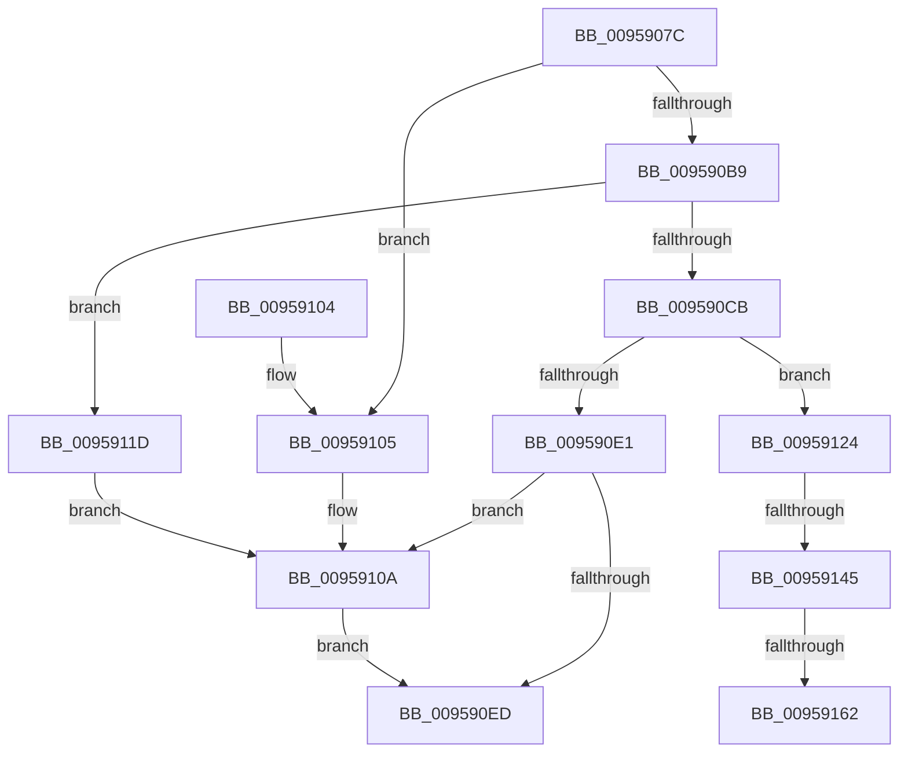

# KsepEngineGetShimsFromRegistry

- RVA: `0x0095907C`–`0x0095916C` (길이 `240` bytes)
- VA: `0x000000014095907C`
- 실행 섹션: `PAGE`
- PDB 이름 있음: `예`; PDB Function 태그: `예`
- unwind 정보 RVA: `0x000927A4`
- 디코드: `75`개 명령, `240/240` bytes 표시
- 미해석 바이트: `0` (있으면 어셈블리에 `.byte`로 보존)

> 이 문서는 커널 이미지의 기계어와 PDB 기호를 분석해 생성했습니다. 4번과 5번은 함수 원형과 자료형을 바이너리 사용 방식에서 추정한 C 해석이며 원본 소스 복구 결과는 아닙니다.

## 1. Dependencies

- 직접 호출 지점: **6**; 고유 호출 대상: **4**
- 직접 호출자로 확인된 함수: **1**
- RIP 상대 이미지 참조: **0**

### Outgoing calls
- `0x009590BE` → [KsepPoolAllocatePaged](../../text/4A/KsepPoolAllocatePaged_function_004A9EFC.md) (function, `0x004A9EFC`)
- `0x009590D6` → [KsepRegistryQueryDriverShims](KsepRegistryQueryDriverShims_function_00959524.md) (function, `0x00959524`)
- `0x009590E4` → [KsepPoolFreePaged](../../text/4B/KsepPoolFreePaged_function_004B0E10.md) (function, `0x004B0E10`)
- `0x0095910D` → [KsepPoolFreePaged](../../text/4B/KsepPoolFreePaged_function_004B0E10.md) (function, `0x004B0E10`)
- `0x00959133` → [KsepStringSplitMultiString](../74/KsepStringSplitMultiString_function_0074AB48.md) (function, `0x0074AB48`)
- `0x0095914D` → [KsepPoolAllocatePaged](../../text/4A/KsepPoolAllocatePaged_function_004A9EFC.md) (function, `0x004A9EFC`)

### Direct callers
- [KsepGetShimsForDriver](KsepGetShimsForDriver_function_00958A78.md) at `0x00958AEC`

### Static image references
- 디코드된 RIP-relative 메모리 참조가 없습니다.

## 2. Other-region calls and transfers

- 다른 실행 섹션으로 향하는 call: **4**
  - `0x009590BE` → [KsepPoolAllocatePaged](../../text/4A/KsepPoolAllocatePaged_function_004A9EFC.md) (`PAGE` → `.text`)
  - `0x009590E4` → [KsepPoolFreePaged](../../text/4B/KsepPoolFreePaged_function_004B0E10.md) (`PAGE` → `.text`)
  - `0x0095910D` → [KsepPoolFreePaged](../../text/4B/KsepPoolFreePaged_function_004B0E10.md) (`PAGE` → `.text`)
  - `0x0095914D` → [KsepPoolAllocatePaged](../../text/4A/KsepPoolAllocatePaged_function_004A9EFC.md) (`PAGE` → `.text`)
- call이 아닌 외부 분기/꼬리 이동: **3**
  - `0x0095913F` → [sub_00B27464 + 0xA2](../B2/Unknown_function_00B27464.md) (`tail-transfer`)
  - `0x0095915C` → [sub_00B27464](../B2/Unknown_function_00B27464.md) (`tail-transfer`)
  - `0x00959167` → [sub_00B27464 + 0xA6](../B2/Unknown_function_00B27464.md) (`tail-transfer`)

## 3. Assembly (complete function range)

```asm
0095907C  48 89 5C 24 10                  mov qword ptr [rsp + 0x10], rbx
00959081  4C 89 44 24 18                  mov qword ptr [rsp + 0x18], r8
00959086  55                              push rbp
00959087  56                              push rsi
00959088  57                              push rdi
00959089  41 54                           push r12
0095908B  41 55                           push r13
0095908D  41 56                           push r14
0095908F  41 57                           push r15
00959091  48 8B EC                        mov rbp, rsp
00959094  48 83 EC 30                     sub rsp, 0x30
00959098  48 83 65 F8 00                  and qword ptr [rbp - 8], 0
0095909D  45 33 F6                        xor r14d, r14d
009590A0  48 83 65 F0 00                  and qword ptr [rbp - 0x10], 0
009590A5  4D 8B E9                        mov r13, r9
009590A8  83 65 40 00                     and dword ptr [rbp + 0x40], 0
009590AC  49 8B F8                        mov rdi, r8
009590AF  8B 41 08                        mov eax, dword ptr [rcx + 8]
009590B2  48 8B DA                        mov rbx, rdx
009590B5  A8 01                           test al, 1
009590B7  75 4C                           jne 0x140959105
009590B9  B9 00 08 00 00                  mov ecx, 0x800
009590BE  E8 39 0E B5 FF                  call 0x1404a9efc
009590C3  4C 8B E0                        mov r12, rax
009590C6  48 85 C0                        test rax, rax
009590C9  74 52                           je 0x14095911d
009590CB  48 8B 4B 08                     mov rcx, qword ptr [rbx + 8]
009590CF  4C 8D 4D F8                     lea r9, [rbp - 8]
009590D3  48 8B D0                        mov rdx, rax
009590D6  E8 49 04 00 00                  call 0x140959524
009590DB  8B D8                           mov ebx, eax
009590DD  85 C0                           test eax, eax
009590DF  79 43                           jns 0x140959124
009590E1  49 8B CC                        mov rcx, r12
009590E4  E8 27 7D B5 FF                  call 0x1404b0e10
009590E9  85 DB                           test ebx, ebx
009590EB  78 1D                           js 0x14095910a
009590ED  8B C3                           mov eax, ebx
009590EF  48 8B 5C 24 78                  mov rbx, qword ptr [rsp + 0x78]
009590F4  48 83 C4 30                     add rsp, 0x30
009590F8  41 5F                           pop r15
009590FA  41 5E                           pop r14
009590FC  41 5D                           pop r13
009590FE  41 5C                           pop r12
00959100  5F                              pop rdi
00959101  5E                              pop rsi
00959102  5D                              pop rbp
00959103  C3                              ret
00959104  CC                              int3
00959105  BB 25 02 00 C0                  mov ebx, 0xc0000225
0095910A  49 8B CE                        mov rcx, r14
0095910D  E8 FE 7C B5 FF                  call 0x1404b0e10
00959112  48 83 27 00                     and qword ptr [rdi], 0
00959116  41 83 65 00 00                  and dword ptr [r13], 0
0095911B  EB D0                           jmp 0x1409590ed
0095911D  BB 17 00 00 C0                  mov ebx, 0xc0000017
00959122  EB E6                           jmp 0x14095910a
00959124  48 8B 55 F8                     mov rdx, qword ptr [rbp - 8]
00959128  4C 8D 4D 40                     lea r9, [rbp + 0x40]
0095912C  4C 8D 45 F0                     lea r8, [rbp - 0x10]
00959130  49 8B CC                        mov rcx, r12
00959133  E8 10 1A DF FF                  call 0x14074ab48
00959138  8B 7D 40                        mov edi, dword ptr [rbp + 0x40]
0095913B  8B D8                           mov ebx, eax
0095913D  85 C0                           test eax, eax
0095913F  0F 88 C1 E3 1C 00               js 0x140b27506
00959145  48 8D 0C BF                     lea rcx, [rdi + rdi*4]
00959149  48 C1 E1 04                     shl rcx, 4
0095914D  E8 AA 0D B5 FF                  call 0x1404a9efc
00959152  48 8B 75 F0                     mov rsi, qword ptr [rbp - 0x10]
00959156  4C 8B F0                        mov r14, rax
00959159  48 85 C0                        test rax, rax
0095915C  0F 85 02 E3 1C 00               jne 0x140b27464
00959162  BB 17 00 00 C0                  mov ebx, 0xc0000017
00959167  E9 9E E3 1C 00                  jmp 0x140b2750a
```

## 4. C-style interpretation (structured pseudocode)

```c
__int64 __fastcall KsepEngineGetShimsFromRegistry(__int64 a1, __int64 a2, __int64 a3, __int64 a4)
{
    __int64 result;
    __int64 v_r14;
    __int64 v_rsp;
    unsigned __int64 v_stack_m40;
    unsigned __int64 v_stack_m48;
    unsigned __int64 v_stack_p10;
    unsigned __int64 v_stack_p18;
    unsigned int v_stack_p8;

    v_stack_p10 = v_rbx;
    v_stack_p18 = a3;
    v_rsp = (v_rsp) - (48);
    v_r14 = 0;
    if ((((unsigned __int8)((unsigned int)(*(unsigned int *)(a1 + 8)))) & (1)) != 0) goto loc_00959105;
    result = KsepPoolAllocatePaged((unsigned int)(0x800ULL), a2, a3, a4);
    if (result == 0) goto loc_0095911D;
    result = KsepRegistryQueryDriverShims(*(unsigned __int64 *)(a2 + 8), result, a3, v_stack_m40);
    if (!sign_flag) goto loc_00959124;
    result = KsepPoolFreePaged(result, result, a3, v_stack_m40);
    if (sign_flag) goto loc_0095910A;
loc_009590ED:
    v_rsp = (v_rsp) + (48);
    return (unsigned int)((unsigned int)((unsigned int)((unsigned int)(result))));
loc_00959105:
loc_0095910A:
    result = KsepPoolFreePaged(0, result, a3, v_stack_m40);
    goto loc_009590ED;
loc_0095911D:
    goto loc_0095910A;
loc_00959124:
    result = KsepStringSplitMultiString(result, v_stack_m40, v_stack_m48, v_stack_p8);
    a1 = ((unsigned int)(v_stack_p8) + (unsigned int)(v_stack_p8) * 4) << (4);
    result = KsepPoolAllocatePaged(a1, v_stack_m40, v_stack_m48, v_stack_p8);
}
```

## 5. (Beta) C Style

```c
int64_t KsepEngineGetShimsFromRegistry(void *Arg1, void *Arg2, void *Arg3, void *Arg4)
{
    uint8_t *arg1 = (uint8_t *)Arg1;
    uint8_t *arg2 = (uint8_t *)Arg2;
    uint8_t *arg3 = (uint8_t *)Arg3;
    uint8_t *arg4 = (uint8_t *)Arg4;

    int64_t result;
    int64_t local_r14;
    int64_t local_rsp;
    uint64_t v_stack_m40;
    uint64_t v_stack_m48;
    uint64_t v_stack_p10;
    uint64_t v_stack_p18;
    uint32_t v_stack_p8;

    v_stack_p10 = local_rbx;
    v_stack_p18 = Arg3;
    local_rsp = (local_rsp) - (48);
    local_r14 = 0;
    if ((((uint8_t)((uint32_t)(*(uint32_t *)(arg1 + 0x8)))) & (1)) != 0) goto loc_00959105;
    result = KsepPoolAllocatePaged((uint32_t)(0x800ULL), Arg2, Arg3, Arg4);
    if (result == 0) goto loc_0095911D;
    result = KsepRegistryQueryDriverShims(*(uint64_t *)(arg2 + 0x8), result, Arg3, v_stack_m40);
    if (!sign_flag) goto loc_00959124;
    result = KsepPoolFreePaged(result, result, Arg3, v_stack_m40);
    if (sign_flag) goto loc_0095910A;
loc_009590ED:
    local_rsp = (local_rsp) + (48);
    return (uint32_t)((uint32_t)((uint32_t)((uint32_t)(result))));
loc_00959105:
loc_0095910A:
    result = KsepPoolFreePaged(0, result, Arg3, v_stack_m40);
    goto loc_009590ED;
loc_0095911D:
    goto loc_0095910A;
loc_00959124:
    result = KsepStringSplitMultiString(result, v_stack_m40, v_stack_m48, v_stack_p8);
    Arg1 = ((uint32_t)(v_stack_p8) + (uint32_t)(v_stack_p8) * 4) << (4);
    result = KsepPoolAllocatePaged(Arg1, v_stack_m40, v_stack_m48, v_stack_p8);
}
```

### 관측된 메모리 오프셋

구조체 형식이 확인되지 않은 접근은 인자 기준의 오프셋으로만 기록했습니다.

| 기준 인자 | 오프셋 표현 | 폭 (bit) | 접근 |
|---|---:|---:|---|
| `Arg1` | `+ 0x8` | `32` | `R` |
| `Arg2` | `+ 0x8` | `64` | `R` |
| `Arg3` | `+ 0x0` | `64` | `R/W` |
| `Arg4` | `+ 0x0` | `32` | `R/W` |

## 6. Execution-region graph

[열기: 2D/3D 그래프와 함수 탐색 컨트롤 패널](../../../control-panel.html?section=page&rva=0x0095907C&view=graph)

- 2D 그래프는 위에서 아래로 흐르고, 3D 그래프는 빈 공간을 드래그해 회전합니다. Shift+드래그는 이동, 휠은 확대·축소, 함수 노드 선택은 대상 보고서 이동입니다.

### Static fallback


