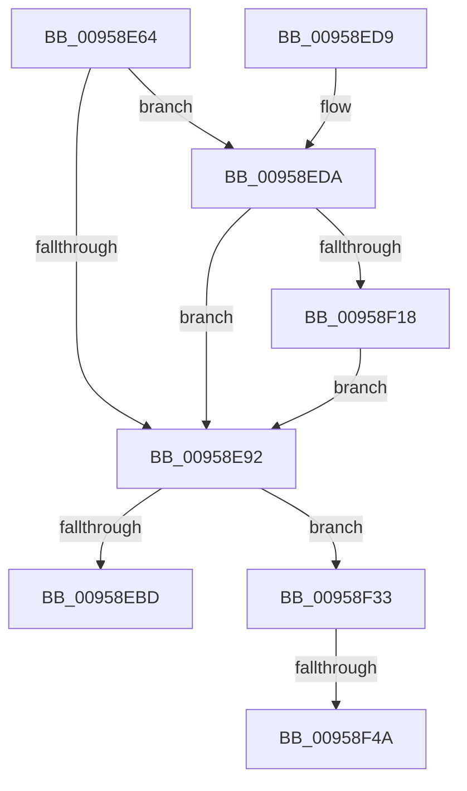

# KsepGetShimCallbacksForDriver

- RVA: `0x00958E64`–`0x00958F68` (길이 `260` bytes)
- VA: `0x0000000140958E64`
- 실행 섹션: `PAGE`
- PDB 이름 있음: `예`; PDB Function 태그: `예`
- unwind 정보 RVA: `0x00092778`
- 디코드: `66`개 명령, `260/260` bytes 표시
- 미해석 바이트: `0` (있으면 어셈블리에 `.byte`로 보존)

> 이 문서는 커널 이미지의 기계어와 PDB 기호를 분석해 생성했습니다. 4번과 5번은 함수 원형과 자료형을 바이너리 사용 방식에서 추정한 C 해석이며 원본 소스 복구 결과는 아닙니다.

## 1. Dependencies

- 직접 호출 지점: **3**; 고유 호출 대상: **3**
- 직접 호출자로 확인된 함수: **1**
- RIP 상대 이미지 참조: **6**

### Outgoing calls
- `0x00958E9D` → [memset](../../text/6C/memset_function_006C6C40.md) (function, `0x006C6C40`)
- `0x00958EB4` → [KsepIsModuleShimmed](KsepIsModuleShimmed_function_00958F70.md) (function, `0x00958F70`)
- `0x00958F29` → [RtlAssert](../../text/5E/RtlAssert_function_005E75E0.md) (function, `0x005E75E0`)

### Direct callers
- [KseShimDriverIoCallbacks](KseShimDriverIoCallbacks_function_00958BFC.md) at `0x00958CE8`

### Static image references
- `0x00958E7C` → RVA `0x00000000` (`image boundary/outside`; read)
- `0x00958EAD` → RVA `0x00E66C80` (`.data`; read)
- `0x00958EDF` → RVA `0x00F101C0` (`.data`; read/write)
- `0x00958F0A` → RVA `0x00E66CE8` (`.data`; read)
- `0x00958F1B` → RVA `0x00B00C70` (` ?? ::NNGAKEGL::`string'`; read)
- `0x00958F22` → RVA `0x00B00CA0` (` ?? ::NNGAKEGL::`string'`; read)

## 2. Other-region calls and transfers

- 다른 실행 섹션으로 향하는 call: **2**
  - `0x00958E9D` → [memset](../../text/6C/memset_function_006C6C40.md) (`PAGE` → `.text`)
  - `0x00958F29` → [RtlAssert](../../text/5E/RtlAssert_function_005E75E0.md) (`PAGE` → `.text`)
- call이 아닌 외부 분기/꼬리 이동: **2**
  - `0x00958F44` → [sub_00B27116 + 0x2FD](../B2/Unknown_function_00B27116.md) (`tail-transfer`)
  - `0x00958F63` → [sub_00B27116](../B2/Unknown_function_00B27116.md) (`tail-transfer`)

## 3. Assembly (complete function range)

```asm
00958E64  48 8B C4                        mov rax, rsp
00958E67  48 89 58 08                     mov qword ptr [rax + 8], rbx
00958E6B  55                              push rbp
00958E6C  56                              push rsi
00958E6D  57                              push rdi
00958E6E  41 54                           push r12
00958E70  41 55                           push r13
00958E72  41 56                           push r14
00958E74  41 57                           push r15
00958E76  48 83 EC 30                     sub rsp, 0x30
00958E7A  33 DB                           xor ebx, ebx
00958E7C  4C 8D 35 7D 71 6A FF            lea r14, [rip - 0x958e83]
00958E83  48 89 58 20                     mov qword ptr [rax + 0x20], rbx
00958E87  48 8B F2                        mov rsi, rdx
00958E8A  48 8B F9                        mov rdi, rcx
00958E8D  48 85 D2                        test rdx, rdx
00958E90  74 48                           je 0x140958eda
00958E92  33 D2                           xor edx, edx
00958E94  41 B8 00 01 00 00               mov r8d, 0x100
00958E9A  48 8B CE                        mov rcx, rsi
00958E9D  E8 9E DD D6 FF                  call 0x1406c6c40
00958EA2  4C 8D 84 24 88 00 00 00         lea r8, [rsp + 0x88]
00958EAA  48 8B D7                        mov rdx, rdi
00958EAD  48 8D 0D CC DD 50 00            lea rcx, [rip + 0x50ddcc]
00958EB4  E8 B7 00 00 00                  call 0x140958f70
00958EB9  85 C0                           test eax, eax
00958EBB  75 76                           jne 0x140958f33
00958EBD  BB 25 02 00 C0                  mov ebx, 0xc0000225
00958EC2  8B C3                           mov eax, ebx
00958EC4  48 8B 5C 24 70                  mov rbx, qword ptr [rsp + 0x70]
00958EC9  48 83 C4 30                     add rsp, 0x30
00958ECD  41 5F                           pop r15
00958ECF  41 5E                           pop r14
00958ED1  41 5D                           pop r13
00958ED3  41 5C                           pop r12
00958ED5  5F                              pop rdi
00958ED6  5E                              pop rsi
00958ED7  5D                              pop rbp
00958ED8  C3                              ret
00958ED9  CC                              int3
00958EDA  B8 01 00 00 00                  mov eax, 1
00958EDF  F0 0F C1 05 D9 72 5B 00         lock xadd dword ptr [rip + 0x5b72d9], eax
00958EE7  FF C0                           inc eax
00958EE9  41 B8 FF 02 00 00               mov r8d, 0x2ff
00958EEF  83 E0 3F                        and eax, 0x3f
00958EF2  41 C7 84 C6 E4 01 F1 00 20 04 00 C0  mov dword ptr [r14 + rax*8 + 0xf101e4], 0xc0000420
00958EFE  41 C7 84 C6 E0 01 F1 00 FF 02 07 00  mov dword ptr [r14 + rax*8 + 0xf101e0], 0x702ff
00958F0A  8B 05 D8 DD 50 00               mov eax, dword ptr [rip + 0x50ddd8]
00958F10  A8 04                           test al, 4
00958F12  0F 84 7A FF FF FF               je 0x140958e92
00958F18  45 33 C9                        xor r9d, r9d
00958F1B  48 8D 15 4E 7D 1A 00            lea rdx, [rip + 0x1a7d4e]
00958F22  48 8D 0D 77 7D 1A 00            lea rcx, [rip + 0x1a7d77]
00958F29  E8 B2 E6 C8 FF                  call 0x1405e75e0
00958F2E  E9 5F FF FF FF                  jmp 0x140958e92
00958F33  48 8B 84 24 88 00 00 00         mov rax, qword ptr [rsp + 0x88]
00958F3B  8B 48 18                        mov ecx, dword ptr [rax + 0x18]
00958F3E  48 8B 50 20                     mov rdx, qword ptr [rax + 0x20]
00958F42  85 C9                           test ecx, ecx
00958F44  0F 84 C9 E4 1C 00               je 0x140b27413
00958F4A  4C 8D 62 48                     lea r12, [rdx + 0x48]
00958F4E  48 89 8C 24 80 00 00 00         mov qword ptr [rsp + 0x80], rcx
00958F56  4C 89 64 24 20                  mov qword ptr [rsp + 0x20], r12
00958F5B  8B D1                           mov edx, ecx
00958F5D  41 B8 34 03 00 00               mov r8d, 0x334
00958F63  E9 AE E1 1C 00                  jmp 0x140b27116
```

## 4. C-style interpretation (structured pseudocode)

```c
__int64 __fastcall KsepGetShimCallbacksForDriver(__int64 a1, __int64 a2, __int64 a3, int a4)
{
    __int64 result;
    __int64 v_rbx;
    __int64 v_rsp;
    unsigned __int64 v_stack_p20;
    unsigned __int64 v_stack_p8;
    unsigned __int64 v_stack_p80;
    unsigned __int64 v_stack_p88;

    *(unsigned __int64 *)(v_rsp + 8) = v_rbx;
    v_rsp = (v_rsp) - (48);
    v_rbx = 0;
    *(unsigned __int64 *)(v_rsp + 32) = 0;
    if (a2 == 0) goto loc_00958EDA;
loc_00958E92:
    a2 = 0;
    result = memset(0, a2, 256, a4);
    result = KsepIsModuleShimmed(v_rip + 5299660, a1, v_stack_p20, a4);
    if ((unsigned int)(result) != 0) goto loc_00958F33;
    v_rsp = (v_rsp) + (48);
    return (unsigned int)((unsigned int)((unsigned int)(0xC0000225ULL)));
loc_00958EDA:
    result = (unsigned int)((1) + 1);
    result = (unsigned int)((result) & (63));
    *(unsigned int *)(v_rip - 9801347 + result * 8 + 15794660) = 0xC0000420ULL;
    *(unsigned int *)(v_rip - 9801347 + result * 8 + 15794656) = 0x702FFULL;
    if ((((unsigned __int8)((unsigned int)(*(unsigned int *)(v_rip + 5299672)))) & (4)) == 0) goto loc_00958E92;
    a4 = 0;
    result = RtlAssert(v_rip + 1736055, v_rip + 1736014, 767, a4);
    goto loc_00958E92;
loc_00958F33:
    v_stack_p80 = (unsigned int)(*(unsigned int *)(v_stack_p88 + 24));
    v_stack_p20 = *(unsigned __int64 *)(v_stack_p88 + 32) + 72;
}
```

## 5. (Beta) C Style

```c
int64_t KsepGetShimCallbacksForDriver(int64_t Arg1, int64_t Arg2, int64_t Arg3, int32_t Arg4)
{
    int64_t result;
    int64_t local_rbx;
    int64_t local_rsp;
    uint64_t v_stack_p20;
    uint64_t v_stack_p8;
    uint64_t v_stack_p80;
    uint64_t v_stack_p88;

    *(uint64_t *)(local_rsp + 0x8) = local_rbx;
    local_rsp = (local_rsp) - (48);
    local_rbx = 0;
    *(uint64_t *)(local_rsp + 0x20) = 0;
    if (Arg2 == 0) goto loc_00958EDA;
loc_00958E92:
    Arg2 = 0;
    result = memset(0, Arg2, 256, Arg4);
    result = KsepIsModuleShimmed(v_rip + 5299660, Arg1, v_stack_p20, Arg4);
    if ((uint32_t)(result) != 0) goto loc_00958F33;
    local_rsp = (local_rsp) + (48);
    return (uint32_t)((uint32_t)((uint32_t)(0xC0000225ULL)));
loc_00958EDA:
    result = (uint32_t)((1) + 1);
    result = (uint32_t)((result) & (63));
    *(uint32_t *)(v_rip - 0x958E83 + result * 8 + 0xF101E4) = 0xC0000420ULL;
    *(uint32_t *)(v_rip - 0x958E83 + result * 8 + 0xF101E0) = 0x702FFULL;
    if ((((uint8_t)((uint32_t)(*(uint32_t *)(v_rip + 0x50DDD8)))) & (4)) == 0) goto loc_00958E92;
    Arg4 = 0;
    result = RtlAssert(v_rip + 1736055, v_rip + 1736014, 767, Arg4);
    goto loc_00958E92;
loc_00958F33:
    v_stack_p80 = (uint32_t)(*(uint32_t *)(v_stack_p88 + 0x18));
    v_stack_p20 = *(uint64_t *)(v_stack_p88 + 0x20) + 72;
}
```

## 6. Execution-region graph

[열기: 2D/3D 그래프와 함수 탐색 컨트롤 패널](../../../control-panel.html?section=page&rva=0x00958E64&view=graph)

- 2D 그래프는 위에서 아래로 흐르고, 3D 그래프는 빈 공간을 드래그해 회전합니다. Shift+드래그는 이동, 휠은 확대·축소, 함수 노드 선택은 대상 보고서 이동입니다.

### Static fallback


