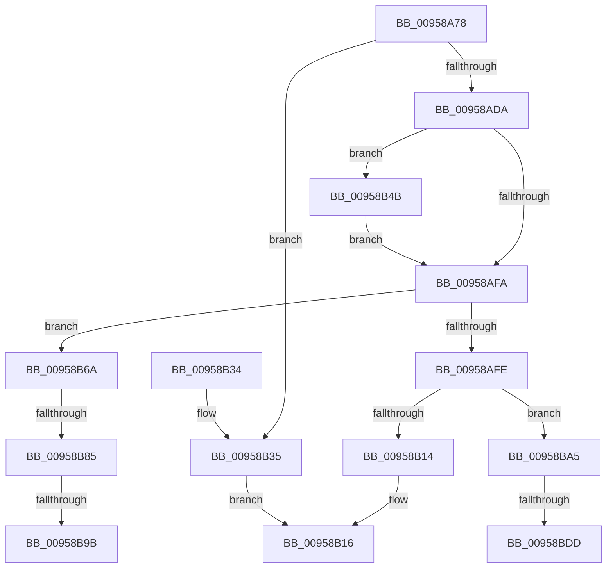

# KsepGetShimsForDriver

- RVA: `0x00958A78`–`0x00958BF5` (길이 `381` bytes)
- VA: `0x0000000140958A78`
- 실행 섹션: `PAGE`
- PDB 이름 있음: `예`; PDB Function 태그: `예`
- unwind 정보 RVA: `0x00092718`
- 디코드: `107`개 명령, `381/381` bytes 표시
- 미해석 바이트: `0` (있으면 어셈블리에 `.byte`로 보존)

> 이 문서는 커널 이미지의 기계어와 PDB 기호를 분석해 생성했습니다. 4번과 5번은 함수 원형과 자료형을 바이너리 사용 방식에서 추정한 C 해석이며 원본 소스 복구 결과는 아닙니다.

## 1. Dependencies

- 직접 호출 지점: **6**; 고유 호출 대상: **6**
- 직접 호출자로 확인된 함수: **1**
- RIP 상대 이미지 참조: **5**

### Outgoing calls
- `0x00958AD1` → [KsepIsModuleShimmed](KsepIsModuleShimmed_function_00958F70.md) (function, `0x00958F70`)
- `0x00958AEC` → [KsepEngineGetShimsFromRegistry](KsepEngineGetShimsFromRegistry_function_0095907C.md) (function, `0x0095907C`)
- `0x00958B61` → [KsepDbGetDriverShims](KsepDbGetDriverShims_function_00959A58.md) (function, `0x00959A58`)
- `0x00958B76` → [KsepResolveApplicableShimsForDriver](../74/KsepResolveApplicableShimsForDriver_function_0074A168.md) (function, `0x0074A168`)
- `0x00958B8A` → [KsepPoolAllocatePaged](../../text/4A/KsepPoolAllocatePaged_function_004A9EFC.md) (function, `0x004A9EFC`)
- `0x00958BEA` → [KsepDebugPrint](../../text/4D/KsepDebugPrint_function_004DCFF0.md) (function, `0x004DCFF0`)

### Direct callers
- [KseDriverLoadImage](KseDriverLoadImage_function_009588C0.md) at `0x00958963`

### Static image references
- `0x00958AC3` → RVA `0x00E66C80` (`.data`; read)
- `0x00958BAA` → RVA `0x00F105E0` (`.data`; read/write)
- `0x00958BB4` → RVA `0x00F103E0` (`.data`; read)
- `0x00958BCF` → RVA `0x00E66CE8` (`.data`; read)
- `0x00958BE1` → RVA `0x00B00B90` (` ?? ::NNGAKEGL::`string'`; read)

## 2. Other-region calls and transfers

- 다른 실행 섹션으로 향하는 call: **2**
  - `0x00958B8A` → [KsepPoolAllocatePaged](../../text/4A/KsepPoolAllocatePaged_function_004A9EFC.md) (`PAGE` → `.text`)
  - `0x00958BEA` → [KsepDebugPrint](../../text/4D/KsepDebugPrint_function_004DCFF0.md) (`PAGE` → `.text`)
- call이 아닌 외부 분기/꼬리 이동: **5**
  - `0x00958B7F` → [sub_00B26EEC + 0xC3](../B2/Unknown_function_00B26EEC.md) (`tail-transfer`)
  - `0x00958B95` → [sub_00B26EEC](../B2/Unknown_function_00B26EEC.md) (`tail-transfer`)
  - `0x00958BA0` → [sub_00B26EEC + 0xC3](../B2/Unknown_function_00B26EEC.md) (`tail-transfer`)
  - `0x00958BD7` → [sub_00B26EEC + 0xE4](../B2/Unknown_function_00B26EEC.md) (`tail-transfer`)
  - `0x00958BF0` → [sub_00B26EEC + 0xE4](../B2/Unknown_function_00B26EEC.md) (`tail-transfer`)

## 3. Assembly (complete function range)

```asm
00958A78  48 8B C4                        mov rax, rsp
00958A7B  48 89 58 08                     mov qword ptr [rax + 8], rbx
00958A7F  48 89 70 10                     mov qword ptr [rax + 0x10], rsi
00958A83  48 89 78 20                     mov qword ptr [rax + 0x20], rdi
00958A87  4C 89 40 18                     mov qword ptr [rax + 0x18], r8
00958A8B  55                              push rbp
00958A8C  41 54                           push r12
00958A8E  41 55                           push r13
00958A90  41 56                           push r14
00958A92  41 57                           push r15
00958A94  48 8B EC                        mov rbp, rsp
00958A97  48 83 EC 50                     sub rsp, 0x50
00958A9B  4C 8B 7D 50                     mov r15, qword ptr [rbp + 0x50]
00958A9F  33 FF                           xor edi, edi
00958AA1  4C 8B 65 58                     mov r12, qword ptr [rbp + 0x58]
00958AA5  49 8B D8                        mov rbx, r8
00958AA8  4C 8B F2                        mov r14, rdx
00958AAB  48 89 7D E8                     mov qword ptr [rbp - 0x18], rdi
00958AAF  4C 8B E9                        mov r13, rcx
00958AB2  89 7D E0                        mov dword ptr [rbp - 0x20], edi
00958AB5  4C 8D 45 F0                     lea r8, [rbp - 0x10]
00958AB9  49 89 3F                        mov qword ptr [r15], rdi
00958ABC  48 8B D3                        mov rdx, rbx
00958ABF  41 89 3C 24                     mov dword ptr [r12], edi
00958AC3  48 8D 0D B6 E1 50 00            lea rcx, [rip + 0x50e1b6]
00958ACA  48 89 7D F0                     mov qword ptr [rbp - 0x10], rdi
00958ACE  41 8B F1                        mov esi, r9d
00958AD1  E8 9A 04 00 00                  call 0x140958f70
00958AD6  85 C0                           test eax, eax
00958AD8  75 5B                           jne 0x140958b35
00958ADA  4C 8D 4D E0                     lea r9, [rbp - 0x20]
00958ADE  49 8B D5                        mov rdx, r13
00958AE1  4C 8D 45 E8                     lea r8, [rbp - 0x18]
00958AE5  48 8D 0D 94 E1 50 00            lea rcx, [rip + 0x50e194]
00958AEC  E8 8B 05 00 00                  call 0x14095907c
00958AF1  8B F8                           mov edi, eax
00958AF3  3D 25 02 00 C0                  cmp eax, 0xc0000225
00958AF8  74 51                           je 0x140958b4b
00958AFA  85 FF                           test edi, edi
00958AFC  79 6C                           jns 0x140958b6a
00958AFE  48 8B 45 E8                     mov rax, qword ptr [rbp - 0x18]
00958B02  49 89 07                        mov qword ptr [r15], rax
00958B05  8B 45 E0                        mov eax, dword ptr [rbp - 0x20]
00958B08  41 89 04 24                     mov dword ptr [r12], eax
00958B0C  85 FF                           test edi, edi
00958B0E  0F 89 91 00 00 00               jns 0x140958ba5
00958B14  8B C7                           mov eax, edi
00958B16  4C 8D 5C 24 50                  lea r11, [rsp + 0x50]
00958B1B  49 8B 5B 30                     mov rbx, qword ptr [r11 + 0x30]
00958B1F  49 8B 73 38                     mov rsi, qword ptr [r11 + 0x38]
00958B23  49 8B 7B 48                     mov rdi, qword ptr [r11 + 0x48]
00958B27  49 8B E3                        mov rsp, r11
00958B2A  41 5F                           pop r15
00958B2C  41 5E                           pop r14
00958B2E  41 5D                           pop r13
00958B30  41 5C                           pop r12
00958B32  5D                              pop rbp
00958B33  C3                              ret
00958B34  CC                              int3
00958B35  48 8B 4D F0                     mov rcx, qword ptr [rbp - 0x10]
00958B39  48 8B 41 20                     mov rax, qword ptr [rcx + 0x20]
00958B3D  49 89 07                        mov qword ptr [r15], rax
00958B40  8B 41 18                        mov eax, dword ptr [rcx + 0x18]
00958B43  41 89 04 24                     mov dword ptr [r12], eax
00958B47  33 C0                           xor eax, eax
00958B49  EB CB                           jmp 0x140958b16
00958B4B  48 8D 45 E0                     lea rax, [rbp - 0x20]
00958B4F  44 8B C6                        mov r8d, esi
00958B52  4C 8D 4D E8                     lea r9, [rbp - 0x18]
00958B56  48 89 44 24 20                  mov qword ptr [rsp + 0x20], rax
00958B5B  48 8B D3                        mov rdx, rbx
00958B5E  49 8B CE                        mov rcx, r14
00958B61  E8 F2 0E 00 00                  call 0x140959a58
00958B66  8B F8                           mov edi, eax
00958B68  EB 90                           jmp 0x140958afa
00958B6A  4C 8B 75 E8                     mov r14, qword ptr [rbp - 0x18]
00958B6E  8B 5D E0                        mov ebx, dword ptr [rbp - 0x20]
00958B71  49 8B CE                        mov rcx, r14
00958B74  8B D3                           mov edx, ebx
00958B76  E8 ED 15 DF FF                  call 0x14074a168
00958B7B  8B F8                           mov edi, eax
00958B7D  85 C0                           test eax, eax
00958B7F  0F 88 2A E4 1C 00               js 0x140b26faf
00958B85  B9 28 00 00 00                  mov ecx, 0x28
00958B8A  E8 6D 13 B5 FF                  call 0x1404a9efc
00958B8F  48 8B F0                        mov rsi, rax
00958B92  48 85 C0                        test rax, rax
00958B95  0F 85 51 E3 1C 00               jne 0x140b26eec
00958B9B  BF 9A 00 00 C0                  mov edi, 0xc000009a
00958BA0  E9 0A E4 1C 00                  jmp 0x140b26faf
00958BA5  B8 01 00 00 00                  mov eax, 1
00958BAA  F0 0F C1 05 2E 7A 5B 00         lock xadd dword ptr [rip + 0x5b7a2e], eax
00958BB2  FF C0                           inc eax
00958BB4  48 8D 15 25 78 5B 00            lea rdx, [rip + 0x5b7825]
00958BBB  83 E0 3F                        and eax, 0x3f
00958BBE  BB 07 00 00 00                  mov ebx, 7
00958BC3  83 64 C2 04 00                  and dword ptr [rdx + rax*8 + 4], 0
00958BC8  C7 04 C2 64 01 07 00            mov dword ptr [rdx + rax*8], 0x70164
00958BCF  8B 05 13 E1 50 00               mov eax, dword ptr [rip + 0x50e113]
00958BD5  A8 01                           test al, 1
00958BD7  0F 84 F3 E3 1C 00               je 0x140b26fd0
00958BDD  4D 8B 45 08                     mov r8, qword ptr [r13 + 8]
00958BE1  48 8D 15 A8 7F 1A 00            lea rdx, [rip + 0x1a7fa8]
00958BE8  8B CB                           mov ecx, ebx
00958BEA  E8 01 44 B8 FF                  call 0x1404dcff0
00958BEF  90                              nop
00958BF0  E9 DB E3 1C 00                  jmp 0x140b26fd0
```

## 4. C-style interpretation (structured pseudocode)

```c
__int64 __fastcall KsepGetShimsForDriver(__int64 a1, __int64 a2, __int64 a3, int a4, __int64 a5, __int64 a6)
{
    __int64 result;
    __int64 v_rdi;
    __int64 v_rsp;
    unsigned __int64 v_stack_m28;
    unsigned __int64 v_stack_m30;
    unsigned __int64 v_stack_m38;
    unsigned __int64 v_stack_m40;
    unsigned int v_stack_m48;

    *(unsigned __int64 *)(v_rsp + 8) = v_rbx;
    *(unsigned __int64 *)(v_rsp + 16) = v_rsi;
    *(unsigned __int64 *)(v_rsp + 32) = v_rdi;
    *(unsigned __int64 *)(v_rsp + 24) = a3;
    v_rsp = (v_rsp) - (80);
    v_rdi = 0;
    v_stack_m40 = 0;
    v_stack_m48 = 0;
    *(unsigned __int64 *)(a5) = 0;
    *(unsigned int *)(a6) = 0;
    v_stack_m38 = 0;
    result = KsepIsModuleShimmed(v_rip + 5300662, a3, v_stack_m38, a4);
    if ((unsigned int)(result) != 0) goto loc_00958B35;
    result = KsepEngineGetShimsFromRegistry(v_rip + 5300628, a1, v_stack_m40, v_stack_m48);
    if (((unsigned int)(result)) == 0xC0000225ULL) goto loc_00958B4B;
loc_00958AFA:
    if (!sign_flag) goto loc_00958B6A;
    *(unsigned __int64 *)(a5) = v_stack_m40;
    *(unsigned int *)(a6) = (unsigned int)((unsigned int)(v_stack_m48));
    if (!sign_flag) goto loc_00958BA5;
loc_00958B16:
    return (unsigned int)((unsigned int)((unsigned int)((unsigned int)(result))));
loc_00958B35:
    *(unsigned __int64 *)(a5) = *(unsigned __int64 *)(v_stack_m38 + 32);
    *(unsigned int *)(a6) = (unsigned int)((unsigned int)(*(unsigned int *)(v_stack_m38 + 24)));
    result = 0;
    goto loc_00958B16;
loc_00958B4B:
    v_stack_m30 = v_stack_m48;
    result = KsepDbGetDriverShims(a2, *(unsigned __int64 *)(v_stack_m28 + 48), (unsigned int)((unsigned int)(*(unsigned __int64 *)(v_stack_m28 + 56))), v_stack_m40);
    goto loc_00958AFA;
loc_00958B6A:
    result = KsepResolveApplicableShimsForDriver(v_stack_m40, (unsigned int)((unsigned int)((unsigned int)(v_stack_m48))), (unsigned int)((unsigned int)(*(unsigned __int64 *)(v_stack_m28 + 56))), v_stack_m40);
    result = KsepPoolAllocatePaged(40, (unsigned int)((unsigned int)((unsigned int)(v_stack_m48))), (unsigned int)((unsigned int)(*(unsigned __int64 *)(v_stack_m28 + 56))), v_stack_m40);
loc_00958BA5:
    result = (unsigned int)((1) + 1);
    result = (unsigned int)((result) & (63));
    *(unsigned int *)(v_rip + 5994533 + result * 8) = 0x70164ULL;
    result = KsepDebugPrint(7, v_rip + 1736616, *(unsigned __int64 *)(a1 + 8), v_stack_m40);
}
```

## 5. (Beta) C Style

```c
int64_t KsepGetShimsForDriver(void *Arg1, int64_t Arg2, int64_t Arg3, int32_t Arg4, void *Arg5, void *Arg6)
{
    uint8_t *arg1 = (uint8_t *)Arg1;
    uint8_t *arg5 = (uint8_t *)Arg5;
    uint8_t *arg6 = (uint8_t *)Arg6;

    int64_t result;
    int64_t local_rdi;
    int64_t local_rsp;
    uint64_t v_stack_m28;
    uint64_t v_stack_m30;
    uint64_t v_stack_m38;
    uint64_t v_stack_m40;
    uint32_t v_stack_m48;

    *(uint64_t *)(local_rsp + 0x8) = local_rbx;
    *(uint64_t *)(local_rsp + 0x10) = local_rsi;
    *(uint64_t *)(local_rsp + 0x20) = local_rdi;
    *(uint64_t *)(local_rsp + 0x18) = Arg3;
    local_rsp = (local_rsp) - (80);
    local_rdi = 0;
    v_stack_m40 = 0;
    v_stack_m48 = 0;
    *(uint64_t *)(arg5) = 0;
    *(uint32_t *)(arg6) = 0;
    v_stack_m38 = 0;
    result = KsepIsModuleShimmed(v_rip + 5300662, Arg3, v_stack_m38, Arg4);
    if ((uint32_t)(result) != 0) goto loc_00958B35;
    result = KsepEngineGetShimsFromRegistry(v_rip + 5300628, Arg1, v_stack_m40, v_stack_m48);
    if (((uint32_t)(result)) == 0xC0000225ULL) goto loc_00958B4B;
loc_00958AFA:
    if (!sign_flag) goto loc_00958B6A;
    *(uint64_t *)(arg5) = v_stack_m40;
    *(uint32_t *)(arg6) = (uint32_t)((uint32_t)(v_stack_m48));
    if (!sign_flag) goto loc_00958BA5;
loc_00958B16:
    return (uint32_t)((uint32_t)((uint32_t)((uint32_t)(result))));
loc_00958B35:
    *(uint64_t *)(arg5) = *(uint64_t *)(v_stack_m38 + 0x20);
    *(uint32_t *)(arg6) = (uint32_t)((uint32_t)(*(uint32_t *)(v_stack_m38 + 0x18)));
    result = 0;
    goto loc_00958B16;
loc_00958B4B:
    v_stack_m30 = v_stack_m48;
    result = KsepDbGetDriverShims(Arg2, *(uint64_t *)(v_stack_m28 + 0x30), (uint32_t)((uint32_t)(*(uint64_t *)(v_stack_m28 + 0x38))), v_stack_m40);
    goto loc_00958AFA;
loc_00958B6A:
    result = KsepResolveApplicableShimsForDriver(v_stack_m40, (uint32_t)((uint32_t)((uint32_t)(v_stack_m48))), (uint32_t)((uint32_t)(*(uint64_t *)(v_stack_m28 + 0x38))), v_stack_m40);
    result = KsepPoolAllocatePaged(40, (uint32_t)((uint32_t)((uint32_t)(v_stack_m48))), (uint32_t)((uint32_t)(*(uint64_t *)(v_stack_m28 + 0x38))), v_stack_m40);
loc_00958BA5:
    result = (uint32_t)((1) + 1);
    result = (uint32_t)((result) & (63));
    *(uint32_t *)(v_rip + 0x5B7825 + result * 8) = 0x70164ULL;
    result = KsepDebugPrint(7, v_rip + 1736616, *(uint64_t *)(arg1 + 0x8), v_stack_m40);
}
```

### 관측된 메모리 오프셋

구조체 형식이 확인되지 않은 접근은 인자 기준의 오프셋으로만 기록했습니다.

| 기준 인자 | 오프셋 표현 | 폭 (bit) | 접근 |
|---|---:|---:|---|
| `Arg1` | `+ 0x8` | `64` | `R` |
| `Arg5` | `+ 0x0` | `64` | `W` |
| `Arg6` | `+ 0x0` | `32` | `W` |

## 6. Execution-region graph

[열기: 2D/3D 그래프와 함수 탐색 컨트롤 패널](../../../control-panel.html?section=page&rva=0x00958A78&view=graph)

- 2D 그래프는 위에서 아래로 흐르고, 3D 그래프는 빈 공간을 드래그해 회전합니다. Shift+드래그는 이동, 휠은 확대·축소, 함수 노드 선택은 대상 보고서 이동입니다.

### Static fallback


