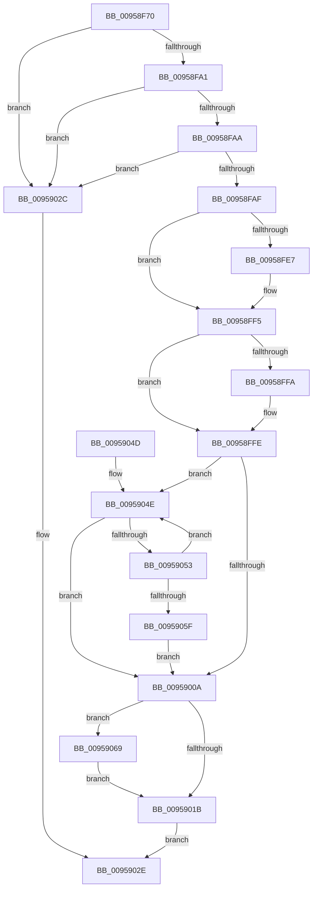

# KsepIsModuleShimmed

- RVA: `0x00958F70`–`0x00959073` (길이 `259` bytes)
- VA: `0x0000000140958F70`
- 실행 섹션: `PAGE`
- PDB 이름 있음: `예`; PDB Function 태그: `아니요`
- unwind 정보 RVA: `0x00065924`
- 디코드: `75`개 명령, `259/259` bytes 표시
- 미해석 바이트: `0` (있으면 어셈블리에 `.byte`로 보존)

> 이 문서는 커널 이미지의 기계어와 PDB 기호를 분석해 생성했습니다. 4번과 5번은 함수 원형과 자료형을 바이너리 사용 방식에서 추정한 C 해석이며 원본 소스 복구 결과는 아닙니다.

## 1. Dependencies

- 직접 호출 지점: **5**; 고유 호출 대상: **5**
- 직접 호출자로 확인된 함수: **3**
- RIP 상대 이미지 참조: **2**

### Outgoing calls
- `0x00958FD6` → [KeAbPreAcquire](../../text/21/KeAbPreAcquire_function_00210230.md) (function, `0x00210230`)
- `0x00958FF0` → [ExfAcquirePushLockExclusiveEx](../../text/20/ExfAcquirePushLockExclusiveEx_function_0020FC90.md) (function, `0x0020FC90`)
- `0x0095901E` → [KeAbPostRelease](../../text/2E/KeAbPostRelease_function_002E1600.md) (function, `0x002E1600`)
- `0x00959023` → [KeLeaveCriticalRegion](../../text/25/KeLeaveCriticalRegion_function_0025D8B0.md) (function, `0x0025D8B0`)
- `0x0095906C` → [ExfTryToWakePushLock](../../text/26/ExfTryToWakePushLock_function_00265DD0.md) (function, `0x00265DD0`)

### Direct callers
- [KseDriverUnloadImage](KseDriverUnloadImage_function_009587E0.md) at `0x00958843`
- [KsepGetShimsForDriver](KsepGetShimsForDriver_function_00958A78.md) at `0x00958AD1`
- [KsepGetShimCallbacksForDriver](KsepGetShimCallbacksForDriver_function_00958E64.md) at `0x00958EB4`

### Static image references
- `0x00958FB8` → RVA `0x00E66CB0` (`.data`; read)
- `0x0095900A` → RVA `0x00E66CB0` (`.data`; read/write)

## 2. Other-region calls and transfers

- 다른 실행 섹션으로 향하는 call: **5**
  - `0x00958FD6` → [KeAbPreAcquire](../../text/21/KeAbPreAcquire_function_00210230.md) (`PAGE` → `.text`)
  - `0x00958FF0` → [ExfAcquirePushLockExclusiveEx](../../text/20/ExfAcquirePushLockExclusiveEx_function_0020FC90.md) (`PAGE` → `.text`)
  - `0x0095901E` → [KeAbPostRelease](../../text/2E/KeAbPostRelease_function_002E1600.md) (`PAGE` → `.text`)
  - `0x00959023` → [KeLeaveCriticalRegion](../../text/25/KeLeaveCriticalRegion_function_0025D8B0.md) (`PAGE` → `.text`)
  - `0x0095906C` → [ExfTryToWakePushLock](../../text/26/ExfTryToWakePushLock_function_00265DD0.md) (`PAGE` → `.text`)
- 별도 외부 분기/꼬리 이동을 확인하지 못했습니다.

## 3. Assembly (complete function range)

```asm
00958F70  48 8B C4                        mov rax, rsp
00958F73  48 89 58 08                     mov qword ptr [rax + 8], rbx
00958F77  48 89 68 10                     mov qword ptr [rax + 0x10], rbp
00958F7B  48 89 70 18                     mov qword ptr [rax + 0x18], rsi
00958F7F  48 89 78 20                     mov qword ptr [rax + 0x20], rdi
00958F83  41 54                           push r12
00958F85  41 56                           push r14
00958F87  41 57                           push r15
00958F89  48 83 EC 20                     sub rsp, 0x20
00958F8D  33 FF                           xor edi, edi
00958F8F  4D 8B F0                        mov r14, r8
00958F92  4C 8B FA                        mov r15, rdx
00958F95  48 8B E9                        mov rbp, rcx
00958F98  48 85 D2                        test rdx, rdx
00958F9B  0F 84 8B 00 00 00               je 0x14095902c
00958FA1  48 85 C9                        test rcx, rcx
00958FA4  0F 84 82 00 00 00               je 0x14095902c
00958FAA  4D 85 C0                        test r8, r8
00958FAD  74 7D                           je 0x14095902c
00958FAF  65 48 8B 04 25 88 01 00 00      mov rax, qword ptr gs:[0x188]
00958FB8  4C 8D 25 F1 DC 50 00            lea r12, [rip + 0x50dcf1]
00958FBF  49 89 38                        mov qword ptr [r8], rdi
00958FC2  48 83 CB FF                     or rbx, 0xffffffffffffffff
00958FC6  45 33 C0                        xor r8d, r8d
00958FC9  33 D2                           xor edx, edx
00958FCB  49 8B CC                        mov rcx, r12
00958FCE  66 01 98 E4 01 00 00            add word ptr [rax + 0x1e4], bx
00958FD5  90                              nop
00958FD6  E8 55 72 8B FF                  call 0x140210230
00958FDB  F0 49 0F BA 2C 24 00            lock bts qword ptr [r12], 0
00958FE2  48 8B F0                        mov rsi, rax
00958FE5  73 0E                           jae 0x140958ff5
00958FE7  4D 8B C4                        mov r8, r12
00958FEA  48 8B D0                        mov rdx, rax
00958FED  49 8B CC                        mov rcx, r12
00958FF0  E8 9B 6C 8B FF                  call 0x14020fc90
00958FF5  48 85 F6                        test rsi, rsi
00958FF8  74 04                           je 0x140958ffe
00958FFA  C6 46 0A 01                     mov byte ptr [rsi + 0xa], 1
00958FFE  48 8D 4D 20                     lea rcx, [rbp + 0x20]
00959002  48 8B 01                        mov rax, qword ptr [rcx]
00959005  48 3B C1                        cmp rax, rcx
00959008  75 44                           jne 0x14095904e
0095900A  F0 48 0F C1 1D 9D DC 50 00      lock xadd qword ptr [rip + 0x50dc9d], rbx
00959013  80 E3 06                        and bl, 6
00959016  80 FB 02                        cmp bl, 2
00959019  74 4E                           je 0x140959069
0095901B  49 8B CC                        mov rcx, r12
0095901E  E8 DD 85 98 FF                  call 0x1402e1600
00959023  E8 88 48 90 FF                  call 0x14025d8b0
00959028  8B C7                           mov eax, edi
0095902A  EB 02                           jmp 0x14095902e
0095902C  33 C0                           xor eax, eax
0095902E  48 8B 5C 24 40                  mov rbx, qword ptr [rsp + 0x40]
00959033  48 8B 6C 24 48                  mov rbp, qword ptr [rsp + 0x48]
00959038  48 8B 74 24 50                  mov rsi, qword ptr [rsp + 0x50]
0095903D  48 8B 7C 24 58                  mov rdi, qword ptr [rsp + 0x58]
00959042  48 83 C4 20                     add rsp, 0x20
00959046  41 5F                           pop r15
00959048  41 5E                           pop r14
0095904A  41 5C                           pop r12
0095904C  C3                              ret
0095904D  CC                              int3
0095904E  48 3B C1                        cmp rax, rcx
00959051  74 B7                           je 0x14095900a
00959053  48 8B D0                        mov rdx, rax
00959056  48 8B 00                        mov rax, qword ptr [rax]
00959059  4C 39 7A 10                     cmp qword ptr [rdx + 0x10], r15
0095905D  75 EF                           jne 0x14095904e
0095905F  49 89 16                        mov qword ptr [r14], rdx
00959062  BF 01 00 00 00                  mov edi, 1
00959067  EB A1                           jmp 0x14095900a
00959069  49 8B CC                        mov rcx, r12
0095906C  E8 5F CD 90 FF                  call 0x140265dd0
00959071  EB A8                           jmp 0x14095901b
```

## 4. C-style interpretation (structured pseudocode)

```c
__int64 __fastcall KsepIsModuleShimmed(__int64 a1, __int64 a2, __int64 a3)
{
    __int64 result;
    __int64 v_rbx;
    __int64 v_rdi;
    __int64 v_rsp;
    unsigned __int64 v_stack_p10;
    unsigned __int64 v_stack_p18;
    unsigned __int64 v_stack_p20;
    unsigned __int64 v_stack_p8;

    *(unsigned __int64 *)(v_rsp + 8) = v_rbx;
    *(unsigned __int64 *)(v_rsp + 16) = v_rbp;
    *(unsigned __int64 *)(v_rsp + 24) = v_rsi;
    *(unsigned __int64 *)(v_rsp + 32) = v_rdi;
    v_rsp = (v_rsp) - (32);
    v_rdi = 0;
    if (a2 == 0) goto loc_0095902C;
    if (a1 == 0) goto loc_0095902C;
    if (a3 == 0) goto loc_0095902C;
    *(unsigned __int64 *)(a3) = 0;
    v_rbx = (v_rbx) | (-1);
    a3 = 0;
    a2 = 0;
    result = KeAbPreAcquire(v_rip + 5299441, a2, a3, a4);
    if (!(condition_is_above_or_equal)) {
        a3 = v_rip + 5299441;
        a2 = result;
        a1 = v_rip + 5299441;
        result = ExfAcquirePushLockExclusiveEx(a1, a2, a3, a4);
    }
    if (result != 0) {
        *(unsigned __int8 *)(result + 10) = 1;
    }
    if ((*(unsigned __int64 *)(a1 + 32)) != (a1 + 32)) goto loc_0095904E;
loc_0095900A:
    v_rbx = (unsigned __int8)((v_rbx) & (6));
    if (((unsigned __int8)(v_rbx)) == 2) goto loc_00959069;
loc_0095901B:
    result = KeAbPostRelease(v_rip + 5299441, a2, a3, a4);
    result = KeLeaveCriticalRegion(v_rip + 5299441, a2, a3, a4);
    goto loc_0095902E;
loc_0095902C:
    result = 0;
loc_0095902E:
    v_rsp = (v_rsp) + (32);
    return result;
loc_0095904E:
    if (0 == (v_rip + 5299441)) goto loc_0095900A;
    if ((*(unsigned __int64 *)(0 + 16)) != a2) goto loc_0095904E;
    *(unsigned __int64 *)(a3) = 0;
    goto loc_0095900A;
loc_00959069:
    result = ExfTryToWakePushLock(v_rip + 5299441, 0, a3, a4);
    goto loc_0095901B;
}
```

## 5. (Beta) C Style

```c
int64_t KsepIsModuleShimmed(void *Arg1, int64_t Arg2, void *Arg3)
{
    uint8_t *arg1 = (uint8_t *)Arg1;
    uint8_t *arg3 = (uint8_t *)Arg3;

    int64_t result;
    int64_t local_rbx;
    int64_t local_rdi;
    int64_t local_rsp;
    uint64_t v_stack_p10;
    uint64_t v_stack_p18;
    uint64_t v_stack_p20;
    uint64_t v_stack_p8;

    *(uint64_t *)(local_rsp + 0x8) = local_rbx;
    *(uint64_t *)(local_rsp + 0x10) = local_rbp;
    *(uint64_t *)(local_rsp + 0x18) = local_rsi;
    *(uint64_t *)(local_rsp + 0x20) = local_rdi;
    local_rsp = (local_rsp) - (32);
    local_rdi = 0;
    if (Arg2 == 0) goto loc_0095902C;
    if (Arg1 == NULL) goto loc_0095902C;
    if (Arg3 == NULL) goto loc_0095902C;
    *(uint64_t *)(arg3) = 0;
    local_rbx = (local_rbx) | (-1);
    Arg3 = 0;
    Arg2 = 0;
    result = KeAbPreAcquire(v_rip + 5299441, Arg2, Arg3, a4);
    if (!(condition_is_above_or_equal)) {
        Arg3 = v_rip + 5299441;
        Arg2 = result;
        Arg1 = v_rip + 5299441;
        result = ExfAcquirePushLockExclusiveEx(Arg1, Arg2, Arg3, a4);
    }
    if (result != 0) {
        *(uint8_t *)(result + 0xA) = 1;
    }
    if ((*(uint64_t *)(arg1 + 0x20)) != (Arg1 + 32)) goto loc_0095904E;
loc_0095900A:
    local_rbx = (uint8_t)((local_rbx) & (6));
    if (((uint8_t)(local_rbx)) == 2) goto loc_00959069;
loc_0095901B:
    result = KeAbPostRelease(v_rip + 5299441, Arg2, Arg3, a4);
    result = KeLeaveCriticalRegion(v_rip + 5299441, Arg2, Arg3, a4);
    goto loc_0095902E;
loc_0095902C:
    result = 0;
loc_0095902E:
    local_rsp = (local_rsp) + (32);
    return result;
loc_0095904E:
    if (0 == (v_rip + 5299441)) goto loc_0095900A;
    if ((*(uint64_t *)(0 + 0x10)) != Arg2) goto loc_0095904E;
    *(uint64_t *)(arg3) = 0;
    goto loc_0095900A;
loc_00959069:
    result = ExfTryToWakePushLock(v_rip + 5299441, 0, Arg3, a4);
    goto loc_0095901B;
}
```

### 관측된 메모리 오프셋

구조체 형식이 확인되지 않은 접근은 인자 기준의 오프셋으로만 기록했습니다.

| 기준 인자 | 오프셋 표현 | 폭 (bit) | 접근 |
|---|---:|---:|---|
| `Arg1` | `+ 0x0` | `64` | `R` |
| `Arg1` | `+ 0x20` | `64` | `R` |
| `Arg3` | `+ 0x0` | `64` | `W` |

## 6. Execution-region graph

[열기: 2D/3D 그래프와 함수 탐색 컨트롤 패널](../../../control-panel.html?section=page&rva=0x00958F70&view=graph)

- 2D 그래프는 위에서 아래로 흐르고, 3D 그래프는 빈 공간을 드래그해 회전합니다. Shift+드래그는 이동, 휠은 확대·축소, 함수 노드 선택은 대상 보고서 이동입니다.

### Static fallback


