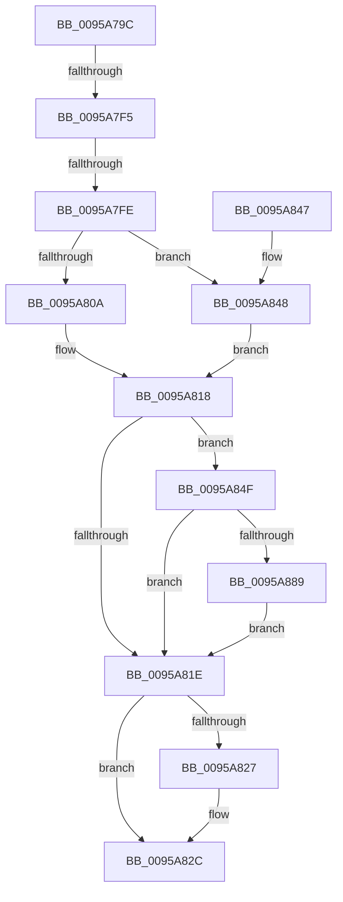

# KsepRegistryOpenKey

- RVA: `0x0095A79C`–`0x0095A899` (길이 `253` bytes)
- VA: `0x000000014095A79C`
- 실행 섹션: `PAGE`
- PDB 이름 있음: `예`; PDB Function 태그: `예`
- unwind 정보 RVA: `0x000929D0`
- 디코드: `74`개 명령, `253/253` bytes 표시
- 미해석 바이트: `0` (있으면 어셈블리에 `.byte`로 보존)

> 이 문서는 커널 이미지의 기계어와 PDB 기호를 분석해 생성했습니다. 4번과 5번은 함수 원형과 자료형을 바이너리 사용 방식에서 추정한 C 해석이며 원본 소스 복구 결과는 아닙니다.

## 1. Dependencies

- 직접 호출 지점: **4**; 고유 호출 대상: **4**
- 직접 호출자로 확인된 함수: **3**
- RIP 상대 이미지 참조: **2**

### Outgoing calls
- `0x0095A813` → [KsepStringConcatenate](KsepStringConcatenate_function_0095A8A0.md) (function, `0x0095A8A0`)
- `0x0095A827` → [KsepPoolFreePaged](../../text/4B/KsepPoolFreePaged_function_004B0E10.md) (function, `0x004B0E10`)
- `0x0095A848` → [KsepStringDuplicate](KsepStringDuplicate_function_0095B454.md) (function, `0x0095B454`)
- `0x0095A87E` → [ZwOpenKey](../../text/6A/ZwOpenKey_function_006AD310.md) (function, `0x006AD310`)

### Direct callers
- [KsepDbQueryRegistryDeviceDataList](../74/KsepDbQueryRegistryDeviceDataList_function_007490B4.md) at `0x0074911A`
- [KsepMatchInitBiosInfo](../../init/C3/KsepMatchInitBiosInfo_function_00C3BCB0.md) at `0x00C3BD1A`
- [KsepEngineReadFlags](../../init/C3/KsepEngineReadFlags_function_00C3C310.md) at `0x00C3C39E`
- [KsepEngineReadFlags](../../init/C3/KsepEngineReadFlags_function_00C3C310.md) at `0x00C3C475`

### Static image references
- `0x0095A7B8` → RVA `0x00F101E0` (`.data`; read)
- `0x0095A890` → RVA `0x00F10178` (`.data`; read/write)

## 2. Other-region calls and transfers

- 다른 실행 섹션으로 향하는 call: **2**
  - `0x0095A827` → [KsepPoolFreePaged](../../text/4B/KsepPoolFreePaged_function_004B0E10.md) (`PAGE` → `.text`)
  - `0x0095A87E` → [ZwOpenKey](../../text/6A/ZwOpenKey_function_006AD310.md) (`PAGE` → `.text`)
- call이 아닌 외부 분기/꼬리 이동: **2**
  - `0x0095A7EF` → [sub_00B27692](../B2/Unknown_function_00B27692.md) (`tail-transfer`)
  - `0x0095A7F8` → [sub_00B27692 + 0x54](../B2/Unknown_function_00B27692.md) (`tail-transfer`)

## 3. Assembly (complete function range)

```asm
0095A79C  48 89 5C 24 10                  mov qword ptr [rsp + 0x10], rbx
0095A7A1  48 89 74 24 18                  mov qword ptr [rsp + 0x18], rsi
0095A7A6  55                              push rbp
0095A7A7  57                              push rdi
0095A7A8  41 54                           push r12
0095A7AA  41 55                           push r13
0095A7AC  41 56                           push r14
0095A7AE  48 8B EC                        mov rbp, rsp
0095A7B1  48 83 EC 60                     sub rsp, 0x60
0095A7B5  45 33 F6                        xor r14d, r14d
0095A7B8  4C 8D 25 21 5A 5B 00            lea r12, [rip + 0x5b5a21]
0095A7BF  33 C0                           xor eax, eax
0095A7C1  4C 89 75 C0                     mov qword ptr [rbp - 0x40], r14
0095A7C5  4C 89 75 C8                     mov qword ptr [rbp - 0x38], r14
0095A7C9  0F 57 C0                        xorps xmm0, xmm0
0095A7CC  48 89 45 F0                     mov qword ptr [rbp - 0x10], rax
0095A7D0  49 8B F0                        mov rsi, r8
0095A7D3  89 45 F8                        mov dword ptr [rbp - 8], eax
0095A7D6  45 8D 6E 04                     lea r13d, [r14 + 4]
0095A7DA  4C 89 75 30                     mov qword ptr [rbp + 0x30], r14
0095A7DE  48 8B FA                        mov rdi, rdx
0095A7E1  48 8B D9                        mov rbx, rcx
0095A7E4  0F 11 45 D0                     movups xmmword ptr [rbp - 0x30], xmm0
0095A7E8  0F 11 45 E0                     movups xmmword ptr [rbp - 0x20], xmm0
0095A7EC  48 85 C9                        test rcx, rcx
0095A7EF  0F 84 9D CE 1C 00               je 0x140b27692
0095A7F5  48 85 F6                        test rsi, rsi
0095A7F8  0F 84 E8 CE 1C 00               je 0x140b276e6
0095A7FE  48 8D 4D C0                     lea rcx, [rbp - 0x40]
0095A802  48 8B D3                        mov rdx, rbx
0095A805  48 85 FF                        test rdi, rdi
0095A808  74 3E                           je 0x14095a848
0095A80A  41 B9 01 00 00 00               mov r9d, 1
0095A810  4C 8B C7                        mov r8, rdi
0095A813  E8 88 00 00 00                  call 0x14095a8a0
0095A818  8B D8                           mov ebx, eax
0095A81A  85 C0                           test eax, eax
0095A81C  79 31                           jns 0x14095a84f
0095A81E  48 8B 4D C8                     mov rcx, qword ptr [rbp - 0x38]
0095A822  48 85 C9                        test rcx, rcx
0095A825  74 05                           je 0x14095a82c
0095A827  E8 E4 65 B5 FF                  call 0x1404b0e10
0095A82C  4C 8D 5C 24 60                  lea r11, [rsp + 0x60]
0095A831  8B C3                           mov eax, ebx
0095A833  49 8B 5B 38                     mov rbx, qword ptr [r11 + 0x38]
0095A837  49 8B 73 40                     mov rsi, qword ptr [r11 + 0x40]
0095A83B  49 8B E3                        mov rsp, r11
0095A83E  41 5E                           pop r14
0095A840  41 5D                           pop r13
0095A842  41 5C                           pop r12
0095A844  5F                              pop rdi
0095A845  5D                              pop rbp
0095A846  C3                              ret
0095A847  CC                              int3
0095A848  E8 07 0C 00 00                  call 0x14095b454
0095A84D  EB C9                           jmp 0x14095a818
0095A84F  48 8D 45 C0                     lea rax, [rbp - 0x40]
0095A853  C7 45 D0 30 00 00 00            mov dword ptr [rbp - 0x30], 0x30
0095A85A  0F 57 C0                        xorps xmm0, xmm0
0095A85D  48 89 45 E0                     mov qword ptr [rbp - 0x20], rax
0095A861  4C 8D 45 D0                     lea r8, [rbp - 0x30]
0095A865  4C 89 75 D8                     mov qword ptr [rbp - 0x28], r14
0095A869  BA 19 00 02 00                  mov edx, 0x20019
0095A86E  C7 45 E8 40 02 00 00            mov dword ptr [rbp - 0x18], 0x240
0095A875  48 8D 4D 30                     lea rcx, [rbp + 0x30]
0095A879  F3 0F 7F 45 F0                  movdqu xmmword ptr [rbp - 0x10], xmm0
0095A87E  E8 8D 2A D5 FF                  call 0x1406ad310
0095A883  8B D8                           mov ebx, eax
0095A885  85 C0                           test eax, eax
0095A887  78 95                           js 0x14095a81e
0095A889  48 8B 45 30                     mov rax, qword ptr [rbp + 0x30]
0095A88D  48 89 06                        mov qword ptr [rsi], rax
0095A890  F0 FF 05 E1 58 5B 00            lock inc dword ptr [rip + 0x5b58e1]
0095A897  EB 85                           jmp 0x14095a81e
```

## 4. C-style interpretation (structured pseudocode)

```c
__int64 __fastcall KsepRegistryOpenKey(__int64 a1, __int64 a2, __int64 a3)
{
    __int64 result;
    __int64 v_r14;
    __int64 v_rsp;
    unsigned __int64 v_stack_m28;
    unsigned int v_stack_m30;
    unsigned __int64 v_stack_m38;
    unsigned int v_stack_m40;
    unsigned __int64 v_stack_m48;
    unsigned __int64 v_stack_m50;
    unsigned __int64 v_stack_m58;
    unsigned __int64 v_stack_m60;
    unsigned __int64 v_stack_m68;
    unsigned __int64 v_stack_p10;
    unsigned __int64 v_stack_p18;
    unsigned __int64 v_stack_p8;

    v_stack_p10 = v_rbx;
    v_stack_p18 = v_rsi;
    v_rsp = (v_rsp) - (96);
    v_r14 = 0;
    result = 0;
    v_stack_m68 = 0;
    v_stack_m60 = 0;
    v_stack_m38 = 0;
    v_stack_m30 = 0;
    v_stack_p8 = 0;
    v_stack_m58 = v_xmm0;
    v_stack_m48 = v_xmm0;
    if (a2 == 0) goto loc_0095A848;
    result = KsepStringConcatenate(v_stack_m68, a1, a2, 1);
loc_0095A818:
    if (!sign_flag) goto loc_0095A84F;
loc_0095A81E:
    if (v_stack_m60 != 0) {
        result = KsepPoolFreePaged(v_stack_m60, a1, a2, 1);
    }
    return (unsigned int)((unsigned int)((unsigned int)((unsigned int)(result))));
loc_0095A848:
    result = KsepStringDuplicate(v_stack_m60, a1, a2, 1);
    goto loc_0095A818;
loc_0095A84F:
    v_stack_m58 = 48;
    v_stack_m48 = v_stack_m68;
    v_stack_m50 = 0;
    v_stack_m40 = 576;
    v_stack_m38 = v_xmm0;
    result = ZwOpenKey(v_stack_p8, (unsigned int)(0x20019ULL), v_stack_m58, 1);
    if (sign_flag) goto loc_0095A81E;
    *(unsigned __int64 *)(*(unsigned __int64 *)(v_stack_m28 + 64)) = v_stack_p8;
    goto loc_0095A81E;
}
```

## 5. (Beta) C Style

```c
int64_t KsepRegistryOpenKey(int64_t Arg1, int64_t Arg2, int64_t Arg3)
{
    int64_t result;
    int64_t local_r14;
    int64_t local_rsp;
    uint64_t v_stack_m28;
    uint32_t v_stack_m30;
    uint64_t v_stack_m38;
    uint32_t v_stack_m40;
    uint64_t v_stack_m48;
    uint64_t v_stack_m50;
    uint64_t v_stack_m58;
    uint64_t v_stack_m60;
    uint64_t v_stack_m68;
    uint64_t v_stack_p10;
    uint64_t v_stack_p18;
    uint64_t v_stack_p8;

    v_stack_p10 = local_rbx;
    v_stack_p18 = local_rsi;
    local_rsp = (local_rsp) - (96);
    local_r14 = 0;
    result = 0;
    v_stack_m68 = 0;
    v_stack_m60 = 0;
    v_stack_m38 = 0;
    v_stack_m30 = 0;
    v_stack_p8 = 0;
    v_stack_m58 = v_xmm0;
    v_stack_m48 = v_xmm0;
    if (Arg2 == 0) goto loc_0095A848;
    result = KsepStringConcatenate(v_stack_m68, Arg1, Arg2, 1);
loc_0095A818:
    if (!sign_flag) goto loc_0095A84F;
loc_0095A81E:
    if (v_stack_m60 != 0) {
        result = KsepPoolFreePaged(v_stack_m60, Arg1, Arg2, 1);
    }
    return (uint32_t)((uint32_t)((uint32_t)((uint32_t)(result))));
loc_0095A848:
    result = KsepStringDuplicate(v_stack_m60, Arg1, Arg2, 1);
    goto loc_0095A818;
loc_0095A84F:
    v_stack_m58 = 48;
    v_stack_m48 = v_stack_m68;
    v_stack_m50 = 0;
    v_stack_m40 = 576;
    v_stack_m38 = v_xmm0;
    result = ZwOpenKey(v_stack_p8, (uint32_t)(0x20019ULL), v_stack_m58, 1);
    if (sign_flag) goto loc_0095A81E;
    *(uint64_t *)(*(uint64_t *)(v_stack_m28 + 0x40)) = v_stack_p8;
    goto loc_0095A81E;
}
```

## 6. Execution-region graph

[열기: 2D/3D 그래프와 함수 탐색 컨트롤 패널](../../../control-panel.html?section=page&rva=0x0095A79C&view=graph)

- 2D 그래프는 위에서 아래로 흐르고, 3D 그래프는 빈 공간을 드래그해 회전합니다. Shift+드래그는 이동, 휠은 확대·축소, 함수 노드 선택은 대상 보고서 이동입니다.

### Static fallback


