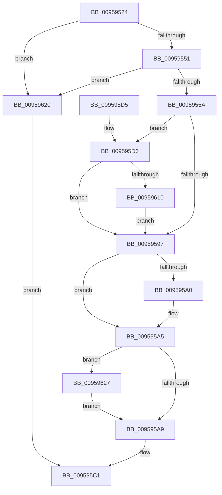

# KsepRegistryQueryDriverShims

- RVA: `0x00959524`–`0x00959654` (길이 `304` bytes)
- VA: `0x0000000140959524`
- 실행 섹션: `PAGE`
- PDB 이름 있음: `예`; PDB Function 태그: `아니요`
- unwind 정보 RVA: `0x00092808`
- 디코드: `83`개 명령, `304/304` bytes 표시
- 미해석 바이트: `0` (있으면 어셈블리에 `.byte`로 보존)

> 이 문서는 커널 이미지의 기계어와 PDB 기호를 분석해 생성했습니다. 4번과 5번은 함수 원형과 자료형을 바이너리 사용 방식에서 추정한 C 해석이며 원본 소스 복구 결과는 아닙니다.

## 1. Dependencies

- 직접 호출 지점: **5**; 고유 호출 대상: **5**
- 직접 호출자로 확인된 함수: **1**
- RIP 상대 이미지 참조: **3**

### Outgoing calls
- `0x0095958C` → [KsepStringConcatenate](KsepStringConcatenate_function_0095A8A0.md) (function, `0x0095A8A0`)
- `0x009595A0` → [KsepPoolFreePaged](../../text/4B/KsepPoolFreePaged_function_004B0E10.md) (function, `0x004B0E10`)
- `0x009595BA` → [KsepRegistryCloseKey](KsepRegistryCloseKey_function_00959500.md) (function, `0x00959500`)
- `0x00959605` → [ZwOpenKey](../../text/6A/ZwOpenKey_function_006AD310.md) (function, `0x006AD310`)
- `0x00959648` → [KsepRegistryQuerySZ](../74/KsepRegistryQuerySZ_function_0074B58C.md) (function, `0x0074B58C`)

### Direct callers
- [KsepEngineGetShimsFromRegistry](KsepEngineGetShimsFromRegistry_function_0095907C.md) at `0x009590D6`

### Static image references
- `0x0095957D` → RVA `0x00B011F0` (` ?? ::NNGAKEGL::`string'`; read)
- `0x00959614` → RVA `0x00F10178` (`.data`; read/write)
- `0x0095962C` → RVA `0x00B011B0` (` ?? ::NNGAKEGL::`string'`; read)

## 2. Other-region calls and transfers

- 다른 실행 섹션으로 향하는 call: **2**
  - `0x009595A0` → [KsepPoolFreePaged](../../text/4B/KsepPoolFreePaged_function_004B0E10.md) (`PAGE` → `.text`)
  - `0x00959605` → [ZwOpenKey](../../text/6A/ZwOpenKey_function_006AD310.md) (`PAGE` → `.text`)
- 별도 외부 분기/꼬리 이동을 확인하지 못했습니다.

## 3. Assembly (complete function range)

```asm
00959524  48 89 5C 24 10                  mov qword ptr [rsp + 0x10], rbx
00959529  4C 89 44 24 18                  mov qword ptr [rsp + 0x18], r8
0095952E  55                              push rbp
0095952F  56                              push rsi
00959530  57                              push rdi
00959531  41 56                           push r14
00959533  41 57                           push r15
00959535  48 8B EC                        mov rbp, rsp
00959538  48 83 EC 70                     sub rsp, 0x70
0095953C  45 33 FF                        xor r15d, r15d
0095953F  4D 8B F1                        mov r14, r9
00959542  48 8B F2                        mov rsi, rdx
00959545  41 8B FF                        mov edi, r15d
00959548  48 85 C9                        test rcx, rcx
0095954B  0F 84 CF 00 00 00               je 0x140959620
00959551  48 85 D2                        test rdx, rdx
00959554  0F 84 C6 00 00 00               je 0x140959620
0095955A  33 C0                           xor eax, eax
0095955C  4C 89 7D C0                     mov qword ptr [rbp - 0x40], r15
00959560  0F 57 C0                        xorps xmm0, xmm0
00959563  48 89 45 F0                     mov qword ptr [rbp - 0x10], rax
00959567  4C 8B C1                        mov r8, rcx
0095956A  89 45 F8                        mov dword ptr [rbp - 8], eax
0095956D  48 8D 4D C0                     lea rcx, [rbp - 0x40]
00959571  4C 89 7D C8                     mov qword ptr [rbp - 0x38], r15
00959575  45 8D 4F 01                     lea r9d, [r15 + 1]
00959579  4C 89 7D 40                     mov qword ptr [rbp + 0x40], r15
0095957D  48 8D 15 6C 7C 1A 00            lea rdx, [rip + 0x1a7c6c]
00959584  0F 11 45 D0                     movups xmmword ptr [rbp - 0x30], xmm0
00959588  0F 11 45 E0                     movups xmmword ptr [rbp - 0x20], xmm0
0095958C  E8 0F 13 00 00                  call 0x14095a8a0
00959591  8B D8                           mov ebx, eax
00959593  85 C0                           test eax, eax
00959595  79 3F                           jns 0x1409595d6
00959597  48 8B 4D C8                     mov rcx, qword ptr [rbp - 0x38]
0095959B  48 85 C9                        test rcx, rcx
0095959E  74 05                           je 0x1409595a5
009595A0  E8 6B 78 B5 FF                  call 0x1404b0e10
009595A5  85 DB                           test ebx, ebx
009595A7  79 7E                           jns 0x140959627
009595A9  81 FB 34 00 00 C0               cmp ebx, 0xc0000034
009595AF  B8 25 02 00 C0                  mov eax, 0xc0000225
009595B4  48 8B CF                        mov rcx, rdi
009595B7  0F 44 D8                        cmove ebx, eax
009595BA  E8 41 FF FF FF                  call 0x140959500
009595BF  8B C3                           mov eax, ebx
009595C1  48 8B 9C 24 A8 00 00 00         mov rbx, qword ptr [rsp + 0xa8]
009595C9  48 83 C4 70                     add rsp, 0x70
009595CD  41 5F                           pop r15
009595CF  41 5E                           pop r14
009595D1  5F                              pop rdi
009595D2  5E                              pop rsi
009595D3  5D                              pop rbp
009595D4  C3                              ret
009595D5  CC                              int3
009595D6  48 8D 45 C0                     lea rax, [rbp - 0x40]
009595DA  C7 45 D0 30 00 00 00            mov dword ptr [rbp - 0x30], 0x30
009595E1  0F 57 C0                        xorps xmm0, xmm0
009595E4  48 89 45 E0                     mov qword ptr [rbp - 0x20], rax
009595E8  4C 8D 45 D0                     lea r8, [rbp - 0x30]
009595EC  4C 89 7D D8                     mov qword ptr [rbp - 0x28], r15
009595F0  BA 19 00 02 00                  mov edx, 0x20019
009595F5  C7 45 E8 40 02 00 00            mov dword ptr [rbp - 0x18], 0x240
009595FC  48 8D 4D 40                     lea rcx, [rbp + 0x40]
00959600  F3 0F 7F 45 F0                  movdqu xmmword ptr [rbp - 0x10], xmm0
00959605  E8 06 3D D5 FF                  call 0x1406ad310
0095960A  8B D8                           mov ebx, eax
0095960C  85 C0                           test eax, eax
0095960E  78 87                           js 0x140959597
00959610  48 8B 7D 40                     mov rdi, qword ptr [rbp + 0x40]
00959614  F0 FF 05 5D 6B 5B 00            lock inc dword ptr [rip + 0x5b6b5d]
0095961B  E9 77 FF FF FF                  jmp 0x140959597
00959620  B8 0D 00 00 C0                  mov eax, 0xc000000d
00959625  EB 9A                           jmp 0x1409595c1
00959627  4C 89 74 24 28                  mov qword ptr [rsp + 0x28], r14
0095962C  48 8D 15 7D 7B 1A 00            lea rdx, [rip + 0x1a7b7d]
00959633  4C 8B CE                        mov r9, rsi
00959636  48 C7 44 24 20 00 08 00 00      mov qword ptr [rsp + 0x20], 0x800
0095963F  41 B8 07 00 00 00               mov r8d, 7
00959645  48 8B CF                        mov rcx, rdi
00959648  E8 3F 1F DF FF                  call 0x14074b58c
0095964D  8B D8                           mov ebx, eax
0095964F  E9 55 FF FF FF                  jmp 0x1409595a9
```

## 4. C-style interpretation (structured pseudocode)

```c
__int64 __fastcall KsepRegistryQueryDriverShims(__int64 a1, __int64 a2, __int64 a3, __int64 a4)
{
    __int64 result;
    __int64 v_r15;
    __int64 v_rbx;
    __int64 v_rsp;
    unsigned int v_stack_m30;
    unsigned __int64 v_stack_m38;
    unsigned int v_stack_m40;
    unsigned __int64 v_stack_m48;
    unsigned __int64 v_stack_m50;
    unsigned __int64 v_stack_m58;
    unsigned __int64 v_stack_m60;
    unsigned __int64 v_stack_m68;
    unsigned __int64 v_stack_p10;
    unsigned __int64 v_stack_p18;
    unsigned __int64 v_stack_p20;
    unsigned __int64 v_stack_p28;

    v_stack_p10 = v_rbx;
    v_stack_p18 = a3;
    v_rsp = (v_rsp) - (112);
    v_r15 = 0;
    if (a1 == 0) goto loc_00959620;
    if (a2 == 0) goto loc_00959620;
    result = 0;
    v_stack_m68 = 0;
    v_stack_m38 = 0;
    v_stack_m30 = 0;
    v_stack_m60 = 0;
    v_stack_p18 = 0;
    v_stack_m58 = v_xmm0;
    v_stack_m48 = v_xmm0;
    result = KsepStringConcatenate(v_stack_m68, v_rip + 1735788, a1, v_r15 + 1);
    if (!sign_flag) goto loc_009595D6;
loc_00959597:
    if (v_stack_m60 != 0) {
        result = KsepPoolFreePaged(v_stack_m60, v_rip + 1735788, a1, v_r15 + 1);
    }
    if (!sign_flag) goto loc_00959627;
loc_009595A9:
    v_rbx = (unsigned int)((unsigned int)(result));
    if (((unsigned int)((unsigned int)((unsigned int)(result)))) == 0xC0000034ULL) { v_rbx = (unsigned int)((unsigned int)(0xC0000225ULL)); }
    result = KsepRegistryCloseKey(0, v_rip + 1735788, a1, v_r15 + 1);
loc_009595C1:
    v_rsp = (v_rsp) + (112);
    return (unsigned int)((unsigned int)(v_rbx));
loc_009595D6:
    v_stack_m58 = 48;
    v_stack_m48 = v_stack_m68;
    v_stack_m50 = 0;
    v_stack_m40 = 576;
    v_stack_m38 = v_xmm0;
    result = ZwOpenKey(v_stack_p18, (unsigned int)(0x20019ULL), v_stack_m58, v_r15 + 1);
    if (sign_flag) goto loc_00959597;
    goto loc_00959597;
loc_00959620:
    goto loc_009595C1;
loc_00959627:
    v_stack_p28 = a4;
    v_stack_p20 = 0x800ULL;
    result = KsepRegistryQuerySZ(v_stack_p18, v_rip + 1735549, 7, a2);
    goto loc_009595A9;
}
```

## 5. (Beta) C Style

```c
int64_t KsepRegistryQueryDriverShims(int64_t Arg1, int64_t Arg2, int64_t Arg3, int64_t Arg4)
{
    int64_t result;
    int64_t local_r15;
    int64_t local_rbx;
    int64_t local_rsp;
    uint32_t v_stack_m30;
    uint64_t v_stack_m38;
    uint32_t v_stack_m40;
    uint64_t v_stack_m48;
    uint64_t v_stack_m50;
    uint64_t v_stack_m58;
    uint64_t v_stack_m60;
    uint64_t v_stack_m68;
    uint64_t v_stack_p10;
    uint64_t v_stack_p18;
    uint64_t v_stack_p20;
    uint64_t v_stack_p28;

    v_stack_p10 = local_rbx;
    v_stack_p18 = Arg3;
    local_rsp = (local_rsp) - (112);
    local_r15 = 0;
    if (Arg1 == 0) goto loc_00959620;
    if (Arg2 == 0) goto loc_00959620;
    result = 0;
    v_stack_m68 = 0;
    v_stack_m38 = 0;
    v_stack_m30 = 0;
    v_stack_m60 = 0;
    v_stack_p18 = 0;
    v_stack_m58 = v_xmm0;
    v_stack_m48 = v_xmm0;
    result = KsepStringConcatenate(v_stack_m68, v_rip + 1735788, Arg1, local_r15 + 1);
    if (!sign_flag) goto loc_009595D6;
loc_00959597:
    if (v_stack_m60 != 0) {
        result = KsepPoolFreePaged(v_stack_m60, v_rip + 1735788, Arg1, local_r15 + 1);
    }
    if (!sign_flag) goto loc_00959627;
loc_009595A9:
    local_rbx = (uint32_t)((uint32_t)(result));
    if (((uint32_t)((uint32_t)((uint32_t)(result)))) == 0xC0000034ULL) { local_rbx = (uint32_t)((uint32_t)(0xC0000225ULL)); }
    result = KsepRegistryCloseKey(0, v_rip + 1735788, Arg1, local_r15 + 1);
loc_009595C1:
    local_rsp = (local_rsp) + (112);
    return (uint32_t)((uint32_t)(local_rbx));
loc_009595D6:
    v_stack_m58 = 48;
    v_stack_m48 = v_stack_m68;
    v_stack_m50 = 0;
    v_stack_m40 = 576;
    v_stack_m38 = v_xmm0;
    result = ZwOpenKey(v_stack_p18, (uint32_t)(0x20019ULL), v_stack_m58, local_r15 + 1);
    if (sign_flag) goto loc_00959597;
    goto loc_00959597;
loc_00959620:
    goto loc_009595C1;
loc_00959627:
    v_stack_p28 = Arg4;
    v_stack_p20 = 0x800ULL;
    result = KsepRegistryQuerySZ(v_stack_p18, v_rip + 1735549, 7, Arg2);
    goto loc_009595A9;
}
```

## 6. Execution-region graph

[열기: 2D/3D 그래프와 함수 탐색 컨트롤 패널](../../../control-panel.html?section=page&rva=0x00959524&view=graph)

- 2D 그래프는 위에서 아래로 흐르고, 3D 그래프는 빈 공간을 드래그해 회전합니다. Shift+드래그는 이동, 휠은 확대·축소, 함수 노드 선택은 대상 보고서 이동입니다.

### Static fallback


