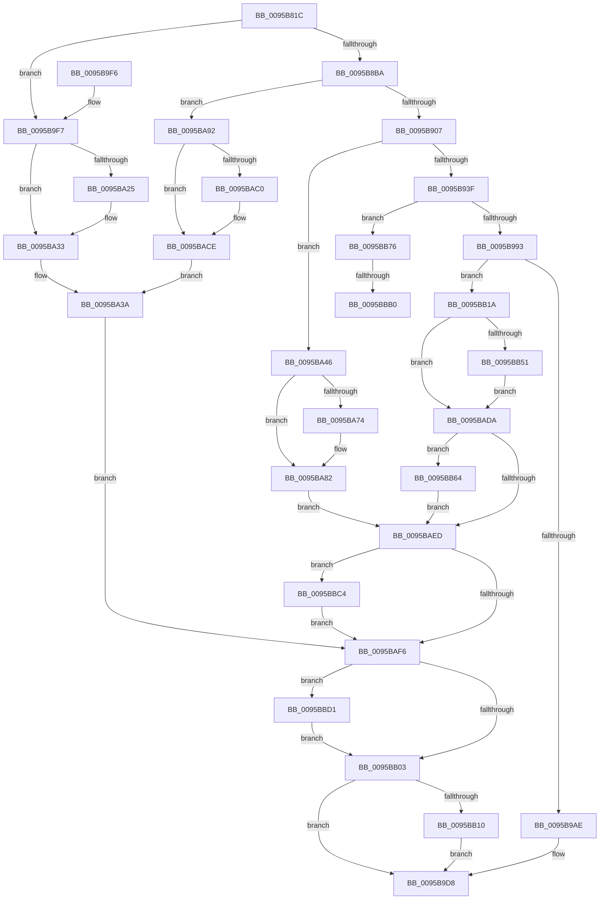

# KsepSdbMapToMemory

- RVA: `0x0095B81C`–`0x0095BBDB` (길이 `959` bytes)
- VA: `0x000000014095B81C`
- 실행 섹션: `PAGE`
- PDB 이름 있음: `예`; PDB Function 태그: `예`
- unwind 정보 RVA: `0x00092BC8`
- 디코드: `227`개 명령, `959/959` bytes 표시
- 미해석 바이트: `0` (있으면 어셈블리에 `.byte`로 보존)

> 이 문서는 커널 이미지의 기계어와 PDB 기호를 분석해 생성했습니다. 4번과 5번은 함수 원형과 자료형을 바이너리 사용 방식에서 추정한 C 해석이며 원본 소스 복구 결과는 아닙니다.

## 1. Dependencies

- 직접 호출 지점: **22**; 고유 호출 대상: **15**
- 직접 호출자로 확인된 함수: **1**
- RIP 상대 이미지 참조: **9**

### Outgoing calls
- `0x0095B862` → [RtlInitUnicodeString](../../text/42/RtlInitUnicodeString_function_0042A780.md) (function, `0x0042A780`)
- `0x0095B8AB` → [ZwOpenFile](../../text/6A/ZwOpenFile_function_006AD730.md) (function, `0x006AD730`)
- `0x0095B8F8` → [ZwCreateSection](../../text/6A/ZwCreateSection_function_006ADA10.md) (function, `0x006ADA10`)
- `0x0095B92C` → [ObReferenceObjectByHandle](../86/ObReferenceObjectByHandle_function_00868DB0.md) (function, `0x00868DB0`)
- `0x0095B94A` → [MiSectionControlArea](../../text/29/MiSectionControlArea_function_00294CB0.md) (function, `0x00294CB0`)
- `0x0095B955` → [MiCheckPurgeAndUpMapCount](../../text/41/MiCheckPurgeAndUpMapCount_function_004186B0.md) (function, `0x004186B0`)
- `0x0095B984` → [MiInsertInSystemSpace](../../text/3B/MiInsertInSystemSpace_function_003B2F5C.md) (function, `0x003B2F5C`)
- `0x0095B99D` → [SdbInitDatabaseInMemory](SdbInitDatabaseInMemory_function_0095BC5C.md) (function, `0x0095BC5C`)
- `0x0095B9D0` → [SdbGetDatabaseEdition](SdbGetDatabaseEdition_function_0095BBE4.md) (function, `0x0095BBE4`)
- `0x0095BA2E` → [KsepDebugPrint](../../text/4D/KsepDebugPrint_function_004DCFF0.md) (function, `0x004DCFF0`)
- `0x0095BA3C` → [KsepLogError](../../text/49/KsepLogError_function_00499A98.md) (function, `0x00499A98`)
- `0x0095BA7D` → [KsepDebugPrint](../../text/4D/KsepDebugPrint_function_004DCFF0.md) (function, `0x004DCFF0`)
- `0x0095BA8B` → [KsepLogError](../../text/49/KsepLogError_function_00499A98.md) (function, `0x00499A98`)
- `0x0095BAC9` → [KsepDebugPrint](../../text/4D/KsepDebugPrint_function_004DCFF0.md) (function, `0x004DCFF0`)
- `0x0095BAE3` → [KsepLogError](../../text/49/KsepLogError_function_00499A98.md) (function, `0x00499A98`)
- `0x0095BB10` → [ZwClose](../../text/6A/ZwClose_function_006AD2B0.md) (function, `0x006AD2B0`)
- `0x0095BB5A` → [KsepDebugPrint](../../text/4D/KsepDebugPrint_function_004DCFF0.md) (function, `0x004DCFF0`)
- `0x0095BB6C` → [MiRemoveFromSystemSpace](../../text/29/MiRemoveFromSystemSpace_function_002962FC.md) (function, `0x002962FC`)
- `0x0095BB79` → [MiDereferenceControlArea](../../text/47/MiDereferenceControlArea_function_00479A20.md) (function, `0x00479A20`)
- `0x0095BBB9` → [KsepDebugPrint](../../text/4D/KsepDebugPrint_function_004DCFF0.md) (function, `0x004DCFF0`)
- `0x0095BBC7` → [ObfDereferenceObject](../../text/2F/ObfDereferenceObject_function_002F9350.md) (function, `0x002F9350`)
- `0x0095BBD1` → [ZwClose](../../text/6A/ZwClose_function_006AD2B0.md) (function, `0x006AD2B0`)

### Direct callers
- [KseShimDatabaseOpen](KseShimDatabaseOpen_function_0095AD7C.md) at `0x0095AE0D`
- [KseShimDatabaseOpen](KseShimDatabaseOpen_function_0095AD7C.md) at `0x0095AE90`

### Static image references
- `0x0095B907` → RVA `0x00FC6BD8` (`ALMOSTRO`; read)
- `0x0095B9FC` → RVA `0x00F101C0` (`.data`; read/write)
- `0x0095BA06` → RVA `0x00F101E0` (`.data`; read)
- `0x0095BA14` → RVA `0x00E66CE8` (`.data`; read)
- `0x0095BA25` → RVA `0x00B00F40` (` ?? ::NNGAKEGL::`string'`; read)
- `0x0095BA74` → RVA `0x00B01080` (` ?? ::NNGAKEGL::`string'`; read)
- `0x0095BAC0` → RVA `0x00B01060` (` ?? ::NNGAKEGL::`string'`; read)
- `0x0095BADA` → RVA `0x00B01030` (` ?? ::NNGAKEGL::`string'`; read)
- `0x0095BBB0` → RVA `0x00B01000` (` ?? ::NNGAKEGL::`string'`; read)

## 2. Other-region calls and transfers

- 다른 실행 섹션으로 향하는 call: **19**
  - `0x0095B862` → [RtlInitUnicodeString](../../text/42/RtlInitUnicodeString_function_0042A780.md) (`PAGE` → `.text`)
  - `0x0095B8AB` → [ZwOpenFile](../../text/6A/ZwOpenFile_function_006AD730.md) (`PAGE` → `.text`)
  - `0x0095B8F8` → [ZwCreateSection](../../text/6A/ZwCreateSection_function_006ADA10.md) (`PAGE` → `.text`)
  - `0x0095B94A` → [MiSectionControlArea](../../text/29/MiSectionControlArea_function_00294CB0.md) (`PAGE` → `.text`)
  - `0x0095B955` → [MiCheckPurgeAndUpMapCount](../../text/41/MiCheckPurgeAndUpMapCount_function_004186B0.md) (`PAGE` → `.text`)
  - `0x0095B984` → [MiInsertInSystemSpace](../../text/3B/MiInsertInSystemSpace_function_003B2F5C.md) (`PAGE` → `.text`)
  - `0x0095BA2E` → [KsepDebugPrint](../../text/4D/KsepDebugPrint_function_004DCFF0.md) (`PAGE` → `.text`)
  - `0x0095BA3C` → [KsepLogError](../../text/49/KsepLogError_function_00499A98.md) (`PAGE` → `.text`)
  - `0x0095BA7D` → [KsepDebugPrint](../../text/4D/KsepDebugPrint_function_004DCFF0.md) (`PAGE` → `.text`)
  - `0x0095BA8B` → [KsepLogError](../../text/49/KsepLogError_function_00499A98.md) (`PAGE` → `.text`)
  - `0x0095BAC9` → [KsepDebugPrint](../../text/4D/KsepDebugPrint_function_004DCFF0.md) (`PAGE` → `.text`)
  - `0x0095BAE3` → [KsepLogError](../../text/49/KsepLogError_function_00499A98.md) (`PAGE` → `.text`)
  - `0x0095BB10` → [ZwClose](../../text/6A/ZwClose_function_006AD2B0.md) (`PAGE` → `.text`)
  - `0x0095BB5A` → [KsepDebugPrint](../../text/4D/KsepDebugPrint_function_004DCFF0.md) (`PAGE` → `.text`)
  - `0x0095BB6C` → [MiRemoveFromSystemSpace](../../text/29/MiRemoveFromSystemSpace_function_002962FC.md) (`PAGE` → `.text`)
  - `0x0095BB79` → [MiDereferenceControlArea](../../text/47/MiDereferenceControlArea_function_00479A20.md) (`PAGE` → `.text`)
  - `0x0095BBB9` → [KsepDebugPrint](../../text/4D/KsepDebugPrint_function_004DCFF0.md) (`PAGE` → `.text`)
  - `0x0095BBC7` → [ObfDereferenceObject](../../text/2F/ObfDereferenceObject_function_002F9350.md) (`PAGE` → `.text`)
  - `0x0095BBD1` → [ZwClose](../../text/6A/ZwClose_function_006AD2B0.md) (`PAGE` → `.text`)
- call이 아닌 외부 분기/꼬리 이동: **2**
  - `0x0095BBAA` → [sub_00B2794E](../B2/Unknown_function_00B2794E.md) (`tail-transfer`)
  - `0x0095BBBF` → [sub_00B2794E](../B2/Unknown_function_00B2794E.md) (`tail-transfer`)

## 3. Assembly (complete function range)

```asm
0095B81C  48 89 5C 24 08                  mov qword ptr [rsp + 8], rbx
0095B821  48 89 74 24 10                  mov qword ptr [rsp + 0x10], rsi
0095B826  55                              push rbp
0095B827  57                              push rdi
0095B828  41 54                           push r12
0095B82A  41 56                           push r14
0095B82C  41 57                           push r15
0095B82E  48 8D 6C 24 C9                  lea rbp, [rsp - 0x37]
0095B833  48 81 EC B0 00 00 00            sub rsp, 0xb0
0095B83A  45 33 E4                        xor r12d, r12d
0095B83D  0F 57 C0                        xorps xmm0, xmm0
0095B840  48 8B FA                        mov rdi, rdx
0095B843  44 89 65 03                     mov dword ptr [rbp + 3], r12d
0095B847  48 8B D1                        mov rdx, rcx
0095B84A  44 89 65 1B                     mov dword ptr [rbp + 0x1b], r12d
0095B84E  48 8D 4D DF                     lea rcx, [rbp - 0x21]
0095B852  4C 89 65 C7                     mov qword ptr [rbp - 0x39], r12
0095B856  0F 11 45 DF                     movups xmmword ptr [rbp - 0x21], xmm0
0095B85A  4C 89 65 7F                     mov qword ptr [rbp + 0x7f], r12
0095B85E  0F 11 45 EF                     movups xmmword ptr [rbp - 0x11], xmm0
0095B862  E8 19 EF AC FF                  call 0x14042a780
0095B867  48 8D 45 DF                     lea rax, [rbp - 0x21]
0095B86B  44 89 64 24 28                  mov dword ptr [rsp + 0x28], r12d
0095B870  0F 57 C0                        xorps xmm0, xmm0
0095B873  48 89 45 0F                     mov qword ptr [rbp + 0xf], rax
0095B877  41 8D 74 24 30                  lea esi, [r12 + 0x30]
0095B87C  4C 89 65 07                     mov qword ptr [rbp + 7], r12
0095B880  41 BE 40 02 00 00               mov r14d, 0x240
0095B886  89 75 FF                        mov dword ptr [rbp - 1], esi
0095B889  4C 8D 4D EF                     lea r9, [rbp - 0x11]
0095B88D  44 89 75 17                     mov dword ptr [rbp + 0x17], r14d
0095B891  4C 8D 45 FF                     lea r8, [rbp - 1]
0095B895  C7 44 24 20 05 00 00 00         mov dword ptr [rsp + 0x20], 5
0095B89D  BA 00 00 00 80                  mov edx, 0x80000000
0095B8A2  48 8D 4D C7                     lea rcx, [rbp - 0x39]
0095B8A6  F3 0F 7F 45 1F                  movdqu xmmword ptr [rbp + 0x1f], xmm0
0095B8AB  E8 80 1E D5 FF                  call 0x1406ad730
0095B8B0  8B D8                           mov ebx, eax
0095B8B2  85 C0                           test eax, eax
0095B8B4  0F 88 3D 01 00 00               js 0x14095b9f7
0095B8BA  48 8B 45 C7                     mov rax, qword ptr [rbp - 0x39]
0095B8BE  4C 8D 45 FF                     lea r8, [rbp - 1]
0095B8C2  48 89 44 24 30                  mov qword ptr [rsp + 0x30], rax
0095B8C7  8D 56 D4                        lea edx, [rsi - 0x2c]
0095B8CA  0F 57 C0                        xorps xmm0, xmm0
0095B8CD  C7 44 24 28 00 00 00 08         mov dword ptr [rsp + 0x28], 0x8000000
0095B8D5  45 33 C9                        xor r9d, r9d
0095B8D8  C7 44 24 20 02 00 00 00         mov dword ptr [rsp + 0x20], 2
0095B8E0  48 8D 4D 7F                     lea rcx, [rbp + 0x7f]
0095B8E4  89 75 FF                        mov dword ptr [rbp - 1], esi
0095B8E7  4C 89 65 07                     mov qword ptr [rbp + 7], r12
0095B8EB  44 89 75 17                     mov dword ptr [rbp + 0x17], r14d
0095B8EF  4C 89 65 0F                     mov qword ptr [rbp + 0xf], r12
0095B8F3  F3 0F 7F 45 1F                  movdqu xmmword ptr [rbp + 0x1f], xmm0
0095B8F8  E8 13 21 D5 FF                  call 0x1406ada10
0095B8FD  8B D8                           mov ebx, eax
0095B8FF  85 C0                           test eax, eax
0095B901  0F 88 8B 01 00 00               js 0x14095ba92
0095B907  4C 8B 05 CA B2 66 00            mov r8, qword ptr [rip + 0x66b2ca]
0095B90E  48 8D 45 CF                     lea rax, [rbp - 0x31]
0095B912  48 8B 4D 7F                     mov rcx, qword ptr [rbp + 0x7f]
0095B916  45 33 C9                        xor r9d, r9d
0095B919  4C 89 64 24 28                  mov qword ptr [rsp + 0x28], r12
0095B91E  BA 1F 00 0F 00                  mov edx, 0xf001f
0095B923  48 89 44 24 20                  mov qword ptr [rsp + 0x20], rax
0095B928  4C 89 65 CF                     mov qword ptr [rbp - 0x31], r12
0095B92C  E8 7F D4 F0 FF                  call 0x140868db0
0095B931  48 8B 75 CF                     mov rsi, qword ptr [rbp - 0x31]
0095B935  8B D8                           mov ebx, eax
0095B937  85 C0                           test eax, eax
0095B939  0F 88 07 01 00 00               js 0x14095ba46
0095B93F  48 8B CE                        mov rcx, rsi
0095B942  4C 89 65 77                     mov qword ptr [rbp + 0x77], r12
0095B946  4C 89 65 D7                     mov qword ptr [rbp - 0x29], r12
0095B94A  E8 61 93 93 FF                  call 0x140294cb0
0095B94F  48 8B C8                        mov rcx, rax
0095B952  4C 8B F0                        mov r14, rax
0095B955  E8 56 CD AB FF                  call 0x1404186b0
0095B95A  4C 8B 7E 30                     mov r15, qword ptr [rsi + 0x30]
0095B95E  48 8D 45 D7                     lea rax, [rbp - 0x29]
0095B962  81 65 77 00 00 FF FF            and dword ptr [rbp + 0x77], 0xffff0000
0095B969  4C 8D 45 77                     lea r8, [rbp + 0x77]
0095B96D  4C 2B 7D 77                     sub r15, qword ptr [rbp + 0x77]
0095B971  45 33 C9                        xor r9d, r9d
0095B974  48 89 44 24 28                  mov qword ptr [rsp + 0x28], rax
0095B979  49 8B CF                        mov rcx, r15
0095B97C  48 8B D6                        mov rdx, rsi
0095B97F  4C 89 64 24 20                  mov qword ptr [rsp + 0x20], r12
0095B984  E8 D3 75 A5 FF                  call 0x1403b2f5c
0095B989  8B D8                           mov ebx, eax
0095B98B  85 C0                           test eax, eax
0095B98D  0F 88 E3 01 00 00               js 0x14095bb76
0095B993  4C 8B 75 D7                     mov r14, qword ptr [rbp - 0x29]
0095B997  41 8B D7                        mov edx, r15d
0095B99A  49 8B CE                        mov rcx, r14
0095B99D  E8 BA 02 00 00                  call 0x14095bc5c
0095B9A2  48 8B C8                        mov rcx, rax
0095B9A5  48 85 C0                        test rax, rax
0095B9A8  0F 84 6C 01 00 00               je 0x14095bb1a
0095B9AE  48 8B 45 C7                     mov rax, qword ptr [rbp - 0x39]
0095B9B2  41 8B DC                        mov ebx, r12d
0095B9B5  48 89 47 10                     mov qword ptr [rdi + 0x10], rax
0095B9B9  48 8B 45 7F                     mov rax, qword ptr [rbp + 0x7f]
0095B9BD  48 89 47 18                     mov qword ptr [rdi + 0x18], rax
0095B9C1  48 89 77 20                     mov qword ptr [rdi + 0x20], rsi
0095B9C5  4C 89 77 08                     mov qword ptr [rdi + 8], r14
0095B9C9  48 89 0F                        mov qword ptr [rdi], rcx
0095B9CC  48 8B 49 08                     mov rcx, qword ptr [rcx + 8]
0095B9D0  E8 0F 02 00 00                  call 0x14095bbe4
0095B9D5  89 47 30                        mov dword ptr [rdi + 0x30], eax
0095B9D8  4C 8D 9C 24 B0 00 00 00         lea r11, [rsp + 0xb0]
0095B9E0  8B C3                           mov eax, ebx
0095B9E2  49 8B 5B 30                     mov rbx, qword ptr [r11 + 0x30]
0095B9E6  49 8B 73 38                     mov rsi, qword ptr [r11 + 0x38]
0095B9EA  49 8B E3                        mov rsp, r11
0095B9ED  41 5F                           pop r15
0095B9EF  41 5E                           pop r14
0095B9F1  41 5C                           pop r12
0095B9F3  5F                              pop rdi
0095B9F4  5D                              pop rbp
0095B9F5  C3                              ret
0095B9F6  CC                              int3
0095B9F7  B9 01 00 00 00                  mov ecx, 1
0095B9FC  F0 0F C1 0D BC 47 5B 00         lock xadd dword ptr [rip + 0x5b47bc], ecx
0095BA04  FF C1                           inc ecx
0095BA06  48 8D 15 D3 47 5B 00            lea rdx, [rip + 0x5b47d3]
0095BA0D  83 E1 3F                        and ecx, 0x3f
0095BA10  89 44 CA 04                     mov dword ptr [rdx + rcx*8 + 4], eax
0095BA14  8B 05 CE B2 50 00               mov eax, dword ptr [rip + 0x50b2ce]
0095BA1A  C7 04 CA AA 02 09 00            mov dword ptr [rdx + rcx*8], 0x902aa
0095BA21  A8 02                           test al, 2
0095BA23  74 0E                           je 0x14095ba33
0095BA25  48 8D 15 14 55 1A 00            lea rdx, [rip + 0x1a5514]
0095BA2C  33 C9                           xor ecx, ecx
0095BA2E  E8 BD 15 B8 FF                  call 0x1404dcff0
0095BA33  48 8D 15 06 55 1A 00            lea rdx, [rip + 0x1a5506]
0095BA3A  33 C9                           xor ecx, ecx
0095BA3C  E8 57 E0 B3 FF                  call 0x140499a98
0095BA41  E9 B0 00 00 00                  jmp 0x14095baf6
0095BA46  B8 01 00 00 00                  mov eax, 1
0095BA4B  F0 0F C1 05 6D 47 5B 00         lock xadd dword ptr [rip + 0x5b476d], eax
0095BA53  FF C0                           inc eax
0095BA55  48 8D 15 84 47 5B 00            lea rdx, [rip + 0x5b4784]
0095BA5C  83 E0 3F                        and eax, 0x3f
0095BA5F  89 5C C2 04                     mov dword ptr [rdx + rax*8 + 4], ebx
0095BA63  C7 04 C2 CE 02 09 00            mov dword ptr [rdx + rax*8], 0x902ce
0095BA6A  8B 05 78 B2 50 00               mov eax, dword ptr [rip + 0x50b278]
0095BA70  A8 02                           test al, 2
0095BA72  74 0E                           je 0x14095ba82
0095BA74  48 8D 15 05 56 1A 00            lea rdx, [rip + 0x1a5605]
0095BA7B  33 C9                           xor ecx, ecx
0095BA7D  E8 6E 15 B8 FF                  call 0x1404dcff0
0095BA82  48 8D 15 F7 55 1A 00            lea rdx, [rip + 0x1a55f7]
0095BA89  33 C9                           xor ecx, ecx
0095BA8B  E8 08 E0 B3 FF                  call 0x140499a98
0095BA90  EB 5B                           jmp 0x14095baed
0095BA92  B8 01 00 00 00                  mov eax, 1
0095BA97  F0 0F C1 05 21 47 5B 00         lock xadd dword ptr [rip + 0x5b4721], eax
0095BA9F  FF C0                           inc eax
0095BAA1  48 8D 15 38 47 5B 00            lea rdx, [rip + 0x5b4738]
0095BAA8  83 E0 3F                        and eax, 0x3f
0095BAAB  89 5C C2 04                     mov dword ptr [rdx + rax*8 + 4], ebx
0095BAAF  C7 04 C2 C0 02 09 00            mov dword ptr [rdx + rax*8], 0x902c0
0095BAB6  8B 05 2C B2 50 00               mov eax, dword ptr [rip + 0x50b22c]
0095BABC  A8 02                           test al, 2
0095BABE  74 0E                           je 0x14095bace
0095BAC0  48 8D 15 99 55 1A 00            lea rdx, [rip + 0x1a5599]
0095BAC7  33 C9                           xor ecx, ecx
0095BAC9  E8 22 15 B8 FF                  call 0x1404dcff0
0095BACE  48 8D 15 8B 55 1A 00            lea rdx, [rip + 0x1a558b]
0095BAD5  E9 60 FF FF FF                  jmp 0x14095ba3a
0095BADA  48 8D 15 4F 55 1A 00            lea rdx, [rip + 0x1a554f]
0095BAE1  33 C9                           xor ecx, ecx
0095BAE3  E8 B0 DF B3 FF                  call 0x140499a98
0095BAE8  4D 85 F6                        test r14, r14
0095BAEB  75 77                           jne 0x14095bb64
0095BAED  48 85 F6                        test rsi, rsi
0095BAF0  0F 85 CE 00 00 00               jne 0x14095bbc4
0095BAF6  48 8B 4D 7F                     mov rcx, qword ptr [rbp + 0x7f]
0095BAFA  48 85 C9                        test rcx, rcx
0095BAFD  0F 85 CE 00 00 00               jne 0x14095bbd1
0095BB03  48 8B 4D C7                     mov rcx, qword ptr [rbp - 0x39]
0095BB07  48 85 C9                        test rcx, rcx
0095BB0A  0F 84 C8 FE FF FF               je 0x14095b9d8
0095BB10  E8 9B 17 D5 FF                  call 0x1406ad2b0
0095BB15  E9 BE FE FF FF                  jmp 0x14095b9d8
0095BB1A  BB 01 00 00 C0                  mov ebx, 0xc0000001
0095BB1F  B8 01 00 00 00                  mov eax, 1
0095BB24  F0 0F C1 05 94 46 5B 00         lock xadd dword ptr [rip + 0x5b4694], eax
0095BB2C  FF C0                           inc eax
0095BB2E  48 8D 15 AB 46 5B 00            lea rdx, [rip + 0x5b46ab]
0095BB35  83 E0 3F                        and eax, 0x3f
0095BB38  C7 44 C2 04 01 00 00 C0         mov dword ptr [rdx + rax*8 + 4], 0xc0000001
0095BB40  C7 04 C2 E4 02 09 00            mov dword ptr [rdx + rax*8], 0x902e4
0095BB47  8B 05 9B B1 50 00               mov eax, dword ptr [rip + 0x50b19b]
0095BB4D  A8 02                           test al, 2
0095BB4F  74 89                           je 0x14095bada
0095BB51  48 8D 15 D8 54 1A 00            lea rdx, [rip + 0x1a54d8]
0095BB58  33 C9                           xor ecx, ecx
0095BB5A  E8 91 14 B8 FF                  call 0x1404dcff0
0095BB5F  E9 76 FF FF FF                  jmp 0x14095bada
0095BB64  BA 01 00 00 00                  mov edx, 1
0095BB69  49 8B CE                        mov rcx, r14
0095BB6C  E8 8B A7 93 FF                  call 0x1402962fc
0095BB71  E9 77 FF FF FF                  jmp 0x14095baed
0095BB76  49 8B CE                        mov rcx, r14
0095BB79  E8 A2 DE B1 FF                  call 0x140479a20
0095BB7E  B8 01 00 00 00                  mov eax, 1
0095BB83  F0 0F C1 05 35 46 5B 00         lock xadd dword ptr [rip + 0x5b4635], eax
0095BB8B  FF C0                           inc eax
0095BB8D  48 8D 15 4C 46 5B 00            lea rdx, [rip + 0x5b464c]
0095BB94  83 E0 3F                        and eax, 0x3f
0095BB97  89 5C C2 04                     mov dword ptr [rdx + rax*8 + 4], ebx
0095BB9B  C7 04 C2 DB 02 09 00            mov dword ptr [rdx + rax*8], 0x902db
0095BBA2  8B 05 40 B1 50 00               mov eax, dword ptr [rip + 0x50b140]
0095BBA8  A8 02                           test al, 2
0095BBAA  0F 84 9E BD 1C 00               je 0x140b2794e
0095BBB0  48 8D 15 49 54 1A 00            lea rdx, [rip + 0x1a5449]
0095BBB7  33 C9                           xor ecx, ecx
0095BBB9  E8 32 14 B8 FF                  call 0x1404dcff0
0095BBBE  90                              nop
0095BBBF  E9 8A BD 1C 00                  jmp 0x140b2794e
0095BBC4  48 8B CE                        mov rcx, rsi
0095BBC7  E8 84 D7 99 FF                  call 0x1402f9350
0095BBCC  E9 25 FF FF FF                  jmp 0x14095baf6
0095BBD1  E8 DA 16 D5 FF                  call 0x1406ad2b0
0095BBD6  E9 28 FF FF FF                  jmp 0x14095bb03
```

## 4. C-style interpretation (structured pseudocode)

```c
__int64 __fastcall KsepSdbMapToMemory(__int64 a1, __int64 a2)
{
    __int64 result;
    __int64 v_r12;
    __int64 v_r15;
    __int64 v_rsp;
    unsigned __int64 v_stack_m28;
    unsigned __int64 v_stack_m40;
    unsigned int v_stack_m44;
    unsigned int v_stack_m48;
    unsigned __int64 v_stack_m50;
    unsigned __int64 v_stack_m58;
    unsigned int v_stack_m5C;
    unsigned __int64 v_stack_m5F;
    unsigned int v_stack_m60;
    unsigned __int64 v_stack_m70;
    unsigned __int64 v_stack_m80;
    unsigned __int64 v_stack_m88;
    unsigned __int64 v_stack_m90;
    unsigned __int64 v_stack_m98;
    unsigned __int64 v_stack_mA8;
    unsigned int v_stack_mB0;
    unsigned int v_stack_mB8;
    unsigned __int64 v_stack_p10;
    unsigned __int64 v_stack_p18;
    unsigned __int64 v_stack_p20;
    unsigned __int64 v_stack_p8;

    v_stack_p8 = v_rbx;
    v_stack_p10 = v_rsi;
    v_rsp = (v_rsp) - (176);
    v_r12 = 0;
    v_stack_m5C = 0;
    v_stack_m44 = 0;
    v_stack_m98 = 0;
    v_stack_m80 = v_xmm0;
    v_stack_p20 = 0;
    v_stack_m70 = v_xmm0;
    result = RtlInitUnicodeString(v_stack_m80, a1, a3, a4);
    v_stack_mB0 = 0;
    v_stack_m50 = v_stack_m80;
    v_stack_m58 = 0;
    v_stack_m60 = (unsigned int)(v_r12 + 48);
    v_stack_m48 = 576;
    v_stack_mB8 = 5;
    v_stack_m40 = v_xmm0;
    result = ZwOpenFile(v_stack_m98, (unsigned int)(0x80000000ULL), v_stack_m60, v_stack_m70);
    if (sign_flag) goto loc_0095B9F7;
    v_stack_mA8 = v_stack_m98;
    v_stack_mB0 = 0x8000000ULL;
    a4 = 0;
    v_stack_mB8 = 2;
    v_stack_m60 = (unsigned int)(v_r12 + 48);
    v_stack_m58 = 0;
    v_stack_m48 = 576;
    v_stack_m50 = 0;
    v_stack_m40 = v_xmm0;
    result = ZwCreateSection(v_stack_p20, v_r12 + 48 - 44, v_stack_m60, a4);
    if (sign_flag) goto loc_0095BA92;
    a4 = 0;
    v_stack_mB0 = 0;
    v_stack_mB8 = v_stack_m90;
    v_stack_m90 = 0;
    result = ObReferenceObjectByHandle(v_stack_p20, (unsigned int)(0xF001FULL), *(unsigned __int64 *)(v_rip + 6730442), a4);
    if (sign_flag) goto loc_0095BA46;
    v_stack_p18 = 0;
    v_stack_m88 = 0;
    result = MiSectionControlArea(v_stack_m90, (unsigned int)(0xF001FULL), *(unsigned __int64 *)(v_rip + 6730442), a4);
    result = MiCheckPurgeAndUpMapCount(result, (unsigned int)(0xF001FULL), *(unsigned __int64 *)(v_rip + 6730442), a4);
    v_r15 = (*(unsigned __int64 *)(v_stack_m90 + 48)) - (v_stack_p18);
    a4 = 0;
    v_stack_mB0 = v_stack_m88;
    v_stack_mB8 = 0;
    result = MiInsertInSystemSpace(v_r15, v_stack_m90, v_stack_p18, a4);
    if (sign_flag) goto loc_0095BB76;
    result = SdbInitDatabaseInMemory(v_stack_m88, (unsigned int)((unsigned int)(v_r15)), v_stack_p18, a4);
    if (result == 0) goto loc_0095BB1A;
    *(unsigned __int64 *)(a2 + 16) = v_stack_m98;
    *(unsigned __int64 *)(a2 + 24) = v_stack_p20;
    *(unsigned __int64 *)(a2 + 32) = v_stack_m90;
    *(unsigned __int64 *)(a2 + 8) = v_stack_m88;
    *(unsigned __int64 *)(a2) = result;
    result = SdbGetDatabaseEdition(*(unsigned __int64 *)(result + 8), (unsigned int)((unsigned int)(v_r15)), v_stack_p18, a4);
    *(unsigned int *)(a2 + 48) = (unsigned int)(result);
loc_0095B9D8:
    return 0;
loc_0095B9F7:
    a1 = (unsigned int)((1) + 1);
    a1 = (unsigned int)((a1) & (63));
    *(unsigned int *)(v_rip + 5982163 + a1 * 8 + 4) = 0;
    *(unsigned int *)(v_rip + 5982163 + a1 * 8) = 0x902AAULL;
    result = (unsigned int)(*(unsigned int *)(v_rip + 5288654));
    if ((((unsigned __int8)((unsigned int)(*(unsigned int *)(v_rip + 5288654)))) & (2)) != 0) {
        a2 = v_rip + 1725716;
        a1 = 0;
        result = KsepDebugPrint(a1, a2, v_stack_p18, a4);
    }
loc_0095BA3A:
    a1 = 0;
    result = KsepLogError(a1, v_rip + 1725702, v_stack_p18, a4);
    goto loc_0095BAF6;
loc_0095BA46:
    result = (unsigned int)((1) + 1);
    result = (unsigned int)((result) & (63));
    *(unsigned int *)(v_rip + 5982084 + result * 8 + 4) = (unsigned int)(*(unsigned __int64 *)(v_stack_m28 + 48));
    *(unsigned int *)(v_rip + 5982084 + result * 8) = 0x902CEULL;
    result = (unsigned int)(*(unsigned int *)(v_rip + 5288568));
    if ((((unsigned __int8)((unsigned int)(*(unsigned int *)(v_rip + 5288568)))) & (2)) != 0) {
        a2 = v_rip + 1725957;
        a1 = 0;
        result = KsepDebugPrint(a1, a2, v_stack_p18, a4);
    }
    a1 = 0;
    result = KsepLogError(a1, v_rip + 1725943, v_stack_p18, a4);
    goto loc_0095BAED;
loc_0095BA92:
    result = (unsigned int)((1) + 1);
    result = (unsigned int)((result) & (63));
    *(unsigned int *)(v_rip + 5982008 + result * 8 + 4) = (unsigned int)(*(unsigned __int64 *)(v_stack_m28 + 48));
    *(unsigned int *)(v_rip + 5982008 + result * 8) = 0x902C0ULL;
    result = (unsigned int)(*(unsigned int *)(v_rip + 5288492));
    if ((((unsigned __int8)((unsigned int)(*(unsigned int *)(v_rip + 5288492)))) & (2)) != 0) {
        a2 = v_rip + 1725849;
        a1 = 0;
        result = KsepDebugPrint(a1, a2, v_stack_p18, a4);
    }
    goto loc_0095BA3A;
loc_0095BADA:
    a1 = 0;
    result = KsepLogError(a1, v_rip + 1725775, v_stack_p18, a4);
    if (v_stack_m88 != 0) goto loc_0095BB64;
loc_0095BAED:
    if (*(unsigned __int64 *)(v_stack_m28 + 56) != 0) goto loc_0095BBC4;
loc_0095BAF6:
    if (v_stack_p20 != 0) goto loc_0095BBD1;
loc_0095BB03:
    if (v_stack_m98 == 0) goto loc_0095B9D8;
    result = ZwClose(v_stack_m98, v_rip + 1725775, v_stack_p18, a4);
    goto loc_0095B9D8;
loc_0095BB1A:
    result = (unsigned int)((1) + 1);
    result = (unsigned int)((result) & (63));
    *(unsigned int *)(v_rip + 5981867 + result * 8 + 4) = 0xC0000001ULL;
    *(unsigned int *)(v_rip + 5981867 + result * 8) = 0x902E4ULL;
    if ((((unsigned __int8)((unsigned int)(*(unsigned int *)(v_rip + 5288347)))) & (2)) == 0) goto loc_0095BADA;
    a1 = 0;
    result = KsepDebugPrint(a1, v_rip + 1725656, v_stack_p18, a4);
    goto loc_0095BADA;
loc_0095BB64:
    result = MiRemoveFromSystemSpace(v_stack_m88, 1, v_stack_p18, a4);
    goto loc_0095BAED;
loc_0095BB76:
    result = MiDereferenceControlArea(v_stack_m88, 1, v_stack_p18, a4);
    result = (unsigned int)((1) + 1);
    result = (unsigned int)((result) & (63));
    *(unsigned int *)(v_rip + 5981772 + result * 8 + 4) = (unsigned int)((unsigned int)(0xC0000001ULL));
    *(unsigned int *)(v_rip + 5981772 + result * 8) = 0x902DBULL;
    a1 = 0;
    result = KsepDebugPrint(a1, v_rip + 1725513, v_stack_p18, a4);
loc_0095BBC4:
    result = ObfDereferenceObject(*(unsigned __int64 *)(v_stack_m28 + 56), v_rip + 1725513, v_stack_p18, a4);
    goto loc_0095BAF6;
loc_0095BBD1:
    result = ZwClose(*(unsigned __int64 *)(v_stack_m28 + 56), v_rip + 1725513, v_stack_p18, a4);
    goto loc_0095BB03;
}
```

## 5. (Beta) C Style

```c
int64_t KsepSdbMapToMemory(int64_t Arg1, void *Arg2)
{
    uint8_t *arg2 = (uint8_t *)Arg2;

    int64_t result;
    int64_t local_r12;
    int64_t local_r15;
    int64_t local_rsp;
    uint64_t v_stack_m28;
    uint64_t v_stack_m40;
    uint32_t v_stack_m44;
    uint32_t v_stack_m48;
    uint64_t v_stack_m50;
    uint64_t v_stack_m58;
    uint32_t v_stack_m5C;
    uint64_t v_stack_m5F;
    uint32_t v_stack_m60;
    uint64_t v_stack_m70;
    uint64_t v_stack_m80;
    uint64_t v_stack_m88;
    uint64_t v_stack_m90;
    uint64_t v_stack_m98;
    uint64_t v_stack_mA8;
    uint32_t v_stack_mB0;
    uint32_t v_stack_mB8;
    uint64_t v_stack_p10;
    uint64_t v_stack_p18;
    uint64_t v_stack_p20;
    uint64_t v_stack_p8;

    v_stack_p8 = local_rbx;
    v_stack_p10 = local_rsi;
    local_rsp = (local_rsp) - (176);
    local_r12 = 0;
    v_stack_m5C = 0;
    v_stack_m44 = 0;
    v_stack_m98 = 0;
    v_stack_m80 = v_xmm0;
    v_stack_p20 = 0;
    v_stack_m70 = v_xmm0;
    result = RtlInitUnicodeString(v_stack_m80, Arg1, a3, a4);
    v_stack_mB0 = 0;
    v_stack_m50 = v_stack_m80;
    v_stack_m58 = 0;
    v_stack_m60 = (uint32_t)(local_r12 + 48);
    v_stack_m48 = 576;
    v_stack_mB8 = 5;
    v_stack_m40 = v_xmm0;
    result = ZwOpenFile(v_stack_m98, (uint32_t)(0x80000000ULL), v_stack_m60, v_stack_m70);
    if (sign_flag) goto loc_0095B9F7;
    v_stack_mA8 = v_stack_m98;
    v_stack_mB0 = 0x8000000ULL;
    a4 = 0;
    v_stack_mB8 = 2;
    v_stack_m60 = (uint32_t)(local_r12 + 48);
    v_stack_m58 = 0;
    v_stack_m48 = 576;
    v_stack_m50 = 0;
    v_stack_m40 = v_xmm0;
    result = ZwCreateSection(v_stack_p20, local_r12 + 48 - 44, v_stack_m60, a4);
    if (sign_flag) goto loc_0095BA92;
    a4 = 0;
    v_stack_mB0 = 0;
    v_stack_mB8 = v_stack_m90;
    v_stack_m90 = 0;
    result = ObReferenceObjectByHandle(v_stack_p20, (uint32_t)(0xF001FULL), *(uint64_t *)(v_rip + 0x66B2CA), a4);
    if (sign_flag) goto loc_0095BA46;
    v_stack_p18 = 0;
    v_stack_m88 = 0;
    result = MiSectionControlArea(v_stack_m90, (uint32_t)(0xF001FULL), *(uint64_t *)(v_rip + 0x66B2CA), a4);
    result = MiCheckPurgeAndUpMapCount(result, (uint32_t)(0xF001FULL), *(uint64_t *)(v_rip + 0x66B2CA), a4);
    local_r15 = (*(uint64_t *)(v_stack_m90 + 0x30)) - (v_stack_p18);
    a4 = 0;
    v_stack_mB0 = v_stack_m88;
    v_stack_mB8 = 0;
    result = MiInsertInSystemSpace(local_r15, v_stack_m90, v_stack_p18, a4);
    if (sign_flag) goto loc_0095BB76;
    result = SdbInitDatabaseInMemory(v_stack_m88, (uint32_t)((uint32_t)(local_r15)), v_stack_p18, a4);
    if (result == 0) goto loc_0095BB1A;
    *(uint64_t *)(arg2 + 0x10) = v_stack_m98;
    *(uint64_t *)(arg2 + 0x18) = v_stack_p20;
    *(uint64_t *)(arg2 + 0x20) = v_stack_m90;
    *(uint64_t *)(arg2 + 0x8) = v_stack_m88;
    *(uint64_t *)(arg2) = result;
    result = SdbGetDatabaseEdition(*(uint64_t *)(result + 0x8), (uint32_t)((uint32_t)(local_r15)), v_stack_p18, a4);
    *(uint32_t *)(arg2 + 0x30) = (uint32_t)(result);
loc_0095B9D8:
    return 0;
loc_0095B9F7:
    Arg1 = (uint32_t)((1) + 1);
    Arg1 = (uint32_t)((Arg1) & (63));
    *(uint32_t *)(v_rip + 0x5B47D3 + Arg1 * 8 + 0x4) = 0;
    *(uint32_t *)(v_rip + 0x5B47D3 + Arg1 * 8) = 0x902AAULL;
    result = (uint32_t)(*(uint32_t *)(v_rip + 0x50B2CE));
    if ((((uint8_t)((uint32_t)(*(uint32_t *)(v_rip + 0x50B2CE)))) & (2)) != 0) {
        Arg2 = v_rip + 1725716;
        Arg1 = 0;
        result = KsepDebugPrint(Arg1, Arg2, v_stack_p18, a4);
    }
loc_0095BA3A:
    Arg1 = 0;
    result = KsepLogError(Arg1, v_rip + 1725702, v_stack_p18, a4);
    goto loc_0095BAF6;
loc_0095BA46:
    result = (uint32_t)((1) + 1);
    result = (uint32_t)((result) & (63));
    *(uint32_t *)(v_rip + 0x5B4784 + result * 8 + 0x4) = (uint32_t)(*(uint64_t *)(v_stack_m28 + 0x30));
    *(uint32_t *)(v_rip + 0x5B4784 + result * 8) = 0x902CEULL;
    result = (uint32_t)(*(uint32_t *)(v_rip + 0x50B278));
    if ((((uint8_t)((uint32_t)(*(uint32_t *)(v_rip + 0x50B278)))) & (2)) != 0) {
        Arg2 = v_rip + 1725957;
        Arg1 = 0;
        result = KsepDebugPrint(Arg1, Arg2, v_stack_p18, a4);
    }
    Arg1 = 0;
    result = KsepLogError(Arg1, v_rip + 1725943, v_stack_p18, a4);
    goto loc_0095BAED;
loc_0095BA92:
    result = (uint32_t)((1) + 1);
    result = (uint32_t)((result) & (63));
    *(uint32_t *)(v_rip + 0x5B4738 + result * 8 + 0x4) = (uint32_t)(*(uint64_t *)(v_stack_m28 + 0x30));
    *(uint32_t *)(v_rip + 0x5B4738 + result * 8) = 0x902C0ULL;
    result = (uint32_t)(*(uint32_t *)(v_rip + 0x50B22C));
    if ((((uint8_t)((uint32_t)(*(uint32_t *)(v_rip + 0x50B22C)))) & (2)) != 0) {
        Arg2 = v_rip + 1725849;
        Arg1 = 0;
        result = KsepDebugPrint(Arg1, Arg2, v_stack_p18, a4);
    }
    goto loc_0095BA3A;
loc_0095BADA:
    Arg1 = 0;
    result = KsepLogError(Arg1, v_rip + 1725775, v_stack_p18, a4);
    if (v_stack_m88 != 0) goto loc_0095BB64;
loc_0095BAED:
    if (*(uint64_t *)(v_stack_m28 + 0x38) != 0) goto loc_0095BBC4;
loc_0095BAF6:
    if (v_stack_p20 != 0) goto loc_0095BBD1;
loc_0095BB03:
    if (v_stack_m98 == 0) goto loc_0095B9D8;
    result = ZwClose(v_stack_m98, v_rip + 1725775, v_stack_p18, a4);
    goto loc_0095B9D8;
loc_0095BB1A:
    result = (uint32_t)((1) + 1);
    result = (uint32_t)((result) & (63));
    *(uint32_t *)(v_rip + 0x5B46AB + result * 8 + 0x4) = 0xC0000001ULL;
    *(uint32_t *)(v_rip + 0x5B46AB + result * 8) = 0x902E4ULL;
    if ((((uint8_t)((uint32_t)(*(uint32_t *)(v_rip + 0x50B19B)))) & (2)) == 0) goto loc_0095BADA;
    Arg1 = 0;
    result = KsepDebugPrint(Arg1, v_rip + 1725656, v_stack_p18, a4);
    goto loc_0095BADA;
loc_0095BB64:
    result = MiRemoveFromSystemSpace(v_stack_m88, 1, v_stack_p18, a4);
    goto loc_0095BAED;
loc_0095BB76:
    result = MiDereferenceControlArea(v_stack_m88, 1, v_stack_p18, a4);
    result = (uint32_t)((1) + 1);
    result = (uint32_t)((result) & (63));
    *(uint32_t *)(v_rip + 0x5B464C + result * 8 + 0x4) = (uint32_t)((uint32_t)(0xC0000001ULL));
    *(uint32_t *)(v_rip + 0x5B464C + result * 8) = 0x902DBULL;
    Arg1 = 0;
    result = KsepDebugPrint(Arg1, v_rip + 1725513, v_stack_p18, a4);
loc_0095BBC4:
    result = ObfDereferenceObject(*(uint64_t *)(v_stack_m28 + 0x38), v_rip + 1725513, v_stack_p18, a4);
    goto loc_0095BAF6;
loc_0095BBD1:
    result = ZwClose(*(uint64_t *)(v_stack_m28 + 0x38), v_rip + 1725513, v_stack_p18, a4);
    goto loc_0095BB03;
}
```

### 관측된 메모리 오프셋

구조체 형식이 확인되지 않은 접근은 인자 기준의 오프셋으로만 기록했습니다.

| 기준 인자 | 오프셋 표현 | 폭 (bit) | 접근 |
|---|---:|---:|---|
| `Arg2` | `+ 0x0` | `64` | `W` |
| `Arg2` | `+ 0x8` | `64` | `W` |
| `Arg2` | `+ 0x10` | `64` | `W` |
| `Arg2` | `+ 0x18` | `64` | `W` |
| `Arg2` | `+ 0x20` | `64` | `W` |
| `Arg2` | `+ 0x30` | `32` | `W` |

## 6. Execution-region graph

[열기: 2D/3D 그래프와 함수 탐색 컨트롤 패널](../../../control-panel.html?section=page&rva=0x0095B81C&view=graph)

- 2D 그래프는 위에서 아래로 흐르고, 3D 그래프는 빈 공간을 드래그해 회전합니다. Shift+드래그는 이동, 휠은 확대·축소, 함수 노드 선택은 대상 보고서 이동입니다.

### Static fallback


