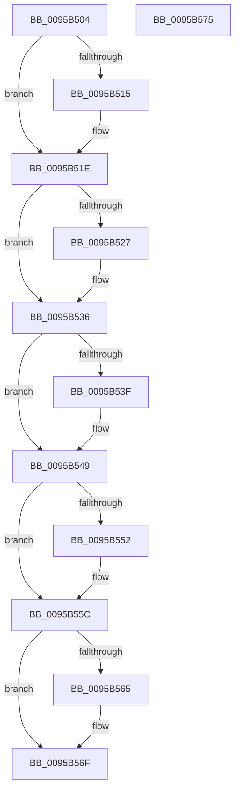

# KsepSdbUnmapFromMemory

- RVA: `0x0095B504`–`0x0095B576` (길이 `114` bytes)
- VA: `0x000000014095B504`
- 실행 섹션: `PAGE`
- PDB 이름 있음: `예`; PDB Function 태그: `아니요`
- unwind 정보 RVA: `0x0005CF00`
- 디코드: `33`개 명령, `114/114` bytes 표시
- 미해석 바이트: `0` (있으면 어셈블리에 `.byte`로 보존)

> 이 문서는 커널 이미지의 기계어와 PDB 기호를 분석해 생성했습니다. 4번과 5번은 함수 원형과 자료형을 바이너리 사용 방식에서 추정한 C 해석이며 원본 소스 복구 결과는 아닙니다.

## 1. Dependencies

- 직접 호출 지점: **5**; 고유 호출 대상: **4**
- 직접 호출자로 확인된 함수: **2**
- RIP 상대 이미지 참조: **0**

### Outgoing calls
- `0x0095B515` → [SdbReleaseDatabase](SdbReleaseDatabase_function_0095B57C.md) (function, `0x0095B57C`)
- `0x0095B52C` → [MiRemoveFromSystemSpace](../../text/29/MiRemoveFromSystemSpace_function_002962FC.md) (function, `0x002962FC`)
- `0x0095B53F` → [ObfDereferenceObject](../../text/2F/ObfDereferenceObject_function_002F9350.md) (function, `0x002F9350`)
- `0x0095B552` → [ZwClose](../../text/6A/ZwClose_function_006AD2B0.md) (function, `0x006AD2B0`)
- `0x0095B565` → [ZwClose](../../text/6A/ZwClose_function_006AD2B0.md) (function, `0x006AD2B0`)

### Direct callers
- [KseShimDatabaseClose](KseShimDatabaseClose_function_0095ABCC.md) at `0x0095AC6C`
- [KseShimDatabaseClose](KseShimDatabaseClose_function_0095ABCC.md) at `0x0095AC78`
- [KseShimDatabaseOpen](KseShimDatabaseOpen_function_0095AD7C.md) at `0x0095AEEA`

### Static image references
- 디코드된 RIP-relative 메모리 참조가 없습니다.

## 2. Other-region calls and transfers

- 다른 실행 섹션으로 향하는 call: **4**
  - `0x0095B52C` → [MiRemoveFromSystemSpace](../../text/29/MiRemoveFromSystemSpace_function_002962FC.md) (`PAGE` → `.text`)
  - `0x0095B53F` → [ObfDereferenceObject](../../text/2F/ObfDereferenceObject_function_002F9350.md) (`PAGE` → `.text`)
  - `0x0095B552` → [ZwClose](../../text/6A/ZwClose_function_006AD2B0.md) (`PAGE` → `.text`)
  - `0x0095B565` → [ZwClose](../../text/6A/ZwClose_function_006AD2B0.md) (`PAGE` → `.text`)
- 별도 외부 분기/꼬리 이동을 확인하지 못했습니다.

## 3. Assembly (complete function range)

```asm
0095B504  40 53                           push rbx
0095B506  48 83 EC 20                     sub rsp, 0x20
0095B50A  48 8B D9                        mov rbx, rcx
0095B50D  48 8B 09                        mov rcx, qword ptr [rcx]
0095B510  48 85 C9                        test rcx, rcx
0095B513  74 09                           je 0x14095b51e
0095B515  E8 62 00 00 00                  call 0x14095b57c
0095B51A  48 83 23 00                     and qword ptr [rbx], 0
0095B51E  48 8B 4B 08                     mov rcx, qword ptr [rbx + 8]
0095B522  48 85 C9                        test rcx, rcx
0095B525  74 0F                           je 0x14095b536
0095B527  BA 01 00 00 00                  mov edx, 1
0095B52C  E8 CB AD 93 FF                  call 0x1402962fc
0095B531  48 83 63 08 00                  and qword ptr [rbx + 8], 0
0095B536  48 8B 4B 20                     mov rcx, qword ptr [rbx + 0x20]
0095B53A  48 85 C9                        test rcx, rcx
0095B53D  74 0A                           je 0x14095b549
0095B53F  E8 0C DE 99 FF                  call 0x1402f9350
0095B544  48 83 63 20 00                  and qword ptr [rbx + 0x20], 0
0095B549  48 8B 4B 18                     mov rcx, qword ptr [rbx + 0x18]
0095B54D  48 85 C9                        test rcx, rcx
0095B550  74 0A                           je 0x14095b55c
0095B552  E8 59 1D D5 FF                  call 0x1406ad2b0
0095B557  48 83 63 18 00                  and qword ptr [rbx + 0x18], 0
0095B55C  48 8B 4B 10                     mov rcx, qword ptr [rbx + 0x10]
0095B560  48 85 C9                        test rcx, rcx
0095B563  74 0A                           je 0x14095b56f
0095B565  E8 46 1D D5 FF                  call 0x1406ad2b0
0095B56A  48 83 63 10 00                  and qword ptr [rbx + 0x10], 0
0095B56F  48 83 C4 20                     add rsp, 0x20
0095B573  5B                              pop rbx
0095B574  C3                              ret
0095B575  CC                              int3
```

## 4. C-style interpretation (structured pseudocode)

```c
__int64 __fastcall KsepSdbUnmapFromMemory(__int64 a1)
{
    __int64 result;
    __int64 v_rsp;

    v_rsp = (v_rsp) - (32);
    if (*(unsigned __int64 *)(a1) != 0) {
        result = SdbReleaseDatabase(*(unsigned __int64 *)(a1), a2, a3, a4);
    }
    if (*(unsigned __int64 *)(a1 + 8) != 0) {
        a2 = 1;
        result = MiRemoveFromSystemSpace(*(unsigned __int64 *)(a1 + 8), a2, a3, a4);
    }
    if (*(unsigned __int64 *)(a1 + 32) != 0) {
        result = ObfDereferenceObject(*(unsigned __int64 *)(a1 + 32), a2, a3, a4);
    }
    if (*(unsigned __int64 *)(a1 + 24) != 0) {
        result = ZwClose(*(unsigned __int64 *)(a1 + 24), a2, a3, a4);
    }
    if (*(unsigned __int64 *)(a1 + 16) != 0) {
        result = ZwClose(*(unsigned __int64 *)(a1 + 16), a2, a3, a4);
    }
    v_rsp = (v_rsp) + (32);
    return result;
}
```

## 5. (Beta) C Style

```c
int64_t KsepSdbUnmapFromMemory(void *Arg1)
{
    uint8_t *arg1 = (uint8_t *)Arg1;

    int64_t result;
    int64_t local_rsp;

    local_rsp = (local_rsp) - (32);
    if (*(uint64_t *)(arg1) != 0) {
        result = SdbReleaseDatabase(*(uint64_t *)(arg1), a2, a3, a4);
    }
    if (*(uint64_t *)(arg1 + 0x8) != 0) {
        a2 = 1;
        result = MiRemoveFromSystemSpace(*(uint64_t *)(arg1 + 0x8), a2, a3, a4);
    }
    if (*(uint64_t *)(arg1 + 0x20) != 0) {
        result = ObfDereferenceObject(*(uint64_t *)(arg1 + 0x20), a2, a3, a4);
    }
    if (*(uint64_t *)(arg1 + 0x18) != 0) {
        result = ZwClose(*(uint64_t *)(arg1 + 0x18), a2, a3, a4);
    }
    if (*(uint64_t *)(arg1 + 0x10) != 0) {
        result = ZwClose(*(uint64_t *)(arg1 + 0x10), a2, a3, a4);
    }
    local_rsp = (local_rsp) + (32);
    return result;
}
```

### 관측된 메모리 오프셋

구조체 형식이 확인되지 않은 접근은 인자 기준의 오프셋으로만 기록했습니다.

| 기준 인자 | 오프셋 표현 | 폭 (bit) | 접근 |
|---|---:|---:|---|
| `Arg1` | `+ 0x0` | `64` | `R` |
| `Arg1` | `+ 0x0` | `64` | `R/W` |
| `Arg1` | `+ 0x8` | `64` | `R` |
| `Arg1` | `+ 0x8` | `64` | `R/W` |
| `Arg1` | `+ 0x10` | `64` | `R` |
| `Arg1` | `+ 0x10` | `64` | `R/W` |
| `Arg1` | `+ 0x18` | `64` | `R` |
| `Arg1` | `+ 0x18` | `64` | `R/W` |
| `Arg1` | `+ 0x20` | `64` | `R` |
| `Arg1` | `+ 0x20` | `64` | `R/W` |

## 6. Execution-region graph

[열기: 2D/3D 그래프와 함수 탐색 컨트롤 패널](../../../control-panel.html?section=page&rva=0x0095B504&view=graph)

- 2D 그래프는 위에서 아래로 흐르고, 3D 그래프는 빈 공간을 드래그해 회전합니다. Shift+드래그는 이동, 휠은 확대·축소, 함수 노드 선택은 대상 보고서 이동입니다.

### Static fallback


