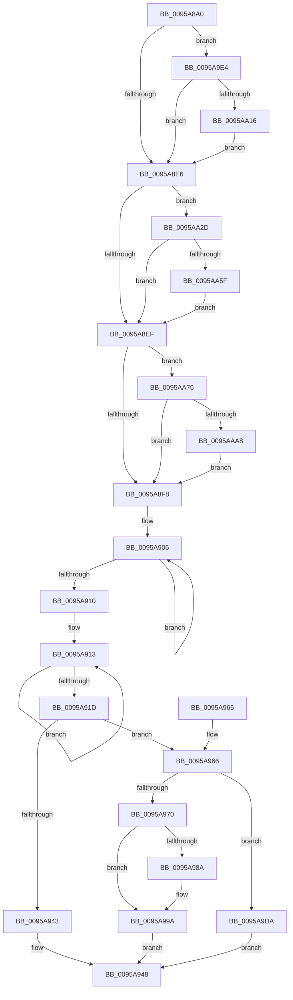

# KsepStringConcatenate

- RVA: `0x0095A8A0`–`0x0095AABF` (길이 `543` bytes)
- VA: `0x000000014095A8A0`
- 실행 섹션: `PAGE`
- PDB 이름 있음: `예`; PDB Function 태그: `아니요`
- unwind 정보 RVA: `0x000929FC`
- 디코드: `136`개 명령, `543/543` bytes 표시
- 미해석 바이트: `0` (있으면 어셈블리에 `.byte`로 보존)

> 이 문서는 커널 이미지의 기계어와 PDB 기호를 분석해 생성했습니다. 4번과 5번은 함수 원형과 자료형을 바이너리 사용 방식에서 추정한 C 해석이며 원본 소스 복구 결과는 아닙니다.

## 1. Dependencies

- 직접 호출 지점: **6**; 고유 호출 대상: **3**
- 직접 호출자로 확인된 함수: **4**
- RIP 상대 이미지 참조: **7**

### Outgoing calls
- `0x0095A966` → [KsepPoolAllocatePaged](../../text/4A/KsepPoolAllocatePaged_function_004A9EFC.md) (function, `0x004A9EFC`)
- `0x0095A97D` → [memcpy](../../text/6C/memcpy_function_006C6840.md) (function, `0x006C6840`)
- `0x0095A9AF` → [memcpy](../../text/6C/memcpy_function_006C6840.md) (function, `0x006C6840`)
- `0x0095AA23` → [RtlAssert](../../text/5E/RtlAssert_function_005E75E0.md) (function, `0x005E75E0`)
- `0x0095AA6C` → [RtlAssert](../../text/5E/RtlAssert_function_005E75E0.md) (function, `0x005E75E0`)
- `0x0095AAB5` → [RtlAssert](../../text/5E/RtlAssert_function_005E75E0.md) (function, `0x005E75E0`)

### Direct callers
- [KsepLoadShimProvider](../../text/5C/KsepLoadShimProvider_function_005CBA44.md) at `0x005CBA91`
- [KsepRegistryQueryDriverShims](KsepRegistryQueryDriverShims_function_00959524.md) at `0x0095958C`
- [KsepRegistryOpenKey](KsepRegistryOpenKey_function_0095A79C.md) at `0x0095A813`
- [KsepDbQueryRegistryDeviceData](KsepDbQueryRegistryDeviceData_function_0095B174.md) at `0x0095B22C`

### Static image references
- `0x0095A8BE` → RVA `0x00B01160` (` ?? ::NNGAKEGL::`string'`; read)
- `0x0095A8C5` → RVA `0x00F101E0` (`.data`; read)
- `0x0095A9E6` → RVA `0x00F101C0` (`.data`; read/write)
- `0x0095AA08` → RVA `0x00E66CE8` (`.data`; read)
- `0x0095AA19` → RVA `0x00B01140` (` ?? ::NNGAKEGL::`string'`; read)
- `0x0095AA62` → RVA `0x00B010E0` (` ?? ::NNGAKEGL::`string'`; read)
- `0x0095AAAB` → RVA `0x00B01100` (` ?? ::NNGAKEGL::`string'`; read)

## 2. Other-region calls and transfers

- 다른 실행 섹션으로 향하는 call: **6**
  - `0x0095A966` → [KsepPoolAllocatePaged](../../text/4A/KsepPoolAllocatePaged_function_004A9EFC.md) (`PAGE` → `.text`)
  - `0x0095A97D` → [memcpy](../../text/6C/memcpy_function_006C6840.md) (`PAGE` → `.text`)
  - `0x0095A9AF` → [memcpy](../../text/6C/memcpy_function_006C6840.md) (`PAGE` → `.text`)
  - `0x0095AA23` → [RtlAssert](../../text/5E/RtlAssert_function_005E75E0.md) (`PAGE` → `.text`)
  - `0x0095AA6C` → [RtlAssert](../../text/5E/RtlAssert_function_005E75E0.md) (`PAGE` → `.text`)
  - `0x0095AAB5` → [RtlAssert](../../text/5E/RtlAssert_function_005E75E0.md) (`PAGE` → `.text`)
- 별도 외부 분기/꼬리 이동을 확인하지 못했습니다.

## 3. Assembly (complete function range)

```asm
0095A8A0  48 89 5C 24 08                  mov qword ptr [rsp + 8], rbx
0095A8A5  48 89 6C 24 10                  mov qword ptr [rsp + 0x10], rbp
0095A8AA  48 89 74 24 18                  mov qword ptr [rsp + 0x18], rsi
0095A8AF  57                              push rdi
0095A8B0  41 54                           push r12
0095A8B2  41 55                           push r13
0095A8B4  41 56                           push r14
0095A8B6  41 57                           push r15
0095A8B8  48 83 EC 20                     sub rsp, 0x20
0095A8BC  33 F6                           xor esi, esi
0095A8BE  48 8D 3D 9B 68 1A 00            lea rdi, [rip + 0x1a689b]
0095A8C5  48 8D 1D 14 59 5B 00            lea rbx, [rip + 0x5b5914]
0095A8CC  45 8B E9                        mov r13d, r9d
0095A8CF  4D 8B E0                        mov r12, r8
0095A8D2  4C 8B FA                        mov r15, rdx
0095A8D5  4C 8B F1                        mov r14, rcx
0095A8D8  BD 01 00 00 00                  mov ebp, 1
0095A8DD  48 85 C9                        test rcx, rcx
0095A8E0  0F 84 FE 00 00 00               je 0x14095a9e4
0095A8E6  4D 85 FF                        test r15, r15
0095A8E9  0F 84 3E 01 00 00               je 0x14095aa2d
0095A8EF  4D 85 E4                        test r12, r12
0095A8F2  0F 84 7E 01 00 00               je 0x14095aa76
0095A8F8  0F 57 C0                        xorps xmm0, xmm0
0095A8FB  48 83 CF FF                     or rdi, 0xffffffffffffffff
0095A8FF  41 0F 11 06                     movups xmmword ptr [r14], xmm0
0095A903  48 8B DF                        mov rbx, rdi
0095A906  48 FF C3                        inc rbx
0095A909  66 41 39 34 5F                  cmp word ptr [r15 + rbx*2], si
0095A90E  75 F6                           jne 0x14095a906
0095A910  48 03 DB                        add rbx, rbx
0095A913  48 FF C7                        inc rdi
0095A916  66 41 39 34 7C                  cmp word ptr [r12 + rdi*2], si
0095A91B  75 F6                           jne 0x14095a913
0095A91D  48 03 FF                        add rdi, rdi
0095A920  41 8B C5                        mov eax, r13d
0095A923  F7 D8                           neg eax
0095A925  48 1B F6                        sbb rsi, rsi
0095A928  48 83 E6 02                     and rsi, 2
0095A92C  48 8D 2C 3E                     lea rbp, [rsi + rdi]
0095A930  48 03 EB                        add rbp, rbx
0095A933  48 8D 4D 02                     lea rcx, [rbp + 2]
0095A937  48 8D 41 FF                     lea rax, [rcx - 1]
0095A93B  48 3D FE FF 00 00               cmp rax, 0xfffe
0095A941  76 23                           jbe 0x14095a966
0095A943  B8 05 00 00 80                  mov eax, 0x80000005
0095A948  48 8B 5C 24 50                  mov rbx, qword ptr [rsp + 0x50]
0095A94D  48 8B 6C 24 58                  mov rbp, qword ptr [rsp + 0x58]
0095A952  48 8B 74 24 60                  mov rsi, qword ptr [rsp + 0x60]
0095A957  48 83 C4 20                     add rsp, 0x20
0095A95B  41 5F                           pop r15
0095A95D  41 5E                           pop r14
0095A95F  41 5D                           pop r13
0095A961  41 5C                           pop r12
0095A963  5F                              pop rdi
0095A964  C3                              ret
0095A965  CC                              int3
0095A966  E8 91 F5 B4 FF                  call 0x1404a9efc
0095A96B  48 85 C0                        test rax, rax
0095A96E  74 6A                           je 0x14095a9da
0095A970  4C 8B C3                        mov r8, rbx
0095A973  49 89 46 08                     mov qword ptr [r14 + 8], rax
0095A977  49 8B D7                        mov rdx, r15
0095A97A  48 8B C8                        mov rcx, rax
0095A97D  E8 BE BE D6 FF                  call 0x1406c6840
0095A982  45 33 FF                        xor r15d, r15d
0095A985  45 85 ED                        test r13d, r13d
0095A988  74 10                           je 0x14095a99a
0095A98A  49 8B 46 08                     mov rax, qword ptr [r14 + 8]
0095A98E  48 8B CB                        mov rcx, rbx
0095A991  48 D1 E9                        shr rcx, 1
0095A994  66 C7 04 48 5C 00               mov word ptr [rax + rcx*2], 0x5c
0095A99A  49 8B 46 08                     mov rax, qword ptr [r14 + 8]
0095A99E  48 8D 0C 1E                     lea rcx, [rsi + rbx]
0095A9A2  48 D1 E9                        shr rcx, 1
0095A9A5  4C 8B C7                        mov r8, rdi
0095A9A8  49 8B D4                        mov rdx, r12
0095A9AB  48 8D 0C 48                     lea rcx, [rax + rcx*2]
0095A9AF  E8 8C BE D6 FF                  call 0x1406c6840
0095A9B4  49 8B 46 08                     mov rax, qword ptr [r14 + 8]
0095A9B8  66 03 F3                        add si, bx
0095A9BB  66 03 F7                        add si, di
0095A9BE  48 D1 ED                        shr rbp, 1
0095A9C1  66 44 89 3C 68                  mov word ptr [rax + rbp*2], r15w
0095A9C6  66 41 89 36                     mov word ptr [r14], si
0095A9CA  66 83 C6 02                     add si, 2
0095A9CE  66 41 89 76 02                  mov word ptr [r14 + 2], si
0095A9D3  33 C0                           xor eax, eax
0095A9D5  E9 6E FF FF FF                  jmp 0x14095a948
0095A9DA  B8 17 00 00 C0                  mov eax, 0xc0000017
0095A9DF  E9 64 FF FF FF                  jmp 0x14095a948
0095A9E4  8B C5                           mov eax, ebp
0095A9E6  F0 0F C1 05 D2 57 5B 00         lock xadd dword ptr [rip + 0x5b57d2], eax
0095A9EE  03 C5                           add eax, ebp
0095A9F0  41 B8 CC 02 00 00               mov r8d, 0x2cc
0095A9F6  83 E0 3F                        and eax, 0x3f
0095A9F9  C7 44 C3 04 20 04 00 C0         mov dword ptr [rbx + rax*8 + 4], 0xc0000420
0095AA01  C7 04 C3 CC 02 03 00            mov dword ptr [rbx + rax*8], 0x302cc
0095AA08  8B 05 DA C2 50 00               mov eax, dword ptr [rip + 0x50c2da]
0095AA0E  A8 04                           test al, 4
0095AA10  0F 84 D0 FE FF FF               je 0x14095a8e6
0095AA16  45 33 C9                        xor r9d, r9d
0095AA19  48 8D 0D 20 67 1A 00            lea rcx, [rip + 0x1a6720]
0095AA20  48 8B D7                        mov rdx, rdi
0095AA23  E8 B8 CB C8 FF                  call 0x1405e75e0
0095AA28  E9 B9 FE FF FF                  jmp 0x14095a8e6
0095AA2D  8B C5                           mov eax, ebp
0095AA2F  F0 0F C1 05 89 57 5B 00         lock xadd dword ptr [rip + 0x5b5789], eax
0095AA37  03 C5                           add eax, ebp
0095AA39  41 B8 CD 02 00 00               mov r8d, 0x2cd
0095AA3F  83 E0 3F                        and eax, 0x3f
0095AA42  C7 44 C3 04 20 04 00 C0         mov dword ptr [rbx + rax*8 + 4], 0xc0000420
0095AA4A  C7 04 C3 CD 02 03 00            mov dword ptr [rbx + rax*8], 0x302cd
0095AA51  8B 05 91 C2 50 00               mov eax, dword ptr [rip + 0x50c291]
0095AA57  A8 04                           test al, 4
0095AA59  0F 84 90 FE FF FF               je 0x14095a8ef
0095AA5F  45 33 C9                        xor r9d, r9d
0095AA62  48 8D 0D 77 66 1A 00            lea rcx, [rip + 0x1a6677]
0095AA69  48 8B D7                        mov rdx, rdi
0095AA6C  E8 6F CB C8 FF                  call 0x1405e75e0
0095AA71  E9 79 FE FF FF                  jmp 0x14095a8ef
0095AA76  8B C5                           mov eax, ebp
0095AA78  F0 0F C1 05 40 57 5B 00         lock xadd dword ptr [rip + 0x5b5740], eax
0095AA80  03 C5                           add eax, ebp
0095AA82  41 B8 CE 02 00 00               mov r8d, 0x2ce
0095AA88  83 E0 3F                        and eax, 0x3f
0095AA8B  C7 44 C3 04 20 04 00 C0         mov dword ptr [rbx + rax*8 + 4], 0xc0000420
0095AA93  C7 04 C3 CE 02 03 00            mov dword ptr [rbx + rax*8], 0x302ce
0095AA9A  8B 05 48 C2 50 00               mov eax, dword ptr [rip + 0x50c248]
0095AAA0  A8 04                           test al, 4
0095AAA2  0F 84 50 FE FF FF               je 0x14095a8f8
0095AAA8  45 33 C9                        xor r9d, r9d
0095AAAB  48 8D 0D 4E 66 1A 00            lea rcx, [rip + 0x1a664e]
0095AAB2  48 8B D7                        mov rdx, rdi
0095AAB5  E8 26 CB C8 FF                  call 0x1405e75e0
0095AABA  E9 39 FE FF FF                  jmp 0x14095a8f8
```

## 4. C-style interpretation (structured pseudocode)

```c
__int64 __fastcall KsepStringConcatenate(__int64 a1, __int64 a2, __int64 a3, int a4)
{
    __int64 result;
    __int64 v_r15;
    __int64 v_rbp;
    __int64 v_rbx;
    __int64 v_rdi;
    __int64 v_rsi;
    __int64 v_rsp;
    unsigned __int64 v_stack_p10;
    unsigned __int64 v_stack_p18;
    unsigned __int64 v_stack_p8;

    v_stack_p8 = v_rbx;
    v_stack_p10 = v_rbp;
    v_stack_p18 = v_rsi;
    v_rsp = (v_rsp) - (32);
    v_rsi = 0;
    if (a1 == 0) goto loc_0095A9E4;
loc_0095A8E6:
    if (a2 == 0) goto loc_0095AA2D;
loc_0095A8EF:
    if (a3 == 0) goto loc_0095AA76;
loc_0095A8F8:
    v_rdi = (v_rip + 1730715) | (-1);
    *(unsigned __int64 *)(a1) = v_xmm0;
loc_0095A906:
    v_rbx = (v_rdi) + 1;
    if ((*(unsigned __int16 *)(a2 + v_rbx * 2)) != 0) goto loc_0095A906;
    v_rbx = (v_rbx) + (v_rbx);
loc_0095A913:
    v_rdi = (v_rdi) + 1;
    if ((*(unsigned __int16 *)(a3 + v_rdi * 2)) != 0) goto loc_0095A913;
    v_rdi = (v_rdi) + (v_rdi);
    result = (unsigned int)(-((unsigned int)((unsigned int)((unsigned int)(a4)))));
    v_rsi = (v_rsi) & (2);
    v_rbp = (v_rsi + v_rdi * 1) + (v_rbx);
    if ((v_rbp + 2 - 1) <= 0xFFFEULL) goto loc_0095A966;
loc_0095A948:
    v_rsp = (v_rsp) + (32);
    return (unsigned int)(0x80000005ULL);
loc_0095A966:
    result = KsepPoolAllocatePaged(v_rbp + 2, a2, a3, a4);
    if (result == 0) goto loc_0095A9DA;
    *(unsigned __int64 *)(a1 + 8) = result;
    result = memcpy(result, a2, v_stack_p8, a4);
    v_r15 = 0;
    if ((unsigned int)((unsigned int)(a4)) != 0) {
        result = *(unsigned __int64 *)(a1 + 8);
        a1 = v_stack_p8;
        a1 = (a1) >> (1);
        *(unsigned __int16 *)(result + a1 * 2) = 92;
    }
    a1 = (v_stack_p18 + v_stack_p8 * 1) >> (1);
    result = memcpy(*(unsigned __int64 *)(a1 + 8) + a1 * 2, a3, v_rdi, a4);
    v_rsi = (unsigned __int16)((v_stack_p18) + ((unsigned __int16)(v_stack_p8)));
    v_rsi = (unsigned __int16)((v_rsi) + ((unsigned __int16)(v_rdi)));
    v_rbp = (v_stack_p10) >> (1);
    *(unsigned __int16 *)(*(unsigned __int64 *)(a1 + 8) + v_rbp * 2) = 0;
    *(unsigned __int16 *)(a1) = (unsigned __int16)(v_rsi);
    v_rsi = (unsigned __int16)((v_rsi) + (2));
    *(unsigned __int16 *)(a1 + 2) = (unsigned __int16)(v_rsi);
    result = 0;
    goto loc_0095A948;
loc_0095A9DA:
    goto loc_0095A948;
loc_0095A9E4:
    result = (unsigned int)(((unsigned int)((unsigned int)(v_rbp))) + ((unsigned int)(v_rbp)));
    result = (unsigned int)((result) & (63));
    *(unsigned int *)(v_stack_p8 + result * 8 + 4) = 0xC0000420ULL;
    *(unsigned int *)(v_stack_p8 + result * 8) = 0x302CCULL;
    if ((((unsigned __int8)((unsigned int)(*(unsigned int *)(v_rip + 5292762)))) & (4)) == 0) goto loc_0095A8E6;
    a4 = 0;
    result = RtlAssert(v_rip + 1730336, v_rdi, 716, a4);
    goto loc_0095A8E6;
loc_0095AA2D:
    result = (unsigned int)(((unsigned int)((unsigned int)(v_rbp))) + ((unsigned int)(v_rbp)));
    result = (unsigned int)((result) & (63));
    *(unsigned int *)(v_stack_p8 + result * 8 + 4) = 0xC0000420ULL;
    *(unsigned int *)(v_stack_p8 + result * 8) = 0x302CDULL;
    if ((((unsigned __int8)((unsigned int)(*(unsigned int *)(v_rip + 5292689)))) & (4)) == 0) goto loc_0095A8EF;
    a4 = 0;
    result = RtlAssert(v_rip + 1730167, v_rdi, 717, a4);
    goto loc_0095A8EF;
loc_0095AA76:
    result = (unsigned int)(((unsigned int)((unsigned int)(v_rbp))) + ((unsigned int)(v_rbp)));
    result = (unsigned int)((result) & (63));
    *(unsigned int *)(v_stack_p8 + result * 8 + 4) = 0xC0000420ULL;
    *(unsigned int *)(v_stack_p8 + result * 8) = 0x302CEULL;
    if ((((unsigned __int8)((unsigned int)(*(unsigned int *)(v_rip + 5292616)))) & (4)) == 0) goto loc_0095A8F8;
    a4 = 0;
    result = RtlAssert(v_rip + 1730126, v_rdi, 718, a4);
    goto loc_0095A8F8;
}
```

## 5. (Beta) C Style

```c
int64_t KsepStringConcatenate(void *Arg1, int64_t Arg2, int64_t Arg3, int32_t Arg4)
{
    uint8_t *arg1 = (uint8_t *)Arg1;

    int64_t result;
    int64_t local_r15;
    int64_t local_rbp;
    int64_t local_rbx;
    int64_t local_rdi;
    int64_t local_rsi;
    int64_t local_rsp;
    uint64_t v_stack_p10;
    uint64_t v_stack_p18;
    uint64_t v_stack_p8;

    v_stack_p8 = local_rbx;
    v_stack_p10 = local_rbp;
    v_stack_p18 = local_rsi;
    local_rsp = (local_rsp) - (32);
    local_rsi = 0;
    if (Arg1 == NULL) goto loc_0095A9E4;
loc_0095A8E6:
    if (Arg2 == 0) goto loc_0095AA2D;
loc_0095A8EF:
    if (Arg3 == 0) goto loc_0095AA76;
loc_0095A8F8:
    local_rdi = (v_rip + 1730715) | (-1);
    *(uint64_t *)(arg1) = v_xmm0;
loc_0095A906:
    local_rbx = (local_rdi) + 1;
    if ((*(uint16_t *)(Arg2 + local_rbx * 2)) != 0) goto loc_0095A906;
    local_rbx = (local_rbx) + (local_rbx);
loc_0095A913:
    local_rdi = (local_rdi) + 1;
    if ((*(uint16_t *)(Arg3 + local_rdi * 2)) != 0) goto loc_0095A913;
    local_rdi = (local_rdi) + (local_rdi);
    result = (uint32_t)(-((uint32_t)((uint32_t)((uint32_t)(Arg4)))));
    local_rsi = (local_rsi) & (2);
    local_rbp = (local_rsi + local_rdi * 1) + (local_rbx);
    if ((local_rbp + 2 - 1) <= 0xFFFEULL) goto loc_0095A966;
loc_0095A948:
    local_rsp = (local_rsp) + (32);
    return (uint32_t)(0x80000005ULL);
loc_0095A966:
    result = KsepPoolAllocatePaged(local_rbp + 2, Arg2, Arg3, Arg4);
    if (result == 0) goto loc_0095A9DA;
    *(uint64_t *)(arg1 + 0x8) = result;
    result = memcpy(result, Arg2, v_stack_p8, Arg4);
    local_r15 = 0;
    if ((uint32_t)((uint32_t)(Arg4)) != 0) {
        result = *(uint64_t *)(arg1 + 0x8);
        Arg1 = v_stack_p8;
        Arg1 = (Arg1) >> (1);
        *(uint16_t *)(result + arg1 * 2) = 92;
    }
    Arg1 = (v_stack_p18 + v_stack_p8 * 1) >> (1);
    result = memcpy(*(uint64_t *)(arg1 + 0x8) + Arg1 * 2, Arg3, local_rdi, Arg4);
    local_rsi = (uint16_t)((v_stack_p18) + ((uint16_t)(v_stack_p8)));
    local_rsi = (uint16_t)((local_rsi) + ((uint16_t)(local_rdi)));
    local_rbp = (v_stack_p10) >> (1);
    *(uint16_t *)(*(uint64_t *)(arg1 + 0x8) + local_rbp * 2) = 0;
    *(uint16_t *)(arg1) = (uint16_t)(local_rsi);
    local_rsi = (uint16_t)((local_rsi) + (2));
    *(uint16_t *)(arg1 + 0x2) = (uint16_t)(local_rsi);
    result = 0;
    goto loc_0095A948;
loc_0095A9DA:
    goto loc_0095A948;
loc_0095A9E4:
    result = (uint32_t)(((uint32_t)((uint32_t)(local_rbp))) + ((uint32_t)(local_rbp)));
    result = (uint32_t)((result) & (63));
    *(uint32_t *)(v_stack_p8 + result * 8 + 0x4) = 0xC0000420ULL;
    *(uint32_t *)(v_stack_p8 + result * 8) = 0x302CCULL;
    if ((((uint8_t)((uint32_t)(*(uint32_t *)(v_rip + 0x50C2DA)))) & (4)) == 0) goto loc_0095A8E6;
    Arg4 = 0;
    result = RtlAssert(v_rip + 1730336, local_rdi, 716, Arg4);
    goto loc_0095A8E6;
loc_0095AA2D:
    result = (uint32_t)(((uint32_t)((uint32_t)(local_rbp))) + ((uint32_t)(local_rbp)));
    result = (uint32_t)((result) & (63));
    *(uint32_t *)(v_stack_p8 + result * 8 + 0x4) = 0xC0000420ULL;
    *(uint32_t *)(v_stack_p8 + result * 8) = 0x302CDULL;
    if ((((uint8_t)((uint32_t)(*(uint32_t *)(v_rip + 0x50C291)))) & (4)) == 0) goto loc_0095A8EF;
    Arg4 = 0;
    result = RtlAssert(v_rip + 1730167, local_rdi, 717, Arg4);
    goto loc_0095A8EF;
loc_0095AA76:
    result = (uint32_t)(((uint32_t)((uint32_t)(local_rbp))) + ((uint32_t)(local_rbp)));
    result = (uint32_t)((result) & (63));
    *(uint32_t *)(v_stack_p8 + result * 8 + 0x4) = 0xC0000420ULL;
    *(uint32_t *)(v_stack_p8 + result * 8) = 0x302CEULL;
    if ((((uint8_t)((uint32_t)(*(uint32_t *)(v_rip + 0x50C248)))) & (4)) == 0) goto loc_0095A8F8;
    Arg4 = 0;
    result = RtlAssert(v_rip + 1730126, local_rdi, 718, Arg4);
    goto loc_0095A8F8;
}
```

### 관측된 메모리 오프셋

구조체 형식이 확인되지 않은 접근은 인자 기준의 오프셋으로만 기록했습니다.

| 기준 인자 | 오프셋 표현 | 폭 (bit) | 접근 |
|---|---:|---:|---|
| `Arg1` | `+ 0x0` | `16` | `W` |
| `Arg1` | `+ 0x0` | `128` | `R` |
| `Arg1` | `+ 0x2` | `16` | `W` |
| `Arg1` | `+ 0x8` | `64` | `R` |
| `Arg1` | `+ 0x8` | `64` | `W` |

## 6. Execution-region graph

[열기: 2D/3D 그래프와 함수 탐색 컨트롤 패널](../../../control-panel.html?section=page&rva=0x0095A8A0&view=graph)

- 2D 그래프는 위에서 아래로 흐르고, 3D 그래프는 빈 공간을 드래그해 회전합니다. Shift+드래그는 이동, 휠은 확대·축소, 함수 노드 선택은 대상 보고서 이동입니다.

### Static fallback


