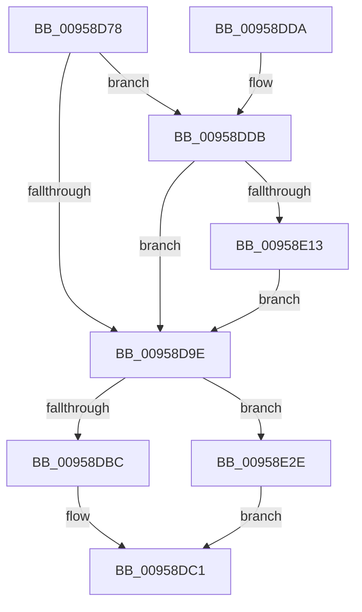

# KsepStringDuplicateUnicode

- RVA: `0x00958D78`–`0x00958E5E` (길이 `230` bytes)
- VA: `0x0000000140958D78`
- 실행 섹션: `PAGE`
- PDB 이름 있음: `예`; PDB Function 태그: `아니요`
- unwind 정보 RVA: `0x000918C0`
- 디코드: `60`개 명령, `230/230` bytes 표시
- 미해석 바이트: `0` (있으면 어셈블리에 `.byte`로 보존)

> 이 문서는 커널 이미지의 기계어와 PDB 기호를 분석해 생성했습니다. 4번과 5번은 함수 원형과 자료형을 바이너리 사용 방식에서 추정한 C 해석이며 원본 소스 복구 결과는 아닙니다.

## 1. Dependencies

- 직접 호출 지점: **3**; 고유 호출 대상: **3**
- 직접 호출자로 확인된 함수: **2**
- RIP 상대 이미지 참조: **5**

### Outgoing calls
- `0x00958DAF` → [KsepPoolAllocatePaged](../../text/4A/KsepPoolAllocatePaged_function_004A9EFC.md) (function, `0x004A9EFC`)
- `0x00958E24` → [RtlAssert](../../text/5E/RtlAssert_function_005E75E0.md) (function, `0x005E75E0`)
- `0x00958E38` → [memcpy](../../text/6C/memcpy_function_006C6840.md) (function, `0x006C6840`)

### Direct callers
- [KseDriverLoadImage](KseDriverLoadImage_function_009588C0.md) at `0x00958923`
- [KseDriverLoadImage](KseDriverLoadImage_function_009588C0.md) at `0x00958936`
- [KseShimDriverIoCallbacks](KseShimDriverIoCallbacks_function_00958BFC.md) at `0x00958CA1`

### Static image references
- `0x00958DE0` → RVA `0x00F101C0` (`.data`; read/write)
- `0x00958DEA` → RVA `0x00F101E0` (`.data`; read)
- `0x00958E09` → RVA `0x00E66CE8` (`.data`; read)
- `0x00958E16` → RVA `0x00B01160` (` ?? ::NNGAKEGL::`string'`; read)
- `0x00958E1D` → RVA `0x00B01120` (` ?? ::NNGAKEGL::`string'`; read)

## 2. Other-region calls and transfers

- 다른 실행 섹션으로 향하는 call: **3**
  - `0x00958DAF` → [KsepPoolAllocatePaged](../../text/4A/KsepPoolAllocatePaged_function_004A9EFC.md) (`PAGE` → `.text`)
  - `0x00958E24` → [RtlAssert](../../text/5E/RtlAssert_function_005E75E0.md) (`PAGE` → `.text`)
  - `0x00958E38` → [memcpy](../../text/6C/memcpy_function_006C6840.md) (`PAGE` → `.text`)
- 별도 외부 분기/꼬리 이동을 확인하지 못했습니다.

## 3. Assembly (complete function range)

```asm
00958D78  48 89 5C 24 08                  mov qword ptr [rsp + 8], rbx
00958D7D  48 89 6C 24 10                  mov qword ptr [rsp + 0x10], rbp
00958D82  48 89 74 24 18                  mov qword ptr [rsp + 0x18], rsi
00958D87  57                              push rdi
00958D88  41 56                           push r14
00958D8A  41 57                           push r15
00958D8C  48 83 EC 20                     sub rsp, 0x20
00958D90  45 33 FF                        xor r15d, r15d
00958D93  48 8B DA                        mov rbx, rdx
00958D96  48 8B F9                        mov rdi, rcx
00958D99  48 85 D2                        test rdx, rdx
00958D9C  74 3D                           je 0x140958ddb
00958D9E  0F 57 C0                        xorps xmm0, xmm0
00958DA1  0F 11 07                        movups xmmword ptr [rdi], xmm0
00958DA4  44 0F B7 33                     movzx r14d, word ptr [rbx]
00958DA8  49 8D 76 02                     lea rsi, [r14 + 2]
00958DAC  48 8B CE                        mov rcx, rsi
00958DAF  E8 48 11 B5 FF                  call 0x1404a9efc
00958DB4  48 8B E8                        mov rbp, rax
00958DB7  48 85 C0                        test rax, rax
00958DBA  75 72                           jne 0x140958e2e
00958DBC  B8 17 00 00 C0                  mov eax, 0xc0000017
00958DC1  48 8B 5C 24 40                  mov rbx, qword ptr [rsp + 0x40]
00958DC6  48 8B 6C 24 48                  mov rbp, qword ptr [rsp + 0x48]
00958DCB  48 8B 74 24 50                  mov rsi, qword ptr [rsp + 0x50]
00958DD0  48 83 C4 20                     add rsp, 0x20
00958DD4  41 5F                           pop r15
00958DD6  41 5E                           pop r14
00958DD8  5F                              pop rdi
00958DD9  C3                              ret
00958DDA  CC                              int3
00958DDB  B8 01 00 00 00                  mov eax, 1
00958DE0  F0 0F C1 05 D8 73 5B 00         lock xadd dword ptr [rip + 0x5b73d8], eax
00958DE8  FF C0                           inc eax
00958DEA  48 8D 15 EF 73 5B 00            lea rdx, [rip + 0x5b73ef]
00958DF1  83 E0 3F                        and eax, 0x3f
00958DF4  41 B8 8D 02 00 00               mov r8d, 0x28d
00958DFA  C7 44 C2 04 20 04 00 C0         mov dword ptr [rdx + rax*8 + 4], 0xc0000420
00958E02  C7 04 C2 8D 02 03 00            mov dword ptr [rdx + rax*8], 0x3028d
00958E09  8B 05 D9 DE 50 00               mov eax, dword ptr [rip + 0x50ded9]
00958E0F  A8 04                           test al, 4
00958E11  74 8B                           je 0x140958d9e
00958E13  45 33 C9                        xor r9d, r9d
00958E16  48 8D 15 43 83 1A 00            lea rdx, [rip + 0x1a8343]
00958E1D  48 8D 0D FC 82 1A 00            lea rcx, [rip + 0x1a82fc]
00958E24  E8 B7 E7 C8 FF                  call 0x1405e75e0
00958E29  E9 70 FF FF FF                  jmp 0x140958d9e
00958E2E  48 8B 53 08                     mov rdx, qword ptr [rbx + 8]
00958E32  4D 8B C6                        mov r8, r14
00958E35  48 8B CD                        mov rcx, rbp
00958E38  E8 03 DA D6 FF                  call 0x1406c6840
00958E3D  48 8B C6                        mov rax, rsi
00958E40  48 D1 E8                        shr rax, 1
00958E43  66 44 89 7C 45 FE               mov word ptr [rbp + rax*2 - 2], r15w
00958E49  8D 46 FE                        lea eax, [rsi - 2]
00958E4C  66 89 07                        mov word ptr [rdi], ax
00958E4F  33 C0                           xor eax, eax
00958E51  48 89 6F 08                     mov qword ptr [rdi + 8], rbp
00958E55  66 89 77 02                     mov word ptr [rdi + 2], si
00958E59  E9 63 FF FF FF                  jmp 0x140958dc1
```

## 4. C-style interpretation (structured pseudocode)

```c
__int64 __fastcall KsepStringDuplicateUnicode(__int64 a1, __int64 a2, __int64 a3, int a4)
{
    __int64 result;
    __int64 v_r15;
    __int64 v_rsp;
    unsigned __int64 v_stack_p10;
    unsigned __int64 v_stack_p18;
    unsigned __int64 v_stack_p8;

    v_stack_p8 = v_rbx;
    v_stack_p10 = v_rbp;
    v_stack_p18 = v_rsi;
    v_rsp = (v_rsp) - (32);
    v_r15 = 0;
    if (a2 == 0) goto loc_00958DDB;
loc_00958D9E:
    *(unsigned __int64 *)(a1) = v_xmm0;
    result = KsepPoolAllocatePaged(*(unsigned __int16 *)(a2) + 2, a2, a3, a4);
    if (result != 0) goto loc_00958E2E;
loc_00958DC1:
    v_rsp = (v_rsp) + (32);
    return (unsigned int)(0xC0000017ULL);
loc_00958DDB:
    result = (unsigned int)((1) + 1);
    result = (unsigned int)((result) & (63));
    *(unsigned int *)(v_rip + 5993455 + result * 8 + 4) = 0xC0000420ULL;
    *(unsigned int *)(v_rip + 5993455 + result * 8) = 0x3028DULL;
    if ((((unsigned __int8)((unsigned int)(*(unsigned int *)(v_rip + 5299929)))) & (4)) == 0) goto loc_00958D9E;
    a4 = 0;
    result = RtlAssert(v_rip + 1737468, v_rip + 1737539, 653, a4);
    goto loc_00958D9E;
loc_00958E2E:
    result = memcpy(v_stack_p10, *(unsigned __int64 *)(v_stack_p8 + 8), *(unsigned __int16 *)(a2), a4);
    result = (v_stack_p18) >> (1);
    *(unsigned __int16 *)(v_stack_p10 + result * 2 - 2) = 0;
    *(unsigned __int16 *)(a1) = (unsigned __int16)(v_stack_p18 - 2);
    result = 0;
    *(unsigned __int64 *)(a1 + 8) = v_stack_p10;
    *(unsigned __int16 *)(a1 + 2) = (unsigned __int16)(v_stack_p18);
    goto loc_00958DC1;
}
```

## 5. (Beta) C Style

```c
int64_t KsepStringDuplicateUnicode(void *Arg1, void *Arg2, int64_t Arg3, int32_t Arg4)
{
    uint8_t *arg1 = (uint8_t *)Arg1;
    uint8_t *arg2 = (uint8_t *)Arg2;

    int64_t result;
    int64_t local_r15;
    int64_t local_rsp;
    uint64_t v_stack_p10;
    uint64_t v_stack_p18;
    uint64_t v_stack_p8;

    v_stack_p8 = local_rbx;
    v_stack_p10 = local_rbp;
    v_stack_p18 = local_rsi;
    local_rsp = (local_rsp) - (32);
    local_r15 = 0;
    if (Arg2 == NULL) goto loc_00958DDB;
loc_00958D9E:
    *(uint64_t *)(arg1) = v_xmm0;
    result = KsepPoolAllocatePaged(*(uint16_t *)(arg2) + 2, Arg2, Arg3, Arg4);
    if (result != 0) goto loc_00958E2E;
loc_00958DC1:
    local_rsp = (local_rsp) + (32);
    return (uint32_t)(0xC0000017ULL);
loc_00958DDB:
    result = (uint32_t)((1) + 1);
    result = (uint32_t)((result) & (63));
    *(uint32_t *)(v_rip + 0x5B73EF + result * 8 + 0x4) = 0xC0000420ULL;
    *(uint32_t *)(v_rip + 0x5B73EF + result * 8) = 0x3028DULL;
    if ((((uint8_t)((uint32_t)(*(uint32_t *)(v_rip + 0x50DED9)))) & (4)) == 0) goto loc_00958D9E;
    Arg4 = 0;
    result = RtlAssert(v_rip + 1737468, v_rip + 1737539, 653, Arg4);
    goto loc_00958D9E;
loc_00958E2E:
    result = memcpy(v_stack_p10, *(uint64_t *)(v_stack_p8 + 0x8), *(uint16_t *)(arg2), Arg4);
    result = (v_stack_p18) >> (1);
    *(uint16_t *)(v_stack_p10 + result * 2 - 0x2) = 0;
    *(uint16_t *)(arg1) = (uint16_t)(v_stack_p18 - 2);
    result = 0;
    *(uint64_t *)(arg1 + 0x8) = v_stack_p10;
    *(uint16_t *)(arg1 + 0x2) = (uint16_t)(v_stack_p18);
    goto loc_00958DC1;
}
```

### 관측된 메모리 오프셋

구조체 형식이 확인되지 않은 접근은 인자 기준의 오프셋으로만 기록했습니다.

| 기준 인자 | 오프셋 표현 | 폭 (bit) | 접근 |
|---|---:|---:|---|
| `Arg1` | `+ 0x0` | `16` | `W` |
| `Arg1` | `+ 0x0` | `128` | `R` |
| `Arg1` | `+ 0x2` | `16` | `W` |
| `Arg1` | `+ 0x8` | `64` | `W` |
| `Arg2` | `+ 0x0` | `16` | `R` |
| `Arg2` | `+ 0x8` | `64` | `R` |

## 6. Execution-region graph

[열기: 2D/3D 그래프와 함수 탐색 컨트롤 패널](../../../control-panel.html?section=page&rva=0x00958D78&view=graph)

- 2D 그래프는 위에서 아래로 흐르고, 3D 그래프는 빈 공간을 드래그해 회전합니다. Shift+드래그는 이동, 휠은 확대·축소, 함수 노드 선택은 대상 보고서 이동입니다.

### Static fallback


