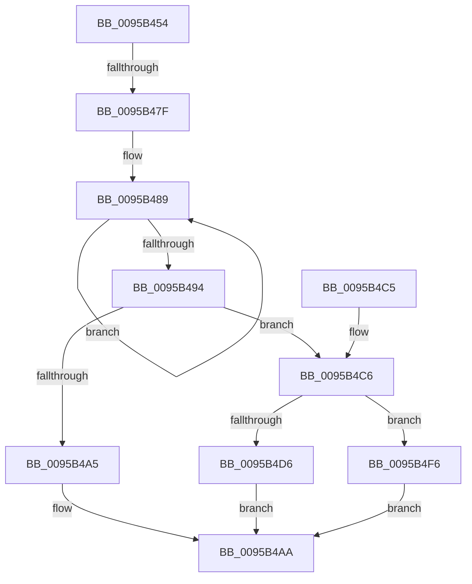

# KsepStringDuplicate

- RVA: `0x0095B454`–`0x0095B4FD` (길이 `169` bytes)
- VA: `0x000000014095B454`
- 실행 섹션: `PAGE`
- PDB 이름 있음: `예`; PDB Function 태그: `예`
- unwind 정보 RVA: `0x00092B0C`
- 디코드: `47`개 명령, `169/169` bytes 표시
- 미해석 바이트: `0` (있으면 어셈블리에 `.byte`로 보존)

> 이 문서는 커널 이미지의 기계어와 PDB 기호를 분석해 생성했습니다. 4번과 5번은 함수 원형과 자료형을 바이너리 사용 방식에서 추정한 C 해석이며 원본 소스 복구 결과는 아닙니다.

## 1. Dependencies

- 직접 호출 지점: **2**; 고유 호출 대상: **2**
- 직접 호출자로 확인된 함수: **10**
- RIP 상대 이미지 참조: **0**

### Outgoing calls
- `0x0095B4C9` → [KsepPoolAllocatePaged](../../text/4A/KsepPoolAllocatePaged_function_004A9EFC.md) (function, `0x004A9EFC`)
- `0x0095B4DF` → [memcpy](../../text/6C/memcpy_function_006C6840.md) (function, `0x006C6840`)

### Direct callers
- [KsepDbGetSdbString](../74/KsepDbGetSdbString_function_00748E60.md) at `0x00748E80`
- [KsepStringSplitMultiString](../74/KsepStringSplitMultiString_function_0074AB48.md) at `0x0074AC82`
- [KsepCacheDeviceInsertData](../74/KsepCacheDeviceInsertData_function_0074AD9C.md) at `0x0074ADE0`
- [KsepRegistryCreateKey](../74/KsepRegistryCreateKey_function_0074B008.md) at `0x0074B148`
- [KsepRegistryCreateKey](../74/KsepRegistryCreateKey_function_0074B008.md) at `0x0074B1A3`
- [KseAddHardwareId](KseAddHardwareId_function_00959254.md) at `0x00959352`
- [KsepRegistryOpenKey](KsepRegistryOpenKey_function_0095A79C.md) at `0x0095A848`
- [KsepDbCacheReadDevice](KsepDbCacheReadDevice_function_0095AAC8.md) at `0x0095AB12`
- [KsepDbQueryRegistryDeviceData](KsepDbQueryRegistryDeviceData_function_0095B174.md) at `0x0095B264`
- [KsepStringTransform](KsepStringTransform_function_0095B318.md) at `0x0095B358`
- [sub_00B27464](../B2/Unknown_function_00B27464.md) at `0x00B27483`

### Static image references
- 디코드된 RIP-relative 메모리 참조가 없습니다.

## 2. Other-region calls and transfers

- 다른 실행 섹션으로 향하는 call: **2**
  - `0x0095B4C9` → [KsepPoolAllocatePaged](../../text/4A/KsepPoolAllocatePaged_function_004A9EFC.md) (`PAGE` → `.text`)
  - `0x0095B4DF` → [memcpy](../../text/6C/memcpy_function_006C6840.md) (`PAGE` → `.text`)
- call이 아닌 외부 분기/꼬리 이동: **1**
  - `0x0095B479` → [sub_00B27812](../B2/Unknown_function_00B27812.md) (`tail-transfer`)

## 3. Assembly (complete function range)

```asm
0095B454  48 8B C4                        mov rax, rsp
0095B457  48 89 58 08                     mov qword ptr [rax + 8], rbx
0095B45B  48 89 68 10                     mov qword ptr [rax + 0x10], rbp
0095B45F  48 89 70 18                     mov qword ptr [rax + 0x18], rsi
0095B463  48 89 78 20                     mov qword ptr [rax + 0x20], rdi
0095B467  41 56                           push r14
0095B469  48 83 EC 20                     sub rsp, 0x20
0095B46D  45 33 F6                        xor r14d, r14d
0095B470  48 8B EA                        mov rbp, rdx
0095B473  48 8B F9                        mov rdi, rcx
0095B476  48 85 D2                        test rdx, rdx
0095B479  0F 84 93 C3 1C 00               je 0x140b27812
0095B47F  0F 57 C0                        xorps xmm0, xmm0
0095B482  48 83 CB FF                     or rbx, 0xffffffffffffffff
0095B486  0F 11 07                        movups xmmword ptr [rdi], xmm0
0095B489  48 FF C3                        inc rbx
0095B48C  66 44 39 74 5D 00               cmp word ptr [rbp + rbx*2], r14w
0095B492  75 F5                           jne 0x14095b489
0095B494  48 8D 1C 5D 02 00 00 00         lea rbx, [rbx*2 + 2]
0095B49C  48 81 FB FE FF 00 00            cmp rbx, 0xfffe
0095B4A3  76 21                           jbe 0x14095b4c6
0095B4A5  B8 06 02 00 C0                  mov eax, 0xc0000206
0095B4AA  48 8B 5C 24 30                  mov rbx, qword ptr [rsp + 0x30]
0095B4AF  48 8B 6C 24 38                  mov rbp, qword ptr [rsp + 0x38]
0095B4B4  48 8B 74 24 40                  mov rsi, qword ptr [rsp + 0x40]
0095B4B9  48 8B 7C 24 48                  mov rdi, qword ptr [rsp + 0x48]
0095B4BE  48 83 C4 20                     add rsp, 0x20
0095B4C2  41 5E                           pop r14
0095B4C4  C3                              ret
0095B4C5  CC                              int3
0095B4C6  48 8B CB                        mov rcx, rbx
0095B4C9  E8 2E EA B4 FF                  call 0x1404a9efc
0095B4CE  48 8B F0                        mov rsi, rax
0095B4D1  48 85 C0                        test rax, rax
0095B4D4  74 20                           je 0x14095b4f6
0095B4D6  4C 8B C3                        mov r8, rbx
0095B4D9  48 8B D5                        mov rdx, rbp
0095B4DC  48 8B C8                        mov rcx, rax
0095B4DF  E8 5C B3 D6 FF                  call 0x1406c6840
0095B4E4  8D 43 FE                        lea eax, [rbx - 2]
0095B4E7  48 89 77 08                     mov qword ptr [rdi + 8], rsi
0095B4EB  66 89 07                        mov word ptr [rdi], ax
0095B4EE  33 C0                           xor eax, eax
0095B4F0  66 89 5F 02                     mov word ptr [rdi + 2], bx
0095B4F4  EB B4                           jmp 0x14095b4aa
0095B4F6  B8 17 00 00 C0                  mov eax, 0xc0000017
0095B4FB  EB AD                           jmp 0x14095b4aa
```

## 4. C-style interpretation (structured pseudocode)

```c
__int64 __fastcall KsepStringDuplicate(__int64 a1, __int64 a2)
{
    __int64 result;
    __int64 v_r14;
    __int64 v_rbx;
    __int64 v_rsp;
    unsigned __int64 v_stack_p10;
    unsigned __int64 v_stack_p18;
    unsigned __int64 v_stack_p20;
    unsigned __int64 v_stack_p8;

    *(unsigned __int64 *)(v_rsp + 8) = v_rbx;
    *(unsigned __int64 *)(v_rsp + 16) = v_rbp;
    *(unsigned __int64 *)(v_rsp + 24) = v_rsi;
    *(unsigned __int64 *)(v_rsp + 32) = v_rdi;
    v_rsp = (v_rsp) - (32);
    v_r14 = 0;
    v_rbx = (v_rbx) | (-1);
    *(unsigned __int64 *)(a1) = v_xmm0;
loc_0095B489:
    v_rbx = (v_rbx) + 1;
    if ((*(unsigned __int16 *)(a2 + v_rbx * 2)) != 0) goto loc_0095B489;
    if ((v_rbx * 2 + 2) <= 0xFFFEULL) goto loc_0095B4C6;
loc_0095B4AA:
    v_rsp = (v_rsp) + (32);
    return (unsigned int)(0xC0000206ULL);
loc_0095B4C6:
    result = KsepPoolAllocatePaged(v_stack_p8, a2, a3, a4);
    if (result == 0) goto loc_0095B4F6;
    result = memcpy(result, v_stack_p10, v_stack_p8, a4);
    *(unsigned __int64 *)(v_stack_p20 + 8) = result;
    *(unsigned __int16 *)(v_stack_p20) = (unsigned __int16)(v_stack_p8 - 2);
    result = 0;
    *(unsigned __int16 *)(v_stack_p20 + 2) = (unsigned __int16)(v_stack_p8);
    goto loc_0095B4AA;
loc_0095B4F6:
    goto loc_0095B4AA;
}
```

## 5. (Beta) C Style

```c
int64_t KsepStringDuplicate(void *Arg1, void *Arg2)
{
    uint8_t *arg1 = (uint8_t *)Arg1;
    uint8_t *arg2 = (uint8_t *)Arg2;

    int64_t result;
    int64_t local_r14;
    int64_t local_rbx;
    int64_t local_rsp;
    uint64_t v_stack_p10;
    uint64_t v_stack_p18;
    uint64_t v_stack_p20;
    uint64_t v_stack_p8;

    *(uint64_t *)(local_rsp + 0x8) = local_rbx;
    *(uint64_t *)(local_rsp + 0x10) = local_rbp;
    *(uint64_t *)(local_rsp + 0x18) = local_rsi;
    *(uint64_t *)(local_rsp + 0x20) = local_rdi;
    local_rsp = (local_rsp) - (32);
    local_r14 = 0;
    local_rbx = (local_rbx) | (-1);
    *(uint64_t *)(arg1) = v_xmm0;
loc_0095B489:
    local_rbx = (local_rbx) + 1;
    if ((*(uint16_t *)(arg2 + local_rbx * 2)) != 0) goto loc_0095B489;
    if ((local_rbx * 2 + 2) <= 0xFFFEULL) goto loc_0095B4C6;
loc_0095B4AA:
    local_rsp = (local_rsp) + (32);
    return (uint32_t)(0xC0000206ULL);
loc_0095B4C6:
    result = KsepPoolAllocatePaged(v_stack_p8, Arg2, a3, a4);
    if (result == 0) goto loc_0095B4F6;
    result = memcpy(result, v_stack_p10, v_stack_p8, a4);
    *(uint64_t *)(v_stack_p20 + 0x8) = result;
    *(uint16_t *)(v_stack_p20) = (uint16_t)(v_stack_p8 - 2);
    result = 0;
    *(uint16_t *)(v_stack_p20 + 0x2) = (uint16_t)(v_stack_p8);
    goto loc_0095B4AA;
loc_0095B4F6:
    goto loc_0095B4AA;
}
```

### 관측된 메모리 오프셋

구조체 형식이 확인되지 않은 접근은 인자 기준의 오프셋으로만 기록했습니다.

| 기준 인자 | 오프셋 표현 | 폭 (bit) | 접근 |
|---|---:|---:|---|
| `Arg1` | `+ 0x0` | `16` | `W` |
| `Arg1` | `+ 0x0` | `128` | `R` |
| `Arg1` | `+ 0x2` | `16` | `W` |
| `Arg1` | `+ 0x8` | `64` | `W` |
| `Arg2` | `+ 0x0 + rbx*2` | `16` | `R` |

## 6. Execution-region graph

[열기: 2D/3D 그래프와 함수 탐색 컨트롤 패널](../../../control-panel.html?section=page&rva=0x0095B454&view=graph)

- 2D 그래프는 위에서 아래로 흐르고, 3D 그래프는 빈 공간을 드래그해 회전합니다. Shift+드래그는 이동, 휠은 확대·축소, 함수 노드 선택은 대상 보고서 이동입니다.

### Static fallback


