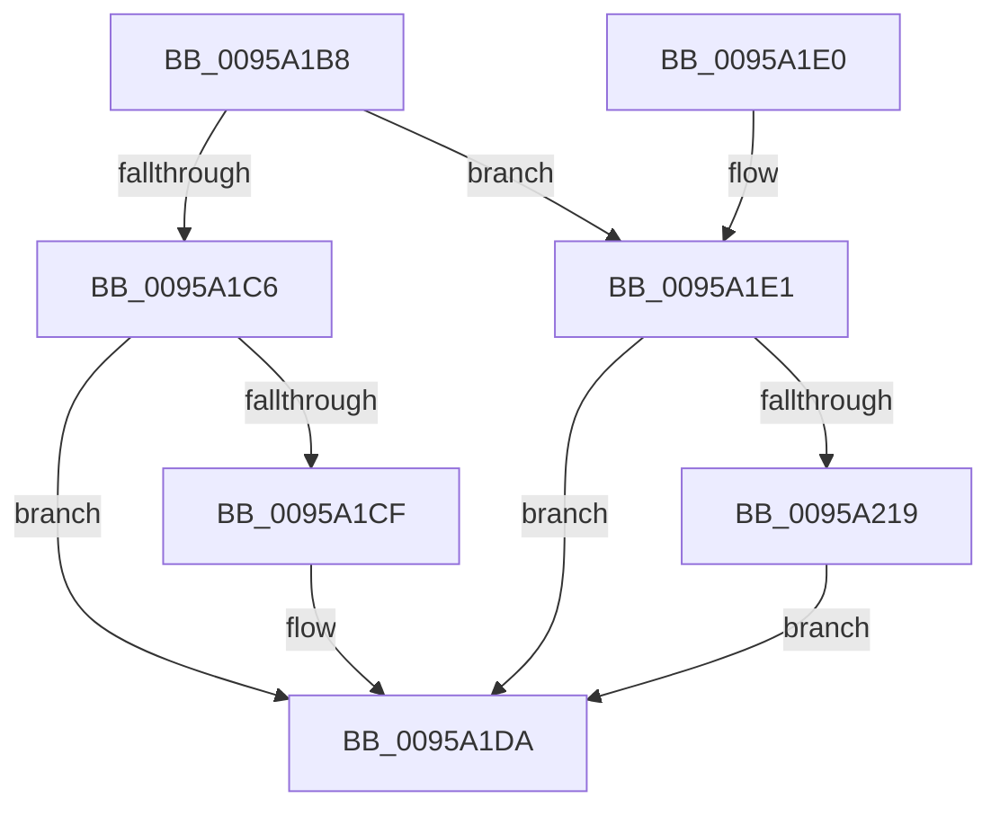

# KsepStringFree

- RVA: `0x0095A1B8`–`0x0095A231` (길이 `121` bytes)
- VA: `0x000000014095A1B8`
- 실행 섹션: `PAGE`
- PDB 이름 있음: `예`; PDB Function 태그: `아니요`
- unwind 정보 RVA: `0x0006CB1C`
- 디코드: `31`개 명령, `121/121` bytes 표시
- 미해석 바이트: `0` (있으면 어셈블리에 `.byte`로 보존)

> 이 문서는 커널 이미지의 기계어와 PDB 기호를 분석해 생성했습니다. 4번과 5번은 함수 원형과 자료형을 바이너리 사용 방식에서 추정한 C 해석이며 원본 소스 복구 결과는 아닙니다.

## 1. Dependencies

- 직접 호출 지점: **2**; 고유 호출 대상: **2**
- 직접 호출자로 확인된 함수: **11**
- RIP 상대 이미지 참조: **5**

### Outgoing calls
- `0x0095A1CF` → [KsepPoolFreePaged](../../text/4B/KsepPoolFreePaged_function_004B0E10.md) (function, `0x004B0E10`)
- `0x0095A22A` → [RtlAssert](../../text/5E/RtlAssert_function_005E75E0.md) (function, `0x005E75E0`)

### Direct callers
- [KsepLoadShimProvider](../../text/5C/KsepLoadShimProvider_function_005CBA44.md) at `0x005CBAB5`
- [KsepCacheHwIdFree](../../text/5C/KsepCacheHwIdFree_function_005CBE30.md) at `0x005CBE41`
- [KseSetDeviceFlags](../74/KseSetDeviceFlags_function_00748B20.md) at `0x00748C3A`
- [KsepDbQueryRegistryDeviceDataList](../74/KsepDbQueryRegistryDeviceDataList_function_007490B4.md) at `0x00749202`
- [KsepStringSplitMultiString](../74/KsepStringSplitMultiString_function_0074AB48.md) at `0x0074ACAB`
- [KsepCacheDeviceInsertData](../74/KsepCacheDeviceInsertData_function_0074AD9C.md) at `0x0074AE08`
- [KsepRegistryCreateKey](../74/KsepRegistryCreateKey_function_0074B008.md) at `0x0074B20D`
- [KsepRegistryCreateKey](../74/KsepRegistryCreateKey_function_0074B008.md) at `0x0074B216`
- [KsepDbFreeDriverShims](KsepDbFreeDriverShims_function_00958754.md) at `0x00958789`
- [KsepDbFreeDriverShims](KsepDbFreeDriverShims_function_00958754.md) at `0x00958797`
- [KsepDbFreeDriverShims](KsepDbFreeDriverShims_function_00958754.md) at `0x009587A7`
- [KseAddHardwareId](KseAddHardwareId_function_00959254.md) at `0x00959378`
- [KsepCacheDeviceFree](KsepCacheDeviceFree_function_0095AD00.md) at `0x0095AD37`
- [KsepCacheDeviceFree](KsepCacheDeviceFree_function_0095AD00.md) at `0x0095AD53`
- [sub_00B27464](../B2/Unknown_function_00B27464.md) at `0x00B27519`

### Static image references
- `0x0095A1E6` → RVA `0x00F101C0` (`.data`; read/write)
- `0x0095A1F0` → RVA `0x00F101E0` (`.data`; read)
- `0x0095A20F` → RVA `0x00E66CE8` (`.data`; read)
- `0x0095A21C` → RVA `0x00B01160` (` ?? ::NNGAKEGL::`string'`; read)
- `0x0095A223` → RVA `0x00B010D0` (` ?? ::NNGAKEGL::`string'`; read)

## 2. Other-region calls and transfers

- 다른 실행 섹션으로 향하는 call: **2**
  - `0x0095A1CF` → [KsepPoolFreePaged](../../text/4B/KsepPoolFreePaged_function_004B0E10.md) (`PAGE` → `.text`)
  - `0x0095A22A` → [RtlAssert](../../text/5E/RtlAssert_function_005E75E0.md) (`PAGE` → `.text`)
- 별도 외부 분기/꼬리 이동을 확인하지 못했습니다.

## 3. Assembly (complete function range)

```asm
0095A1B8  40 53                           push rbx
0095A1BA  48 83 EC 20                     sub rsp, 0x20
0095A1BE  48 8B D9                        mov rbx, rcx
0095A1C1  48 85 C9                        test rcx, rcx
0095A1C4  74 1B                           je 0x14095a1e1
0095A1C6  48 8B 49 08                     mov rcx, qword ptr [rcx + 8]
0095A1CA  48 85 C9                        test rcx, rcx
0095A1CD  74 0B                           je 0x14095a1da
0095A1CF  E8 3C 6C B5 FF                  call 0x1404b0e10
0095A1D4  0F 57 C0                        xorps xmm0, xmm0
0095A1D7  0F 11 03                        movups xmmword ptr [rbx], xmm0
0095A1DA  48 83 C4 20                     add rsp, 0x20
0095A1DE  5B                              pop rbx
0095A1DF  C3                              ret
0095A1E0  CC                              int3
0095A1E1  B8 01 00 00 00                  mov eax, 1
0095A1E6  F0 0F C1 05 D2 5F 5B 00         lock xadd dword ptr [rip + 0x5b5fd2], eax
0095A1EE  FF C0                           inc eax
0095A1F0  48 8D 15 E9 5F 5B 00            lea rdx, [rip + 0x5b5fe9]
0095A1F7  83 E0 3F                        and eax, 0x3f
0095A1FA  41 B8 4B 03 00 00               mov r8d, 0x34b
0095A200  C7 44 C2 04 20 04 00 C0         mov dword ptr [rdx + rax*8 + 4], 0xc0000420
0095A208  C7 04 C2 4B 03 03 00            mov dword ptr [rdx + rax*8], 0x3034b
0095A20F  8B 05 D3 CA 50 00               mov eax, dword ptr [rip + 0x50cad3]
0095A215  A8 04                           test al, 4
0095A217  74 C1                           je 0x14095a1da
0095A219  45 33 C9                        xor r9d, r9d
0095A21C  48 8D 15 3D 6F 1A 00            lea rdx, [rip + 0x1a6f3d]
0095A223  48 8D 0D A6 6E 1A 00            lea rcx, [rip + 0x1a6ea6]
0095A22A  E8 B1 D3 C8 FF                  call 0x1405e75e0
0095A22F  EB A9                           jmp 0x14095a1da
```

## 4. C-style interpretation (structured pseudocode)

```c
__int64 __fastcall KsepStringFree(__int64 a1, __int64 a2, __int64 a3, int a4)
{
    __int64 result;
    __int64 v_rsp;

    v_rsp = (v_rsp) - (32);
    if (a1 == 0) goto loc_0095A1E1;
    if (*(unsigned __int64 *)(a1 + 8) != 0) {
        result = KsepPoolFreePaged(*(unsigned __int64 *)(a1 + 8), a2, a3, a4);
        *(unsigned __int64 *)(a1) = v_xmm0;
    }
    v_rsp = (v_rsp) + (32);
    return result;
loc_0095A1E1:
    result = (unsigned int)((1) + 1);
    result = (unsigned int)((result) & (63));
    *(unsigned int *)(v_rip + 5988329 + result * 8 + 4) = 0xC0000420ULL;
    *(unsigned int *)(v_rip + 5988329 + result * 8) = 0x3034BULL;
    if ((((unsigned __int8)((unsigned int)(*(unsigned int *)(v_rip + 5294803)))) & (4)) == 0) goto loc_0095A1DA;
    a4 = 0;
    result = RtlAssert(v_rip + 1732262, v_rip + 1732413, 843, a4);
    goto loc_0095A1DA;
}
```

## 5. (Beta) C Style

```c
int64_t KsepStringFree(void *Arg1, int64_t Arg2, int64_t Arg3, int32_t Arg4)
{
    uint8_t *arg1 = (uint8_t *)Arg1;

    int64_t result;
    int64_t local_rsp;

    local_rsp = (local_rsp) - (32);
    if (Arg1 == NULL) goto loc_0095A1E1;
    if (*(uint64_t *)(arg1 + 0x8) != 0) {
        result = KsepPoolFreePaged(*(uint64_t *)(arg1 + 0x8), Arg2, Arg3, Arg4);
        *(uint64_t *)(arg1) = v_xmm0;
    }
    local_rsp = (local_rsp) + (32);
    return result;
loc_0095A1E1:
    result = (uint32_t)((1) + 1);
    result = (uint32_t)((result) & (63));
    *(uint32_t *)(v_rip + 0x5B5FE9 + result * 8 + 0x4) = 0xC0000420ULL;
    *(uint32_t *)(v_rip + 0x5B5FE9 + result * 8) = 0x3034BULL;
    if ((((uint8_t)((uint32_t)(*(uint32_t *)(v_rip + 0x50CAD3)))) & (4)) == 0) goto loc_0095A1DA;
    Arg4 = 0;
    result = RtlAssert(v_rip + 1732262, v_rip + 1732413, 843, Arg4);
    goto loc_0095A1DA;
}
```

### 관측된 메모리 오프셋

구조체 형식이 확인되지 않은 접근은 인자 기준의 오프셋으로만 기록했습니다.

| 기준 인자 | 오프셋 표현 | 폭 (bit) | 접근 |
|---|---:|---:|---|
| `Arg1` | `+ 0x0` | `128` | `R` |

## 6. Execution-region graph

[열기: 2D/3D 그래프와 함수 탐색 컨트롤 패널](../../../control-panel.html?section=page&rva=0x0095A1B8&view=graph)

- 2D 그래프는 위에서 아래로 흐르고, 3D 그래프는 빈 공간을 드래그해 회전합니다. Shift+드래그는 이동, 휠은 확대·축소, 함수 노드 선택은 대상 보고서 이동입니다.

### Static fallback


