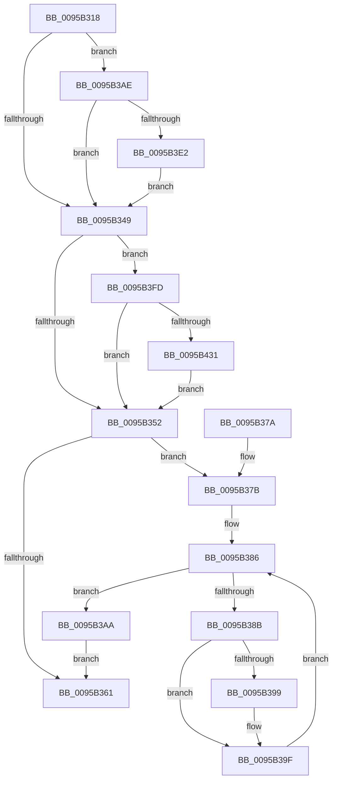

# KsepStringTransform

- RVA: `0x0095B318`–`0x0095B44C` (길이 `308` bytes)
- VA: `0x000000014095B318`
- 실행 섹션: `PAGE`
- PDB 이름 있음: `예`; PDB Function 태그: `아니요`
- unwind 정보 RVA: `0x00092AF0`
- 디코드: `76`개 명령, `308/308` bytes 표시
- 미해석 바이트: `0` (있으면 어셈블리에 `.byte`로 보존)

> 이 문서는 커널 이미지의 기계어와 PDB 기호를 분석해 생성했습니다. 4번과 5번은 함수 원형과 자료형을 바이너리 사용 방식에서 추정한 C 해석이며 원본 소스 복구 결과는 아닙니다.

## 1. Dependencies

- 직접 호출 지점: **3**; 고유 호출 대상: **2**
- 직접 호출자로 확인된 함수: **3**
- RIP 상대 이미지 참조: **6**

### Outgoing calls
- `0x0095B358` → [KsepStringDuplicate](KsepStringDuplicate_function_0095B454.md) (function, `0x0095B454`)
- `0x0095B3F3` → [RtlAssert](../../text/5E/RtlAssert_function_005E75E0.md) (function, `0x005E75E0`)
- `0x0095B442` → [RtlAssert](../../text/5E/RtlAssert_function_005E75E0.md) (function, `0x005E75E0`)

### Direct callers
- [KseSetDeviceFlags](../74/KseSetDeviceFlags_function_00748B20.md) at `0x00748B83`
- [KsepDbQueryRegistryDeviceDataList](../74/KsepDbQueryRegistryDeviceDataList_function_007490B4.md) at `0x007490FC`
- [KsepDbQueryRegistryDeviceData](KsepDbQueryRegistryDeviceData_function_0095B174.md) at `0x0095B1B5`

### Static image references
- `0x0095B332` → RVA `0x00F101E0` (`.data`; read)
- `0x0095B3B0` → RVA `0x00F101C0` (`.data`; read/write)
- `0x0095B3D4` → RVA `0x00E66CE8` (`.data`; read)
- `0x0095B3E5` → RVA `0x00B01160` (` ?? ::NNGAKEGL::`string'`; read)
- `0x0095B3EC` → RVA `0x00B010B0` (` ?? ::NNGAKEGL::`string'`; read)
- `0x0095B43B` → RVA `0x00B01120` (` ?? ::NNGAKEGL::`string'`; read)

## 2. Other-region calls and transfers

- 다른 실행 섹션으로 향하는 call: **2**
  - `0x0095B3F3` → [RtlAssert](../../text/5E/RtlAssert_function_005E75E0.md) (`PAGE` → `.text`)
  - `0x0095B442` → [RtlAssert](../../text/5E/RtlAssert_function_005E75E0.md) (`PAGE` → `.text`)
- 별도 외부 분기/꼬리 이동을 확인하지 못했습니다.

## 3. Assembly (complete function range)

```asm
0095B318  48 89 5C 24 08                  mov qword ptr [rsp + 8], rbx
0095B31D  48 89 6C 24 10                  mov qword ptr [rsp + 0x10], rbp
0095B322  48 89 74 24 18                  mov qword ptr [rsp + 0x18], rsi
0095B327  57                              push rdi
0095B328  41 54                           push r12
0095B32A  41 56                           push r14
0095B32C  48 83 EC 20                     sub rsp, 0x20
0095B330  33 DB                           xor ebx, ebx
0095B332  4C 8D 35 A7 4E 5B 00            lea r14, [rip + 0x5b4ea7]
0095B339  48 8B F2                        mov rsi, rdx
0095B33C  48 8B F9                        mov rdi, rcx
0095B33F  BD 01 00 00 00                  mov ebp, 1
0095B344  48 85 C9                        test rcx, rcx
0095B347  74 65                           je 0x14095b3ae
0095B349  48 85 F6                        test rsi, rsi
0095B34C  0F 84 AB 00 00 00               je 0x14095b3fd
0095B352  48 8B D6                        mov rdx, rsi
0095B355  48 8B CF                        mov rcx, rdi
0095B358  E8 F7 00 00 00                  call 0x14095b454
0095B35D  85 C0                           test eax, eax
0095B35F  79 1A                           jns 0x14095b37b
0095B361  48 8B 5C 24 40                  mov rbx, qword ptr [rsp + 0x40]
0095B366  48 8B 6C 24 48                  mov rbp, qword ptr [rsp + 0x48]
0095B36B  48 8B 74 24 50                  mov rsi, qword ptr [rsp + 0x50]
0095B370  48 83 C4 20                     add rsp, 0x20
0095B374  41 5E                           pop r14
0095B376  41 5C                           pop r12
0095B378  5F                              pop rdi
0095B379  C3                              ret
0095B37A  CC                              int3
0095B37B  0F B7 07                        movzx eax, word ptr [rdi]
0095B37E  B9 FE FF 00 00                  mov ecx, 0xfffe
0095B383  66 23 C1                        and ax, cx
0095B386  66 3B D8                        cmp bx, ax
0095B389  73 1F                           jae 0x14095b3aa
0095B38B  48 8B 4F 08                     mov rcx, qword ptr [rdi + 8]
0095B38F  0F B7 C3                        movzx eax, bx
0095B392  66 83 3C 41 5C                  cmp word ptr [rcx + rax*2], 0x5c
0095B397  75 06                           jne 0x14095b39f
0095B399  66 C7 04 41 21 00               mov word ptr [rcx + rax*2], 0x21
0095B39F  0F B7 07                        movzx eax, word ptr [rdi]
0095B3A2  66 03 DD                        add bx, bp
0095B3A5  66 D1 E8                        shr ax, 1
0095B3A8  EB DC                           jmp 0x14095b386
0095B3AA  33 C0                           xor eax, eax
0095B3AC  EB B3                           jmp 0x14095b361
0095B3AE  8B C5                           mov eax, ebp
0095B3B0  F0 0F C1 05 08 4E 5B 00         lock xadd dword ptr [rip + 0x5b4e08], eax
0095B3B8  03 C5                           add eax, ebp
0095B3BA  41 B8 1D 03 00 00               mov r8d, 0x31d
0095B3C0  83 E0 3F                        and eax, 0x3f
0095B3C3  41 C7 44 C6 04 20 04 00 C0      mov dword ptr [r14 + rax*8 + 4], 0xc0000420
0095B3CC  41 C7 04 C6 1D 03 03 00         mov dword ptr [r14 + rax*8], 0x3031d
0095B3D4  8B 05 0E B9 50 00               mov eax, dword ptr [rip + 0x50b90e]
0095B3DA  A8 04                           test al, 4
0095B3DC  0F 84 67 FF FF FF               je 0x14095b349
0095B3E2  45 33 C9                        xor r9d, r9d
0095B3E5  48 8D 15 74 5D 1A 00            lea rdx, [rip + 0x1a5d74]
0095B3EC  48 8D 0D BD 5C 1A 00            lea rcx, [rip + 0x1a5cbd]
0095B3F3  E8 E8 C1 C8 FF                  call 0x1405e75e0
0095B3F8  E9 4C FF FF FF                  jmp 0x14095b349
0095B3FD  8B C5                           mov eax, ebp
0095B3FF  F0 0F C1 05 B9 4D 5B 00         lock xadd dword ptr [rip + 0x5b4db9], eax
0095B407  03 C5                           add eax, ebp
0095B409  41 B8 1E 03 00 00               mov r8d, 0x31e
0095B40F  83 E0 3F                        and eax, 0x3f
0095B412  41 C7 44 C6 04 20 04 00 C0      mov dword ptr [r14 + rax*8 + 4], 0xc0000420
0095B41B  41 C7 04 C6 1E 03 03 00         mov dword ptr [r14 + rax*8], 0x3031e
0095B423  8B 05 BF B8 50 00               mov eax, dword ptr [rip + 0x50b8bf]
0095B429  A8 04                           test al, 4
0095B42B  0F 84 21 FF FF FF               je 0x14095b352
0095B431  45 33 C9                        xor r9d, r9d
0095B434  48 8D 15 25 5D 1A 00            lea rdx, [rip + 0x1a5d25]
0095B43B  48 8D 0D DE 5C 1A 00            lea rcx, [rip + 0x1a5cde]
0095B442  E8 99 C1 C8 FF                  call 0x1405e75e0
0095B447  E9 06 FF FF FF                  jmp 0x14095b352
```

## 4. C-style interpretation (structured pseudocode)

```c
__int64 __fastcall KsepStringTransform(__int64 a1, __int64 a2, __int64 a3, int a4)
{
    __int64 result;
    __int64 v_rbx;
    __int64 v_rsp;
    unsigned __int64 v_stack_p10;
    unsigned __int64 v_stack_p18;
    unsigned __int64 v_stack_p8;

    v_stack_p8 = v_rbx;
    v_stack_p10 = v_rbp;
    v_stack_p18 = v_rsi;
    v_rsp = (v_rsp) - (32);
    v_rbx = 0;
    if (a1 == 0) goto loc_0095B3AE;
loc_0095B349:
    if (a2 == 0) goto loc_0095B3FD;
loc_0095B352:
    result = KsepStringDuplicate(a1, a2, a3, a4);
    if (!sign_flag) goto loc_0095B37B;
loc_0095B361:
    v_rsp = (v_rsp) + (32);
    return result;
loc_0095B37B:
    result = (unsigned __int16)((*(unsigned __int16 *)(a1)) & ((unsigned __int16)((unsigned int)(0xFFFEULL))));
loc_0095B386:
    if (((unsigned __int16)(v_stack_p8)) >= ((unsigned __int16)(result))) goto loc_0095B3AA;
    if ((*(unsigned __int16 *)(*(unsigned __int64 *)(a1 + 8) + (unsigned __int16)(v_stack_p8) * 2)) == 92) {
        *(unsigned __int16 *)(*(unsigned __int64 *)(a1 + 8) + (unsigned __int16)(v_stack_p8) * 2) = 33;
    }
    v_rbx = (unsigned __int16)((v_stack_p8) + ((unsigned __int16)(v_stack_p10)));
    result = (unsigned __int16)((*(unsigned __int16 *)(a1)) >> (1));
    goto loc_0095B386;
loc_0095B3AA:
    result = 0;
    goto loc_0095B361;
loc_0095B3AE:
    result = (unsigned int)(((unsigned int)((unsigned int)(v_stack_p10))) + ((unsigned int)(v_stack_p10)));
    result = (unsigned int)((result) & (63));
    *(unsigned int *)(v_rip + 5983911 + result * 8 + 4) = 0xC0000420ULL;
    *(unsigned int *)(v_rip + 5983911 + result * 8) = 0x3031DULL;
    if ((((unsigned __int8)((unsigned int)(*(unsigned int *)(v_rip + 5290254)))) & (4)) == 0) goto loc_0095B349;
    a4 = 0;
    result = RtlAssert(v_rip + 1727677, v_rip + 1727860, 797, a4);
    goto loc_0095B349;
loc_0095B3FD:
    result = (unsigned int)(((unsigned int)((unsigned int)(v_stack_p10))) + ((unsigned int)(v_stack_p10)));
    result = (unsigned int)((result) & (63));
    *(unsigned int *)(v_rip + 5983911 + result * 8 + 4) = 0xC0000420ULL;
    *(unsigned int *)(v_rip + 5983911 + result * 8) = 0x3031EULL;
    if ((((unsigned __int8)((unsigned int)(*(unsigned int *)(v_rip + 5290175)))) & (4)) == 0) goto loc_0095B352;
    a4 = 0;
    result = RtlAssert(v_rip + 1727710, v_rip + 1727781, 798, a4);
    goto loc_0095B352;
}
```

## 5. (Beta) C Style

```c
int64_t KsepStringTransform(void *Arg1, int64_t Arg2, int64_t Arg3, int32_t Arg4)
{
    uint8_t *arg1 = (uint8_t *)Arg1;

    int64_t result;
    int64_t local_rbx;
    int64_t local_rsp;
    uint64_t v_stack_p10;
    uint64_t v_stack_p18;
    uint64_t v_stack_p8;

    v_stack_p8 = local_rbx;
    v_stack_p10 = local_rbp;
    v_stack_p18 = local_rsi;
    local_rsp = (local_rsp) - (32);
    local_rbx = 0;
    if (Arg1 == NULL) goto loc_0095B3AE;
loc_0095B349:
    if (Arg2 == 0) goto loc_0095B3FD;
loc_0095B352:
    result = KsepStringDuplicate(Arg1, Arg2, Arg3, Arg4);
    if (!sign_flag) goto loc_0095B37B;
loc_0095B361:
    local_rsp = (local_rsp) + (32);
    return result;
loc_0095B37B:
    result = (uint16_t)((*(uint16_t *)(arg1)) & ((uint16_t)((uint32_t)(0xFFFEULL))));
loc_0095B386:
    if (((uint16_t)(v_stack_p8)) >= ((uint16_t)(result))) goto loc_0095B3AA;
    if ((*(uint16_t *)(*(uint64_t *)(arg1 + 0x8) + (uint16_t)(v_stack_p8) * 2)) == 92) {
        *(uint16_t *)(*(uint64_t *)(arg1 + 0x8) + (uint16_t)(v_stack_p8) * 2) = 33;
    }
    local_rbx = (uint16_t)((v_stack_p8) + ((uint16_t)(v_stack_p10)));
    result = (uint16_t)((*(uint16_t *)(arg1)) >> (1));
    goto loc_0095B386;
loc_0095B3AA:
    result = 0;
    goto loc_0095B361;
loc_0095B3AE:
    result = (uint32_t)(((uint32_t)((uint32_t)(v_stack_p10))) + ((uint32_t)(v_stack_p10)));
    result = (uint32_t)((result) & (63));
    *(uint32_t *)(v_rip + 0x5B4EA7 + result * 8 + 0x4) = 0xC0000420ULL;
    *(uint32_t *)(v_rip + 0x5B4EA7 + result * 8) = 0x3031DULL;
    if ((((uint8_t)((uint32_t)(*(uint32_t *)(v_rip + 0x50B90E)))) & (4)) == 0) goto loc_0095B349;
    Arg4 = 0;
    result = RtlAssert(v_rip + 1727677, v_rip + 1727860, 797, Arg4);
    goto loc_0095B349;
loc_0095B3FD:
    result = (uint32_t)(((uint32_t)((uint32_t)(v_stack_p10))) + ((uint32_t)(v_stack_p10)));
    result = (uint32_t)((result) & (63));
    *(uint32_t *)(v_rip + 0x5B4EA7 + result * 8 + 0x4) = 0xC0000420ULL;
    *(uint32_t *)(v_rip + 0x5B4EA7 + result * 8) = 0x3031EULL;
    if ((((uint8_t)((uint32_t)(*(uint32_t *)(v_rip + 0x50B8BF)))) & (4)) == 0) goto loc_0095B352;
    Arg4 = 0;
    result = RtlAssert(v_rip + 1727710, v_rip + 1727781, 798, Arg4);
    goto loc_0095B352;
}
```

### 관측된 메모리 오프셋

구조체 형식이 확인되지 않은 접근은 인자 기준의 오프셋으로만 기록했습니다.

| 기준 인자 | 오프셋 표현 | 폭 (bit) | 접근 |
|---|---:|---:|---|
| `Arg1` | `+ 0x0` | `16` | `R` |
| `Arg1` | `+ 0x8` | `64` | `R` |

## 6. Execution-region graph

[열기: 2D/3D 그래프와 함수 탐색 컨트롤 패널](../../../control-panel.html?section=page&rva=0x0095B318&view=graph)

- 2D 그래프는 위에서 아래로 흐르고, 3D 그래프는 빈 공간을 드래그해 회전합니다. Shift+드래그는 이동, 휠은 확대·축소, 함수 노드 선택은 대상 보고서 이동입니다.

### Static fallback


