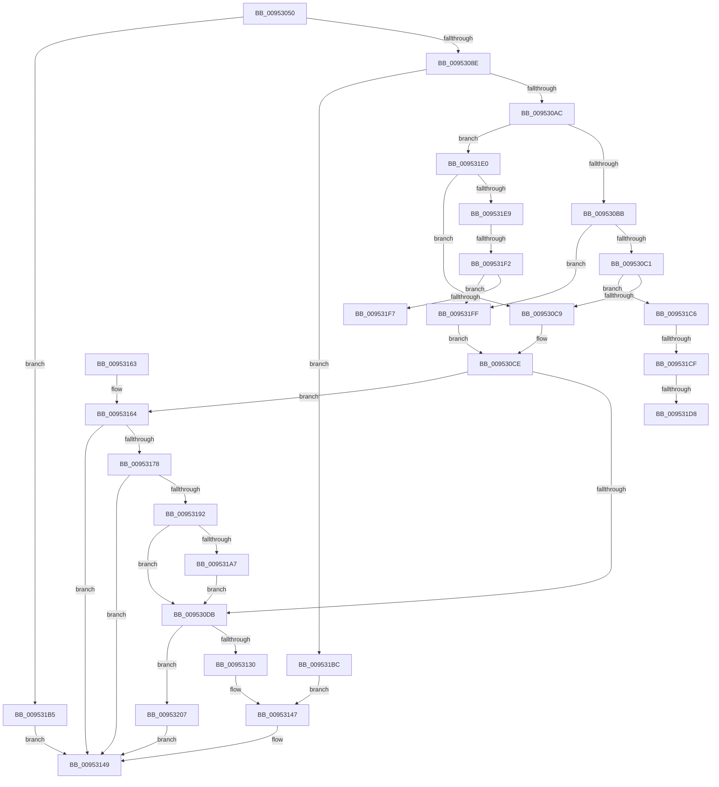

# NtApphelpCacheControl

- RVA: `0x00953050`–`0x0095320F` (길이 `447` bytes)
- VA: `0x0000000140953050`
- 실행 섹션: `PAGE`
- PDB 이름 있음: `예`; PDB Function 태그: `예`
- unwind 정보 RVA: `0x0009203C`
- 디코드: `109`개 명령, `447/447` bytes 표시
- 미해석 바이트: `0` (있으면 어셈블리에 `.byte`로 보존)

> 이 문서는 커널 이미지의 기계어와 PDB 기호를 분석해 생성했습니다. 4번과 5번은 함수 원형과 자료형을 바이너리 사용 방식에서 추정한 C 해석이며 원본 소스 복구 결과는 아닙니다.

## 1. Dependencies

- 직접 호출 지점: **8**; 고유 호출 대상: **8**
- 직접 호출자로 확인된 함수: **0**
- RIP 상대 이미지 참조: **2**

### Outgoing calls
- `0x009530E6` → [KeInitializeEvent](../../text/40/KeInitializeEvent_function_0040DD10.md) (function, `0x0040DD10`)
- `0x0095311F` → [IoBuildDeviceIoControlRequest](../../text/20/IoBuildDeviceIoControlRequest_function_00204FD0.md) (function, `0x00204FD0`)
- `0x00953130` → [ExGetPreviousMode](../../text/44/ExGetPreviousMode_function_0044C3A0.md) (function, `0x0044C3A0`)
- `0x00953142` → [IofCallDriver](../../text/29/IofCallDriver_function_0029B4B0.md) (function, `0x0029B4B0`)
- `0x0095316F` → [RtlInitUnicodeStringEx](../../text/46/RtlInitUnicodeStringEx_function_00463960.md) (function, `0x00463960`)
- `0x00953189` → [IoGetDeviceObjectPointer](IoGetDeviceObjectPointer_function_00953220.md) (function, `0x00953220`)
- `0x009531AB` → [ObfDereferenceObject](../../text/2F/ObfDereferenceObject_function_002F9350.md) (function, `0x002F9350`)
- `0x009531BF` → [AhcCacheQueryHwId](../83/AhcCacheQueryHwId_function_0083ACB8.md) (function, `0x0083ACB8`)

### Direct callers
- 이 함수 시작 RVA로 연결되는 직접 call은 확인되지 않았습니다. 간접 호출은 완전히 역산할 수 없습니다.

### Static image references
- `0x009530CE` → RVA `0x00EF0008` (`.data`; read)
- `0x00953164` → RVA `0x00B0E050` (` ?? ::NNGAKEGL::`string'`; read)

## 2. Other-region calls and transfers

- 다른 실행 섹션으로 향하는 call: **6**
  - `0x009530E6` → [KeInitializeEvent](../../text/40/KeInitializeEvent_function_0040DD10.md) (`PAGE` → `.text`)
  - `0x0095311F` → [IoBuildDeviceIoControlRequest](../../text/20/IoBuildDeviceIoControlRequest_function_00204FD0.md) (`PAGE` → `.text`)
  - `0x00953130` → [ExGetPreviousMode](../../text/44/ExGetPreviousMode_function_0044C3A0.md) (`PAGE` → `.text`)
  - `0x00953142` → [IofCallDriver](../../text/29/IofCallDriver_function_0029B4B0.md) (`PAGE` → `.text`)
  - `0x0095316F` → [RtlInitUnicodeStringEx](../../text/46/RtlInitUnicodeStringEx_function_00463960.md) (`PAGE` → `.text`)
  - `0x009531AB` → [ObfDereferenceObject](../../text/2F/ObfDereferenceObject_function_002F9350.md) (`PAGE` → `.text`)
- call이 아닌 외부 분기/꼬리 이동: **5**
  - `0x009531C9` → [sub_00B2631C](../B2/Unknown_function_00B2631C.md) (`tail-transfer`)
  - `0x009531D2` → [sub_00B2631C](../B2/Unknown_function_00B2631C.md) (`tail-transfer`)
  - `0x009531DB` → [sub_00B2631C + 0x7](../B2/Unknown_function_00B2631C.md) (`tail-transfer`)
  - `0x009531EC` → [sub_00B2631C](../B2/Unknown_function_00B2631C.md) (`tail-transfer`)
  - `0x009531FA` → [sub_00B2631C + 0x7](../B2/Unknown_function_00B2631C.md) (`tail-transfer`)

## 3. Assembly (complete function range)

```asm
00953050  48 89 5C 24 08                  mov qword ptr [rsp + 8], rbx
00953055  48 89 74 24 10                  mov qword ptr [rsp + 0x10], rsi
0095305A  55                              push rbp
0095305B  57                              push rdi
0095305C  41 57                           push r15
0095305E  48 8D 6C 24 B9                  lea rbp, [rsp - 0x47]
00953063  48 81 EC 90 00 00 00            sub rsp, 0x90
0095306A  33 C0                           xor eax, eax
0095306C  0F 57 C0                        xorps xmm0, xmm0
0095306F  48 89 45 37                     mov qword ptr [rbp + 0x37], rax
00953073  0F 57 C9                        xorps xmm1, xmm1
00953076  48 8B F2                        mov rsi, rdx
00953079  0F 11 45 07                     movups xmmword ptr [rbp + 7], xmm0
0095307D  0F 11 4D 27                     movups xmmword ptr [rbp + 0x27], xmm1
00953081  0F 11 45 17                     movups xmmword ptr [rbp + 0x17], xmm0
00953085  83 F9 0C                        cmp ecx, 0xc
00953088  0F 8D 27 01 00 00               jge 0x1409531b5
0095308E  48 21 45 7F                     and qword ptr [rbp + 0x7f], rax
00953092  8D 3C 8D 00 00 00 00            lea edi, [rcx*4]
00953099  48 21 45 77                     and qword ptr [rbp + 0x77], rax
0095309D  81 CF 03 00 22 00               or edi, 0x220003
009530A3  83 F9 09                        cmp ecx, 9
009530A6  0F 84 10 01 00 00               je 0x1409531bc
009530AC  41 BF 01 00 00 C0               mov r15d, 0xc0000001
009530B2  83 F9 05                        cmp ecx, 5
009530B5  0F 8F 25 01 00 00               jg 0x1409531e0
009530BB  0F 84 3E 01 00 00               je 0x1409531ff
009530C1  85 C9                           test ecx, ecx
009530C3  0F 85 FD 00 00 00               jne 0x1409531c6
009530C9  BB 25 02 00 C0                  mov ebx, 0xc0000225
009530CE  48 39 05 33 CF 59 00            cmp qword ptr [rip + 0x59cf33], rax
009530D5  0F 84 89 00 00 00               je 0x140953164
009530DB  45 33 C0                        xor r8d, r8d
009530DE  48 8D 4D 27                     lea rcx, [rbp + 0x27]
009530E2  41 8D 50 01                     lea edx, [r8 + 1]
009530E6  E8 25 AC AB FF                  call 0x14040dd10
009530EB  48 8B 15 16 CF 59 00            mov rdx, qword ptr [rip + 0x59cf16]
009530F2  48 8D 45 17                     lea rax, [rbp + 0x17]
009530F6  48 89 44 24 40                  mov qword ptr [rsp + 0x40], rax
009530FB  41 B9 88 01 00 00               mov r9d, 0x188
00953101  48 8D 45 27                     lea rax, [rbp + 0x27]
00953105  4C 8B C6                        mov r8, rsi
00953108  48 89 44 24 38                  mov qword ptr [rsp + 0x38], rax
0095310D  8B CF                           mov ecx, edi
0095310F  C6 44 24 30 00                  mov byte ptr [rsp + 0x30], 0
00953114  83 64 24 28 00                  and dword ptr [rsp + 0x28], 0
00953119  48 83 64 24 20 00               and qword ptr [rsp + 0x20], 0
0095311F  E8 AC 1E 8B FF                  call 0x140204fd0
00953124  48 8B D8                        mov rbx, rax
00953127  48 85 C0                        test rax, rax
0095312A  0F 84 D7 00 00 00               je 0x140953207
00953130  E8 6B 92 AF FF                  call 0x14044c3a0
00953135  88 43 40                        mov byte ptr [rbx + 0x40], al
00953138  48 8B D3                        mov rdx, rbx
0095313B  48 8B 0D C6 CE 59 00            mov rcx, qword ptr [rip + 0x59cec6]
00953142  E8 69 83 94 FF                  call 0x14029b4b0
00953147  8B D8                           mov ebx, eax
00953149  4C 8D 9C 24 90 00 00 00         lea r11, [rsp + 0x90]
00953151  8B C3                           mov eax, ebx
00953153  49 8B 5B 20                     mov rbx, qword ptr [r11 + 0x20]
00953157  49 8B 73 28                     mov rsi, qword ptr [r11 + 0x28]
0095315B  49 8B E3                        mov rsp, r11
0095315E  41 5F                           pop r15
00953160  5F                              pop rdi
00953161  5D                              pop rbp
00953162  C3                              ret
00953163  CC                              int3
00953164  48 8D 15 E5 AE 1B 00            lea rdx, [rip + 0x1baee5]
0095316B  48 8D 4D 07                     lea rcx, [rbp + 7]
0095316F  E8 EC 07 B1 FF                  call 0x140463960
00953174  85 C0                           test eax, eax
00953176  78 D1                           js 0x140953149
00953178  4C 8D 4D 77                     lea r9, [rbp + 0x77]
0095317C  BA 00 00 00 C0                  mov edx, 0xc0000000
00953181  4C 8D 45 7F                     lea r8, [rbp + 0x7f]
00953185  48 8D 4D 07                     lea rcx, [rbp + 7]
00953189  E8 92 00 00 00                  call 0x140953220
0095318E  85 C0                           test eax, eax
00953190  78 B7                           js 0x140953149
00953192  48 8B 4D 77                     mov rcx, qword ptr [rbp + 0x77]
00953196  33 C0                           xor eax, eax
00953198  F0 48 0F B1 0D 67 CE 59 00      lock cmpxchg qword ptr [rip + 0x59ce67], rcx
009531A1  0F 84 34 FF FF FF               je 0x1409530db
009531A7  48 8B 4D 7F                     mov rcx, qword ptr [rbp + 0x7f]
009531AB  E8 A0 61 9A FF                  call 0x1402f9350
009531B0  E9 26 FF FF FF                  jmp 0x1409530db
009531B5  BB 0D 00 00 C0                  mov ebx, 0xc000000d
009531BA  EB 8D                           jmp 0x140953149
009531BC  48 8B CE                        mov rcx, rsi
009531BF  E8 F4 7A EE FF                  call 0x14083acb8
009531C4  EB 81                           jmp 0x140953147
009531C6  83 E9 01                        sub ecx, 1
009531C9  0F 84 4D 31 1D 00               je 0x140b2631c
009531CF  83 E9 01                        sub ecx, 1
009531D2  0F 84 44 31 1D 00               je 0x140b2631c
009531D8  83 E9 01                        sub ecx, 1
009531DB  E9 43 31 1D 00                  jmp 0x140b26323
009531E0  83 E9 06                        sub ecx, 6
009531E3  0F 84 E0 FE FF FF               je 0x1409530c9
009531E9  83 E9 01                        sub ecx, 1
009531EC  0F 84 2A 31 1D 00               je 0x140b2631c
009531F2  83 E9 01                        sub ecx, 1
009531F5  74 08                           je 0x1409531ff
009531F7  83 E9 02                        sub ecx, 2
009531FA  E9 24 31 1D 00                  jmp 0x140b26323
009531FF  41 8B DF                        mov ebx, r15d
00953202  E9 C7 FE FF FF                  jmp 0x1409530ce
00953207  41 8B DF                        mov ebx, r15d
0095320A  E9 3A FF FF FF                  jmp 0x140953149
```

## 4. C-style interpretation (structured pseudocode)

```c
__int64 __fastcall NtApphelpCacheControl(__int64 a1, __int64 a2, int a3)
{
    __int64 result;
    __int64 v_rdi;
    __int64 v_rsp;
    unsigned __int64 v_stack_m18;
    unsigned __int64 v_stack_m28;
    unsigned __int64 v_stack_m38;
    unsigned __int64 v_stack_m48;
    unsigned __int64 v_stack_m58;
    unsigned __int64 v_stack_m5F;
    unsigned __int64 v_stack_m68;
    unsigned __int64 v_stack_m70;
    unsigned __int8 v_stack_m78;
    unsigned int v_stack_m80;
    unsigned __int64 v_stack_m88;
    unsigned __int64 v_stack_p10;
    unsigned __int64 v_stack_p18;
    unsigned __int64 v_stack_p20;
    unsigned __int64 v_stack_p8;

    v_stack_p8 = v_rbx;
    v_stack_p10 = v_rsi;
    v_rsp = (v_rsp) - (144);
    result = 0;
    v_stack_m28 = 0;
    v_stack_m58 = v_xmm0;
    v_stack_m38 = v_xmm1;
    v_stack_m48 = v_xmm0;
    if (((unsigned int)(a1)) >= 12) goto loc_009531B5;
    v_rdi = (unsigned int)((a1 * 4) | (0x220003ULL));
    if (((unsigned int)(a1)) == 9) goto loc_009531BC;
    if (((unsigned int)(a1)) > 5) goto loc_009531E0;
    if (((unsigned int)(a1)) == 5) goto loc_009531FF;
    if ((unsigned int)(a1) != 0) goto loc_009531C6;
loc_009530C9:
loc_009530CE:
    if ((*(unsigned __int64 *)(v_rip + 5885747)) == 0) goto loc_00953164;
loc_009530DB:
    a3 = 0;
    result = KeInitializeEvent(v_stack_m38, a3 + 1, a3, a4);
    v_stack_m68 = v_stack_m48;
    v_stack_m70 = v_stack_m38;
    v_stack_m78 = 0;
    result = IoBuildDeviceIoControlRequest((unsigned int)((unsigned int)(v_rdi)), *(unsigned __int64 *)(v_rip + 5885718), a2, 392);
    if (result == 0) goto loc_00953207;
    result = ExGetPreviousMode((unsigned int)((unsigned int)(v_rdi)), *(unsigned __int64 *)(v_rip + 5885718), a2, 392);
    *(unsigned __int8 *)(result + 64) = (unsigned __int8)(result);
    result = IofCallDriver(*(unsigned __int64 *)(v_rip + 5885638), result, a2, 392);
loc_00953147:
loc_00953149:
    return (unsigned int)((unsigned int)((unsigned int)((unsigned int)(result))));
loc_00953164:
    result = RtlInitUnicodeStringEx(v_stack_m58, v_rip + 1814245, a2, 392);
    if (sign_flag) goto loc_00953149;
    result = IoGetDeviceObjectPointer(v_stack_m58, (unsigned int)(0xC0000000ULL), v_stack_p20, v_stack_p18);
    if (sign_flag) goto loc_00953149;
    result = 0;
    if (condition_is_equal) goto loc_009530DB;
    result = ObfDereferenceObject(v_stack_p20, (unsigned int)(0xC0000000ULL), v_stack_p20, v_stack_p18);
    goto loc_009530DB;
loc_009531B5:
    goto loc_00953149;
loc_009531BC:
    result = AhcCacheQueryHwId(*(unsigned __int64 *)(v_stack_m18 + 40), (unsigned int)(0xC0000000ULL), v_stack_p20, v_stack_p18);
    goto loc_00953147;
loc_009531C6:
    a1 = (unsigned int)((*(unsigned __int64 *)(v_stack_m18 + 40)) - (1));
    a1 = (unsigned int)((a1) - (1));
    a1 = (unsigned int)((a1) - (1));
loc_009531E0:
    a1 = (unsigned int)((a1) - (6));
    if (condition_is_equal) goto loc_009530C9;
    a1 = (unsigned int)((a1) - (1));
    a1 = (unsigned int)((a1) - (1));
    if (condition_is_equal) goto loc_009531FF;
    a1 = (unsigned int)((a1) - (2));
loc_009531FF:
    goto loc_009530CE;
loc_00953207:
    goto loc_00953149;
}
```

## 5. (Beta) C Style

```c
int64_t NtApphelpCacheControl(int64_t Arg1, int64_t Arg2, int32_t Arg3)
{
    int64_t result;
    int64_t local_rdi;
    int64_t local_rsp;
    uint64_t v_stack_m18;
    uint64_t v_stack_m28;
    uint64_t v_stack_m38;
    uint64_t v_stack_m48;
    uint64_t v_stack_m58;
    uint64_t v_stack_m5F;
    uint64_t v_stack_m68;
    uint64_t v_stack_m70;
    uint8_t v_stack_m78;
    uint32_t v_stack_m80;
    uint64_t v_stack_m88;
    uint64_t v_stack_p10;
    uint64_t v_stack_p18;
    uint64_t v_stack_p20;
    uint64_t v_stack_p8;

    v_stack_p8 = local_rbx;
    v_stack_p10 = local_rsi;
    local_rsp = (local_rsp) - (144);
    result = 0;
    v_stack_m28 = 0;
    v_stack_m58 = v_xmm0;
    v_stack_m38 = v_xmm1;
    v_stack_m48 = v_xmm0;
    if (((uint32_t)(Arg1)) >= 12) goto loc_009531B5;
    local_rdi = (uint32_t)((Arg1 * 4) | (0x220003ULL));
    if (((uint32_t)(Arg1)) == 9) goto loc_009531BC;
    if (((uint32_t)(Arg1)) > 5) goto loc_009531E0;
    if (((uint32_t)(Arg1)) == 5) goto loc_009531FF;
    if ((uint32_t)(Arg1) != 0) goto loc_009531C6;
loc_009530C9:
loc_009530CE:
    if ((*(uint64_t *)(v_rip + 0x59CF33)) == 0) goto loc_00953164;
loc_009530DB:
    Arg3 = 0;
    result = KeInitializeEvent(v_stack_m38, Arg3 + 1, Arg3, a4);
    v_stack_m68 = v_stack_m48;
    v_stack_m70 = v_stack_m38;
    v_stack_m78 = 0;
    result = IoBuildDeviceIoControlRequest((uint32_t)((uint32_t)(local_rdi)), *(uint64_t *)(v_rip + 0x59CF16), Arg2, 392);
    if (result == 0) goto loc_00953207;
    result = ExGetPreviousMode((uint32_t)((uint32_t)(local_rdi)), *(uint64_t *)(v_rip + 0x59CF16), Arg2, 392);
    *(uint8_t *)(result + 0x40) = (uint8_t)(result);
    result = IofCallDriver(*(uint64_t *)(v_rip + 0x59CEC6), result, Arg2, 392);
loc_00953147:
loc_00953149:
    return (uint32_t)((uint32_t)((uint32_t)((uint32_t)(result))));
loc_00953164:
    result = RtlInitUnicodeStringEx(v_stack_m58, v_rip + 1814245, Arg2, 392);
    if (sign_flag) goto loc_00953149;
    result = IoGetDeviceObjectPointer(v_stack_m58, (uint32_t)(0xC0000000ULL), v_stack_p20, v_stack_p18);
    if (sign_flag) goto loc_00953149;
    result = 0;
    if (condition_is_equal) goto loc_009530DB;
    result = ObfDereferenceObject(v_stack_p20, (uint32_t)(0xC0000000ULL), v_stack_p20, v_stack_p18);
    goto loc_009530DB;
loc_009531B5:
    goto loc_00953149;
loc_009531BC:
    result = AhcCacheQueryHwId(*(uint64_t *)(v_stack_m18 + 0x28), (uint32_t)(0xC0000000ULL), v_stack_p20, v_stack_p18);
    goto loc_00953147;
loc_009531C6:
    Arg1 = (uint32_t)((*(uint64_t *)(v_stack_m18 + 0x28)) - (1));
    Arg1 = (uint32_t)((Arg1) - (1));
    Arg1 = (uint32_t)((Arg1) - (1));
loc_009531E0:
    Arg1 = (uint32_t)((Arg1) - (6));
    if (condition_is_equal) goto loc_009530C9;
    Arg1 = (uint32_t)((Arg1) - (1));
    Arg1 = (uint32_t)((Arg1) - (1));
    if (condition_is_equal) goto loc_009531FF;
    Arg1 = (uint32_t)((Arg1) - (2));
loc_009531FF:
    goto loc_009530CE;
loc_00953207:
    goto loc_00953149;
}
```

## 6. Execution-region graph

[열기: 2D/3D 그래프와 함수 탐색 컨트롤 패널](../../../control-panel.html?section=page&rva=0x00953050&view=graph)

- 2D 그래프는 위에서 아래로 흐르고, 3D 그래프는 빈 공간을 드래그해 회전합니다. Shift+드래그는 이동, 휠은 확대·축소, 함수 노드 선택은 대상 보고서 이동입니다.

### Static fallback


