# NtQuerySystemEnvironmentValueEx

- RVA: `0x00952180`–`0x009524D5` (길이 `853` bytes)
- VA: `0x0000000140952180`
- 실행 섹션: `PAGE`
- PDB 이름 있음: `예`; PDB Function 태그: `예`
- unwind 정보 RVA: `0x00091F00`
- 디코드: `222`개 명령, `853/853` bytes 표시
- 미해석 바이트: `0` (있으면 어셈블리에 `.byte`로 보존)

> 이 문서는 커널 이미지의 기계어와 PDB 기호를 분석해 생성했습니다. 4번과 5번은 함수 원형과 자료형을 바이너리 사용 방식에서 추정한 C 해석이며 원본 소스 복구 결과는 아닙니다.

## 1. Dependencies

- 직접 호출 지점: **18**; 고유 호출 대상: **17**
- 직접 호출자로 확인된 함수: **0**
- RIP 상대 이미지 참조: **4**

### Outgoing calls
- `0x009521D8` → [PsIsCurrentThreadInServerSilo](../../text/43/PsIsCurrentThreadInServerSilo_function_004362E0.md) (function, `0x004362E0`)
- `0x00952204` → [SeSinglePrivilegeCheck](../87/SeSinglePrivilegeCheck_function_00871E20.md) (function, `0x00871E20`)
- `0x0095227A` → [ExRaiseDatatypeMisalignment](../89/ExRaiseDatatypeMisalignment_function_00899FD0.md) (function, `0x00899FD0`)
- `0x009522D0` → [ProbeForWrite](../8E/ProbeForWrite_function_008E91C0.md) (function, `0x008E91C0`)
- `0x00952306` → [ExAllocatePool2](../../poolcode/B8/ExAllocatePool2_function_00B820F0.md) (function, `0x00B820F0`)
- `0x00952323` → [memcpy](../../text/6C/memcpy_function_006C6840.md) (function, `0x006C6840`)
- `0x0095233F` → [ExRaiseDatatypeMisalignment](../89/ExRaiseDatatypeMisalignment_function_00899FD0.md) (function, `0x00899FD0`)
- `0x0095238D` → [ExLockUserBuffer](ExLockUserBuffer_function_009533B8.md) (function, `0x009533B8`)
- `0x009523B4` → [ExAcquireFastMutexUnsafe](../../text/3F/ExAcquireFastMutexUnsafe_function_003F3720.md) (function, `0x003F3720`)
- `0x009523DD` → [IoGetEnvironmentVariableEx](IoGetEnvironmentVariableEx_function_00952760.md) (function, `0x00952760`)
- `0x009523EB` → [ExReleaseFastMutexUnsafe](../../text/25/ExReleaseFastMutexUnsafe_function_002503A0.md) (function, `0x002503A0`)
- `0x009523F0` → [KeLeaveCriticalRegion](../../text/25/KeLeaveCriticalRegion_function_0025D8B0.md) (function, `0x0025D8B0`)
- `0x009523FF` → [ExUnlockUserBuffer](../../text/29/ExUnlockUserBuffer_function_0029F258.md) (function, `0x0029F258`)
- `0x0095244B` → [ExFreePoolWithTag](../../poolcode/B8/ExFreePoolWithTag_function_00B82870.md) (function, `0x00B82870`)
- `0x0095245D` → [_security_check_cookie](../../text/6A/_security_check_cookie_function_006AC640.md) (function, `0x006AC640`)
- `0x00952499` → [ExGetFirmwareEnvironmentVariable](ExGetFirmwareEnvironmentVariable_function_00952080.md) (function, `0x00952080`)
- `0x009524B7` → [PsIsProcessAppContainer](../A3/PsIsProcessAppContainer_function_00A38C44.md) (function, `0x00A38C44`)
- `0x009524C9` → [ExpFirmwareAccessAppContainerCheck](../AB/ExpFirmwareAccessAppContainerCheck_function_00AB7AFC.md) (function, `0x00AB7AFC`)

### Direct callers
- 이 함수 시작 RVA로 연결되는 직접 call은 확인되지 않았습니다. 간접 호출은 완전히 역산할 수 없습니다.

### Static image references
- `0x00952193` → RVA `0x00E0A740` (`.data`; read)
- `0x009521FD` → RVA `0x00FD9AB8` (`PAGEDATA`; read)
- `0x00952213` → RVA `0x00EFF050` (`.data`; read)
- `0x009523AD` → RVA `0x00EFAB40` (`.data`; read)

## 2. Other-region calls and transfers

- 다른 실행 섹션으로 향하는 call: **9**
  - `0x009521D8` → [PsIsCurrentThreadInServerSilo](../../text/43/PsIsCurrentThreadInServerSilo_function_004362E0.md) (`PAGE` → `.text`)
  - `0x00952306` → [ExAllocatePool2](../../poolcode/B8/ExAllocatePool2_function_00B820F0.md) (`PAGE` → `POOLCODE`)
  - `0x00952323` → [memcpy](../../text/6C/memcpy_function_006C6840.md) (`PAGE` → `.text`)
  - `0x009523B4` → [ExAcquireFastMutexUnsafe](../../text/3F/ExAcquireFastMutexUnsafe_function_003F3720.md) (`PAGE` → `.text`)
  - `0x009523EB` → [ExReleaseFastMutexUnsafe](../../text/25/ExReleaseFastMutexUnsafe_function_002503A0.md) (`PAGE` → `.text`)
  - `0x009523F0` → [KeLeaveCriticalRegion](../../text/25/KeLeaveCriticalRegion_function_0025D8B0.md) (`PAGE` → `.text`)
  - `0x009523FF` → [ExUnlockUserBuffer](../../text/29/ExUnlockUserBuffer_function_0029F258.md) (`PAGE` → `.text`)
  - `0x0095244B` → [ExFreePoolWithTag](../../poolcode/B8/ExFreePoolWithTag_function_00B82870.md) (`PAGE` → `POOLCODE`)
  - `0x0095245D` → [_security_check_cookie](../../text/6A/_security_check_cookie_function_006AC640.md) (`PAGE` → `.text`)
- call이 아닌 외부 분기/꼬리 이동: **2**
  - `0x009524BE` → [sub_00B26286](../B2/Unknown_function_00B26286.md) (`tail-transfer`)
  - `0x009524D0` → [sub_00B26286](../B2/Unknown_function_00B26286.md) (`tail-transfer`)

## 3. Assembly (complete function range)

```asm
00952180  40 53                           push rbx
00952182  56                              push rsi
00952183  57                              push rdi
00952184  41 54                           push r12
00952186  41 55                           push r13
00952188  41 56                           push r14
0095218A  41 57                           push r15
0095218C  48 81 EC A0 00 00 00            sub rsp, 0xa0
00952193  48 8B 05 A6 85 4B 00            mov rax, qword ptr [rip + 0x4b85a6]
0095219A  48 33 C4                        xor rax, rsp
0095219D  48 89 84 24 90 00 00 00         mov qword ptr [rsp + 0x90], rax
009521A5  4D 8B E9                        mov r13, r9
009521A8  4D 8B E0                        mov r12, r8
009521AB  4C 8B FA                        mov r15, rdx
009521AE  48 8B F1                        mov rsi, rcx
009521B1  4C 8B B4 24 00 01 00 00         mov r14, qword ptr [rsp + 0x100]
009521B9  0F 57 C0                        xorps xmm0, xmm0
009521BC  0F 11 44 24 60                  movups xmmword ptr [rsp + 0x60], xmm0
009521C1  33 FF                           xor edi, edi
009521C3  48 89 7C 24 40                  mov qword ptr [rsp + 0x40], rdi
009521C8  0F 11 84 24 80 00 00 00         movups xmmword ptr [rsp + 0x80], xmm0
009521D0  89 7C 24 34                     mov dword ptr [rsp + 0x34], edi
009521D4  89 7C 24 48                     mov dword ptr [rsp + 0x48], edi
009521D8  E8 03 41 AE FF                  call 0x1404362e0
009521DD  84 C0                           test al, al
009521DF  0F 85 BB 02 00 00               jne 0x1409524a0
009521E5  65 48 8B 04 25 88 01 00 00      mov rax, qword ptr gs:[0x188]
009521EE  40 38 B8 32 02 00 00            cmp byte ptr [rax + 0x232], dil
009521F5  0F 84 8D 02 00 00               je 0x140952488
009521FB  B2 01                           mov dl, 1
009521FD  48 8B 0D B4 78 68 00            mov rcx, qword ptr [rip + 0x6878b4]
00952204  E8 17 FC F1 FF                  call 0x140871e20
00952209  8A D8                           mov bl, al
0095220B  84 C0                           test al, al
0095220D  0F 84 94 02 00 00               je 0x1409524a7
00952213  83 3D 36 CE 5A 00 02            cmp dword ptr [rip + 0x5ace36], 2
0095221A  0F 85 56 02 00 00               jne 0x140952476
00952220  40 F6 C6 03                     test sil, 3
00952224  75 54                           jne 0x14095227a
00952226  48 BB 00 00 FF FF FF 7F 00 00   movabs rbx, 0x7fffffff0000
00952230  48 8B C3                        mov rax, rbx
00952233  48 3B F3                        cmp rsi, rbx
00952236  48 0F 42 C6                     cmovb rax, rsi
0095223A  90                              nop
0095223B  8A 00                           mov al, byte ptr [rax]
0095223D  0F 10 06                        movups xmm0, xmmword ptr [rsi]
00952240  0F 11 44 24 60                  movups xmmword ptr [rsp + 0x60], xmm0
00952245  66 0F 7E C0                     movd eax, xmm0
00952249  66 85 C0                        test ax, ax
0095224C  74 32                           je 0x140952280
0095224E  48 8B 4C 24 68                  mov rcx, qword ptr [rsp + 0x68]
00952253  F6 C1 01                        test cl, 1
00952256  0F 85 E3 00 00 00               jne 0x14095233f
0095225C  0F B7 D0                        movzx edx, ax
0095225F  48 03 D1                        add rdx, rcx
00952262  48 3B D3                        cmp rdx, rbx
00952265  0F 87 D9 00 00 00               ja 0x140952344
0095226B  48 3B D1                        cmp rdx, rcx
0095226E  0F 82 D0 00 00 00               jb 0x140952344
00952274  41 F6 C7 03                     test r15b, 3
00952278  74 19                           je 0x140952293
0095227A  E8 51 7D F4 FF                  call 0x140899fd0
0095227F  CC                              int3
00952280  BB 05 00 00 C0                  mov ebx, 0xc0000005
00952285  89 5C 24 38                     mov dword ptr [rsp + 0x38], ebx
00952289  48 8B 74 24 40                  mov rsi, qword ptr [rsp + 0x40]
0095228E  E9 AE 01 00 00                  jmp 0x140952441
00952293  48 8B C3                        mov rax, rbx
00952296  4C 3B FB                        cmp r15, rbx
00952299  49 0F 42 C7                     cmovb rax, r15
0095229D  90                              nop
0095229E  8A 00                           mov al, byte ptr [rax]
009522A0  48 8B CB                        mov rcx, rbx
009522A3  4C 3B EB                        cmp r13, rbx
009522A6  49 0F 42 CD                     cmovb rcx, r13
009522AA  8B 01                           mov eax, dword ptr [rcx]
009522AC  89 01                           mov dword ptr [rcx], eax
009522AE  41 8B 45 00                     mov eax, dword ptr [r13]
009522B2  89 44 24 34                     mov dword ptr [rsp + 0x34], eax
009522B6  4D 85 E4                        test r12, r12
009522B9  75 06                           jne 0x1409522c1
009522BB  89 7C 24 34                     mov dword ptr [rsp + 0x34], edi
009522BF  8B C7                           mov eax, edi
009522C1  85 C0                           test eax, eax
009522C3  74 10                           je 0x1409522d5
009522C5  8B D0                           mov edx, eax
009522C7  41 B8 01 00 00 00               mov r8d, 1
009522CD  49 8B CC                        mov rcx, r12
009522D0  E8 EB 6E F9 FF                  call 0x1408e91c0
009522D5  4D 85 F6                        test r14, r14
009522D8  74 0B                           je 0x1409522e5
009522DA  4C 3B F3                        cmp r14, rbx
009522DD  49 0F 42 DE                     cmovb rbx, r14
009522E1  8B 03                           mov eax, dword ptr [rbx]
009522E3  89 03                           mov dword ptr [rbx], eax
009522E5  41 0F 10 07                     movups xmm0, xmmword ptr [r15]
009522E9  F3 0F 7F 84 24 80 00 00 00      movdqu xmmword ptr [rsp + 0x80], xmm0
009522F2  0F B7 5C 24 60                  movzx ebx, word ptr [rsp + 0x60]
009522F7  48 8D 53 02                     lea rdx, [rbx + 2]
009522FB  B9 40 00 00 00                  mov ecx, 0x40
00952300  41 B8 45 6E 76 72               mov r8d, 0x72766e45
00952306  E8 E5 FD 22 00                  call 0x140b820f0
0095230B  48 8B F0                        mov rsi, rax
0095230E  48 89 44 24 40                  mov qword ptr [rsp + 0x40], rax
00952313  48 85 C0                        test rax, rax
00952316  74 19                           je 0x140952331
00952318  44 8B C3                        mov r8d, ebx
0095231B  48 8B 54 24 68                  mov rdx, qword ptr [rsp + 0x68]
00952320  48 8B C8                        mov rcx, rax
00952323  E8 18 45 D7 FF                  call 0x1406c6840
00952328  48 D1 EB                        shr rbx, 1
0095232B  66 89 3C 5E                     mov word ptr [rsi + rbx*2], di
0095232F  EB 2A                           jmp 0x14095235b
00952331  BB 9A 00 00 C0                  mov ebx, 0xc000009a
00952336  89 5C 24 38                     mov dword ptr [rsp + 0x38], ebx
0095233A  E9 02 01 00 00                  jmp 0x140952441
0095233F  E8 8C 7C F4 FF                  call 0x140899fd0
00952344  8A 03                           mov al, byte ptr [rbx]
00952346  E9 29 FF FF FF                  jmp 0x140952274
0095234B  8B D8                           mov ebx, eax
0095234D  89 44 24 38                     mov dword ptr [rsp + 0x38], eax
00952351  48 8B 74 24 40                  mov rsi, qword ptr [rsp + 0x40]
00952356  E9 E6 00 00 00                  jmp 0x140952441
0095235B  48 89 7C 24 58                  mov qword ptr [rsp + 0x58], rdi
00952360  48 89 7C 24 50                  mov qword ptr [rsp + 0x50], rdi
00952365  8B 54 24 34                     mov edx, dword ptr [rsp + 0x34]
00952369  85 D2                           test edx, edx
0095236B  74 2F                           je 0x14095239c
0095236D  48 8D 44 24 58                  lea rax, [rsp + 0x58]
00952372  48 89 44 24 28                  mov qword ptr [rsp + 0x28], rax
00952377  48 8D 44 24 50                  lea rax, [rsp + 0x50]
0095237C  48 89 44 24 20                  mov qword ptr [rsp + 0x20], rax
00952381  41 B9 01 00 00 00               mov r9d, 1
00952387  45 8A C1                        mov r8b, r9b
0095238A  49 8B CC                        mov rcx, r12
0095238D  E8 26 10 00 00                  call 0x1409533b8
00952392  8B D8                           mov ebx, eax
00952394  85 C0                           test eax, eax
00952396  0F 88 E6 00 00 00               js 0x140952482
0095239C  65 48 8B 04 25 88 01 00 00      mov rax, qword ptr gs:[0x188]
009523A5  66 FF 88 E4 01 00 00            dec word ptr [rax + 0x1e4]
009523AC  90                              nop
009523AD  48 8D 0D 8C 87 5A 00            lea rcx, [rip + 0x5a878c]
009523B4  E8 67 13 AA FF                  call 0x1403f3720
009523B9  48 8D 44 24 48                  lea rax, [rsp + 0x48]
009523BE  48 89 44 24 20                  mov qword ptr [rsp + 0x20], rax
009523C3  4C 8D 4C 24 34                  lea r9, [rsp + 0x34]
009523C8  4C 8B 44 24 50                  mov r8, qword ptr [rsp + 0x50]
009523CD  48 8D 94 24 80 00 00 00         lea rdx, [rsp + 0x80]
009523D5  48 8B 74 24 40                  mov rsi, qword ptr [rsp + 0x40]
009523DA  48 8B CE                        mov rcx, rsi
009523DD  E8 7E 03 00 00                  call 0x140952760
009523E2  8B D8                           mov ebx, eax
009523E4  48 8D 0D 55 87 5A 00            lea rcx, [rip + 0x5a8755]
009523EB  E8 B0 DF 8F FF                  call 0x1402503a0
009523F0  E8 BB B4 90 FF                  call 0x14025d8b0
009523F5  48 8B 4C 24 58                  mov rcx, qword ptr [rsp + 0x58]
009523FA  48 85 C9                        test rcx, rcx
009523FD  74 05                           je 0x140952404
009523FF  E8 54 CE 94 FF                  call 0x14029f258
00952404  89 5C 24 38                     mov dword ptr [rsp + 0x38], ebx
00952408  B9 00 00 00 80                  mov ecx, 0x80000000
0095240D  8D 04 0B                        lea eax, [rbx + rcx]
00952410  85 C1                           test ecx, eax
00952412  75 1A                           jne 0x14095242e
00952414  81 FB 23 00 00 C0               cmp ebx, 0xc0000023
0095241A  74 12                           je 0x14095242e
0095241C  4D 85 F6                        test r14, r14
0095241F  74 17                           je 0x140952438
00952421  85 DB                           test ebx, ebx
00952423  78 13                           js 0x140952438
00952425  8B 44 24 48                     mov eax, dword ptr [rsp + 0x48]
00952429  41 89 06                        mov dword ptr [r14], eax
0095242C  EB 0A                           jmp 0x140952438
0095242E  8B 44 24 34                     mov eax, dword ptr [rsp + 0x34]
00952432  41 89 45 00                     mov dword ptr [r13], eax
00952436  EB E4                           jmp 0x14095241c
00952438  EB 07                           jmp 0x140952441
0095243A  8B D8                           mov ebx, eax
0095243C  48 8B 74 24 40                  mov rsi, qword ptr [rsp + 0x40]
00952441  48 85 F6                        test rsi, rsi
00952444  74 0A                           je 0x140952450
00952446  33 D2                           xor edx, edx
00952448  48 8B CE                        mov rcx, rsi
0095244B  E8 20 04 23 00                  call 0x140b82870
00952450  8B C3                           mov eax, ebx
00952452  48 8B 8C 24 90 00 00 00         mov rcx, qword ptr [rsp + 0x90]
0095245A  48 33 CC                        xor rcx, rsp
0095245D  E8 DE A1 D5 FF                  call 0x1406ac640
00952462  48 81 C4 A0 00 00 00            add rsp, 0xa0
00952469  41 5F                           pop r15
0095246B  41 5E                           pop r14
0095246D  41 5D                           pop r13
0095246F  41 5C                           pop r12
00952471  5F                              pop rdi
00952472  5E                              pop rsi
00952473  5B                              pop rbx
00952474  C3                              ret
00952475  CC                              int3
00952476  BB 02 00 00 C0                  mov ebx, 0xc0000002
0095247B  48 8B 74 24 40                  mov rsi, qword ptr [rsp + 0x40]
00952480  EB BF                           jmp 0x140952441
00952482  89 44 24 38                     mov dword ptr [rsp + 0x38], eax
00952486  EB 80                           jmp 0x140952408
00952488  4C 89 74 24 20                  mov qword ptr [rsp + 0x20], r14
0095248D  4D 8B CD                        mov r9, r13
00952490  4D 8B C4                        mov r8, r12
00952493  49 8B D7                        mov rdx, r15
00952496  48 8B CE                        mov rcx, rsi
00952499  E8 E2 FB FF FF                  call 0x140952080
0095249E  EB B2                           jmp 0x140952452
009524A0  B8 02 00 00 C0                  mov eax, 0xc0000002
009524A5  EB AB                           jmp 0x140952452
009524A7  65 48 8B 0C 25 88 01 00 00      mov rcx, qword ptr gs:[0x188]
009524B0  48 8B 89 B8 00 00 00            mov rcx, qword ptr [rcx + 0xb8]
009524B7  E8 88 67 0E 00                  call 0x140a38c44
009524BC  84 C0                           test al, al
009524BE  0F 84 C2 3D 1D 00               je 0x140b26286
009524C4  B9 01 00 00 00                  mov ecx, 1
009524C9  E8 2E 56 16 00                  call 0x140ab7afc
009524CE  8A D8                           mov bl, al
009524D0  E9 B1 3D 1D 00                  jmp 0x140b26286
```

## 4. C-style interpretation (structured pseudocode)

```c
__int64 __fastcall NtQuerySystemEnvironmentValueEx(__int64 a1, __int64 a2, __int64 a3, __int64 a4, __int64 a5)
{
    __int64 result;
    __int64 v_rbx;
    __int64 v_rdi;
    __int64 v_rsp;
    unsigned __int64 v_stack_m48;
    unsigned __int64 v_stack_m58;
    unsigned __int64 v_stack_m70;
    unsigned __int64 v_stack_m78;
    unsigned __int64 v_stack_m80;
    unsigned __int64 v_stack_m88;
    unsigned int v_stack_m90;
    unsigned __int64 v_stack_m98;
    unsigned int v_stack_mA0;
    unsigned int v_stack_mA4;
    unsigned __int64 v_stack_mB0;
    unsigned __int64 v_stack_mB8;
    unsigned __int64 v_stack_p20;
    unsigned int v_stack_p38;
    unsigned __int64 v_stack_p40;

    v_rsp = (v_rsp) - (160);
    result = (*(unsigned __int64 *)(v_rip + 4949414)) ^ (v_rsp);
    v_stack_m48 = result;
    v_stack_m78 = v_xmm0;
    v_rdi = 0;
    v_stack_m98 = 0;
    v_stack_m58 = v_xmm0;
    v_stack_mA4 = 0;
    v_stack_m90 = 0;
    result = PsIsCurrentThreadInServerSilo(a1, a2, a3, a4);
    if ((unsigned __int8)(result) != 0) goto loc_009524A0;
    if ((*(unsigned __int8 *)(*(unsigned __int64 *)(gs_base + (0 + 392)) + 562)) == 0) goto loc_00952488;
    result = SeSinglePrivilegeCheck(*(unsigned __int64 *)(v_rip + 6846644), 1, a3, a4);
    if ((unsigned __int8)(result) == 0) goto loc_009524A7;
    if ((*(unsigned int *)(v_rip + 5951030)) != 2) goto loc_00952476;
    if ((((unsigned __int8)(a1)) & (3)) != 0) goto loc_0095227A;
    result = (unsigned __int8)(result);
    if (a1 < ((unsigned __int8)(result))) { result = a1; }
    v_stack_m78 = v_xmm0;
    if ((unsigned __int16)(*(unsigned __int8 *)(result)) == 0) goto loc_00952280;
    if ((((unsigned __int8)(v_stack_m70)) & (1)) != 0) goto loc_0095233F;
    a2 = ((unsigned __int16)(*(unsigned __int8 *)(result))) + (v_stack_m70);
    if (a2 > ((unsigned __int8)(result))) goto loc_00952344;
    if (a2 < v_stack_m70) goto loc_00952344;
loc_00952274:
    if ((((unsigned __int8)(a2)) & (3)) == 0) goto loc_00952293;
loc_0095227A:
    result = ExRaiseDatatypeMisalignment(v_stack_m70, a2, a3, a4);
loc_00952280:
    v_stack_mA0 = (unsigned int)((unsigned int)(0xC0000005ULL));
    goto loc_00952441;
loc_00952293:
    result = (unsigned int)(0xC0000005ULL);
    if (a2 < ((unsigned int)(0xC0000005ULL))) { result = a2; }
    a1 = (unsigned int)(0xC0000005ULL);
    if (a4 < ((unsigned int)(0xC0000005ULL))) { a1 = a4; }
    *(unsigned int *)(a1) = (unsigned int)((unsigned int)(*(unsigned int *)(a1)));
    v_stack_mA4 = (unsigned int)((unsigned int)(*(unsigned int *)(a4)));
    result = (unsigned int)(*(unsigned int *)(a4));
    if (a3 == 0) {
        v_stack_mA4 = 0;
        result = 0;
    }
    if ((unsigned int)(result) != 0) {
        a2 = (unsigned int)(result);
        a3 = 1;
        a1 = a3;
        result = ProbeForWrite(a1, a2, a3, a4);
    }
    v_rbx = (unsigned int)(0xC0000005ULL);
    if (a5 != 0) {
        v_rbx = (unsigned int)(0xC0000005ULL);
        if (a5 < ((unsigned int)(0xC0000005ULL))) { v_rbx = a5; }
        result = *(unsigned int *)(v_rbx);
        *(unsigned int *)(v_rbx) = (unsigned int)(result);
    }
    v_stack_m58 = v_xmm0;
    result = ExAllocatePool2(64, v_stack_m78 + 2, (unsigned int)(0x72766E45ULL), a4);
    v_stack_m98 = result;
    if (result == 0) goto loc_00952331;
    result = memcpy(result, v_stack_m70, (unsigned int)((unsigned int)(v_stack_m78)), a4);
    v_rbx = (v_stack_m78) >> (1);
    *(unsigned __int16 *)(result + v_rbx * 2) = 0;
    goto loc_0095235B;
loc_00952331:
    v_stack_mA0 = (unsigned int)((unsigned int)(0xC000009AULL));
    goto loc_00952441;
loc_0095233F:
    result = ExRaiseDatatypeMisalignment(result, v_stack_m70, (unsigned int)((unsigned int)(v_stack_m78)), a4);
loc_00952344:
    goto loc_00952274;
loc_0095235B:
    v_stack_m80 = 0;
    v_stack_m88 = 0;
    if ((unsigned int)((unsigned int)(v_stack_mA4)) == 0) goto loc_0095239C;
    v_stack_mB0 = v_stack_m80;
    v_stack_mB8 = v_stack_m88;
    result = ExLockUserBuffer(a3, (unsigned int)(v_stack_mA4), 1, 1);
    if (sign_flag) goto loc_00952482;
loc_0095239C:
    result = ExAcquireFastMutexUnsafe(v_rip + 5932940, (unsigned int)(v_stack_mA4), 1, 1);
    v_stack_mB8 = v_stack_m90;
    result = IoGetEnvironmentVariableEx(v_stack_m98, v_stack_m58, v_stack_m88, v_stack_mA4);
    result = ExReleaseFastMutexUnsafe(v_rip + 5932885, v_stack_m58, v_stack_m88, v_stack_mA4);
    result = KeLeaveCriticalRegion(v_rip + 5932885, v_stack_m58, v_stack_m88, v_stack_mA4);
    if (v_stack_m80 != 0) {
        result = ExUnlockUserBuffer(v_stack_m80, v_stack_m58, v_stack_m88, v_stack_mA4);
    }
    v_stack_mA0 = (unsigned int)((unsigned int)((unsigned int)(result)));
loc_00952408:
    if ((((unsigned int)((unsigned int)(0x80000000ULL))) & ((unsigned int)((unsigned int)((unsigned int)(result)) + (unsigned int)(0x80000000ULL) * 1))) != 0) goto loc_0095242E;
    if (((unsigned int)((unsigned int)((unsigned int)(result)))) == 0xC0000023ULL) goto loc_0095242E;
loc_0095241C:
    if (a5 == 0) goto loc_00952438;
    if (sign_flag) goto loc_00952438;
    *(unsigned int *)(a5) = (unsigned int)((unsigned int)(v_stack_m90));
    goto loc_00952438;
loc_0095242E:
    *(unsigned int *)(a4) = (unsigned int)((unsigned int)(v_stack_mA4));
    goto loc_0095241C;
loc_00952438:
    goto loc_00952441;
loc_00952441:
    result = (unsigned int)(v_stack_mA4);
    if (v_stack_m98 != 0) {
        a2 = 0;
        a1 = v_stack_m98;
        result = ExFreePoolWithTag(a1, a2, v_stack_m88, v_stack_mA4);
    }
loc_00952452:
    a1 = (v_stack_m48) ^ (v_rsp);
    result = _security_check_cookie(a1, a2, v_stack_m88, v_stack_mA4);
    v_rsp = (v_rsp) + (160);
    return result;
loc_00952476:
    goto loc_00952441;
loc_00952482:
    v_stack_p38 = (unsigned int)(result);
    goto loc_00952408;
loc_00952488:
    v_stack_p20 = a5;
    result = ExGetFirmwareEnvironmentVariable(v_stack_p40, 0, a3, a4);
    goto loc_00952452;
loc_009524A0:
    goto loc_00952452;
loc_009524A7:
    result = PsIsProcessAppContainer(*(unsigned __int64 *)(*(unsigned __int64 *)(gs_base + (0 + 392)) + 184), 0, a3, a4);
    result = ExpFirmwareAccessAppContainerCheck(1, 0, a3, a4);
}
```

## 5. (Beta) C Style

```c
int64_t NtQuerySystemEnvironmentValueEx(int64_t Arg1, int64_t Arg2, int64_t Arg3, int64_t Arg4, int64_t Arg5)
{
    int64_t result;
    int64_t local_rbx;
    int64_t local_rdi;
    int64_t local_rsp;
    uint64_t v_stack_m48;
    uint64_t v_stack_m58;
    uint64_t v_stack_m70;
    uint64_t v_stack_m78;
    uint64_t v_stack_m80;
    uint64_t v_stack_m88;
    uint32_t v_stack_m90;
    uint64_t v_stack_m98;
    uint32_t v_stack_mA0;
    uint32_t v_stack_mA4;
    uint64_t v_stack_mB0;
    uint64_t v_stack_mB8;
    uint64_t v_stack_p20;
    uint32_t v_stack_p38;
    uint64_t v_stack_p40;

    local_rsp = (local_rsp) - (160);
    result = (*(uint64_t *)(v_rip + 0x4B85A6)) ^ (local_rsp);
    v_stack_m48 = result;
    v_stack_m78 = v_xmm0;
    local_rdi = 0;
    v_stack_m98 = 0;
    v_stack_m58 = v_xmm0;
    v_stack_mA4 = 0;
    v_stack_m90 = 0;
    result = PsIsCurrentThreadInServerSilo(Arg1, Arg2, Arg3, Arg4);
    if ((uint8_t)(result) != 0) goto loc_009524A0;
    if ((*(uint8_t *)(*(uint64_t *)(gs_base + (0 + 0x188)) + 0x232)) == 0) goto loc_00952488;
    result = SeSinglePrivilegeCheck(*(uint64_t *)(v_rip + 0x6878B4), 1, Arg3, Arg4);
    if ((uint8_t)(result) == 0) goto loc_009524A7;
    if ((*(uint32_t *)(v_rip + 0x5ACE36)) != 2) goto loc_00952476;
    if ((((uint8_t)(Arg1)) & (3)) != 0) goto loc_0095227A;
    result = (uint8_t)(result);
    if (Arg1 < ((uint8_t)(result))) { result = Arg1; }
    v_stack_m78 = v_xmm0;
    if ((uint16_t)(*(uint8_t *)(result)) == 0) goto loc_00952280;
    if ((((uint8_t)(v_stack_m70)) & (1)) != 0) goto loc_0095233F;
    Arg2 = ((uint16_t)(*(uint8_t *)(result))) + (v_stack_m70);
    if (Arg2 > ((uint8_t)(result))) goto loc_00952344;
    if (Arg2 < v_stack_m70) goto loc_00952344;
loc_00952274:
    if ((((uint8_t)(Arg2)) & (3)) == 0) goto loc_00952293;
loc_0095227A:
    result = ExRaiseDatatypeMisalignment(v_stack_m70, Arg2, Arg3, Arg4);
loc_00952280:
    v_stack_mA0 = (uint32_t)((uint32_t)(0xC0000005ULL));
    goto loc_00952441;
loc_00952293:
    result = (uint32_t)(0xC0000005ULL);
    if (Arg2 < ((uint32_t)(0xC0000005ULL))) { result = Arg2; }
    Arg1 = (uint32_t)(0xC0000005ULL);
    if (Arg4 < ((uint32_t)(0xC0000005ULL))) { Arg1 = Arg4; }
    *(uint32_t *)(Arg1) = (uint32_t)((uint32_t)(*(uint32_t *)(Arg1)));
    v_stack_mA4 = (uint32_t)((uint32_t)(*(uint32_t *)(Arg4)));
    result = (uint32_t)(*(uint32_t *)(Arg4));
    if (Arg3 == 0) {
        v_stack_mA4 = 0;
        result = 0;
    }
    if ((uint32_t)(result) != 0) {
        Arg2 = (uint32_t)(result);
        Arg3 = 1;
        Arg1 = Arg3;
        result = ProbeForWrite(Arg1, Arg2, Arg3, Arg4);
    }
    local_rbx = (uint32_t)(0xC0000005ULL);
    if (Arg5 != 0) {
        local_rbx = (uint32_t)(0xC0000005ULL);
        if (Arg5 < ((uint32_t)(0xC0000005ULL))) { local_rbx = Arg5; }
        result = *(uint32_t *)(local_rbx);
        *(uint32_t *)(local_rbx) = (uint32_t)(result);
    }
    v_stack_m58 = v_xmm0;
    result = ExAllocatePool2(64, v_stack_m78 + 2, (uint32_t)(0x72766E45ULL), Arg4);
    v_stack_m98 = result;
    if (result == 0) goto loc_00952331;
    result = memcpy(result, v_stack_m70, (uint32_t)((uint32_t)(v_stack_m78)), Arg4);
    local_rbx = (v_stack_m78) >> (1);
    *(uint16_t *)(result + local_rbx * 2) = 0;
    goto loc_0095235B;
loc_00952331:
    v_stack_mA0 = (uint32_t)((uint32_t)(0xC000009AULL));
    goto loc_00952441;
loc_0095233F:
    result = ExRaiseDatatypeMisalignment(result, v_stack_m70, (uint32_t)((uint32_t)(v_stack_m78)), Arg4);
loc_00952344:
    goto loc_00952274;
loc_0095235B:
    v_stack_m80 = 0;
    v_stack_m88 = 0;
    if ((uint32_t)((uint32_t)(v_stack_mA4)) == 0) goto loc_0095239C;
    v_stack_mB0 = v_stack_m80;
    v_stack_mB8 = v_stack_m88;
    result = ExLockUserBuffer(Arg3, (uint32_t)(v_stack_mA4), 1, 1);
    if (sign_flag) goto loc_00952482;
loc_0095239C:
    result = ExAcquireFastMutexUnsafe(v_rip + 5932940, (uint32_t)(v_stack_mA4), 1, 1);
    v_stack_mB8 = v_stack_m90;
    result = IoGetEnvironmentVariableEx(v_stack_m98, v_stack_m58, v_stack_m88, v_stack_mA4);
    result = ExReleaseFastMutexUnsafe(v_rip + 5932885, v_stack_m58, v_stack_m88, v_stack_mA4);
    result = KeLeaveCriticalRegion(v_rip + 5932885, v_stack_m58, v_stack_m88, v_stack_mA4);
    if (v_stack_m80 != 0) {
        result = ExUnlockUserBuffer(v_stack_m80, v_stack_m58, v_stack_m88, v_stack_mA4);
    }
    v_stack_mA0 = (uint32_t)((uint32_t)((uint32_t)(result)));
loc_00952408:
    if ((((uint32_t)((uint32_t)(0x80000000ULL))) & ((uint32_t)((uint32_t)((uint32_t)(result)) + (uint32_t)(0x80000000ULL) * 1))) != 0) goto loc_0095242E;
    if (((uint32_t)((uint32_t)((uint32_t)(result)))) == 0xC0000023ULL) goto loc_0095242E;
loc_0095241C:
    if (Arg5 == 0) goto loc_00952438;
    if (sign_flag) goto loc_00952438;
    *(uint32_t *)(Arg5) = (uint32_t)((uint32_t)(v_stack_m90));
    goto loc_00952438;
loc_0095242E:
    *(uint32_t *)(Arg4) = (uint32_t)((uint32_t)(v_stack_mA4));
    goto loc_0095241C;
loc_00952438:
    goto loc_00952441;
loc_00952441:
    result = (uint32_t)(v_stack_mA4);
    if (v_stack_m98 != 0) {
        Arg2 = 0;
        Arg1 = v_stack_m98;
        result = ExFreePoolWithTag(Arg1, Arg2, v_stack_m88, v_stack_mA4);
    }
loc_00952452:
    Arg1 = (v_stack_m48) ^ (local_rsp);
    result = _security_check_cookie(Arg1, Arg2, v_stack_m88, v_stack_mA4);
    local_rsp = (local_rsp) + (160);
    return result;
loc_00952476:
    goto loc_00952441;
loc_00952482:
    v_stack_p38 = (uint32_t)(result);
    goto loc_00952408;
loc_00952488:
    v_stack_p20 = Arg5;
    result = ExGetFirmwareEnvironmentVariable(v_stack_p40, 0, Arg3, Arg4);
    goto loc_00952452;
loc_009524A0:
    goto loc_00952452;
loc_009524A7:
    result = PsIsProcessAppContainer(*(uint64_t *)(*(uint64_t *)(gs_base + (0 + 0x188)) + 0xB8), 0, Arg3, Arg4);
    result = ExpFirmwareAccessAppContainerCheck(1, 0, Arg3, Arg4);
}
```

## 6. Execution-region graph

[열기: 2D/3D 그래프와 함수 탐색 컨트롤 패널](../../../control-panel.html?section=page&rva=0x00952180&view=graph)

- 2D 그래프는 위에서 아래로 흐르고, 3D 그래프는 빈 공간을 드래그해 회전합니다. Shift+드래그는 이동, 휠은 확대·축소, 함수 노드 선택은 대상 보고서 이동입니다.

### Static fallback

```mermaid
flowchart TD
  bb_00952180[BB_00952180]
  bb_009521E5[BB_009521E5]
  bb_009521FB[BB_009521FB]
  bb_00952213[BB_00952213]
  bb_00952220[BB_00952220]
  bb_00952226[BB_00952226]
  bb_0095224E[BB_0095224E]
  bb_0095225C[BB_0095225C]
  bb_0095226B[BB_0095226B]
  bb_00952274[BB_00952274]
  bb_0095227A[BB_0095227A]
  bb_00952280[BB_00952280]
  bb_00952293[BB_00952293]
  bb_009522BB[BB_009522BB]
  bb_009522C1[BB_009522C1]
  bb_009522C5[BB_009522C5]
  bb_009522D5[BB_009522D5]
  bb_009522DA[BB_009522DA]
  bb_009522E5[BB_009522E5]
  bb_00952318[BB_00952318]
  bb_00952331[BB_00952331]
  bb_0095233F[BB_0095233F]
  bb_00952344[BB_00952344]
  bb_0095234B[BB_0095234B]
  bb_0095235B[BB_0095235B]
  bb_0095236D[BB_0095236D]
  bb_0095239C[BB_0095239C]
  bb_009523FF[BB_009523FF]
  bb_00952404[BB_00952404]
  bb_00952408[BB_00952408]
  bb_00952414[BB_00952414]
  bb_0095241C[BB_0095241C]
  bb_00952421[BB_00952421]
  bb_00952425[BB_00952425]
  bb_0095242E[BB_0095242E]
  bb_00952438[BB_00952438]
  bb_0095243A[BB_0095243A]
  bb_00952441[BB_00952441]
  bb_00952446[BB_00952446]
  bb_00952450[BB_00952450]
  bb_00952452[BB_00952452]
  bb_00952475[BB_00952475]
  bb_00952476[BB_00952476]
  bb_00952482[BB_00952482]
  bb_00952488[BB_00952488]
  bb_009524A0[BB_009524A0]
  bb_009524A7[BB_009524A7]
  bb_009524C4[BB_009524C4]
  bb_00952180 -->|branch| bb_009524A0
  bb_00952180 -->|fallthrough| bb_009521E5
  bb_009521E5 -->|branch| bb_00952488
  bb_009521E5 -->|fallthrough| bb_009521FB
  bb_009521FB -->|branch| bb_009524A7
  bb_009521FB -->|fallthrough| bb_00952213
  bb_00952213 -->|branch| bb_00952476
  bb_00952213 -->|fallthrough| bb_00952220
  bb_00952220 -->|branch| bb_0095227A
  bb_00952220 -->|fallthrough| bb_00952226
  bb_00952226 -->|branch| bb_00952280
  bb_00952226 -->|fallthrough| bb_0095224E
  bb_0095224E -->|branch| bb_0095233F
  bb_0095224E -->|fallthrough| bb_0095225C
  bb_0095225C -->|branch| bb_00952344
  bb_0095225C -->|fallthrough| bb_0095226B
  bb_0095226B -->|branch| bb_00952344
  bb_0095226B -->|fallthrough| bb_00952274
  bb_00952274 -->|branch| bb_00952293
  bb_00952274 -->|fallthrough| bb_0095227A
  bb_0095227A -->|flow| bb_00952280
  bb_00952280 -->|branch| bb_00952441
  bb_00952293 -->|branch| bb_009522C1
  bb_00952293 -->|fallthrough| bb_009522BB
  bb_009522BB -->|flow| bb_009522C1
  bb_009522C1 -->|branch| bb_009522D5
  bb_009522C1 -->|fallthrough| bb_009522C5
  bb_009522C5 -->|flow| bb_009522D5
  bb_009522D5 -->|branch| bb_009522E5
  bb_009522D5 -->|fallthrough| bb_009522DA
  bb_009522DA -->|flow| bb_009522E5
  bb_009522E5 -->|branch| bb_00952331
  bb_009522E5 -->|fallthrough| bb_00952318
  bb_00952318 -->|branch| bb_0095235B
  bb_00952331 -->|branch| bb_00952441
  bb_0095233F -->|flow| bb_00952344
  bb_00952344 -->|branch| bb_00952274
  bb_0095234B -->|branch| bb_00952441
  bb_0095235B -->|branch| bb_0095239C
  bb_0095235B -->|fallthrough| bb_0095236D
  bb_0095236D -->|branch| bb_00952482
  bb_0095236D -->|fallthrough| bb_0095239C
  bb_0095239C -->|branch| bb_00952404
  bb_0095239C -->|fallthrough| bb_009523FF
  bb_009523FF -->|flow| bb_00952404
  bb_00952404 -->|flow| bb_00952408
  bb_00952408 -->|branch| bb_0095242E
  bb_00952408 -->|fallthrough| bb_00952414
  bb_00952414 -->|branch| bb_0095242E
  bb_00952414 -->|fallthrough| bb_0095241C
  bb_0095241C -->|branch| bb_00952438
  bb_0095241C -->|fallthrough| bb_00952421
  bb_00952421 -->|branch| bb_00952438
  bb_00952421 -->|fallthrough| bb_00952425
  bb_00952425 -->|branch| bb_00952438
  bb_0095242E -->|branch| bb_0095241C
  bb_00952438 -->|branch| bb_00952441
  bb_0095243A -->|flow| bb_00952441
  bb_00952441 -->|branch| bb_00952450
  bb_00952441 -->|fallthrough| bb_00952446
  bb_00952446 -->|flow| bb_00952450
  bb_00952450 -->|flow| bb_00952452
  bb_00952475 -->|flow| bb_00952476
  bb_00952476 -->|branch| bb_00952441
  bb_00952482 -->|branch| bb_00952408
  bb_00952488 -->|branch| bb_00952452
  bb_009524A0 -->|branch| bb_00952452
  bb_009524A7 -->|fallthrough| bb_009524C4
```


