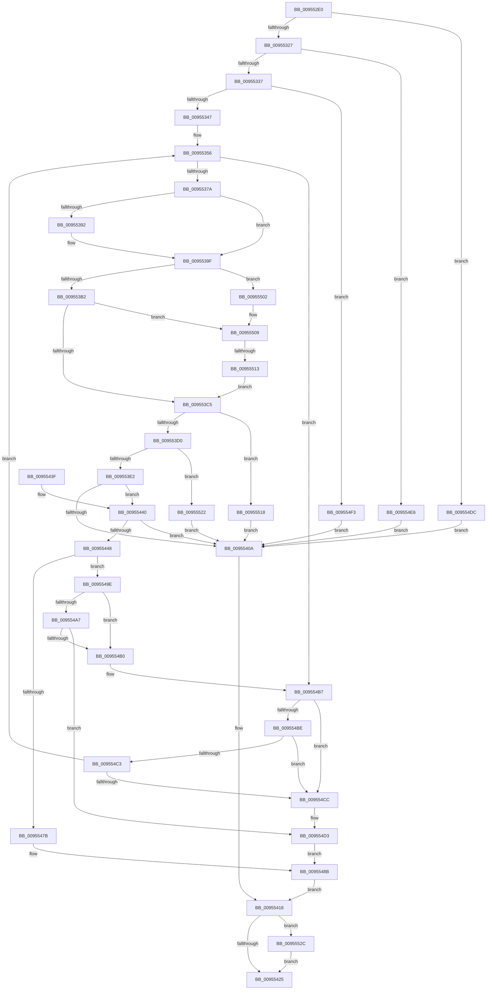

# Pdcv2ActivationClientDeactivate

- RVA: `0x009552E0`–`0x00955541` (길이 `609` bytes)
- VA: `0x00000001409552E0`
- 실행 섹션: `PAGE`
- PDB 이름 있음: `예`; PDB Function 태그: `예`
- unwind 정보 RVA: `0x000922C0`
- 디코드: `144`개 명령, `609/609` bytes 표시
- 미해석 바이트: `0` (있으면 어셈블리에 `.byte`로 보존)

> 이 문서는 커널 이미지의 기계어와 PDB 기호를 분석해 생성했습니다. 4번과 5번은 함수 원형과 자료형을 바이너리 사용 방식에서 추정한 C 해석이며 원본 소스 복구 결과는 아닙니다.

## 1. Dependencies

- 직접 호출 지점: **9**; 고유 호출 대상: **8**
- 직접 호출자로 확인된 함수: **3**
- RIP 상대 이미지 참조: **0**

### Outgoing calls
- `0x0095530D` → [memset](../../text/6C/memset_function_006C6C40.md) (function, `0x006C6C40`)
- `0x0095536D` → [KeWaitForSingleObject](../../text/20/KeWaitForSingleObject_function_0020E6B0.md) (function, `0x0020E6B0`)
- `0x009553FF` → [PdcPortSendMessageSynchronously](../../text/49/PdcPortSendMessageSynchronously_function_0049A6B4.md) (function, `0x0049A6B4`)
- `0x00955413` → [Pdcv2EventWrite_ACTIVATION_CLIENT_DEACTIVATE](../../text/42/Pdcv2EventWrite_ACTIVATION_CLIENT_DEACTIVATE_function_00424588.md) (function, `0x00424588`)
- `0x0095546D` → [Pdcv2EventWrite_ACTIVATION_CLIENT_DEACTIVATE](../../text/42/Pdcv2EventWrite_ACTIVATION_CLIENT_DEACTIVATE_function_00424588.md) (function, `0x00424588`)
- `0x00955472` → [Feature_Servicing_PDCActivationsAVL__private_IsEnabledDeviceUsageNoInline](../../text/4F/Feature_Servicing_PDCActivationsAVL__private_IsEnabledDeviceUsageNoInline_function_004F4F6C.md) (function, `0x004F4F6C`)
- `0x00955486` → [RtlAvlRemoveNode](../../text/29/RtlAvlRemoveNode_function_00296650.md) (function, `0x00296650`)
- `0x00955494` → [ExFreePoolWithTag](../../poolcode/B8/ExFreePoolWithTag_function_00B82870.md) (function, `0x00B82870`)
- `0x00955537` → [PdcReleaseRwLockExclusive2](../A7/PdcReleaseRwLockExclusive2_function_00A71898.md) (function, `0x00A71898`)

### Direct callers
- [PopAdaptiveStandbyHandlePowerMessage](../76/PopAdaptiveStandbyHandlePowerMessage_function_0076DB70.md) at `0x0076DC45`
- [PopWin32kActivatorWorker](PopWin32kActivatorWorker_function_009540C0.md) at `0x0095419B`
- [PiPdcDeactivate](PiPdcDeactivate_function_009552C4.md) at `0x009552CD`

### Static image references
- 디코드된 RIP-relative 메모리 참조가 없습니다.

## 2. Other-region calls and transfers

- 다른 실행 섹션으로 향하는 call: **8**
  - `0x0095530D` → [memset](../../text/6C/memset_function_006C6C40.md) (`PAGE` → `.text`)
  - `0x0095536D` → [KeWaitForSingleObject](../../text/20/KeWaitForSingleObject_function_0020E6B0.md) (`PAGE` → `.text`)
  - `0x009553FF` → [PdcPortSendMessageSynchronously](../../text/49/PdcPortSendMessageSynchronously_function_0049A6B4.md) (`PAGE` → `.text`)
  - `0x00955413` → [Pdcv2EventWrite_ACTIVATION_CLIENT_DEACTIVATE](../../text/42/Pdcv2EventWrite_ACTIVATION_CLIENT_DEACTIVATE_function_00424588.md) (`PAGE` → `.text`)
  - `0x0095546D` → [Pdcv2EventWrite_ACTIVATION_CLIENT_DEACTIVATE](../../text/42/Pdcv2EventWrite_ACTIVATION_CLIENT_DEACTIVATE_function_00424588.md) (`PAGE` → `.text`)
  - `0x00955472` → [Feature_Servicing_PDCActivationsAVL__private_IsEnabledDeviceUsageNoInline](../../text/4F/Feature_Servicing_PDCActivationsAVL__private_IsEnabledDeviceUsageNoInline_function_004F4F6C.md) (`PAGE` → `.text`)
  - `0x00955486` → [RtlAvlRemoveNode](../../text/29/RtlAvlRemoveNode_function_00296650.md) (`PAGE` → `.text`)
  - `0x00955494` → [ExFreePoolWithTag](../../poolcode/B8/ExFreePoolWithTag_function_00B82870.md) (`PAGE` → `POOLCODE`)
- call이 아닌 외부 분기/꼬리 이동: **1**
  - `0x0095550D` → [sub_00B2698A](../B2/Unknown_function_00B2698A.md) (`tail-transfer`)

## 3. Assembly (complete function range)

```asm
009552E0  48 89 5C 24 18                  mov qword ptr [rsp + 0x18], rbx
009552E5  48 89 74 24 20                  mov qword ptr [rsp + 0x20], rsi
009552EA  55                              push rbp
009552EB  57                              push rdi
009552EC  41 56                           push r14
009552EE  48 8D AC 24 B0 FD FF FF         lea rbp, [rsp - 0x250]
009552F6  48 81 EC 50 03 00 00            sub rsp, 0x350
009552FD  48 8B F9                        mov rdi, rcx
00955300  33 D2                           xor edx, edx
00955302  48 8D 4C 24 30                  lea rcx, [rsp + 0x30]
00955307  41 B8 20 03 00 00               mov r8d, 0x320
0095530D  E8 2E 19 D7 FF                  call 0x1406c6c40
00955312  45 33 F6                        xor r14d, r14d
00955315  C6 85 70 02 00 00 00            mov byte ptr [rbp + 0x270], 0
0095531C  33 F6                           xor esi, esi
0095531E  48 85 FF                        test rdi, rdi
00955321  0F 84 B5 01 00 00               je 0x1409554dc
00955327  81 7F 18 50 44 43 41            cmp dword ptr [rdi + 0x18], 0x41434450
0095532E  4C 8B F7                        mov r14, rdi
00955331  0F 85 AF 01 00 00               jne 0x1409554e6
00955337  48 8B 77 20                     mov rsi, qword ptr [rdi + 0x20]
0095533B  81 3E 50 44 41 32               cmp dword ptr [rsi], 0x32414450
00955341  0F 85 AC 01 00 00               jne 0x1409554f3
00955347  48 8D 5E 08                     lea rbx, [rsi + 8]
0095534B  48 C7 85 78 02 00 00 00 BA 3C DC  mov qword ptr [rbp + 0x278], 0xffffffffdc3cba00
00955356  48 8B 0B                        mov rcx, qword ptr [rbx]
00955359  48 8D 85 78 02 00 00            lea rax, [rbp + 0x278]
00955360  45 33 C9                        xor r9d, r9d
00955363  48 89 44 24 20                  mov qword ptr [rsp + 0x20], rax
00955368  45 33 C0                        xor r8d, r8d
0095536B  33 D2                           xor edx, edx
0095536D  E8 3E 93 8B FF                  call 0x14020e6b0
00955372  85 C0                           test eax, eax
00955374  0F 85 3D 01 00 00               jne 0x1409554b7
0095537A  C6 85 70 02 00 00 01            mov byte ptr [rbp + 0x270], 1
00955381  B8 01 00 00 00                  mov eax, 1
00955386  F0 0F C1 43 10                  lock xadd dword ptr [rbx + 0x10], eax
0095538B  FF C0                           inc eax
0095538D  83 F8 01                        cmp eax, 1
00955390  75 0D                           jne 0x14095539f
00955392  65 48 8B 04 25 88 01 00 00      mov rax, qword ptr gs:[0x188]
0095539B  48 89 43 08                     mov qword ptr [rbx + 8], rax
0095539F  65 48 8B 04 25 88 01 00 00      mov rax, qword ptr gs:[0x188]
009553A8  48 39 43 08                     cmp qword ptr [rbx + 8], rax
009553AC  0F 85 50 01 00 00               jne 0x140955502
009553B2  65 48 8B 04 25 88 01 00 00      mov rax, qword ptr gs:[0x188]
009553BB  48 3B 46 68                     cmp rax, qword ptr [rsi + 0x68]
009553BF  0F 85 44 01 00 00               jne 0x140955509
009553C5  48 83 7E 28 00                  cmp qword ptr [rsi + 0x28], 0
009553CA  0F 84 48 01 00 00               je 0x140955518
009553D0  48 63 47 38                     movsxd rax, dword ptr [rdi + 0x38]
009553D4  83 BC 86 08 01 00 00 00         cmp dword ptr [rsi + rax*4 + 0x108], 0
009553DC  0F 84 40 01 00 00               je 0x140955522
009553E2  48 8B 87 58 02 00 00            mov rax, qword ptr [rdi + 0x258]
009553E9  48 8D 54 24 30                  lea rdx, [rsp + 0x30]
009553EE  48 89 44 24 70                  mov qword ptr [rsp + 0x70], rax
009553F3  C7 44 24 58 0D 00 00 00         mov dword ptr [rsp + 0x58], 0xd
009553FB  48 8B 4E 28                     mov rcx, qword ptr [rsi + 0x28]
009553FF  E8 B0 52 B4 FF                  call 0x14049a6b4
00955404  8B D8                           mov ebx, eax
00955406  85 C0                           test eax, eax
00955408  79 36                           jns 0x140955440
0095540A  44 8B C3                        mov r8d, ebx
0095540D  48 8B D6                        mov rdx, rsi
00955410  49 8B CE                        mov rcx, r14
00955413  E8 70 F1 AC FF                  call 0x140424588
00955418  80 BD 70 02 00 00 00            cmp byte ptr [rbp + 0x270], 0
0095541F  0F 85 07 01 00 00               jne 0x14095552c
00955425  4C 8D 9C 24 50 03 00 00         lea r11, [rsp + 0x350]
0095542D  8B C3                           mov eax, ebx
0095542F  49 8B 5B 30                     mov rbx, qword ptr [r11 + 0x30]
00955433  49 8B 73 38                     mov rsi, qword ptr [r11 + 0x38]
00955437  49 8B E3                        mov rsp, r11
0095543A  41 5E                           pop r14
0095543C  5F                              pop rdi
0095543D  5D                              pop rbp
0095543E  C3                              ret
0095543F  CC                              int3
00955440  8B 5C 24 68                     mov ebx, dword ptr [rsp + 0x68]
00955444  85 DB                           test ebx, ebx
00955446  78 C2                           js 0x14095540a
00955448  48 8B 4F 20                     mov rcx, qword ptr [rdi + 0x20]
0095544C  83 CA FF                        or edx, 0xffffffff
0095544F  48 63 47 38                     movsxd rax, dword ptr [rdi + 0x38]
00955453  45 33 C0                        xor r8d, r8d
00955456  01 94 81 08 01 00 00            add dword ptr [rcx + rax*4 + 0x108], edx
0095545D  01 91 04 01 00 00               add dword ptr [rcx + 0x104], edx
00955463  48 8B D6                        mov rdx, rsi
00955466  83 67 18 00                     and dword ptr [rdi + 0x18], 0
0095546A  48 8B CF                        mov rcx, rdi
0095546D  E8 16 F1 AC FF                  call 0x140424588
00955472  E8 F5 FA B9 FF                  call 0x1404f4f6c
00955477  85 C0                           test eax, eax
00955479  74 23                           je 0x14095549e
0095547B  48 8B 4F 20                     mov rcx, qword ptr [rdi + 0x20]
0095547F  48 8B D7                        mov rdx, rdi
00955482  48 83 C1 60                     add rcx, 0x60
00955486  E8 C5 11 94 FF                  call 0x140296650
0095548B  83 67 18 00                     and dword ptr [rdi + 0x18], 0
0095548F  33 D2                           xor edx, edx
00955491  48 8B CF                        mov rcx, rdi
00955494  E8 D7 D3 22 00                  call 0x140b82870
00955499  E9 7A FF FF FF                  jmp 0x140955418
0095549E  48 8B 0F                        mov rcx, qword ptr [rdi]
009554A1  48 39 79 08                     cmp qword ptr [rcx + 8], rdi
009554A5  75 09                           jne 0x1409554b0
009554A7  48 8B 47 08                     mov rax, qword ptr [rdi + 8]
009554AB  48 39 38                        cmp qword ptr [rax], rdi
009554AE  74 23                           je 0x1409554d3
009554B0  B9 03 00 00 00                  mov ecx, 3
009554B5  CD 29                           int 0x29
009554B7  2D C0 00 00 00                  sub eax, 0xc0
009554BC  74 0E                           je 0x1409554cc
009554BE  83 E8 41                        sub eax, 0x41
009554C1  74 09                           je 0x1409554cc
009554C3  83 F8 01                        cmp eax, 1
009554C6  0F 84 8A FE FF FF               je 0x140955356
009554CC  B9 05 00 00 00                  mov ecx, 5
009554D1  CD 29                           int 0x29
009554D3  48 89 08                        mov qword ptr [rax], rcx
009554D6  48 89 41 08                     mov qword ptr [rcx + 8], rax
009554DA  EB AF                           jmp 0x14095548b
009554DC  BB EF 00 00 C0                  mov ebx, 0xc00000ef
009554E1  E9 24 FF FF FF                  jmp 0x14095540a
009554E6  BB EF 00 00 C0                  mov ebx, 0xc00000ef
009554EB  45 33 F6                        xor r14d, r14d
009554EE  E9 17 FF FF FF                  jmp 0x14095540a
009554F3  45 33 F6                        xor r14d, r14d
009554F6  BB EF 00 00 C0                  mov ebx, 0xc00000ef
009554FB  33 F6                           xor esi, esi
009554FD  E9 08 FF FF FF                  jmp 0x14095540a
00955502  B9 28 00 00 00                  mov ecx, 0x28
00955507  CD 29                           int 0x29
00955509  48 39 7E 78                     cmp qword ptr [rsi + 0x78], rdi
0095550D  0F 84 77 14 1D 00               je 0x140b2698a
00955513  E9 AD FE FF FF                  jmp 0x1409553c5
00955518  BB 00 07 00 C0                  mov ebx, 0xc0000700
0095551D  E9 E8 FE FF FF                  jmp 0x14095540a
00955522  BB 01 00 00 C0                  mov ebx, 0xc0000001
00955527  E9 DE FE FF FF                  jmp 0x14095540a
0095552C  48 8D 4E 08                     lea rcx, [rsi + 8]
00955530  48 8D 95 70 02 00 00            lea rdx, [rbp + 0x270]
00955537  E8 5C C3 11 00                  call 0x140a71898
0095553C  E9 E4 FE FF FF                  jmp 0x140955425
```

## 4. C-style interpretation (structured pseudocode)

```c
__int64 __fastcall Pdcv2ActivationClientDeactivate(__int64 a1, int a2, __int64 a3, int a4)
{
    __int64 result;
    __int64 v_r14;
    __int64 v_rsi;
    __int64 v_rsp;
    unsigned __int64 v_stack_m18;
    unsigned __int64 v_stack_m268;
    unsigned int v_stack_m2E8;
    unsigned __int64 v_stack_m2F8;
    unsigned int v_stack_m310;
    unsigned __int64 v_stack_m338;
    unsigned __int64 v_stack_m348;
    unsigned __int64 v_stack_p10;
    unsigned __int64 v_stack_p18;
    unsigned __int64 v_stack_p20;
    unsigned __int8 v_stack_p8;

    v_stack_p18 = v_rbx;
    v_stack_p20 = v_rsi;
    v_rsp = (v_rsp) - (848);
    a2 = 0;
    result = memset(v_stack_m338, a2, 800, a4);
    v_r14 = 0;
    v_stack_p8 = 0;
    v_rsi = 0;
    if (a1 == 0) goto loc_009554DC;
    if ((*(unsigned int *)(a1 + 24)) != 0x41434450ULL) goto loc_009554E6;
    if ((*(unsigned int *)(*(unsigned __int64 *)(a1 + 32))) != 0x32414450ULL) goto loc_009554F3;
    v_stack_p10 = 0xFFFFFFFFDC3CBA00ULL;
loc_00955356:
    a4 = 0;
    v_stack_m348 = v_stack_p10;
    a3 = 0;
    a2 = 0;
    result = KeWaitForSingleObject(*(unsigned __int64 *)(*(unsigned __int64 *)(a1 + 32) + 8), a2, a3, a4);
    if ((unsigned int)(result) != 0) goto loc_009554B7;
    v_stack_p8 = 1;
    result = (unsigned int)((1) + 1);
    if (((unsigned int)(result)) == 1) {
        result = *(unsigned __int64 *)(gs_base + (0 + 392));
        *(unsigned __int64 *)(*(unsigned __int64 *)(a1 + 32) + 8 + 8) = result;
    }
    if ((*(unsigned __int64 *)(*(unsigned __int64 *)(a1 + 32) + 8 + 8)) != (*(unsigned __int64 *)(gs_base + (0 + 392)))) goto loc_00955502;
    if ((*(unsigned __int64 *)(gs_base + (0 + 392))) != (*(unsigned __int64 *)(*(unsigned __int64 *)(a1 + 32) + 104))) goto loc_00955509;
loc_009553C5:
    if ((*(unsigned __int64 *)(*(unsigned __int64 *)(a1 + 32) + 40)) == 0) goto loc_00955518;
    if ((*(unsigned int *)(*(unsigned __int64 *)(a1 + 32) + (int)(*(unsigned int *)(a1 + 56)) * 4 + 264)) == 0) goto loc_00955522;
    v_stack_m2F8 = *(unsigned __int64 *)(a1 + 600);
    v_stack_m310 = 13;
    result = PdcPortSendMessageSynchronously(*(unsigned __int64 *)(*(unsigned __int64 *)(a1 + 32) + 40), v_stack_m338, a3, a4);
    if (!sign_flag) goto loc_00955440;
loc_0095540A:
    result = Pdcv2EventWrite_ACTIVATION_CLIENT_DEACTIVATE(a1, *(unsigned __int64 *)(a1 + 32), (unsigned int)((unsigned int)((unsigned int)((unsigned int)(result)))), a4);
loc_00955418:
    if (v_stack_p8 != 0) goto loc_0095552C;
loc_00955425:
    return (unsigned int)((unsigned int)((unsigned int)((unsigned int)(result))));
loc_00955440:
    if (sign_flag) goto loc_0095540A;
    a2 = (unsigned int)((*(unsigned __int64 *)(a1 + 32)) | (0xFFFFFFFFULL));
    a3 = 0;
    result = Pdcv2EventWrite_ACTIVATION_CLIENT_DEACTIVATE(a1, *(unsigned __int64 *)(v_stack_m18 + 56), a3, a4);
    result = Feature_Servicing_PDCActivationsAVL__private_IsEnabledDeviceUsageNoInline(a1, *(unsigned __int64 *)(v_stack_m18 + 56), a3, a4);
    if ((unsigned int)(result) == 0) goto loc_0095549E;
    a1 = (*(unsigned __int64 *)(a1 + 32)) + (96);
    result = RtlAvlRemoveNode(a1, a1, a3, a4);
loc_0095548B:
    a2 = 0;
    result = ExFreePoolWithTag(a1, a2, a3, a4);
    goto loc_00955418;
loc_0095549E:
    if ((*(unsigned __int64 *)(*(unsigned __int64 *)(a1) + 8)) != a1) goto loc_009554B0;
    if ((*(unsigned __int64 *)(*(unsigned __int64 *)(a1 + 8))) == a1) goto loc_009554D3;
loc_009554B0:
loc_009554B7:
    result = (unsigned int)((*(unsigned __int64 *)(a1 + 8)) - (192));
    if (condition_is_equal) goto loc_009554CC;
    result = (unsigned int)((result) - (65));
    if (condition_is_equal) goto loc_009554CC;
    if (((unsigned int)(result)) == 1) goto loc_00955356;
loc_009554CC:
loc_009554D3:
    *(unsigned __int64 *)(result) = 5;
    *(unsigned __int64 *)(5 + 8) = result;
    goto loc_0095548B;
loc_009554DC:
    goto loc_0095540A;
loc_009554E6:
    v_r14 = 0;
    goto loc_0095540A;
loc_009554F3:
    v_r14 = 0;
    v_rsi = 0;
    goto loc_0095540A;
loc_00955502:
loc_00955509:
    goto loc_009553C5;
loc_00955518:
    goto loc_0095540A;
loc_00955522:
    goto loc_0095540A;
loc_0095552C:
    result = PdcReleaseRwLockExclusive2(v_rsi + 8, v_stack_p8, a3, a4);
    goto loc_00955425;
}
```

## 5. (Beta) C Style

```c
int64_t Pdcv2ActivationClientDeactivate(int64_t Arg1, int32_t Arg2, int64_t Arg3, int32_t Arg4)
{
    int64_t result;
    int64_t local_r14;
    int64_t local_rsi;
    int64_t local_rsp;
    uint64_t v_stack_m18;
    uint64_t v_stack_m268;
    uint32_t v_stack_m2E8;
    uint64_t v_stack_m2F8;
    uint32_t v_stack_m310;
    uint64_t v_stack_m338;
    uint64_t v_stack_m348;
    uint64_t v_stack_p10;
    uint64_t v_stack_p18;
    uint64_t v_stack_p20;
    uint8_t v_stack_p8;

    v_stack_p18 = local_rbx;
    v_stack_p20 = local_rsi;
    local_rsp = (local_rsp) - (848);
    Arg2 = 0;
    result = memset(v_stack_m338, Arg2, 800, Arg4);
    local_r14 = 0;
    v_stack_p8 = 0;
    local_rsi = 0;
    if (Arg1 == 0) goto loc_009554DC;
    if ((*(uint32_t *)(Arg1 + 0x18)) != 0x41434450ULL) goto loc_009554E6;
    if ((*(uint32_t *)(*(uint64_t *)(Arg1 + 0x20))) != 0x32414450ULL) goto loc_009554F3;
    v_stack_p10 = 0xFFFFFFFFDC3CBA00ULL;
loc_00955356:
    Arg4 = 0;
    v_stack_m348 = v_stack_p10;
    Arg3 = 0;
    Arg2 = 0;
    result = KeWaitForSingleObject(*(uint64_t *)(*(uint64_t *)(Arg1 + 0x20) + 0x8), Arg2, Arg3, Arg4);
    if ((uint32_t)(result) != 0) goto loc_009554B7;
    v_stack_p8 = 1;
    result = (uint32_t)((1) + 1);
    if (((uint32_t)(result)) == 1) {
        result = *(uint64_t *)(gs_base + (0 + 0x188));
        *(uint64_t *)(*(uint64_t *)(Arg1 + 0x20) + 0x8 + 0x8) = result;
    }
    if ((*(uint64_t *)(*(uint64_t *)(Arg1 + 0x20) + 0x8 + 0x8)) != (*(uint64_t *)(gs_base + (0 + 0x188)))) goto loc_00955502;
    if ((*(uint64_t *)(gs_base + (0 + 0x188))) != (*(uint64_t *)(*(uint64_t *)(Arg1 + 0x20) + 0x68))) goto loc_00955509;
loc_009553C5:
    if ((*(uint64_t *)(*(uint64_t *)(Arg1 + 0x20) + 0x28)) == 0) goto loc_00955518;
    if ((*(uint32_t *)(*(uint64_t *)(Arg1 + 0x20) + (int32_t)(*(uint32_t *)(Arg1 + 0x38)) * 4 + 0x108)) == 0) goto loc_00955522;
    v_stack_m2F8 = *(uint64_t *)(Arg1 + 0x258);
    v_stack_m310 = 13;
    result = PdcPortSendMessageSynchronously(*(uint64_t *)(*(uint64_t *)(Arg1 + 0x20) + 0x28), v_stack_m338, Arg3, Arg4);
    if (!sign_flag) goto loc_00955440;
loc_0095540A:
    result = Pdcv2EventWrite_ACTIVATION_CLIENT_DEACTIVATE(Arg1, *(uint64_t *)(Arg1 + 0x20), (uint32_t)((uint32_t)((uint32_t)((uint32_t)(result)))), Arg4);
loc_00955418:
    if (v_stack_p8 != 0) goto loc_0095552C;
loc_00955425:
    return (uint32_t)((uint32_t)((uint32_t)((uint32_t)(result))));
loc_00955440:
    if (sign_flag) goto loc_0095540A;
    Arg2 = (uint32_t)((*(uint64_t *)(Arg1 + 0x20)) | (0xFFFFFFFFULL));
    Arg3 = 0;
    result = Pdcv2EventWrite_ACTIVATION_CLIENT_DEACTIVATE(Arg1, *(uint64_t *)(v_stack_m18 + 0x38), Arg3, Arg4);
    result = Feature_Servicing_PDCActivationsAVL__private_IsEnabledDeviceUsageNoInline(Arg1, *(uint64_t *)(v_stack_m18 + 0x38), Arg3, Arg4);
    if ((uint32_t)(result) == 0) goto loc_0095549E;
    Arg1 = (*(uint64_t *)(Arg1 + 0x20)) + (96);
    result = RtlAvlRemoveNode(Arg1, Arg1, Arg3, Arg4);
loc_0095548B:
    Arg2 = 0;
    result = ExFreePoolWithTag(Arg1, Arg2, Arg3, Arg4);
    goto loc_00955418;
loc_0095549E:
    if ((*(uint64_t *)(*(uint64_t *)(Arg1) + 0x8)) != Arg1) goto loc_009554B0;
    if ((*(uint64_t *)(*(uint64_t *)(Arg1 + 0x8))) == Arg1) goto loc_009554D3;
loc_009554B0:
loc_009554B7:
    result = (uint32_t)((*(uint64_t *)(Arg1 + 0x8)) - (192));
    if (condition_is_equal) goto loc_009554CC;
    result = (uint32_t)((result) - (65));
    if (condition_is_equal) goto loc_009554CC;
    if (((uint32_t)(result)) == 1) goto loc_00955356;
loc_009554CC:
loc_009554D3:
    *(uint64_t *)(result) = 5;
    *(uint64_t *)(5 + 0x8) = result;
    goto loc_0095548B;
loc_009554DC:
    goto loc_0095540A;
loc_009554E6:
    local_r14 = 0;
    goto loc_0095540A;
loc_009554F3:
    local_r14 = 0;
    local_rsi = 0;
    goto loc_0095540A;
loc_00955502:
loc_00955509:
    goto loc_009553C5;
loc_00955518:
    goto loc_0095540A;
loc_00955522:
    goto loc_0095540A;
loc_0095552C:
    result = PdcReleaseRwLockExclusive2(local_rsi + 8, v_stack_p8, Arg3, Arg4);
    goto loc_00955425;
}
```

## 6. Execution-region graph

[열기: 2D/3D 그래프와 함수 탐색 컨트롤 패널](../../../control-panel.html?section=page&rva=0x009552E0&view=graph)

- 2D 그래프는 위에서 아래로 흐르고, 3D 그래프는 빈 공간을 드래그해 회전합니다. Shift+드래그는 이동, 휠은 확대·축소, 함수 노드 선택은 대상 보고서 이동입니다.

### Static fallback


