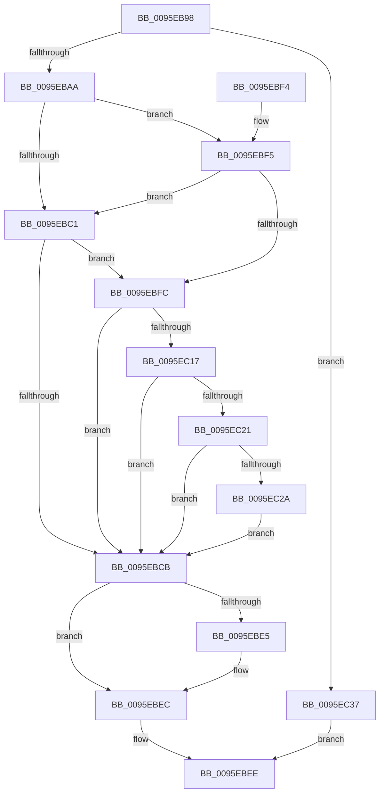

# PfProcessCreateNotification

- RVA: `0x0095EB98`–`0x0095EC3E` (길이 `166` bytes)
- VA: `0x000000014095EB98`
- 실행 섹션: `PAGE`
- PDB 이름 있음: `예`; PDB Function 태그: `아니요`
- unwind 정보 RVA: `0x00092F90`
- 디코드: `47`개 명령, `166/166` bytes 표시
- 미해석 바이트: `0` (있으면 어셈블리에 `.byte`로 보존)

> 이 문서는 커널 이미지의 기계어와 PDB 기호를 분석해 생성했습니다. 4번과 5번은 함수 원형과 자료형을 바이너리 사용 방식에서 추정한 C 해석이며 원본 소스 복구 결과는 아닙니다.

## 1. Dependencies

- 직접 호출 지점: **5**; 고유 호출 대상: **5**
- 직접 호출자로 확인된 함수: **1**
- RIP 상대 이미지 참조: **1**

### Outgoing calls
- `0x0095EBB1` → [MiReadReverseMapAttributes](../../text/4A/MiReadReverseMapAttributes_function_004A32D4.md) (function, `0x004A32D4`)
- `0x0095EBD6` → [PfSnBeginAppLaunch](PfSnBeginAppLaunch_function_0095EC44.md) (function, `0x0095EC44`)
- `0x0095EBE7` → [ExFreePoolWithTag](../../poolcode/B8/ExFreePoolWithTag_function_00B82870.md) (function, `0x00B82870`)
- `0x0095EC08` → [PfCalculateProcessHash](../96/PfCalculateProcessHash_function_00960310.md) (function, `0x00960310`)
- `0x0095EC21` → [PfCheckDeprioritizeImage](../9E/PfCheckDeprioritizeImage_function_009E97A8.md) (function, `0x009E97A8`)

### Direct callers
- [PspNotifyThreadCreation](../8D/PspNotifyThreadCreation_function_008D5D48.md) at `0x008D5E22`

### Static image references
- `0x0095EBC1` → RVA `0x00E671E0` (`.data`; read)

## 2. Other-region calls and transfers

- 다른 실행 섹션으로 향하는 call: **2**
  - `0x0095EBB1` → [MiReadReverseMapAttributes](../../text/4A/MiReadReverseMapAttributes_function_004A32D4.md) (`PAGE` → `.text`)
  - `0x0095EBE7` → [ExFreePoolWithTag](../../poolcode/B8/ExFreePoolWithTag_function_00B82870.md) (`PAGE` → `POOLCODE`)
- 별도 외부 분기/꼬리 이동을 확인하지 못했습니다.

## 3. Assembly (complete function range)

```asm
0095EB98  40 53                           push rbx
0095EB9A  48 83 EC 30                     sub rsp, 0x30
0095EB9E  48 8B D9                        mov rbx, rcx
0095EBA1  48 85 D2                        test rdx, rdx
0095EBA4  0F 84 8D 00 00 00               je 0x14095ec37
0095EBAA  48 8B 89 58 07 00 00            mov rcx, qword ptr [rcx + 0x758]
0095EBB1  E8 1E 47 B4 FF                  call 0x1404a32d4
0095EBB6  48 83 64 24 20 00               and qword ptr [rsp + 0x20], 0
0095EBBC  48 85 C0                        test rax, rax
0095EBBF  75 34                           jne 0x14095ebf5
0095EBC1  8B 05 19 86 50 00               mov eax, dword ptr [rip + 0x508619]
0095EBC7  A8 01                           test al, 1
0095EBC9  75 31                           jne 0x14095ebfc
0095EBCB  48 8B 54 24 20                  mov rdx, qword ptr [rsp + 0x20]
0095EBD0  45 33 C0                        xor r8d, r8d
0095EBD3  48 8B CB                        mov rcx, rbx
0095EBD6  E8 69 00 00 00                  call 0x14095ec44
0095EBDB  48 8B 4C 24 20                  mov rcx, qword ptr [rsp + 0x20]
0095EBE0  48 85 C9                        test rcx, rcx
0095EBE3  74 07                           je 0x14095ebec
0095EBE5  33 D2                           xor edx, edx
0095EBE7  E8 84 3C 22 00                  call 0x140b82870
0095EBEC  33 C0                           xor eax, eax
0095EBEE  48 83 C4 30                     add rsp, 0x30
0095EBF2  5B                              pop rbx
0095EBF3  C3                              ret
0095EBF4  CC                              int3
0095EBF5  8B 40 48                        mov eax, dword ptr [rax + 0x48]
0095EBF8  A8 01                           test al, 1
0095EBFA  74 C5                           je 0x14095ebc1
0095EBFC  48 8D 54 24 20                  lea rdx, [rsp + 0x20]
0095EC01  48 8B CB                        mov rcx, rbx
0095EC04  48 83 CA 01                     or rdx, 1
0095EC08  E8 03 17 00 00                  call 0x140960310
0095EC0D  8B 05 CD 85 50 00               mov eax, dword ptr [rip + 0x5085cd]
0095EC13  A8 01                           test al, 1
0095EC15  74 B4                           je 0x14095ebcb
0095EC17  8B 8B 84 03 00 00               mov ecx, dword ptr [rbx + 0x384]
0095EC1D  85 C9                           test ecx, ecx
0095EC1F  74 AA                           je 0x14095ebcb
0095EC21  E8 82 AB 08 00                  call 0x1409e97a8
0095EC26  85 C0                           test eax, eax
0095EC28  74 A1                           je 0x14095ebcb
0095EC2A  F0 81 8B F4 01 00 00 00 40 00 00  lock or dword ptr [rbx + 0x1f4], 0x4000
0095EC35  EB 94                           jmp 0x14095ebcb
0095EC37  B8 BB 00 00 C0                  mov eax, 0xc00000bb
0095EC3C  EB B0                           jmp 0x14095ebee
```

## 4. C-style interpretation (structured pseudocode)

```c
__int64 __fastcall PfProcessCreateNotification(__int64 a1, __int64 a2, int a3)
{
    __int64 result;
    __int64 v_rsp;
    unsigned __int64 v_stack_m18;
    unsigned __int64 v_stack_p20;

    v_rsp = (v_rsp) - (48);
    if (a2 == 0) goto loc_0095EC37;
    result = MiReadReverseMapAttributes(*(unsigned __int64 *)(a1 + 1880), a2, a3, a4);
    if (result != 0) goto loc_0095EBF5;
loc_0095EBC1:
    if ((((unsigned __int8)((unsigned int)(*(unsigned int *)(v_rip + 5277209)))) & (1)) != 0) goto loc_0095EBFC;
loc_0095EBCB:
    a3 = 0;
    result = PfSnBeginAppLaunch(a1, v_stack_m18, a3, a4);
    if (v_stack_m18 != 0) {
        a2 = 0;
        result = ExFreePoolWithTag(v_stack_m18, a2, a3, a4);
    }
    result = 0;
loc_0095EBEE:
    v_rsp = (v_rsp) + (48);
    return result;
loc_0095EBF5:
    if ((((unsigned __int8)((unsigned int)(*(unsigned int *)(result + 72)))) & (1)) == 0) goto loc_0095EBC1;
loc_0095EBFC:
    a2 = (v_stack_p20) | (1);
    result = PfCalculateProcessHash(a1, a2, a3, a4);
    if ((((unsigned __int8)((unsigned int)(*(unsigned int *)(v_rip + 5277133)))) & (1)) == 0) goto loc_0095EBCB;
    if ((unsigned int)((unsigned int)(*(unsigned int *)(a1 + 900))) == 0) goto loc_0095EBCB;
    result = PfCheckDeprioritizeImage((unsigned int)(*(unsigned int *)(a1 + 900)), a2, a3, a4);
    if ((unsigned int)(result) == 0) goto loc_0095EBCB;
    goto loc_0095EBCB;
loc_0095EC37:
    goto loc_0095EBEE;
}
```

## 5. (Beta) C Style

```c
int64_t PfProcessCreateNotification(void *Arg1, int64_t Arg2, int32_t Arg3)
{
    uint8_t *arg1 = (uint8_t *)Arg1;

    int64_t result;
    int64_t local_rsp;
    uint64_t v_stack_m18;
    uint64_t v_stack_p20;

    local_rsp = (local_rsp) - (48);
    if (Arg2 == 0) goto loc_0095EC37;
    result = MiReadReverseMapAttributes(*(uint64_t *)(arg1 + 0x758), Arg2, Arg3, a4);
    if (result != 0) goto loc_0095EBF5;
loc_0095EBC1:
    if ((((uint8_t)((uint32_t)(*(uint32_t *)(v_rip + 0x508619)))) & (1)) != 0) goto loc_0095EBFC;
loc_0095EBCB:
    Arg3 = 0;
    result = PfSnBeginAppLaunch(Arg1, v_stack_m18, Arg3, a4);
    if (v_stack_m18 != 0) {
        Arg2 = 0;
        result = ExFreePoolWithTag(v_stack_m18, Arg2, Arg3, a4);
    }
    result = 0;
loc_0095EBEE:
    local_rsp = (local_rsp) + (48);
    return result;
loc_0095EBF5:
    if ((((uint8_t)((uint32_t)(*(uint32_t *)(result + 0x48)))) & (1)) == 0) goto loc_0095EBC1;
loc_0095EBFC:
    Arg2 = (v_stack_p20) | (1);
    result = PfCalculateProcessHash(Arg1, Arg2, Arg3, a4);
    if ((((uint8_t)((uint32_t)(*(uint32_t *)(v_rip + 0x5085CD)))) & (1)) == 0) goto loc_0095EBCB;
    if ((uint32_t)((uint32_t)(*(uint32_t *)(arg1 + 0x384))) == 0) goto loc_0095EBCB;
    result = PfCheckDeprioritizeImage((uint32_t)(*(uint32_t *)(arg1 + 0x384)), Arg2, Arg3, a4);
    if ((uint32_t)(result) == 0) goto loc_0095EBCB;
    goto loc_0095EBCB;
loc_0095EC37:
    goto loc_0095EBEE;
}
```

### 관측된 메모리 오프셋

구조체 형식이 확인되지 않은 접근은 인자 기준의 오프셋으로만 기록했습니다.

| 기준 인자 | 오프셋 표현 | 폭 (bit) | 접근 |
|---|---:|---:|---|
| `Arg1` | `+ 0x1F4` | `32` | `R/W` |
| `Arg1` | `+ 0x384` | `32` | `R` |
| `Arg1` | `+ 0x758` | `64` | `R` |

## 6. Execution-region graph

[열기: 2D/3D 그래프와 함수 탐색 컨트롤 패널](../../../control-panel.html?section=page&rva=0x0095EB98&view=graph)

- 2D 그래프는 위에서 아래로 흐르고, 3D 그래프는 빈 공간을 드래그해 회전합니다. Shift+드래그는 이동, 휠은 확대·축소, 함수 노드 선택은 대상 보고서 이동입니다.

### Static fallback


