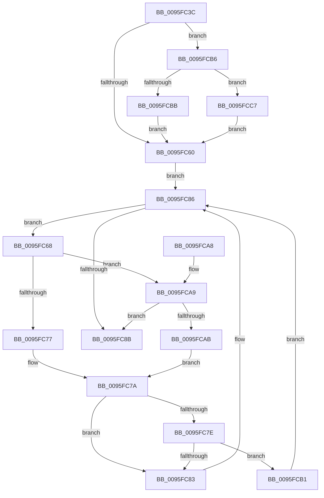

# PfSnAltProfileFindByScenarioId

- RVA: `0x0095FC3C`–`0x0095FCC9` (길이 `141` bytes)
- VA: `0x000000014095FC3C`
- 실행 섹션: `PAGE`
- PDB 이름 있음: `예`; PDB Function 태그: `아니요`
- unwind 정보 RVA: `0x00065748`
- 디코드: `46`개 명령, `141/141` bytes 표시
- 미해석 바이트: `0` (있으면 어셈블리에 `.byte`로 보존)

> 이 문서는 커널 이미지의 기계어와 PDB 기호를 분석해 생성했습니다. 4번과 5번은 함수 원형과 자료형을 바이너리 사용 방식에서 추정한 C 해석이며 원본 소스 복구 결과는 아닙니다.

## 1. Dependencies

- 직접 호출 지점: **1**; 고유 호출 대상: **1**
- 직접 호출자로 확인된 함수: **2**
- RIP 상대 이미지 참조: **2**

### Outgoing calls
- `0x0095FC6E` → [PfSnAltProfileTreeCompareByScenarioId](PfSnAltProfileTreeCompareByScenarioId_function_0095FCD0.md) (function, `0x0095FCD0`)

### Direct callers
- [PfSnSetAltPrefetchParam](../75/PfSnSetAltPrefetchParam_function_00752424.md) at `0x007526AD`
- [PfSnBeginAppLaunch](PfSnBeginAppLaunch_function_0095EC44.md) at `0x0095EE3D`

### Static image references
- `0x0095FC4B` → RVA `0x00E67380` (`.data`; read)
- `0x0095FC55` → RVA `0x00E67378` (`.data`; read)

## 2. Other-region calls and transfers

- 다른 실행 섹션으로 향하는 call: **0**
- 별도 외부 분기/꼬리 이동을 확인하지 못했습니다.

## 3. Assembly (complete function range)

```asm
0095FC3C  48 89 5C 24 08                  mov qword ptr [rsp + 8], rbx
0095FC41  48 89 74 24 10                  mov qword ptr [rsp + 0x10], rsi
0095FC46  57                              push rdi
0095FC47  48 83 EC 20                     sub rsp, 0x20
0095FC4B  48 8B 05 2E 77 50 00            mov rax, qword ptr [rip + 0x50772e]
0095FC52  48 8B F1                        mov rsi, rcx
0095FC55  48 8B 1D 1C 77 50 00            mov rbx, qword ptr [rip + 0x50771c]
0095FC5C  A8 01                           test al, 1
0095FC5E  75 56                           jne 0x14095fcb6
0095FC60  0F B6 F8                        movzx edi, al
0095FC63  83 E7 01                        and edi, 1
0095FC66  EB 1E                           jmp 0x14095fc86
0095FC68  48 8B D3                        mov rdx, rbx
0095FC6B  48 8B CE                        mov rcx, rsi
0095FC6E  E8 5D 00 00 00                  call 0x14095fcd0
0095FC73  85 C0                           test eax, eax
0095FC75  79 32                           jns 0x14095fca9
0095FC77  48 8B 03                        mov rax, qword ptr [rbx]
0095FC7A  85 FF                           test edi, edi
0095FC7C  74 05                           je 0x14095fc83
0095FC7E  48 85 C0                        test rax, rax
0095FC81  75 2E                           jne 0x14095fcb1
0095FC83  48 8B D8                        mov rbx, rax
0095FC86  48 85 DB                        test rbx, rbx
0095FC89  75 DD                           jne 0x14095fc68
0095FC8B  48 8B 74 24 38                  mov rsi, qword ptr [rsp + 0x38]
0095FC90  48 8D 4B E8                     lea rcx, [rbx - 0x18]
0095FC94  48 F7 DB                        neg rbx
0095FC97  48 8B 5C 24 30                  mov rbx, qword ptr [rsp + 0x30]
0095FC9C  48 1B C0                        sbb rax, rax
0095FC9F  48 23 C1                        and rax, rcx
0095FCA2  48 83 C4 20                     add rsp, 0x20
0095FCA6  5F                              pop rdi
0095FCA7  C3                              ret
0095FCA8  CC                              int3
0095FCA9  7E E0                           jle 0x14095fc8b
0095FCAB  48 8B 43 08                     mov rax, qword ptr [rbx + 8]
0095FCAF  EB C9                           jmp 0x14095fc7a
0095FCB1  48 33 D8                        xor rbx, rax
0095FCB4  EB D0                           jmp 0x14095fc86
0095FCB6  48 85 DB                        test rbx, rbx
0095FCB9  74 0C                           je 0x14095fcc7
0095FCBB  48 8D 0D B6 76 50 00            lea rcx, [rip + 0x5076b6]
0095FCC2  48 33 D9                        xor rbx, rcx
0095FCC5  EB 99                           jmp 0x14095fc60
0095FCC7  EB 97                           jmp 0x14095fc60
```

## 4. C-style interpretation (structured pseudocode)

```c
__int64 __fastcall PfSnAltProfileFindByScenarioId(__int64 a1)
{
    __int64 result;
    __int64 v_rbx;
    __int64 v_rdi;
    __int64 v_rsp;
    unsigned __int64 v_stack_p10;
    unsigned __int64 v_stack_p8;

    v_stack_p8 = v_rbx;
    v_stack_p10 = v_rsi;
    v_rsp = (v_rsp) - (32);
    if ((((unsigned __int8)(*(unsigned __int64 *)(v_rip + 5273390))) & (1)) != 0) goto loc_0095FCB6;
loc_0095FC60:
    v_rdi = (unsigned int)(((unsigned __int8)(*(unsigned __int64 *)(v_rip + 5273390))) & (1));
    goto loc_0095FC86;
loc_0095FC68:
    result = PfSnAltProfileTreeCompareByScenarioId(a1, *(unsigned __int64 *)(v_rip + 5273372), a3, a4);
    if (!sign_flag) goto loc_0095FCA9;
loc_0095FC7A:
    if ((unsigned int)(v_rdi) == 0) goto loc_0095FC83;
    if (*(unsigned __int64 *)(*(unsigned __int64 *)(v_rip + 5273372)) != 0) goto loc_0095FCB1;
loc_0095FC83:
loc_0095FC86:
    if (*(unsigned __int64 *)(*(unsigned __int64 *)(v_rip + 5273372)) != 0) goto loc_0095FC68;
loc_0095FC8B:
    v_rbx = -(*(unsigned __int64 *)(*(unsigned __int64 *)(v_rip + 5273372)));
    result = (*(unsigned __int64 *)(*(unsigned __int64 *)(v_rip + 5273372))) & (*(unsigned __int64 *)(*(unsigned __int64 *)(v_rip + 5273372)) - 24);
    v_rsp = (v_rsp) + (32);
    return result;
loc_0095FCA9:
    if (condition_is_less_or_equal) goto loc_0095FC8B;
    goto loc_0095FC7A;
loc_0095FCB1:
    v_rbx = (v_stack_p8) ^ (*(unsigned __int64 *)(v_stack_p8 + 8));
    goto loc_0095FC86;
loc_0095FCB6:
    if (v_rbx == 0) goto loc_0095FCC7;
    v_rbx = (v_rbx) ^ (v_rip + 5273270);
    goto loc_0095FC60;
loc_0095FCC7:
    goto loc_0095FC60;
}
```

## 5. (Beta) C Style

```c
int64_t PfSnAltProfileFindByScenarioId(int64_t Arg1)
{
    int64_t result;
    int64_t local_rbx;
    int64_t local_rdi;
    int64_t local_rsp;
    uint64_t v_stack_p10;
    uint64_t v_stack_p8;

    v_stack_p8 = local_rbx;
    v_stack_p10 = local_rsi;
    local_rsp = (local_rsp) - (32);
    if ((((uint8_t)(*(uint64_t *)(v_rip + 0x50772E))) & (1)) != 0) goto loc_0095FCB6;
loc_0095FC60:
    local_rdi = (uint32_t)(((uint8_t)(*(uint64_t *)(v_rip + 0x50772E))) & (1));
    goto loc_0095FC86;
loc_0095FC68:
    result = PfSnAltProfileTreeCompareByScenarioId(Arg1, *(uint64_t *)(v_rip + 0x50771C), a3, a4);
    if (!sign_flag) goto loc_0095FCA9;
loc_0095FC7A:
    if ((uint32_t)(local_rdi) == 0) goto loc_0095FC83;
    if (*(uint64_t *)(*(uint64_t *)(v_rip + 0x50771C)) != 0) goto loc_0095FCB1;
loc_0095FC83:
loc_0095FC86:
    if (*(uint64_t *)(*(uint64_t *)(v_rip + 0x50771C)) != 0) goto loc_0095FC68;
loc_0095FC8B:
    local_rbx = -(*(uint64_t *)(*(uint64_t *)(v_rip + 0x50771C)));
    result = (*(uint64_t *)(*(uint64_t *)(v_rip + 0x50771C))) & (*(uint64_t *)(*(uint64_t *)(v_rip + 0x50771C)) - 24);
    local_rsp = (local_rsp) + (32);
    return result;
loc_0095FCA9:
    if (condition_is_less_or_equal) goto loc_0095FC8B;
    goto loc_0095FC7A;
loc_0095FCB1:
    local_rbx = (v_stack_p8) ^ (*(uint64_t *)(v_stack_p8 + 0x8));
    goto loc_0095FC86;
loc_0095FCB6:
    if (local_rbx == 0) goto loc_0095FCC7;
    local_rbx = (local_rbx) ^ (v_rip + 5273270);
    goto loc_0095FC60;
loc_0095FCC7:
    goto loc_0095FC60;
}
```

## 6. Execution-region graph

[열기: 2D/3D 그래프와 함수 탐색 컨트롤 패널](../../../control-panel.html?section=page&rva=0x0095FC3C&view=graph)

- 2D 그래프는 위에서 아래로 흐르고, 3D 그래프는 빈 공간을 드래그해 회전합니다. Shift+드래그는 이동, 휠은 확대·축소, 함수 노드 선택은 대상 보고서 이동입니다.

### Static fallback


