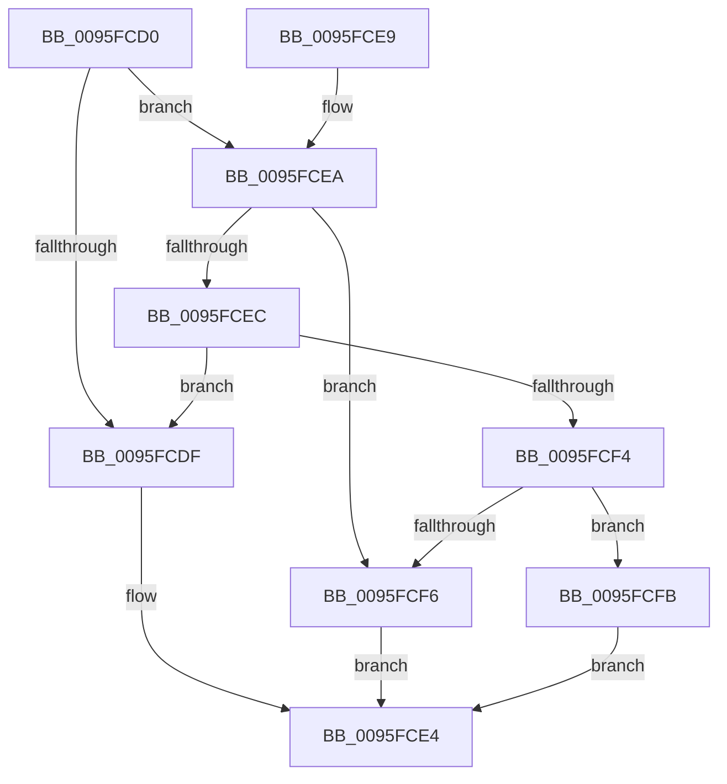

# PfSnAltProfileTreeCompareByScenarioId

- RVA: `0x0095FCD0`–`0x0095FD0F` (길이 `63` bytes)
- VA: `0x000000014095FCD0`
- 실행 섹션: `PAGE`
- PDB 이름 있음: `예`; PDB Function 태그: `아니요`
- unwind 정보 RVA: `0x00093068`
- 디코드: `21`개 명령, `63/63` bytes 표시
- 미해석 바이트: `0` (있으면 어셈블리에 `.byte`로 보존)

> 이 문서는 커널 이미지의 기계어와 PDB 기호를 분석해 생성했습니다. 4번과 5번은 함수 원형과 자료형을 바이너리 사용 방식에서 추정한 C 해석이며 원본 소스 복구 결과는 아닙니다.

## 1. Dependencies

- 직접 호출 지점: **1**; 고유 호출 대상: **1**
- 직접 호출자로 확인된 함수: **2**
- RIP 상대 이미지 참조: **0**

### Outgoing calls
- `0x0095FD08` → [wcsncmp](../../text/50/wcsncmp_function_00501CA0.md) (function, `0x00501CA0`)

### Direct callers
- [PfSnSetAltPrefetchParam](../75/PfSnSetAltPrefetchParam_function_00752424.md) at `0x007527AE`
- [PfSnAltProfileFindByScenarioId](PfSnAltProfileFindByScenarioId_function_0095FC3C.md) at `0x0095FC6E`

### Static image references
- 디코드된 RIP-relative 메모리 참조가 없습니다.

## 2. Other-region calls and transfers

- 다른 실행 섹션으로 향하는 call: **1**
  - `0x0095FD08` → [wcsncmp](../../text/50/wcsncmp_function_00501CA0.md) (`PAGE` → `.text`)
- 별도 외부 분기/꼬리 이동을 확인하지 못했습니다.

## 3. Assembly (complete function range)

```asm
0095FCD0  48 83 EC 28                     sub rsp, 0x28
0095FCD4  8B 42 5C                        mov eax, dword ptr [rdx + 0x5c]
0095FCD7  4C 8B C9                        mov r9, rcx
0095FCDA  3B 41 3C                        cmp eax, dword ptr [rcx + 0x3c]
0095FCDD  76 0B                           jbe 0x14095fcea
0095FCDF  B8 01 00 00 00                  mov eax, 1
0095FCE4  48 83 C4 28                     add rsp, 0x28
0095FCE8  C3                              ret
0095FCE9  CC                              int3
0095FCEA  72 0A                           jb 0x14095fcf6
0095FCEC  8B 42 60                        mov eax, dword ptr [rdx + 0x60]
0095FCEF  3B 41 40                        cmp eax, dword ptr [rcx + 0x40]
0095FCF2  77 EB                           ja 0x14095fcdf
0095FCF4  73 05                           jae 0x14095fcfb
0095FCF6  83 C8 FF                        or eax, 0xffffffff
0095FCF9  EB E9                           jmp 0x14095fce4
0095FCFB  48 8D 4A 20                     lea rcx, [rdx + 0x20]
0095FCFF  41 B8 1E 00 00 00               mov r8d, 0x1e
0095FD05  49 8B D1                        mov rdx, r9
0095FD08  E8 93 1F BA FF                  call 0x140501ca0
0095FD0D  EB D5                           jmp 0x14095fce4
```

## 4. C-style interpretation (structured pseudocode)

```c
__int64 __fastcall PfSnAltProfileTreeCompareByScenarioId(__int64 a1, __int64 a2)
{
    __int64 result;
    __int64 v_rsp;

    v_rsp = (v_rsp) - (40);
    if (((unsigned int)((unsigned int)(*(unsigned int *)(a2 + 92)))) <= (*(unsigned int *)(a1 + 60))) goto loc_0095FCEA;
loc_0095FCDF:
loc_0095FCE4:
    v_rsp = (v_rsp) + (40);
    return 1;
loc_0095FCEA:
    if (condition_is_below) goto loc_0095FCF6;
    if (((unsigned int)((unsigned int)(*(unsigned int *)(a2 + 96)))) > (*(unsigned int *)(a1 + 64))) goto loc_0095FCDF;
    if (((unsigned int)((unsigned int)(*(unsigned int *)(a2 + 96)))) >= (*(unsigned int *)(a1 + 64))) goto loc_0095FCFB;
loc_0095FCF6:
    result = (unsigned int)(((unsigned int)(*(unsigned int *)(a2 + 96))) | (0xFFFFFFFFULL));
    goto loc_0095FCE4;
loc_0095FCFB:
    result = wcsncmp(a2 + 32, a1, 30, a1);
    goto loc_0095FCE4;
}
```

## 5. (Beta) C Style

```c
int64_t PfSnAltProfileTreeCompareByScenarioId(void *Arg1, void *Arg2)
{
    uint8_t *arg1 = (uint8_t *)Arg1;
    uint8_t *arg2 = (uint8_t *)Arg2;

    int64_t result;
    int64_t local_rsp;

    local_rsp = (local_rsp) - (40);
    if (((uint32_t)((uint32_t)(*(uint32_t *)(arg2 + 0x5C)))) <= (*(uint32_t *)(arg1 + 0x3C))) goto loc_0095FCEA;
loc_0095FCDF:
loc_0095FCE4:
    local_rsp = (local_rsp) + (40);
    return 1;
loc_0095FCEA:
    if (condition_is_below) goto loc_0095FCF6;
    if (((uint32_t)((uint32_t)(*(uint32_t *)(arg2 + 0x60)))) > (*(uint32_t *)(arg1 + 0x40))) goto loc_0095FCDF;
    if (((uint32_t)((uint32_t)(*(uint32_t *)(arg2 + 0x60)))) >= (*(uint32_t *)(arg1 + 0x40))) goto loc_0095FCFB;
loc_0095FCF6:
    result = (uint32_t)(((uint32_t)(*(uint32_t *)(arg2 + 0x60))) | (0xFFFFFFFFULL));
    goto loc_0095FCE4;
loc_0095FCFB:
    result = wcsncmp(Arg2 + 32, Arg1, 30, Arg1);
    goto loc_0095FCE4;
}
```

### 관측된 메모리 오프셋

구조체 형식이 확인되지 않은 접근은 인자 기준의 오프셋으로만 기록했습니다.

| 기준 인자 | 오프셋 표현 | 폭 (bit) | 접근 |
|---|---:|---:|---|
| `Arg1` | `+ 0x3C` | `32` | `R` |
| `Arg1` | `+ 0x40` | `32` | `R` |
| `Arg2` | `+ 0x20` | `64` | `R` |
| `Arg2` | `+ 0x5C` | `32` | `R` |
| `Arg2` | `+ 0x60` | `32` | `R` |

## 6. Execution-region graph

[열기: 2D/3D 그래프와 함수 탐색 컨트롤 패널](../../../control-panel.html?section=page&rva=0x0095FCD0&view=graph)

- 2D 그래프는 위에서 아래로 흐르고, 3D 그래프는 빈 공간을 드래그해 회전합니다. Shift+드래그는 이동, 휠은 확대·축소, 함수 노드 선택은 대상 보고서 이동입니다.

### Static fallback


