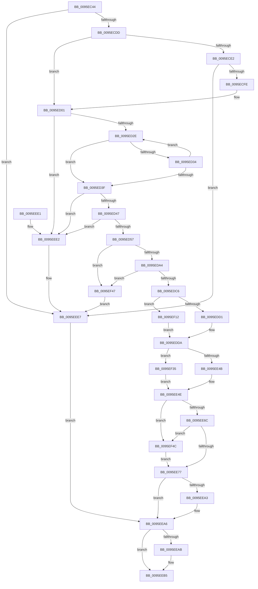

# PfSnBeginAppLaunch

- RVA: `0x0095EC44`–`0x0095EF55` (길이 `785` bytes)
- VA: `0x000000014095EC44`
- 실행 섹션: `PAGE`
- PDB 이름 있음: `예`; PDB Function 태그: `아니요`
- unwind 정보 RVA: `0x00092F9C`
- 디코드: `200`개 명령, `785/785` bytes 표시
- 미해석 바이트: `0` (있으면 어셈블리에 `.byte`로 보존)

> 이 문서는 커널 이미지의 기계어와 PDB 기호를 분석해 생성했습니다. 4번과 5번은 함수 원형과 자료형을 바이너리 사용 방식에서 추정한 C 해석이며 원본 소스 복구 결과는 아닙니다.

## 1. Dependencies

- 직접 호출 지점: **16**; 고유 호출 대상: **15**
- 직접 호출자로 확인된 함수: **2**
- RIP 상대 이미지 참조: **3**

### Outgoing calls
- `0x0095ECA7` → [memset](../../text/6C/memset_function_006C6C40.md) (function, `0x006C6C40`)
- `0x0095ECBF` → [memset](../../text/6C/memset_function_006C6C40.md) (function, `0x006C6C40`)
- `0x0095ECCE` → [PfSnCheckScenario](PfSnCheckScenario_function_0095EF5C.md) (function, `0x0095EF5C`)
- `0x0095ECEA` → [PfCalculateProcessHash](../96/PfCalculateProcessHash_function_00960310.md) (function, `0x00960310`)
- `0x0095ED6C` → [memcpy](../../text/6C/memcpy_function_006C6840.md) (function, `0x006C6840`)
- `0x0095ED82` → [PfSnIsHostingApplication](PfSnIsHostingApplication_function_0095FF34.md) (function, `0x0095FF34`)
- `0x0095ED95` → [PfSnScanCommandLine](PfSnScanCommandLine_function_0095FE78.md) (function, `0x0095FE78`)
- `0x0095EDB7` → [PfSnCheckModernApp](PfSnCheckModernApp_function_0095FFF8.md) (function, `0x0095FFF8`)
- `0x0095EE05` → [PfSnGetAppVersion](../../text/48/PfSnGetAppVersion_function_0048AD84.md) (function, `0x0048AD84`)
- `0x0095EE34` → [FsRtlAcquirePushLockShared](../../text/48/FsRtlAcquirePushLockShared_function_0048B034.md) (function, `0x0048B034`)
- `0x0095EE3D` → [PfSnAltProfileFindByScenarioId](PfSnAltProfileFindByScenarioId_function_0095FC3C.md) (function, `0x0095FC3C`)
- `0x0095EE55` → [PfLockSharedRelease](../../text/48/PfLockSharedRelease_function_0048DF24.md) (function, `0x0048DF24`)
- `0x0095EE98` → [PfSnBeginScenario](PfSnBeginScenario_function_0095EFC0.md) (function, `0x0095EFC0`)
- `0x0095EEB0` → [ExFreePoolWithTag](../../poolcode/B8/ExFreePoolWithTag_function_00B82870.md) (function, `0x00B82870`)
- `0x0095EEC1` → [_security_check_cookie](../../text/6A/_security_check_cookie_function_006AC640.md) (function, `0x006AC640`)
- `0x0095EF0B` → [PfSnLogScenarioDecision](PfSnLogScenarioDecision_function_0095F2BC.md) (function, `0x0095F2BC`)

### Direct callers
- [PfSnAppLaunchScenarioControl](../75/PfSnAppLaunchScenarioControl_function_00752294.md) at `0x0075235B`
- [PfProcessCreateNotification](PfProcessCreateNotification_function_0095EB98.md) at `0x0095EBD6`

### Static image references
- `0x0095EC63` → RVA `0x00E0A740` (`.data`; read)
- `0x0095EE0E` → RVA `0x00E67388` (`.data`; read)
- `0x0095EE5E` → RVA `0x00E67360` (`.data`; read)

## 2. Other-region calls and transfers

- 다른 실행 섹션으로 향하는 call: **8**
  - `0x0095ECA7` → [memset](../../text/6C/memset_function_006C6C40.md) (`PAGE` → `.text`)
  - `0x0095ECBF` → [memset](../../text/6C/memset_function_006C6C40.md) (`PAGE` → `.text`)
  - `0x0095ED6C` → [memcpy](../../text/6C/memcpy_function_006C6840.md) (`PAGE` → `.text`)
  - `0x0095EE05` → [PfSnGetAppVersion](../../text/48/PfSnGetAppVersion_function_0048AD84.md) (`PAGE` → `.text`)
  - `0x0095EE34` → [FsRtlAcquirePushLockShared](../../text/48/FsRtlAcquirePushLockShared_function_0048B034.md) (`PAGE` → `.text`)
  - `0x0095EE55` → [PfLockSharedRelease](../../text/48/PfLockSharedRelease_function_0048DF24.md) (`PAGE` → `.text`)
  - `0x0095EEB0` → [ExFreePoolWithTag](../../poolcode/B8/ExFreePoolWithTag_function_00B82870.md) (`PAGE` → `POOLCODE`)
  - `0x0095EEC1` → [_security_check_cookie](../../text/6A/_security_check_cookie_function_006AC640.md) (`PAGE` → `.text`)
- 별도 외부 분기/꼬리 이동을 확인하지 못했습니다.

## 3. Assembly (complete function range)

```asm
0095EC44  48 89 5C 24 20                  mov qword ptr [rsp + 0x20], rbx
0095EC49  55                              push rbp
0095EC4A  56                              push rsi
0095EC4B  57                              push rdi
0095EC4C  41 54                           push r12
0095EC4E  41 55                           push r13
0095EC50  41 56                           push r14
0095EC52  41 57                           push r15
0095EC54  48 8D AC 24 E0 FE FF FF         lea rbp, [rsp - 0x120]
0095EC5C  48 81 EC 20 02 00 00            sub rsp, 0x220
0095EC63  48 8B 05 D6 BA 4A 00            mov rax, qword ptr [rip + 0x4abad6]
0095EC6A  48 33 C4                        xor rax, rsp
0095EC6D  48 89 85 10 01 00 00            mov qword ptr [rbp + 0x110], rax
0095EC74  45 33 E4                        xor r12d, r12d
0095EC77  45 8B E8                        mov r13d, r8d
0095EC7A  48 8B F2                        mov rsi, rdx
0095EC7D  44 89 64 24 54                  mov dword ptr [rsp + 0x54], r12d
0095EC82  4C 8B F9                        mov r15, rcx
0095EC85  44 89 64 24 50                  mov dword ptr [rsp + 0x50], r12d
0095EC8A  0F 57 C0                        xorps xmm0, xmm0
0095EC8D  44 89 64 24 48                  mov dword ptr [rsp + 0x48], r12d
0095EC92  45 8D 44 24 44                  lea r8d, [r12 + 0x44]
0095EC97  44 89 64 24 4C                  mov dword ptr [rsp + 0x4c], r12d
0095EC9C  33 D2                           xor edx, edx
0095EC9E  48 8D 4D C0                     lea rcx, [rbp - 0x40]
0095ECA2  0F 11 44 24 68                  movups xmmword ptr [rsp + 0x68], xmm0
0095ECA7  E8 94 7F D6 FF                  call 0x1406c6c40
0095ECAC  33 D2                           xor edx, edx
0095ECAE  4C 89 64 24 40                  mov qword ptr [rsp + 0x40], r12
0095ECB3  45 8D 44 24 40                  lea r8d, [r12 + 0x40]
0095ECB8  41 8B FC                        mov edi, r12d
0095ECBB  48 8D 4D 80                     lea rcx, [rbp - 0x80]
0095ECBF  E8 7C 7F D6 FF                  call 0x1406c6c40
0095ECC4  48 8D 54 24 54                  lea rdx, [rsp + 0x54]
0095ECC9  33 C9                           xor ecx, ecx
0095ECCB  45 8B F4                        mov r14d, r12d
0095ECCE  E8 89 02 00 00                  call 0x14095ef5c
0095ECD3  8B D8                           mov ebx, eax
0095ECD5  85 C0                           test eax, eax
0095ECD7  0F 88 0A 02 00 00               js 0x14095eee7
0095ECDD  48 85 F6                        test rsi, rsi
0095ECE0  75 1F                           jne 0x14095ed01
0095ECE2  48 8D 54 24 40                  lea rdx, [rsp + 0x40]
0095ECE7  49 8B CF                        mov rcx, r15
0095ECEA  E8 21 16 00 00                  call 0x140960310
0095ECEF  48 8B 7C 24 40                  mov rdi, qword ptr [rsp + 0x40]
0095ECF4  8B D8                           mov ebx, eax
0095ECF6  85 C0                           test eax, eax
0095ECF8  0F 88 E9 01 00 00               js 0x14095eee7
0095ECFE  48 8B F7                        mov rsi, rdi
0095ED01  0F B7 06                        movzx eax, word ptr [rsi]
0095ED04  41 8B CC                        mov ecx, r12d
0095ED07  48 8B 56 08                     mov rdx, qword ptr [rsi + 8]
0095ED0B  D1 E8                           shr eax, 1
0095ED0D  44 8B C0                        mov r8d, eax
0095ED10  48 FF C8                        dec rax
0095ED13  48 C7 44 24 58 00 01 00 00      mov qword ptr [rsp + 0x58], 0x100
0095ED1C  44 89 64 24 40                  mov dword ptr [rsp + 0x40], r12d
0095ED21  48 8D 04 42                     lea rax, [rdx + rax*2]
0095ED25  48 3B C2                        cmp rax, rdx
0095ED28  0F 82 B4 01 00 00               jb 0x14095eee2
0095ED2E  66 83 38 5C                     cmp word ptr [rax], 0x5c
0095ED32  74 0B                           je 0x14095ed3f
0095ED34  FF C1                           inc ecx
0095ED36  48 83 E8 02                     sub rax, 2
0095ED3A  48 3B C2                        cmp rax, rdx
0095ED3D  73 EF                           jae 0x14095ed2e
0095ED3F  85 C9                           test ecx, ecx
0095ED41  0F 84 9B 01 00 00               je 0x14095eee2
0095ED47  44 2B C1                        sub r8d, ecx
0095ED4A  4A 8D 14 42                     lea rdx, [rdx + r8*2]
0095ED4E  48 85 D2                        test rdx, rdx
0095ED51  0F 84 8B 01 00 00               je 0x14095eee2
0095ED57  B8 1D 00 00 00                  mov eax, 0x1d
0095ED5C  3B C8                           cmp ecx, eax
0095ED5E  0F 43 C8                        cmovae ecx, eax
0095ED61  48 8D 1C 09                     lea rbx, [rcx + rcx]
0095ED65  4C 8B C3                        mov r8, rbx
0095ED68  48 8D 4D 80                     lea rcx, [rbp - 0x80]
0095ED6C  E8 CF 7A D6 FF                  call 0x1406c6840
0095ED71  66 44 89 64 1D 80               mov word ptr [rbp + rbx - 0x80], r12w
0095ED77  48 8D 4D 80                     lea rcx, [rbp - 0x80]
0095ED7B  45 8B A7 84 03 00 00            mov r12d, dword ptr [r15 + 0x384]
0095ED82  E8 AD 11 00 00                  call 0x14095ff34
0095ED87  44 0F B6 C0                     movzx r8d, al
0095ED8B  48 8D 54 24 50                  lea rdx, [rsp + 0x50]
0095ED90  48 8D 4C 24 48                  lea rcx, [rsp + 0x48]
0095ED95  E8 DE 10 00 00                  call 0x14095fe78
0095ED9A  8B D8                           mov ebx, eax
0095ED9C  85 C0                           test eax, eax
0095ED9E  0F 88 A3 01 00 00               js 0x14095ef47
0095EDA4  4C 8D 4C 24 58                  lea r9, [rsp + 0x58]
0095EDA9  4C 8D 45 10                     lea r8, [rbp + 0x10]
0095EDAD  48 8D 54 24 4C                  lea rdx, [rsp + 0x4c]
0095EDB2  48 8D 4C 24 40                  lea rcx, [rsp + 0x40]
0095EDB7  E8 3C 12 00 00                  call 0x14095fff8
0095EDBC  8B D8                           mov ebx, eax
0095EDBE  85 C0                           test eax, eax
0095EDC0  0F 88 81 01 00 00               js 0x14095ef47
0095EDC6  44 39 74 24 40                  cmp dword ptr [rsp + 0x40], r14d
0095EDCB  0F 85 41 01 00 00               jne 0x14095ef12
0095EDD1  0F 10 06                        movups xmm0, xmmword ptr [rsi]
0095EDD4  F3 0F 7F 44 24 68               movdqu xmmword ptr [rsp + 0x68], xmm0
0095EDDA  8B 54 24 4C                     mov edx, dword ptr [rsp + 0x4c]
0095EDDE  49 8B CF                        mov rcx, r15
0095EDE1  03 54 24 48                     add edx, dword ptr [rsp + 0x48]
0095EDE5  8B 5C 24 50                     mov ebx, dword ptr [rsp + 0x50]
0095EDE9  41 03 D4                        add edx, r12d
0095EDEC  89 55 BC                        mov dword ptr [rbp - 0x44], edx
0095EDEF  45 33 E4                        xor r12d, r12d
0095EDF2  48 8D 54 24 60                  lea rdx, [rsp + 0x60]
0095EDF7  4C 89 64 24 60                  mov qword ptr [rsp + 0x60], r12
0095EDFC  89 5C 24 58                     mov dword ptr [rsp + 0x58], ebx
0095EE00  44 89 64 24 5C                  mov dword ptr [rsp + 0x5c], r12d
0095EE05  E8 7A BF B2 FF                  call 0x14048ad84
0095EE0A  0F 28 45 80                     movaps xmm0, xmmword ptr [rbp - 0x80]
0095EE0E  48 8D 0D 73 85 50 00            lea rcx, [rip + 0x508573]
0095EE15  0F 28 4D 90                     movaps xmm1, xmmword ptr [rbp - 0x70]
0095EE19  0F 29 45 C0                     movaps xmmword ptr [rbp - 0x40], xmm0
0095EE1D  0F 28 45 A0                     movaps xmm0, xmmword ptr [rbp - 0x60]
0095EE21  0F 29 4D D0                     movaps xmmword ptr [rbp - 0x30], xmm1
0095EE25  0F 28 4D B0                     movaps xmm1, xmmword ptr [rbp - 0x50]
0095EE29  0F 29 45 E0                     movaps xmmword ptr [rbp - 0x20], xmm0
0095EE2D  0F 29 4D F0                     movaps xmmword ptr [rbp - 0x10], xmm1
0095EE31  89 5D 00                        mov dword ptr [rbp], ebx
0095EE34  E8 FB C1 B2 FF                  call 0x14048b034
0095EE39  48 8D 4D C0                     lea rcx, [rbp - 0x40]
0095EE3D  E8 FA 0D 00 00                  call 0x14095fc3c
0095EE42  48 85 C0                        test rax, rax
0095EE45  0F 85 EA 00 00 00               jne 0x14095ef35
0095EE4B  01 5D BC                        add dword ptr [rbp - 0x44], ebx
0095EE4E  48 8D 0D 33 85 50 00            lea rcx, [rip + 0x508533]
0095EE55  E8 CA F0 B2 FF                  call 0x14048df24
0095EE5A  44 01 6D BC                     add dword ptr [rbp - 0x44], r13d
0095EE5E  8B 05 FC 84 50 00               mov eax, dword ptr [rip + 0x5084fc]
0095EE64  A8 20                           test al, 0x20
0095EE66  0F 85 E0 00 00 00               jne 0x14095ef4c
0095EE6C  83 7C 24 54 02                  cmp dword ptr [rsp + 0x54], 2
0095EE71  0F 84 D5 00 00 00               je 0x14095ef4c
0095EE77  48 8D 44 24 58                  lea rax, [rsp + 0x58]
0095EE7C  45 8B CE                        mov r9d, r14d
0095EE7F  48 89 44 24 28                  mov qword ptr [rsp + 0x28], rax
0095EE84  48 8D 55 80                     lea rdx, [rbp - 0x80]
0095EE88  48 8D 44 24 68                  lea rax, [rsp + 0x68]
0095EE8D  45 33 C0                        xor r8d, r8d
0095EE90  49 8B CF                        mov rcx, r15
0095EE93  48 89 44 24 20                  mov qword ptr [rsp + 0x20], rax
0095EE98  E8 23 01 00 00                  call 0x14095efc0
0095EE9D  8B D8                           mov ebx, eax
0095EE9F  85 C0                           test eax, eax
0095EEA1  78 03                           js 0x14095eea6
0095EEA3  41 8B DC                        mov ebx, r12d
0095EEA6  48 85 FF                        test rdi, rdi
0095EEA9  74 0A                           je 0x14095eeb5
0095EEAB  33 D2                           xor edx, edx
0095EEAD  48 8B CF                        mov rcx, rdi
0095EEB0  E8 BB 39 22 00                  call 0x140b82870
0095EEB5  8B C3                           mov eax, ebx
0095EEB7  48 8B 8D 10 01 00 00            mov rcx, qword ptr [rbp + 0x110]
0095EEBE  48 33 CC                        xor rcx, rsp
0095EEC1  E8 7A D7 D4 FF                  call 0x1406ac640
0095EEC6  48 8B 9C 24 78 02 00 00         mov rbx, qword ptr [rsp + 0x278]
0095EECE  48 81 C4 20 02 00 00            add rsp, 0x220
0095EED5  41 5F                           pop r15
0095EED7  41 5E                           pop r14
0095EED9  41 5D                           pop r13
0095EEDB  41 5C                           pop r12
0095EEDD  5F                              pop rdi
0095EEDE  5E                              pop rsi
0095EEDF  5D                              pop rbp
0095EEE0  C3                              ret
0095EEE1  CC                              int3
0095EEE2  BB 0D 00 00 C0                  mov ebx, 0xc000000d
0095EEE7  48 83 4C 24 38 FF               or qword ptr [rsp + 0x38], 0xffffffffffffffff
0095EEED  48 8D 55 80                     lea rdx, [rbp - 0x80]
0095EEF1  B8 0F 00 00 00                  mov eax, 0xf
0095EEF6  89 5C 24 30                     mov dword ptr [rsp + 0x30], ebx
0095EEFA  89 44 24 28                     mov dword ptr [rsp + 0x28], eax
0095EEFE  45 8B CC                        mov r9d, r12d
0095EF01  45 33 C0                        xor r8d, r8d
0095EF04  89 44 24 20                     mov dword ptr [rsp + 0x20], eax
0095EF08  49 8B CF                        mov rcx, r15
0095EF0B  E8 AC 03 00 00                  call 0x14095f2bc
0095EF10  EB 94                           jmp 0x14095eea6
0095EF12  48 8D 45 10                     lea rax, [rbp + 0x10]
0095EF16  41 BE 08 00 00 00               mov r14d, 8
0095EF1C  48 89 44 24 70                  mov qword ptr [rsp + 0x70], rax
0095EF21  48 8B 44 24 58                  mov rax, qword ptr [rsp + 0x58]
0095EF26  66 89 44 24 68                  mov word ptr [rsp + 0x68], ax
0095EF2B  66 89 44 24 6A                  mov word ptr [rsp + 0x6a], ax
0095EF30  E9 A5 FE FF FF                  jmp 0x14095edda
0095EF35  8B 48 7C                        mov ecx, dword ptr [rax + 0x7c]
0095EF38  01 4D BC                        add dword ptr [rbp - 0x44], ecx
0095EF3B  8B 40 7C                        mov eax, dword ptr [rax + 0x7c]
0095EF3E  89 44 24 5C                     mov dword ptr [rsp + 0x5c], eax
0095EF42  E9 07 FF FF FF                  jmp 0x14095ee4e
0095EF47  45 33 E4                        xor r12d, r12d
0095EF4A  EB 9B                           jmp 0x14095eee7
0095EF4C  41 83 CE 02                     or r14d, 2
0095EF50  E9 22 FF FF FF                  jmp 0x14095ee77
```

## 4. C-style interpretation (structured pseudocode)

```c
__int64 __fastcall PfSnBeginAppLaunch(__int64 a1, __int64 a2, int a3)
{
    __int64 result;
    __int64 v_r12;
    __int64 v_r14;
    __int64 v_rbx;
    __int64 v_rsp;
    unsigned __int64 v_stack_m148;
    unsigned __int64 v_stack_m158;
    unsigned __int64 v_stack_m168;
    unsigned __int64 v_stack_m178;
    unsigned __int64 v_stack_m188;
    unsigned __int64 v_stack_m198;
    unsigned int v_stack_m19C;
    unsigned __int64 v_stack_m1A8;
    unsigned __int64 v_stack_m1B8;
    unsigned __int64 v_stack_m1C8;
    unsigned __int64 v_stack_m1D8;
    unsigned __int64 v_stack_m1F0;
    unsigned __int64 v_stack_m1F8;
    unsigned int v_stack_m1FC;
    unsigned __int64 v_stack_m200;
    unsigned int v_stack_m204;
    unsigned int v_stack_m208;
    unsigned int v_stack_m20C;
    unsigned int v_stack_m210;
    unsigned __int64 v_stack_m218;
    unsigned __int64 v_stack_m230;
    unsigned __int64 v_stack_m238;
    unsigned __int64 v_stack_m48;
    unsigned __int64 v_stack_p20;
    unsigned int v_stack_p28;
    unsigned int v_stack_p30;
    unsigned __int64 v_stack_p38;
    unsigned __int64 v_stack_p58;
    unsigned int v_stack_p5C;
    unsigned __int16 v_stack_p68;
    unsigned __int16 v_stack_p6A;
    unsigned __int64 v_stack_p70;

    v_stack_p20 = v_rbx;
    v_rsp = (v_rsp) - (544);
    result = (*(unsigned __int64 *)(v_rip + 4897494)) ^ (v_rsp);
    v_stack_m48 = result;
    v_r12 = 0;
    v_stack_m204 = 0;
    v_stack_m208 = 0;
    v_stack_m210 = 0;
    v_stack_m20C = 0;
    a2 = 0;
    v_stack_m1F0 = v_xmm0;
    result = memset(v_stack_m198, a2, v_r12 + 68, a4);
    a2 = 0;
    v_stack_m218 = 0;
    result = memset(v_stack_m1D8, a2, v_r12 + 64, a4);
    a1 = 0;
    result = PfSnCheckScenario(a1, v_stack_m204, v_r12 + 64, a4);
    if (sign_flag) goto loc_0095EEE7;
    if (0 != 0) goto loc_0095ED01;
    result = PfCalculateProcessHash(0, v_stack_m218, v_r12 + 64, a4);
    if (sign_flag) goto loc_0095EEE7;
loc_0095ED01:
    result = (unsigned int)((*(unsigned __int16 *)(v_stack_m218)) >> (1));
    result = (result) - 1;
    v_stack_m200 = 256;
    v_stack_m218 = 0;
    if ((*(unsigned __int64 *)(v_stack_m218 + 8) + result * 2) < (*(unsigned __int64 *)(v_stack_m218 + 8))) goto loc_0095EEE2;
loc_0095ED2E:
    if ((*(unsigned __int16 *)(*(unsigned __int64 *)(v_stack_m218 + 8) + result * 2)) == 92) goto loc_0095ED3F;
    a1 = (unsigned int)((0) + 1);
    result = (*(unsigned __int64 *)(v_stack_m218 + 8) + result * 2) - (2);
    if (result >= (*(unsigned __int64 *)(v_stack_m218 + 8))) goto loc_0095ED2E;
loc_0095ED3F:
    if ((unsigned int)(a1) == 0) goto loc_0095EEE2;
    a3 = (unsigned int)(((unsigned int)((unsigned int)(result))) - ((unsigned int)(a1)));
    if (*(unsigned __int64 *)(v_stack_m218 + 8) + a3 * 2 == 0) goto loc_0095EEE2;
    if (((unsigned int)(a1)) >= 29) { a1 = 29; }
    result = memcpy(v_stack_m1D8, *(unsigned __int64 *)(v_stack_m218 + 8) + a3 * 2, a1 + a1 * 1, a4);
    *(unsigned __int16 *)(v_stack_m158 + a1 + a1 * 1 * 1 - 128) = 0;
    result = PfSnIsHostingApplication(v_stack_m1D8, *(unsigned __int64 *)(v_stack_m218 + 8) + a3 * 2, a1 + a1 * 1, a4);
    result = PfSnScanCommandLine(v_stack_m210, v_stack_m208, (unsigned __int8)(result), a4);
    if (sign_flag) goto loc_0095EF47;
    result = PfSnCheckModernApp(v_stack_m218, v_stack_m20C, v_stack_m148, v_stack_m200);
    if (sign_flag) goto loc_0095EF47;
    if (v_stack_m218 != 0) goto loc_0095EF12;
    v_stack_m1F0 = v_xmm0;
loc_0095EDDA:
    a2 = (unsigned int)(((unsigned int)(v_stack_m20C)) + (v_stack_m210));
    a2 = (unsigned int)((a2) + ((unsigned int)((unsigned int)(*(unsigned int *)(a1 + 900)))));
    v_stack_m19C = (unsigned int)(a2);
    v_r12 = 0;
    v_stack_m1F8 = 0;
    v_stack_m200 = (unsigned int)((unsigned int)(v_stack_m208));
    v_stack_m1FC = 0;
    result = PfSnGetAppVersion(a1, v_stack_m1F8, v_stack_m148, v_stack_m200);
    v_stack_m198 = v_xmm0;
    v_stack_m188 = v_xmm1;
    v_stack_m178 = v_xmm0;
    v_stack_m168 = v_xmm1;
    v_stack_m158 = (unsigned int)((unsigned int)(v_stack_m208));
    result = FsRtlAcquirePushLockShared(v_rip + 5277043, v_stack_m1F8, v_stack_m148, v_stack_m200);
    result = PfSnAltProfileFindByScenarioId(v_stack_m198, v_stack_m1F8, v_stack_m148, v_stack_m200);
    if (result != 0) goto loc_0095EF35;
loc_0095EE4E:
    result = PfLockSharedRelease(v_rip + 5276979, v_stack_m1F8, v_stack_m148, v_stack_m200);
    if ((((unsigned __int8)((unsigned int)(*(unsigned int *)(v_rip + 5276924)))) & (32)) != 0) goto loc_0095EF4C;
    if (v_stack_m204 == 2) goto loc_0095EF4C;
loc_0095EE77:
    v_stack_m230 = v_stack_m200;
    a3 = 0;
    v_stack_m238 = v_stack_m1F0;
    result = PfSnBeginScenario(a1, v_stack_m1D8, a3, 0);
    v_rbx = (unsigned int)((unsigned int)(result));
    if (!(sign_flag)) {
        v_rbx = 0;
    }
    if (v_stack_m218 != 0) {
        a2 = 0;
        a1 = v_stack_m218;
        result = ExFreePoolWithTag(a1, a2, a3, 0);
    }
    a1 = (v_stack_m48) ^ (v_rsp);
    result = _security_check_cookie(a1, a2, a3, 0);
    v_rsp = (v_rsp) + (544);
    return result;
loc_0095EEE2:
loc_0095EEE7:
    v_stack_p30 = (unsigned int)((unsigned int)(0xC000000DULL));
    v_stack_p28 = 15;
    a3 = 0;
    v_stack_p20 = 15;
    result = PfSnLogScenarioDecision(a1, v_stack_m1D8, a3, 0);
    goto loc_0095EEA6;
loc_0095EF12:
    v_stack_p70 = v_stack_m148;
    v_stack_p68 = (unsigned __int16)(v_stack_p58);
    v_stack_p6A = (unsigned __int16)(v_stack_p58);
    goto loc_0095EDDA;
loc_0095EF35:
    v_stack_p5C = (unsigned int)((unsigned int)(*(unsigned int *)(v_stack_p58 + 124)));
    goto loc_0095EE4E;
loc_0095EF47:
    v_r12 = 0;
    goto loc_0095EEE7;
loc_0095EF4C:
    v_r14 = (unsigned int)((8) | (2));
    goto loc_0095EE77;
}
```

## 5. (Beta) C Style

```c
int64_t PfSnBeginAppLaunch(void *Arg1, int64_t Arg2, int32_t Arg3)
{
    uint8_t *arg1 = (uint8_t *)Arg1;

    int64_t result;
    int64_t local_r12;
    int64_t local_r14;
    int64_t local_rbx;
    int64_t local_rsp;
    uint64_t v_stack_m148;
    uint64_t v_stack_m158;
    uint64_t v_stack_m168;
    uint64_t v_stack_m178;
    uint64_t v_stack_m188;
    uint64_t v_stack_m198;
    uint32_t v_stack_m19C;
    uint64_t v_stack_m1A8;
    uint64_t v_stack_m1B8;
    uint64_t v_stack_m1C8;
    uint64_t v_stack_m1D8;
    uint64_t v_stack_m1F0;
    uint64_t v_stack_m1F8;
    uint32_t v_stack_m1FC;
    uint64_t v_stack_m200;
    uint32_t v_stack_m204;
    uint32_t v_stack_m208;
    uint32_t v_stack_m20C;
    uint32_t v_stack_m210;
    uint64_t v_stack_m218;
    uint64_t v_stack_m230;
    uint64_t v_stack_m238;
    uint64_t v_stack_m48;
    uint64_t v_stack_p20;
    uint32_t v_stack_p28;
    uint32_t v_stack_p30;
    uint64_t v_stack_p38;
    uint64_t v_stack_p58;
    uint32_t v_stack_p5C;
    uint16_t v_stack_p68;
    uint16_t v_stack_p6A;
    uint64_t v_stack_p70;

    v_stack_p20 = local_rbx;
    local_rsp = (local_rsp) - (544);
    result = (*(uint64_t *)(v_rip + 0x4ABAD6)) ^ (local_rsp);
    v_stack_m48 = result;
    local_r12 = 0;
    v_stack_m204 = 0;
    v_stack_m208 = 0;
    v_stack_m210 = 0;
    v_stack_m20C = 0;
    Arg2 = 0;
    v_stack_m1F0 = v_xmm0;
    result = memset(v_stack_m198, Arg2, local_r12 + 68, a4);
    Arg2 = 0;
    v_stack_m218 = 0;
    result = memset(v_stack_m1D8, Arg2, local_r12 + 64, a4);
    Arg1 = 0;
    result = PfSnCheckScenario(Arg1, v_stack_m204, local_r12 + 64, a4);
    if (sign_flag) goto loc_0095EEE7;
    if (0 != 0) goto loc_0095ED01;
    result = PfCalculateProcessHash(0, v_stack_m218, local_r12 + 64, a4);
    if (sign_flag) goto loc_0095EEE7;
loc_0095ED01:
    result = (uint32_t)((*(uint16_t *)(v_stack_m218)) >> (1));
    result = (result) - 1;
    v_stack_m200 = 256;
    v_stack_m218 = 0;
    if ((*(uint64_t *)(v_stack_m218 + 0x8) + result * 2) < (*(uint64_t *)(v_stack_m218 + 0x8))) goto loc_0095EEE2;
loc_0095ED2E:
    if ((*(uint16_t *)(*(uint64_t *)(v_stack_m218 + 0x8) + result * 2)) == 92) goto loc_0095ED3F;
    Arg1 = (uint32_t)((0) + 1);
    result = (*(uint64_t *)(v_stack_m218 + 0x8) + result * 2) - (2);
    if (result >= (*(uint64_t *)(v_stack_m218 + 0x8))) goto loc_0095ED2E;
loc_0095ED3F:
    if ((uint32_t)(Arg1) == 0) goto loc_0095EEE2;
    Arg3 = (uint32_t)(((uint32_t)((uint32_t)(result))) - ((uint32_t)(Arg1)));
    if (*(uint64_t *)(v_stack_m218 + 0x8) + Arg3 * 2 == 0) goto loc_0095EEE2;
    if (((uint32_t)(Arg1)) >= 29) { Arg1 = 29; }
    result = memcpy(v_stack_m1D8, *(uint64_t *)(v_stack_m218 + 0x8) + Arg3 * 2, Arg1 + Arg1 * 1, a4);
    *(uint16_t *)(v_stack_m158 + arg1 + arg1 * 1 * 1 - 0x80) = 0;
    result = PfSnIsHostingApplication(v_stack_m1D8, *(uint64_t *)(v_stack_m218 + 0x8) + Arg3 * 2, Arg1 + Arg1 * 1, a4);
    result = PfSnScanCommandLine(v_stack_m210, v_stack_m208, (uint8_t)(result), a4);
    if (sign_flag) goto loc_0095EF47;
    result = PfSnCheckModernApp(v_stack_m218, v_stack_m20C, v_stack_m148, v_stack_m200);
    if (sign_flag) goto loc_0095EF47;
    if (v_stack_m218 != 0) goto loc_0095EF12;
    v_stack_m1F0 = v_xmm0;
loc_0095EDDA:
    Arg2 = (uint32_t)(((uint32_t)(v_stack_m20C)) + (v_stack_m210));
    Arg2 = (uint32_t)((Arg2) + ((uint32_t)((uint32_t)(*(uint32_t *)(arg1 + 0x384)))));
    v_stack_m19C = (uint32_t)(Arg2);
    local_r12 = 0;
    v_stack_m1F8 = 0;
    v_stack_m200 = (uint32_t)((uint32_t)(v_stack_m208));
    v_stack_m1FC = 0;
    result = PfSnGetAppVersion(Arg1, v_stack_m1F8, v_stack_m148, v_stack_m200);
    v_stack_m198 = v_xmm0;
    v_stack_m188 = v_xmm1;
    v_stack_m178 = v_xmm0;
    v_stack_m168 = v_xmm1;
    v_stack_m158 = (uint32_t)((uint32_t)(v_stack_m208));
    result = FsRtlAcquirePushLockShared(v_rip + 5277043, v_stack_m1F8, v_stack_m148, v_stack_m200);
    result = PfSnAltProfileFindByScenarioId(v_stack_m198, v_stack_m1F8, v_stack_m148, v_stack_m200);
    if (result != 0) goto loc_0095EF35;
loc_0095EE4E:
    result = PfLockSharedRelease(v_rip + 5276979, v_stack_m1F8, v_stack_m148, v_stack_m200);
    if ((((uint8_t)((uint32_t)(*(uint32_t *)(v_rip + 0x5084FC)))) & (32)) != 0) goto loc_0095EF4C;
    if (v_stack_m204 == 2) goto loc_0095EF4C;
loc_0095EE77:
    v_stack_m230 = v_stack_m200;
    Arg3 = 0;
    v_stack_m238 = v_stack_m1F0;
    result = PfSnBeginScenario(Arg1, v_stack_m1D8, Arg3, 0);
    local_rbx = (uint32_t)((uint32_t)(result));
    if (!(sign_flag)) {
        local_rbx = 0;
    }
    if (v_stack_m218 != 0) {
        Arg2 = 0;
        Arg1 = v_stack_m218;
        result = ExFreePoolWithTag(Arg1, Arg2, Arg3, 0);
    }
    Arg1 = (v_stack_m48) ^ (local_rsp);
    result = _security_check_cookie(Arg1, Arg2, Arg3, 0);
    local_rsp = (local_rsp) + (544);
    return result;
loc_0095EEE2:
loc_0095EEE7:
    v_stack_p30 = (uint32_t)((uint32_t)(0xC000000DULL));
    v_stack_p28 = 15;
    Arg3 = 0;
    v_stack_p20 = 15;
    result = PfSnLogScenarioDecision(Arg1, v_stack_m1D8, Arg3, 0);
    goto loc_0095EEA6;
loc_0095EF12:
    v_stack_p70 = v_stack_m148;
    v_stack_p68 = (uint16_t)(v_stack_p58);
    v_stack_p6A = (uint16_t)(v_stack_p58);
    goto loc_0095EDDA;
loc_0095EF35:
    v_stack_p5C = (uint32_t)((uint32_t)(*(uint32_t *)(v_stack_p58 + 0x7C)));
    goto loc_0095EE4E;
loc_0095EF47:
    local_r12 = 0;
    goto loc_0095EEE7;
loc_0095EF4C:
    local_r14 = (uint32_t)((8) | (2));
    goto loc_0095EE77;
}
```

### 관측된 메모리 오프셋

구조체 형식이 확인되지 않은 접근은 인자 기준의 오프셋으로만 기록했습니다.

| 기준 인자 | 오프셋 표현 | 폭 (bit) | 접근 |
|---|---:|---:|---|
| `Arg1` | `+ 0x384` | `32` | `R` |

## 6. Execution-region graph

[열기: 2D/3D 그래프와 함수 탐색 컨트롤 패널](../../../control-panel.html?section=page&rva=0x0095EC44&view=graph)

- 2D 그래프는 위에서 아래로 흐르고, 3D 그래프는 빈 공간을 드래그해 회전합니다. Shift+드래그는 이동, 휠은 확대·축소, 함수 노드 선택은 대상 보고서 이동입니다.

### Static fallback


