# PfSnBeginScenario

- RVA: `0x0095EFC0`–`0x0095F2B5` (길이 `757` bytes)
- VA: `0x000000014095EFC0`
- 실행 섹션: `PAGE`
- PDB 이름 있음: `예`; PDB Function 태그: `예`
- unwind 정보 RVA: `0x00092FC4`
- 디코드: `191`개 명령, `757/757` bytes 표시
- 미해석 바이트: `0` (있으면 어셈블리에 `.byte`로 보존)

> 이 문서는 커널 이미지의 기계어와 PDB 기호를 분석해 생성했습니다. 4번과 5번은 함수 원형과 자료형을 바이너리 사용 방식에서 추정한 C 해석이며 원본 소스 복구 결과는 아닙니다.

## 1. Dependencies

- 직접 호출 지점: **11**; 고유 호출 대상: **11**
- 직접 호출자로 확인된 함수: **2**
- RIP 상대 이미지 참조: **2**

### Outgoing calls
- `0x0095F02F` → [PsGetIoPriorityThread](../../text/34/PsGetIoPriorityThread_function_00343930.md) (function, `0x00343930`)
- `0x0095F070` → [PfSnCheckActionsNeeded](PfSnCheckActionsNeeded_function_0095F538.md) (function, `0x0095F538`)
- `0x0095F0DC` → [PfSnStartTraceTimer](../../text/49/PfSnStartTraceTimer_function_00499BEC.md) (function, `0x00499BEC`)
- `0x0095F0EB` → [ExReleaseRundownProtection](../../text/34/ExReleaseRundownProtection_function_00349E80.md) (function, `0x00349E80`)
- `0x0095F11E` → [PfSnLogScenarioDecision](PfSnLogScenarioDecision_function_0095F2BC.md) (function, `0x0095F2BC`)
- `0x0095F177` → [PfSnBeginTrace](../96/PfSnBeginTrace_function_00960DE8.md) (function, `0x00960DE8`)
- `0x0095F19F` → [PfSnLogIdentifier](../A7/PfSnLogIdentifier_function_00A7AAC8.md) (function, `0x00A7AAC8`)
- `0x0095F1B4` → [PfSnLogScenarioMeasures](../../text/4A/PfSnLogScenarioMeasures_function_004A8794.md) (function, `0x004A8794`)
- `0x0095F1D3` → [PfSnPrefetchScenario](../96/PfSnPrefetchScenario_function_00961080.md) (function, `0x00961080`)
- `0x0095F1F3` → [PfSnGetPrefetchInstructions](../8A/PfSnGetPrefetchInstructions_function_008AEBE4.md) (function, `0x008AEBE4`)
- `0x0095F2AB` → [ExFreePoolWithTag](../../poolcode/B8/ExFreePoolWithTag_function_00B82870.md) (function, `0x00B82870`)

### Direct callers
- [PfSnBeginAppLaunch](PfSnBeginAppLaunch_function_0095EC44.md) at `0x0095EE98`
- [PfSnOperationProcess](../96/PfSnOperationProcess_function_009615A4.md) at `0x00961765`

### Static image references
- `0x0095F044` → RVA `0x00E672C0` (`.data`; read/write)
- `0x0095F04F` → RVA `0x00E66F38` (`.data`; read)

## 2. Other-region calls and transfers

- 다른 실행 섹션으로 향하는 call: **5**
  - `0x0095F02F` → [PsGetIoPriorityThread](../../text/34/PsGetIoPriorityThread_function_00343930.md) (`PAGE` → `.text`)
  - `0x0095F0DC` → [PfSnStartTraceTimer](../../text/49/PfSnStartTraceTimer_function_00499BEC.md) (`PAGE` → `.text`)
  - `0x0095F0EB` → [ExReleaseRundownProtection](../../text/34/ExReleaseRundownProtection_function_00349E80.md) (`PAGE` → `.text`)
  - `0x0095F1B4` → [PfSnLogScenarioMeasures](../../text/4A/PfSnLogScenarioMeasures_function_004A8794.md) (`PAGE` → `.text`)
  - `0x0095F2AB` → [ExFreePoolWithTag](../../poolcode/B8/ExFreePoolWithTag_function_00B82870.md) (`PAGE` → `POOLCODE`)
- call이 아닌 외부 분기/꼬리 이동: **1**
  - `0x0095F294` → [sub_00B27CC6](../B2/Unknown_function_00B27CC6.md) (`tail-transfer`)

## 3. Assembly (complete function range)

```asm
0095EFC0  48 8B C4                        mov rax, rsp
0095EFC3  48 89 58 20                     mov qword ptr [rax + 0x20], rbx
0095EFC7  44 89 40 18                     mov dword ptr [rax + 0x18], r8d
0095EFCB  48 89 50 10                     mov qword ptr [rax + 0x10], rdx
0095EFCF  48 89 48 08                     mov qword ptr [rax + 8], rcx
0095EFD3  55                              push rbp
0095EFD4  56                              push rsi
0095EFD5  57                              push rdi
0095EFD6  41 54                           push r12
0095EFD8  41 55                           push r13
0095EFDA  41 56                           push r14
0095EFDC  41 57                           push r15
0095EFDE  48 8B EC                        mov rbp, rsp
0095EFE1  48 83 EC 60                     sub rsp, 0x60
0095EFE5  65 4C 8B 2C 25 88 01 00 00      mov r13, qword ptr gs:[0x188]
0095EFEE  33 DB                           xor ebx, ebx
0095EFF0  65 48 8B 04 25 88 01 00 00      mov rax, qword ptr gs:[0x188]
0095EFF9  49 8B CD                        mov rcx, r13
0095EFFC  83 65 E4 00                     and dword ptr [rbp - 0x1c], 0
0095F000  45 8B F9                        mov r15d, r9d
0095F003  83 65 E8 00                     and dword ptr [rbp - 0x18], 0
0095F007  41 8B F0                        mov esi, r8d
0095F00A  48 83 65 F0 00                  and qword ptr [rbp - 0x10], 0
0095F00F  4C 8B F2                        mov r14, rdx
0095F012  8A 80 32 02 00 00               mov al, byte ptr [rax + 0x232]
0095F018  48 83 CF FF                     or rdi, 0xffffffffffffffff
0095F01C  48 83 65 F8 00                  and qword ptr [rbp - 8], 0
0095F021  83 4D EC FF                     or dword ptr [rbp - 0x14], 0xffffffff
0095F025  88 45 E0                        mov byte ptr [rbp - 0x20], al
0095F028  41 88 9D 32 02 00 00            mov byte ptr [r13 + 0x232], bl
0095F02F  E8 FC 48 9E FF                  call 0x140343930
0095F034  83 F8 02                        cmp eax, 2
0095F037  0F 8C 37 02 00 00               jl 0x14095f274
0095F03D  44 8D 63 01                     lea r12d, [rbx + 1]
0095F041  41 8B C4                        mov eax, r12d
0095F044  F0 0F C1 05 74 82 50 00         lock xadd dword ptr [rip + 0x508274], eax
0095F04C  41 03 C4                        add eax, r12d
0095F04F  3B 05 E3 7E 50 00               cmp eax, dword ptr [rip + 0x507ee3]
0095F055  0F 83 06 02 00 00               jae 0x14095f261
0095F05B  48 8D 45 E8                     lea rax, [rbp - 0x18]
0095F05F  4D 8B C5                        mov r8, r13
0095F062  4C 8D 4D E4                     lea r9, [rbp - 0x1c]
0095F066  48 89 44 24 20                  mov qword ptr [rsp + 0x20], rax
0095F06B  8B D6                           mov edx, esi
0095F06D  49 8B CE                        mov rcx, r14
0095F070  E8 C3 04 00 00                  call 0x14095f538
0095F075  8B D8                           mov ebx, eax
0095F077  41 F6 C7 02                     test r15b, 2
0095F07B  74 0A                           je 0x14095f087
0095F07D  83 E3 FD                        and ebx, 0xfffffffd
0095F080  C7 45 E8 09 00 00 00            mov dword ptr [rbp - 0x18], 9
0095F087  F6 C3 02                        test bl, 2
0095F08A  0F 85 5A 01 00 00               jne 0x14095f1ea
0095F090  4C 8B 75 F0                     mov r14, qword ptr [rbp - 0x10]
0095F094  41 F6 C7 04                     test r15b, 4
0095F098  0F 85 E1 01 00 00               jne 0x14095f27f
0095F09E  41 84 DC                        test r12b, bl
0095F0A1  0F 85 A2 00 00 00               jne 0x14095f149
0095F0A7  48 8B 75 F8                     mov rsi, qword ptr [rbp - 8]
0095F0AB  F6 C3 02                        test bl, 2
0095F0AE  0F 85 0A 01 00 00               jne 0x14095f1be
0095F0B4  45 33 FF                        xor r15d, r15d
0095F0B7  45 84 E4                        test r12b, r12b
0095F0BA  74 0F                           je 0x14095f0cb
0095F0BC  F0 FF 0D FD 81 50 00            lock dec dword ptr [rip + 0x5081fd]
0095F0C3  4C 8B 75 F0                     mov r14, qword ptr [rbp - 0x10]
0095F0C7  48 8B 75 F8                     mov rsi, qword ptr [rbp - 8]
0095F0CB  4D 85 F6                        test r14, r14
0095F0CE  0F 85 D2 01 00 00               jne 0x14095f2a6
0095F0D4  48 85 F6                        test rsi, rsi
0095F0D7  74 17                           je 0x14095f0f0
0095F0D9  48 8B CE                        mov rcx, rsi
0095F0DC  E8 0B AB B3 FF                  call 0x140499bec
0095F0E1  48 8D 8E 68 01 00 00            lea rcx, [rsi + 0x168]
0095F0E8  44 8B F8                        mov r15d, eax
0095F0EB  E8 90 AD 9E FF                  call 0x140349e80
0095F0F0  4C 8B 75 48                     mov r14, qword ptr [rbp + 0x48]
0095F0F4  8B 75 50                        mov esi, dword ptr [rbp + 0x50]
0095F0F7  8B 4D E8                        mov ecx, dword ptr [rbp - 0x18]
0095F0FA  44 8B CB                        mov r9d, ebx
0095F0FD  8B 45 EC                        mov eax, dword ptr [rbp - 0x14]
0095F100  44 8B C6                        mov r8d, esi
0095F103  48 89 7C 24 38                  mov qword ptr [rsp + 0x38], rdi
0095F108  49 8B D6                        mov rdx, r14
0095F10B  89 44 24 30                     mov dword ptr [rsp + 0x30], eax
0095F10F  89 4C 24 28                     mov dword ptr [rsp + 0x28], ecx
0095F113  8B 4D E4                        mov ecx, dword ptr [rbp - 0x1c]
0095F116  89 4C 24 20                     mov dword ptr [rsp + 0x20], ecx
0095F11A  48 8B 4D 40                     mov rcx, qword ptr [rbp + 0x40]
0095F11E  E8 99 01 00 00                  call 0x14095f2bc
0095F123  8A 45 E0                        mov al, byte ptr [rbp - 0x20]
0095F126  48 8B 9C 24 B8 00 00 00         mov rbx, qword ptr [rsp + 0xb8]
0095F12E  41 88 85 32 02 00 00            mov byte ptr [r13 + 0x232], al
0095F135  41 8B C7                        mov eax, r15d
0095F138  48 83 C4 60                     add rsp, 0x60
0095F13C  41 5F                           pop r15
0095F13E  41 5E                           pop r14
0095F140  41 5D                           pop r13
0095F142  41 5C                           pop r12
0095F144  5F                              pop rdi
0095F145  5E                              pop rsi
0095F146  5D                              pop rbp
0095F147  C3                              ret
0095F148  CC                              int3
0095F149  4C 8B 45 40                     mov r8, qword ptr [rbp + 0x40]
0095F14D  48 8D 4D F8                     lea rcx, [rbp - 8]
0095F151  41 8A C7                        mov al, r15b
0095F154  48 89 4C 24 28                  mov qword ptr [rsp + 0x28], rcx
0095F159  48 8B 4D 48                     mov rcx, qword ptr [rbp + 0x48]
0095F15D  41 22 C4                        and al, r12b
0095F160  F6 D8                           neg al
0095F162  8B D6                           mov edx, esi
0095F164  41 8B C7                        mov eax, r15d
0095F167  4D 1B C9                        sbb r9, r9
0095F16A  C1 E8 03                        shr eax, 3
0095F16D  41 23 C4                        and eax, r12d
0095F170  4D 23 CD                        and r9, r13
0095F173  89 44 24 20                     mov dword ptr [rsp + 0x20], eax
0095F177  E8 6C 1C 00 00                  call 0x140960de8
0095F17C  8B C8                           mov ecx, eax
0095F17E  85 C0                           test eax, eax
0095F180  0F 88 B5 00 00 00               js 0x14095f23b
0095F186  48 8B 75 F8                     mov rsi, qword ptr [rbp - 8]
0095F18A  48 85 F6                        test rsi, rsi
0095F18D  0F 84 18 FF FF FF               je 0x14095f0ab
0095F193  48 8B 55 60                     mov rdx, qword ptr [rbp + 0x60]
0095F197  48 85 D2                        test rdx, rdx
0095F19A  74 08                           je 0x14095f1a4
0095F19C  48 8B CE                        mov rcx, rsi
0095F19F  E8 24 B9 11 00                  call 0x140a7aac8
0095F1A4  48 8B 55 68                     mov rdx, qword ptr [rbp + 0x68]
0095F1A8  48 85 D2                        test rdx, rdx
0095F1AB  0F 84 FA FE FF FF               je 0x14095f0ab
0095F1B1  48 8B CE                        mov rcx, rsi
0095F1B4  E8 DB 95 B4 FF                  call 0x1404a8794
0095F1B9  E9 ED FE FF FF                  jmp 0x14095f0ab
0095F1BE  41 8B D7                        mov edx, r15d
0095F1C1  49 8B CE                        mov rcx, r14
0095F1C4  83 CA 10                        or edx, 0x10
0095F1C7  41 F6 86 D0 00 00 00 03         test byte ptr [r14 + 0xd0], 3
0095F1CF  41 0F 44 D7                     cmove edx, r15d
0095F1D3  E8 A8 1E 00 00                  call 0x140961080
0095F1D8  45 33 F6                        xor r14d, r14d
0095F1DB  C1 E8 1F                        shr eax, 0x1f
0095F1DE  44 8A E0                        mov r12b, al
0095F1E1  4C 89 75 F0                     mov qword ptr [rbp - 0x10], r14
0095F1E5  E9 CA FE FF FF                  jmp 0x14095f0b4
0095F1EA  4C 8D 45 F0                     lea r8, [rbp - 0x10]
0095F1EE  8B D6                           mov edx, esi
0095F1F0  49 8B CE                        mov rcx, r14
0095F1F3  E8 EC F9 F4 FF                  call 0x1408aebe4
0095F1F8  85 C0                           test eax, eax
0095F1FA  78 30                           js 0x14095f22c
0095F1FC  48 BF 14 00 00 00 80 F7 FF FF   movabs rdi, 0xfffff78000000014
0095F206  48 8B 3F                        mov rdi, qword ptr [rdi]
0095F209  4C 8B 75 F0                     mov r14, qword ptr [rbp - 0x10]
0095F20D  49 2B BE 80 00 00 00            sub rdi, qword ptr [r14 + 0x80]
0095F214  49 3B BE C0 00 00 00            cmp rdi, qword ptr [r14 + 0xc0]
0095F21B  7C 32                           jl 0x14095f24f
0095F21D  41 8B 86 C8 00 00 00            mov eax, dword ptr [r14 + 0xc8]
0095F224  89 45 EC                        mov dword ptr [rbp - 0x14], eax
0095F227  E9 68 FE FF FF                  jmp 0x14095f094
0095F22C  83 E3 FD                        and ebx, 0xfffffffd
0095F22F  C7 45 E8 0A 00 00 00            mov dword ptr [rbp - 0x18], 0xa
0095F236  E9 55 FE FF FF                  jmp 0x14095f090
0095F23B  81 F9 CE 00 00 C0               cmp ecx, 0xc00000ce
0095F241  75 4B                           jne 0x14095f28e
0095F243  C7 45 E4 10 00 00 00            mov dword ptr [rbp - 0x1c], 0x10
0095F24A  E9 37 FF FF FF                  jmp 0x14095f186
0095F24F  83 7D E4 16                     cmp dword ptr [rbp - 0x1c], 0x16
0095F253  74 C8                           je 0x14095f21d
0095F255  83 E3 FE                        and ebx, 0xfffffffe
0095F258  C7 45 E4 0B 00 00 00            mov dword ptr [rbp - 0x1c], 0xb
0095F25F  EB BC                           jmp 0x14095f21d
0095F261  44 89 65 E4                     mov dword ptr [rbp - 0x1c], r12d
0095F265  41 BF C1 00 00 C0               mov r15d, 0xc00000c1
0095F26B  44 89 65 E8                     mov dword ptr [rbp - 0x18], r12d
0095F26F  E9 48 FE FF FF                  jmp 0x14095f0bc
0095F274  41 BF 34 00 19 40               mov r15d, 0x40190034
0095F27A  E9 78 FE FF FF                  jmp 0x14095f0f7
0095F27F  83 E3 FE                        and ebx, 0xfffffffe
0095F282  C7 45 E4 08 00 00 00            mov dword ptr [rbp - 0x1c], 8
0095F289  E9 10 FE FF FF                  jmp 0x14095f09e
0095F28E  81 F9 9A 00 00 C0               cmp ecx, 0xc000009a
0095F294  0F 85 2C 8A 1C 00               jne 0x140b27cc6
0095F29A  C7 45 E4 11 00 00 00            mov dword ptr [rbp - 0x1c], 0x11
0095F2A1  E9 E0 FE FF FF                  jmp 0x14095f186
0095F2A6  33 D2                           xor edx, edx
0095F2A8  49 8B CE                        mov rcx, r14
0095F2AB  E8 C0 35 22 00                  call 0x140b82870
0095F2B0  E9 1F FE FF FF                  jmp 0x14095f0d4
```

## 4. C-style interpretation (structured pseudocode)

```c
__int64 __fastcall PfSnBeginScenario(__int64 a1, __int64 a2, int a3, int a4, __int64 a5, __int64 a6)
{
    __int64 result;
    __int64 v_r14;
    __int64 v_r15;
    __int64 v_rbx;
    __int64 v_rdi;
    __int64 v_rsi;
    __int64 v_rsp;
    unsigned __int64 v_stack_m40;
    unsigned __int64 v_stack_m48;
    unsigned int v_stack_m4C;
    unsigned int v_stack_m50;
    unsigned int v_stack_m54;
    unsigned __int8 v_stack_m58;
    unsigned __int64 v_stack_m60;
    unsigned int v_stack_m68;
    unsigned int v_stack_m70;
    unsigned __int64 v_stack_m78;
    unsigned __int64 v_stack_p10;
    unsigned int v_stack_p18;
    unsigned __int64 v_stack_p20;
    unsigned __int64 v_stack_p28;
    unsigned __int64 v_stack_p8;

    *(unsigned __int64 *)(v_rsp + 32) = v_rbx;
    *(unsigned int *)(v_rsp + 24) = a3;
    *(unsigned __int64 *)(v_rsp + 16) = a2;
    *(unsigned __int64 *)(v_rsp + 8) = a1;
    v_rsp = (v_rsp) - (96);
    v_rbx = 0;
    v_rdi = (v_rdi) | (-1);
    v_stack_m58 = (unsigned __int8)(*(unsigned __int8 *)(*(unsigned __int64 *)(gs_base + (0 + 392)) + 562));
    *(unsigned __int8 *)(*(unsigned __int64 *)(gs_base + (0 + 392)) + 562) = 0;
    result = PsGetIoPriorityThread(*(unsigned __int64 *)(gs_base + (0 + 392)), a2, a3, a4);
    if (((unsigned int)(result)) < 2) goto loc_0095F274;
    result = (unsigned int)(((unsigned int)((unsigned int)(v_rbx + 1))) + ((unsigned int)(v_rbx + 1)));
    if (((unsigned int)(result)) >= (*(unsigned int *)(v_rip + 5275363))) goto loc_0095F261;
    v_stack_m78 = v_stack_m50;
    result = PfSnCheckActionsNeeded(a2, (unsigned int)((unsigned int)((unsigned int)(a3))), *(unsigned __int64 *)(gs_base + (0 + 392)), v_stack_m54);
    v_rbx = (unsigned int)((unsigned int)(result));
    if ((((unsigned __int8)((unsigned int)(a4))) & (2)) != 0) {
        v_rbx = (unsigned int)(((unsigned int)((unsigned int)(result))) & (0xFFFFFFFDULL));
        v_stack_m50 = 9;
    }
    if ((((unsigned __int8)(v_rbx)) & (2)) != 0) goto loc_0095F1EA;
loc_0095F090:
loc_0095F094:
    if ((((unsigned __int8)((unsigned int)(a4))) & (4)) != 0) goto loc_0095F27F;
loc_0095F09E:
    if ((((unsigned __int8)(v_rbx + 1)) & ((unsigned __int8)(v_rbx))) != 0) goto loc_0095F149;
loc_0095F0AB:
    if ((((unsigned __int8)(v_rbx)) & (2)) != 0) goto loc_0095F1BE;
loc_0095F0B4:
    v_r15 = 0;
    v_rsi = v_stack_m40;
    v_r14 = v_stack_m48;
    if ((unsigned __int8)(v_rbx + 1) != 0) {
        v_r14 = v_stack_m48;
        v_rsi = v_stack_m40;
    }
    if (v_r14 != 0) goto loc_0095F2A6;
loc_0095F0D4:
    if (v_rsi != 0) {
        a1 = v_rsi;
        result = PfSnStartTraceTimer(a1, (unsigned int)((unsigned int)((unsigned int)(a3))), *(unsigned __int64 *)(gs_base + (0 + 392)), v_stack_m54);
        a1 = v_rsi + 360;
        v_r15 = (unsigned int)(result);
        result = ExReleaseRundownProtection(a1, (unsigned int)((unsigned int)((unsigned int)(a3))), *(unsigned __int64 *)(gs_base + (0 + 392)), v_stack_m54);
    }
loc_0095F0F7:
    v_stack_m60 = v_rdi;
    v_stack_m68 = (unsigned int)((unsigned int)(v_stack_m4C));
    v_stack_m70 = (unsigned int)((unsigned int)(v_stack_m50));
    v_stack_m78 = (unsigned int)((unsigned int)(v_stack_m54));
    result = PfSnLogScenarioDecision(v_stack_p8, v_stack_p10, (unsigned int)((unsigned int)((unsigned int)(v_stack_p18))), (unsigned int)((unsigned int)(v_rbx)));
    *(unsigned __int8 *)(*(unsigned __int64 *)(gs_base + (0 + 392)) + 562) = (unsigned __int8)(v_stack_m58);
    v_rsp = (v_rsp) + (96);
    return (unsigned int)((unsigned int)(v_r15));
loc_0095F149:
    v_stack_p28 = v_stack_m40;
    result = (unsigned __int8)(((unsigned __int8)(v_r15)) & ((unsigned __int8)(v_rbx + 1)));
    result = (unsigned __int8)(-(result));
    result = (unsigned int)(((unsigned int)((unsigned int)(v_r15))) >> (3));
    result = (unsigned int)((result) & ((unsigned int)(v_rbx + 1)));
    a4 = ((unsigned int)((unsigned int)(v_rbx))) & (*(unsigned __int64 *)(gs_base + (0 + 392)));
    v_stack_p20 = (unsigned int)(result);
    result = PfSnBeginTrace(v_stack_p10, (unsigned int)((unsigned int)((unsigned int)(v_stack_p18))), v_stack_p8, a4);
    if (sign_flag) goto loc_0095F23B;
loc_0095F186:
    if (v_stack_m40 == 0) goto loc_0095F0AB;
    if (a5 != 0) {
        a1 = v_stack_m40;
        result = PfSnLogIdentifier(a1, a5, v_stack_p8, a4);
    }
    if (a6 == 0) goto loc_0095F0AB;
    result = PfSnLogScenarioMeasures(v_stack_m40, a6, v_stack_p8, a4);
    goto loc_0095F0AB;
loc_0095F1BE:
    a2 = (unsigned int)(((unsigned int)((unsigned int)(v_r15))) | (16));
    if (((*(unsigned __int8 *)(v_stack_p10 + 208)) & (3)) == 0) { a2 = (unsigned int)(v_r15); }
    result = PfSnPrefetchScenario(v_stack_p10, a2, v_stack_p8, a4);
    v_r14 = 0;
    result = (unsigned int)((result) >> (31));
    v_stack_m48 = 0;
    goto loc_0095F0B4;
loc_0095F1EA:
    result = PfSnGetPrefetchInstructions(0, (unsigned int)((unsigned int)(v_stack_m40)), v_stack_m48, a4);
    if (sign_flag) goto loc_0095F22C;
    v_rdi = (*(unsigned __int64 *)(v_rdi)) - (*(unsigned __int64 *)(v_stack_m48 + 128));
    if (v_rdi < (*(unsigned __int64 *)(v_stack_m48 + 192))) goto loc_0095F24F;
loc_0095F21D:
    v_stack_m4C = (unsigned int)((unsigned int)(*(unsigned int *)(v_stack_m48 + 200)));
    goto loc_0095F094;
loc_0095F22C:
    v_rbx = (unsigned int)((v_stack_p20) & (0xFFFFFFFDULL));
    v_stack_m50 = 10;
    goto loc_0095F090;
loc_0095F23B:
    if (0 != 0xC00000CEULL) goto loc_0095F28E;
    v_stack_m54 = 16;
    goto loc_0095F186;
loc_0095F24F:
    if (v_stack_m54 == 22) goto loc_0095F21D;
    v_rbx = (unsigned int)((v_rbx) & (0xFFFFFFFEULL));
    v_stack_m54 = 11;
    goto loc_0095F21D;
loc_0095F261:
    v_stack_m54 = (unsigned int)((unsigned __int8)(result));
    v_stack_m50 = (unsigned int)((unsigned __int8)(result));
    goto loc_0095F0BC;
loc_0095F274:
    goto loc_0095F0F7;
loc_0095F27F:
    v_rbx = (unsigned int)((v_rbx) & (0xFFFFFFFEULL));
    v_stack_m54 = 8;
    goto loc_0095F09E;
loc_0095F28E:
    v_stack_m54 = 17;
    goto loc_0095F186;
loc_0095F2A6:
    a2 = 0;
    result = ExFreePoolWithTag(v_stack_m48, a2, v_stack_m48, a4);
    goto loc_0095F0D4;
}
```

## 5. (Beta) C Style

```c
int64_t PfSnBeginScenario(int64_t Arg1, int64_t Arg2, int32_t Arg3, int32_t Arg4, int64_t Arg5, int64_t Arg6)
{
    int64_t result;
    int64_t local_r14;
    int64_t local_r15;
    int64_t local_rbx;
    int64_t local_rdi;
    int64_t local_rsi;
    int64_t local_rsp;
    uint64_t v_stack_m40;
    uint64_t v_stack_m48;
    uint32_t v_stack_m4C;
    uint32_t v_stack_m50;
    uint32_t v_stack_m54;
    uint8_t v_stack_m58;
    uint64_t v_stack_m60;
    uint32_t v_stack_m68;
    uint32_t v_stack_m70;
    uint64_t v_stack_m78;
    uint64_t v_stack_p10;
    uint32_t v_stack_p18;
    uint64_t v_stack_p20;
    uint64_t v_stack_p28;
    uint64_t v_stack_p8;

    *(uint64_t *)(local_rsp + 0x20) = local_rbx;
    *(uint32_t *)(local_rsp + 0x18) = Arg3;
    *(uint64_t *)(local_rsp + 0x10) = Arg2;
    *(uint64_t *)(local_rsp + 0x8) = Arg1;
    local_rsp = (local_rsp) - (96);
    local_rbx = 0;
    local_rdi = (local_rdi) | (-1);
    v_stack_m58 = (uint8_t)(*(uint8_t *)(*(uint64_t *)(gs_base + (0 + 0x188)) + 0x232));
    *(uint8_t *)(*(uint64_t *)(gs_base + (0 + 0x188)) + 0x232) = 0;
    result = PsGetIoPriorityThread(*(uint64_t *)(gs_base + (0 + 0x188)), Arg2, Arg3, Arg4);
    if (((uint32_t)(result)) < 2) goto loc_0095F274;
    result = (uint32_t)(((uint32_t)((uint32_t)(local_rbx + 1))) + ((uint32_t)(local_rbx + 1)));
    if (((uint32_t)(result)) >= (*(uint32_t *)(v_rip + 0x507EE3))) goto loc_0095F261;
    v_stack_m78 = v_stack_m50;
    result = PfSnCheckActionsNeeded(Arg2, (uint32_t)((uint32_t)((uint32_t)(Arg3))), *(uint64_t *)(gs_base + (0 + 0x188)), v_stack_m54);
    local_rbx = (uint32_t)((uint32_t)(result));
    if ((((uint8_t)((uint32_t)(Arg4))) & (2)) != 0) {
        local_rbx = (uint32_t)(((uint32_t)((uint32_t)(result))) & (0xFFFFFFFDULL));
        v_stack_m50 = 9;
    }
    if ((((uint8_t)(local_rbx)) & (2)) != 0) goto loc_0095F1EA;
loc_0095F090:
loc_0095F094:
    if ((((uint8_t)((uint32_t)(Arg4))) & (4)) != 0) goto loc_0095F27F;
loc_0095F09E:
    if ((((uint8_t)(local_rbx + 1)) & ((uint8_t)(local_rbx))) != 0) goto loc_0095F149;
loc_0095F0AB:
    if ((((uint8_t)(local_rbx)) & (2)) != 0) goto loc_0095F1BE;
loc_0095F0B4:
    local_r15 = 0;
    local_rsi = v_stack_m40;
    local_r14 = v_stack_m48;
    if ((uint8_t)(local_rbx + 1) != 0) {
        local_r14 = v_stack_m48;
        local_rsi = v_stack_m40;
    }
    if (local_r14 != 0) goto loc_0095F2A6;
loc_0095F0D4:
    if (local_rsi != 0) {
        Arg1 = local_rsi;
        result = PfSnStartTraceTimer(Arg1, (uint32_t)((uint32_t)((uint32_t)(Arg3))), *(uint64_t *)(gs_base + (0 + 0x188)), v_stack_m54);
        Arg1 = local_rsi + 360;
        local_r15 = (uint32_t)(result);
        result = ExReleaseRundownProtection(Arg1, (uint32_t)((uint32_t)((uint32_t)(Arg3))), *(uint64_t *)(gs_base + (0 + 0x188)), v_stack_m54);
    }
loc_0095F0F7:
    v_stack_m60 = local_rdi;
    v_stack_m68 = (uint32_t)((uint32_t)(v_stack_m4C));
    v_stack_m70 = (uint32_t)((uint32_t)(v_stack_m50));
    v_stack_m78 = (uint32_t)((uint32_t)(v_stack_m54));
    result = PfSnLogScenarioDecision(v_stack_p8, v_stack_p10, (uint32_t)((uint32_t)((uint32_t)(v_stack_p18))), (uint32_t)((uint32_t)(local_rbx)));
    *(uint8_t *)(*(uint64_t *)(gs_base + (0 + 0x188)) + 0x232) = (uint8_t)(v_stack_m58);
    local_rsp = (local_rsp) + (96);
    return (uint32_t)((uint32_t)(local_r15));
loc_0095F149:
    v_stack_p28 = v_stack_m40;
    result = (uint8_t)(((uint8_t)(local_r15)) & ((uint8_t)(local_rbx + 1)));
    result = (uint8_t)(-(result));
    result = (uint32_t)(((uint32_t)((uint32_t)(local_r15))) >> (3));
    result = (uint32_t)((result) & ((uint32_t)(local_rbx + 1)));
    Arg4 = ((uint32_t)((uint32_t)(local_rbx))) & (*(uint64_t *)(gs_base + (0 + 0x188)));
    v_stack_p20 = (uint32_t)(result);
    result = PfSnBeginTrace(v_stack_p10, (uint32_t)((uint32_t)((uint32_t)(v_stack_p18))), v_stack_p8, Arg4);
    if (sign_flag) goto loc_0095F23B;
loc_0095F186:
    if (v_stack_m40 == 0) goto loc_0095F0AB;
    if (Arg5 != 0) {
        Arg1 = v_stack_m40;
        result = PfSnLogIdentifier(Arg1, Arg5, v_stack_p8, Arg4);
    }
    if (Arg6 == 0) goto loc_0095F0AB;
    result = PfSnLogScenarioMeasures(v_stack_m40, Arg6, v_stack_p8, Arg4);
    goto loc_0095F0AB;
loc_0095F1BE:
    Arg2 = (uint32_t)(((uint32_t)((uint32_t)(local_r15))) | (16));
    if (((*(uint8_t *)(v_stack_p10 + 0xD0)) & (3)) == 0) { Arg2 = (uint32_t)(local_r15); }
    result = PfSnPrefetchScenario(v_stack_p10, Arg2, v_stack_p8, Arg4);
    local_r14 = 0;
    result = (uint32_t)((result) >> (31));
    v_stack_m48 = 0;
    goto loc_0095F0B4;
loc_0095F1EA:
    result = PfSnGetPrefetchInstructions(0, (uint32_t)((uint32_t)(v_stack_m40)), v_stack_m48, Arg4);
    if (sign_flag) goto loc_0095F22C;
    local_rdi = (*(uint64_t *)(local_rdi)) - (*(uint64_t *)(v_stack_m48 + 0x80));
    if (local_rdi < (*(uint64_t *)(v_stack_m48 + 0xC0))) goto loc_0095F24F;
loc_0095F21D:
    v_stack_m4C = (uint32_t)((uint32_t)(*(uint32_t *)(v_stack_m48 + 0xC8)));
    goto loc_0095F094;
loc_0095F22C:
    local_rbx = (uint32_t)((v_stack_p20) & (0xFFFFFFFDULL));
    v_stack_m50 = 10;
    goto loc_0095F090;
loc_0095F23B:
    if (0 != 0xC00000CEULL) goto loc_0095F28E;
    v_stack_m54 = 16;
    goto loc_0095F186;
loc_0095F24F:
    if (v_stack_m54 == 22) goto loc_0095F21D;
    local_rbx = (uint32_t)((local_rbx) & (0xFFFFFFFEULL));
    v_stack_m54 = 11;
    goto loc_0095F21D;
loc_0095F261:
    v_stack_m54 = (uint32_t)((uint8_t)(result));
    v_stack_m50 = (uint32_t)((uint8_t)(result));
    goto loc_0095F0BC;
loc_0095F274:
    goto loc_0095F0F7;
loc_0095F27F:
    local_rbx = (uint32_t)((local_rbx) & (0xFFFFFFFEULL));
    v_stack_m54 = 8;
    goto loc_0095F09E;
loc_0095F28E:
    v_stack_m54 = 17;
    goto loc_0095F186;
loc_0095F2A6:
    Arg2 = 0;
    result = ExFreePoolWithTag(v_stack_m48, Arg2, v_stack_m48, Arg4);
    goto loc_0095F0D4;
}
```

## 6. Execution-region graph

[열기: 2D/3D 그래프와 함수 탐색 컨트롤 패널](../../../control-panel.html?section=page&rva=0x0095EFC0&view=graph)

- 2D 그래프는 위에서 아래로 흐르고, 3D 그래프는 빈 공간을 드래그해 회전합니다. Shift+드래그는 이동, 휠은 확대·축소, 함수 노드 선택은 대상 보고서 이동입니다.

### Static fallback

```mermaid
flowchart TD
  bb_0095EFC0[BB_0095EFC0]
  bb_0095F03D[BB_0095F03D]
  bb_0095F05B[BB_0095F05B]
  bb_0095F07D[BB_0095F07D]
  bb_0095F087[BB_0095F087]
  bb_0095F090[BB_0095F090]
  bb_0095F094[BB_0095F094]
  bb_0095F09E[BB_0095F09E]
  bb_0095F0A7[BB_0095F0A7]
  bb_0095F0AB[BB_0095F0AB]
  bb_0095F0B4[BB_0095F0B4]
  bb_0095F0BC[BB_0095F0BC]
  bb_0095F0CB[BB_0095F0CB]
  bb_0095F0D4[BB_0095F0D4]
  bb_0095F0D9[BB_0095F0D9]
  bb_0095F0F0[BB_0095F0F0]
  bb_0095F0F7[BB_0095F0F7]
  bb_0095F148[BB_0095F148]
  bb_0095F149[BB_0095F149]
  bb_0095F186[BB_0095F186]
  bb_0095F193[BB_0095F193]
  bb_0095F19C[BB_0095F19C]
  bb_0095F1A4[BB_0095F1A4]
  bb_0095F1B1[BB_0095F1B1]
  bb_0095F1BE[BB_0095F1BE]
  bb_0095F1EA[BB_0095F1EA]
  bb_0095F1FC[BB_0095F1FC]
  bb_0095F21D[BB_0095F21D]
  bb_0095F22C[BB_0095F22C]
  bb_0095F23B[BB_0095F23B]
  bb_0095F243[BB_0095F243]
  bb_0095F24F[BB_0095F24F]
  bb_0095F255[BB_0095F255]
  bb_0095F261[BB_0095F261]
  bb_0095F274[BB_0095F274]
  bb_0095F27F[BB_0095F27F]
  bb_0095F28E[BB_0095F28E]
  bb_0095F29A[BB_0095F29A]
  bb_0095F2A6[BB_0095F2A6]
  bb_0095EFC0 -->|branch| bb_0095F274
  bb_0095EFC0 -->|fallthrough| bb_0095F03D
  bb_0095F03D -->|branch| bb_0095F261
  bb_0095F03D -->|fallthrough| bb_0095F05B
  bb_0095F05B -->|branch| bb_0095F087
  bb_0095F05B -->|fallthrough| bb_0095F07D
  bb_0095F07D -->|flow| bb_0095F087
  bb_0095F087 -->|branch| bb_0095F1EA
  bb_0095F087 -->|fallthrough| bb_0095F090
  bb_0095F090 -->|flow| bb_0095F094
  bb_0095F094 -->|branch| bb_0095F27F
  bb_0095F094 -->|fallthrough| bb_0095F09E
  bb_0095F09E -->|branch| bb_0095F149
  bb_0095F09E -->|fallthrough| bb_0095F0A7
  bb_0095F0A7 -->|flow| bb_0095F0AB
  bb_0095F0AB -->|branch| bb_0095F1BE
  bb_0095F0AB -->|fallthrough| bb_0095F0B4
  bb_0095F0B4 -->|branch| bb_0095F0CB
  bb_0095F0B4 -->|fallthrough| bb_0095F0BC
  bb_0095F0BC -->|flow| bb_0095F0CB
  bb_0095F0CB -->|branch| bb_0095F2A6
  bb_0095F0CB -->|fallthrough| bb_0095F0D4
  bb_0095F0D4 -->|branch| bb_0095F0F0
  bb_0095F0D4 -->|fallthrough| bb_0095F0D9
  bb_0095F0D9 -->|flow| bb_0095F0F0
  bb_0095F0F0 -->|flow| bb_0095F0F7
  bb_0095F148 -->|flow| bb_0095F149
  bb_0095F149 -->|branch| bb_0095F23B
  bb_0095F149 -->|fallthrough| bb_0095F186
  bb_0095F186 -->|branch| bb_0095F0AB
  bb_0095F186 -->|fallthrough| bb_0095F193
  bb_0095F193 -->|branch| bb_0095F1A4
  bb_0095F193 -->|fallthrough| bb_0095F19C
  bb_0095F19C -->|flow| bb_0095F1A4
  bb_0095F1A4 -->|branch| bb_0095F0AB
  bb_0095F1A4 -->|fallthrough| bb_0095F1B1
  bb_0095F1B1 -->|branch| bb_0095F0AB
  bb_0095F1BE -->|branch| bb_0095F0B4
  bb_0095F1EA -->|branch| bb_0095F22C
  bb_0095F1EA -->|fallthrough| bb_0095F1FC
  bb_0095F1FC -->|branch| bb_0095F24F
  bb_0095F1FC -->|fallthrough| bb_0095F21D
  bb_0095F21D -->|branch| bb_0095F094
  bb_0095F22C -->|branch| bb_0095F090
  bb_0095F23B -->|branch| bb_0095F28E
  bb_0095F23B -->|fallthrough| bb_0095F243
  bb_0095F243 -->|branch| bb_0095F186
  bb_0095F24F -->|branch| bb_0095F21D
  bb_0095F24F -->|fallthrough| bb_0095F255
  bb_0095F255 -->|branch| bb_0095F21D
  bb_0095F261 -->|branch| bb_0095F0BC
  bb_0095F274 -->|branch| bb_0095F0F7
  bb_0095F27F -->|branch| bb_0095F09E
  bb_0095F28E -->|fallthrough| bb_0095F29A
  bb_0095F29A -->|branch| bb_0095F186
  bb_0095F2A6 -->|branch| bb_0095F0D4
```


