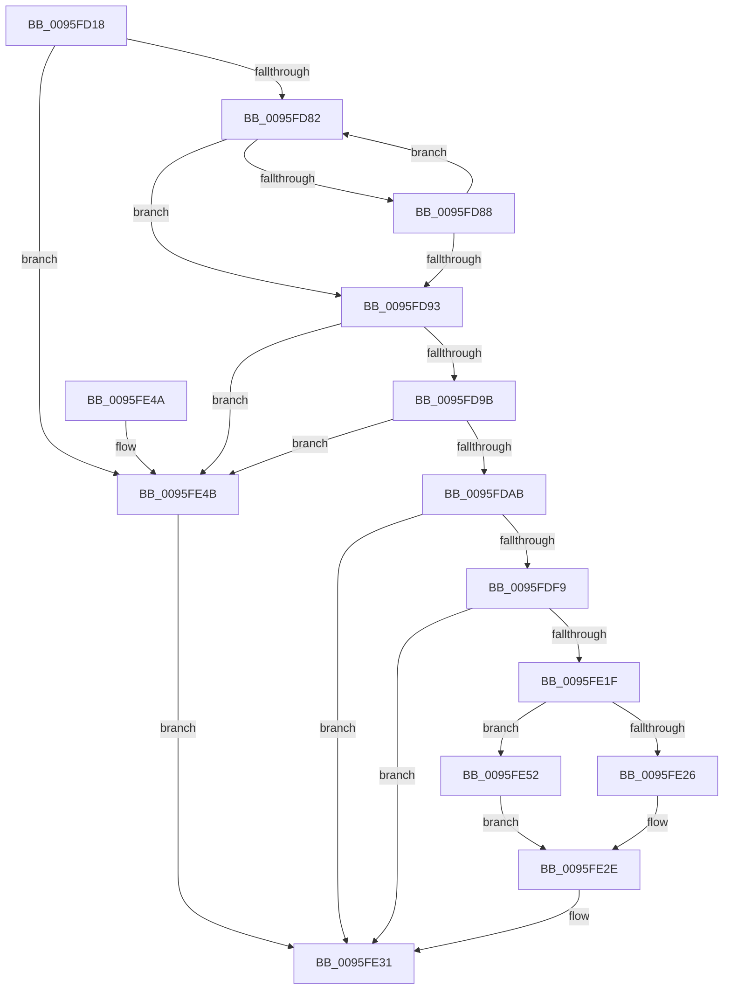

# PfSnCalculateScenarioNameAndHash

- RVA: `0x0095FD18`–`0x0095FE70` (길이 `344` bytes)
- VA: `0x000000014095FD18`
- 실행 섹션: `PAGE`
- PDB 이름 있음: `예`; PDB Function 태그: `아니요`
- unwind 정보 RVA: `0x00093074`
- 디코드: `94`개 명령, `344/344` bytes 표시
- 미해석 바이트: `0` (있으면 어셈블리에 `.byte`로 보존)

> 이 문서는 커널 이미지의 기계어와 PDB 기호를 분석해 생성했습니다. 4번과 5번은 함수 원형과 자료형을 바이너리 사용 방식에서 추정한 C 해석이며 원본 소스 복구 결과는 아닙니다.

## 1. Dependencies

- 직접 호출 지점: **4**; 고유 호출 대상: **4**
- 직접 호출자로 확인된 함수: **1**
- RIP 상대 이미지 참조: **0**

### Outgoing calls
- `0x0095FDBF` → [memcpy](../../text/6C/memcpy_function_006C6840.md) (function, `0x006C6840`)
- `0x0095FDDD` → [PfSnIsHostingApplication](PfSnIsHostingApplication_function_0095FF34.md) (function, `0x0095FF34`)
- `0x0095FDF0` → [PfSnScanCommandLine](PfSnScanCommandLine_function_0095FE78.md) (function, `0x0095FE78`)
- `0x0095FE16` → [PfSnCheckModernApp](PfSnCheckModernApp_function_0095FFF8.md) (function, `0x0095FFF8`)

### Direct callers
- [PfSnSetAltPrefetchParam](../75/PfSnSetAltPrefetchParam_function_00752424.md) at `0x007525E6`

### Static image references
- 디코드된 RIP-relative 메모리 참조가 없습니다.

## 2. Other-region calls and transfers

- 다른 실행 섹션으로 향하는 call: **1**
  - `0x0095FDBF` → [memcpy](../../text/6C/memcpy_function_006C6840.md) (`PAGE` → `.text`)
- 별도 외부 분기/꼬리 이동을 확인하지 못했습니다.

## 3. Assembly (complete function range)

```asm
0095FD18  48 8B C4                        mov rax, rsp
0095FD1B  48 89 58 10                     mov qword ptr [rax + 0x10], rbx
0095FD1F  48 89 68 18                     mov qword ptr [rax + 0x18], rbp
0095FD23  48 89 70 20                     mov qword ptr [rax + 0x20], rsi
0095FD27  89 48 08                        mov dword ptr [rax + 8], ecx
0095FD2A  57                              push rdi
0095FD2B  41 56                           push r14
0095FD2D  41 57                           push r15
0095FD2F  48 83 EC 20                     sub rsp, 0x20
0095FD33  48 8B AC 24 98 00 00 00         mov rbp, qword ptr [rsp + 0x98]
0095FD3B  45 33 FF                        xor r15d, r15d
0095FD3E  0F 57 C0                        xorps xmm0, xmm0
0095FD41  44 89 78 08                     mov dword ptr [rax + 8], r15d
0095FD45  0F 11 02                        movups xmmword ptr [rdx], xmm0
0095FD48  33 C0                           xor eax, eax
0095FD4A  49 8B F8                        mov rdi, r8
0095FD4D  0F 11 42 10                     movups xmmword ptr [rdx + 0x10], xmm0
0095FD51  48 8B F2                        mov rsi, rdx
0095FD54  4D 8B F1                        mov r14, r9
0095FD57  0F 11 42 20                     movups xmmword ptr [rdx + 0x20], xmm0
0095FD5B  48 89 42 30                     mov qword ptr [rdx + 0x30], rax
0095FD5F  41 8B CF                        mov ecx, r15d
0095FD62  89 42 38                        mov dword ptr [rdx + 0x38], eax
0095FD65  44 0F B7 45 00                  movzx r8d, word ptr [rbp]
0095FD6A  48 8B 55 08                     mov rdx, qword ptr [rbp + 8]
0095FD6E  41 D1 E8                        shr r8d, 1
0095FD71  48 8D 42 FE                     lea rax, [rdx - 2]
0095FD75  4A 8D 04 40                     lea rax, [rax + r8*2]
0095FD79  48 3B C2                        cmp rax, rdx
0095FD7C  0F 82 C9 00 00 00               jb 0x14095fe4b
0095FD82  66 83 38 5C                     cmp word ptr [rax], 0x5c
0095FD86  74 0B                           je 0x14095fd93
0095FD88  FF C1                           inc ecx
0095FD8A  48 83 E8 02                     sub rax, 2
0095FD8E  48 3B C2                        cmp rax, rdx
0095FD91  73 EF                           jae 0x14095fd82
0095FD93  85 C9                           test ecx, ecx
0095FD95  0F 84 B0 00 00 00               je 0x14095fe4b
0095FD9B  44 2B C1                        sub r8d, ecx
0095FD9E  4A 8D 14 42                     lea rdx, [rdx + r8*2]
0095FDA2  48 85 D2                        test rdx, rdx
0095FDA5  0F 84 A0 00 00 00               je 0x14095fe4b
0095FDAB  B8 1D 00 00 00                  mov eax, 0x1d
0095FDB0  3B C8                           cmp ecx, eax
0095FDB2  0F 43 C8                        cmovae ecx, eax
0095FDB5  48 8D 1C 09                     lea rbx, [rcx + rcx]
0095FDB9  48 8B CE                        mov rcx, rsi
0095FDBC  4C 8B C3                        mov r8, rbx
0095FDBF  E8 7C 6A D6 FF                  call 0x1406c6840
0095FDC4  48 8B 84 24 90 00 00 00         mov rax, qword ptr [rsp + 0x90]
0095FDCC  66 44 89 3C 33                  mov word ptr [rbx + rsi], r15w
0095FDD1  8B 88 84 03 00 00               mov ecx, dword ptr [rax + 0x384]
0095FDD7  41 89 0E                        mov dword ptr [r14], ecx
0095FDDA  48 8B CE                        mov rcx, rsi
0095FDDD  E8 52 01 00 00                  call 0x14095ff34
0095FDE2  48 8B 54 24 60                  mov rdx, qword ptr [rsp + 0x60]
0095FDE7  48 8B 4C 24 68                  mov rcx, qword ptr [rsp + 0x68]
0095FDEC  44 0F B6 C0                     movzx r8d, al
0095FDF0  E8 83 00 00 00                  call 0x14095fe78
0095FDF5  85 C0                           test eax, eax
0095FDF7  78 38                           js 0x14095fe31
0095FDF9  48 8B 5C 24 78                  mov rbx, qword ptr [rsp + 0x78]
0095FDFE  48 8D 4C 24 40                  lea rcx, [rsp + 0x40]
0095FE03  48 8B B4 24 80 00 00 00         mov rsi, qword ptr [rsp + 0x80]
0095FE0B  4C 8B CB                        mov r9, rbx
0095FE0E  48 8B 54 24 70                  mov rdx, qword ptr [rsp + 0x70]
0095FE13  4C 8B C6                        mov r8, rsi
0095FE16  E8 DD 01 00 00                  call 0x14095fff8
0095FE1B  85 C0                           test eax, eax
0095FE1D  78 12                           js 0x14095fe31
0095FE1F  44 39 7C 24 40                  cmp dword ptr [rsp + 0x40], r15d
0095FE24  75 2C                           jne 0x14095fe52
0095FE26  0F 10 45 00                     movups xmm0, xmmword ptr [rbp]
0095FE2A  F3 0F 7F 07                     movdqu xmmword ptr [rdi], xmm0
0095FE2E  41 8B C7                        mov eax, r15d
0095FE31  48 8B 5C 24 48                  mov rbx, qword ptr [rsp + 0x48]
0095FE36  48 8B 6C 24 50                  mov rbp, qword ptr [rsp + 0x50]
0095FE3B  48 8B 74 24 58                  mov rsi, qword ptr [rsp + 0x58]
0095FE40  48 83 C4 20                     add rsp, 0x20
0095FE44  41 5F                           pop r15
0095FE46  41 5E                           pop r14
0095FE48  5F                              pop rdi
0095FE49  C3                              ret
0095FE4A  CC                              int3
0095FE4B  B8 0D 00 00 C0                  mov eax, 0xc000000d
0095FE50  EB DF                           jmp 0x14095fe31
0095FE52  48 8B 84 24 88 00 00 00         mov rax, qword ptr [rsp + 0x88]
0095FE5A  83 08 08                        or dword ptr [rax], 8
0095FE5D  48 89 77 08                     mov qword ptr [rdi + 8], rsi
0095FE61  0F B7 03                        movzx eax, word ptr [rbx]
0095FE64  66 89 07                        mov word ptr [rdi], ax
0095FE67  0F B7 03                        movzx eax, word ptr [rbx]
0095FE6A  66 89 47 02                     mov word ptr [rdi + 2], ax
0095FE6E  EB BE                           jmp 0x14095fe2e
```

## 4. C-style interpretation (structured pseudocode)

```c
__int64 __fastcall PfSnCalculateScenarioNameAndHash(int a1, __int64 a2, __int64 a3, __int64 a4, __int64 a5, __int64 a6, __int64 a7, __int64 a8, __int64 a9, __int64 a10, __int64 a11, __int64 a12)
{
    __int64 result;
    __int64 v_r15;
    __int64 v_rsp;
    unsigned __int64 v_stack_p10;
    unsigned __int64 v_stack_p18;
    unsigned __int64 v_stack_p20;
    unsigned __int64 v_stack_p8;

    *(unsigned __int64 *)(v_rsp + 16) = v_rbx;
    *(unsigned __int64 *)(v_rsp + 24) = v_rbp;
    *(unsigned __int64 *)(v_rsp + 32) = v_rsi;
    *(unsigned int *)(v_rsp + 8) = a1;
    v_rsp = (v_rsp) - (32);
    v_r15 = 0;
    *(unsigned int *)(v_rsp + 8) = 0;
    *(unsigned __int64 *)(a2) = v_xmm0;
    result = 0;
    *(unsigned __int64 *)(a2 + 16) = v_xmm0;
    *(unsigned __int64 *)(a2 + 32) = v_xmm0;
    *(unsigned __int64 *)(a2 + 48) = 0;
    *(unsigned int *)(a2 + 56) = 0;
    a3 = (unsigned int)((*(unsigned __int16 *)(a12)) >> (1));
    if ((*(unsigned __int64 *)(a12 + 8) - 2 + a3 * 2) < (*(unsigned __int64 *)(a12 + 8))) goto loc_0095FE4B;
loc_0095FD82:
    if ((*(unsigned __int16 *)(*(unsigned __int64 *)(a12 + 8) - 2 + a3 * 2)) == 92) goto loc_0095FD93;
    a1 = (unsigned int)((0) + 1);
    result = (*(unsigned __int64 *)(a12 + 8) - 2 + a3 * 2) - (2);
    if (result >= (*(unsigned __int64 *)(a12 + 8))) goto loc_0095FD82;
loc_0095FD93:
    if (a1 == 0) goto loc_0095FE4B;
    a3 = (unsigned int)((a3) - (a1));
    if (*(unsigned __int64 *)(a12 + 8) + a3 * 2 == 0) goto loc_0095FE4B;
    if (a1 >= 29) { a1 = 29; }
    result = memcpy(a2, *(unsigned __int64 *)(a12 + 8) + a3 * 2, a1 + a1 * 1, a4);
    *(unsigned __int16 *)(a1 + a1 * 1 + a2 * 1) = 0;
    *(unsigned int *)(a4) = (unsigned int)((unsigned int)(*(unsigned int *)(a11 + 900)));
    result = PfSnIsHostingApplication(a2, *(unsigned __int64 *)(a12 + 8) + a3 * 2, a1 + a1 * 1, a4);
    result = PfSnScanCommandLine(a6, a5, (unsigned __int8)(result), a4);
    if (sign_flag) goto loc_0095FE31;
    result = PfSnCheckModernApp(v_stack_p8, a7, a9, a8);
    if (sign_flag) goto loc_0095FE31;
    if (v_stack_p8 != 0) goto loc_0095FE52;
    *(unsigned __int64 *)(a3) = v_xmm0;
loc_0095FE2E:
loc_0095FE31:
    v_rsp = (v_rsp) + (32);
    return 0;
loc_0095FE4B:
    goto loc_0095FE31;
loc_0095FE52:
    *(unsigned __int64 *)(a3 + 8) = v_stack_p20;
    *(unsigned __int16 *)(a3) = (unsigned __int16)(*(unsigned __int16 *)(v_stack_p10));
    *(unsigned __int16 *)(a3 + 2) = (unsigned __int16)(*(unsigned __int16 *)(v_stack_p10));
    goto loc_0095FE2E;
}
```

## 5. (Beta) C Style

```c
int64_t PfSnCalculateScenarioNameAndHash(int32_t Arg1, void *Arg2, void *Arg3, void *Arg4, int64_t Arg5, int64_t Arg6, int64_t Arg7, void *Arg8, int64_t Arg9, void *Arg10, void *Arg11, void *Arg12)
{
    uint8_t *arg2 = (uint8_t *)Arg2;
    uint8_t *arg3 = (uint8_t *)Arg3;
    uint8_t *arg4 = (uint8_t *)Arg4;
    uint8_t *arg8 = (uint8_t *)Arg8;
    uint8_t *arg10 = (uint8_t *)Arg10;
    uint8_t *arg11 = (uint8_t *)Arg11;
    uint8_t *arg12 = (uint8_t *)Arg12;

    int64_t result;
    int64_t local_r15;
    int64_t local_rsp;
    uint64_t v_stack_p10;
    uint64_t v_stack_p18;
    uint64_t v_stack_p20;
    uint64_t v_stack_p8;

    *(uint64_t *)(local_rsp + 0x10) = local_rbx;
    *(uint64_t *)(local_rsp + 0x18) = local_rbp;
    *(uint64_t *)(local_rsp + 0x20) = local_rsi;
    *(uint32_t *)(local_rsp + 0x8) = Arg1;
    local_rsp = (local_rsp) - (32);
    local_r15 = 0;
    *(uint32_t *)(local_rsp + 0x8) = 0;
    *(uint64_t *)(arg2) = v_xmm0;
    result = 0;
    *(uint64_t *)(arg2 + 0x10) = v_xmm0;
    *(uint64_t *)(arg2 + 0x20) = v_xmm0;
    *(uint64_t *)(arg2 + 0x30) = 0;
    *(uint32_t *)(arg2 + 0x38) = 0;
    Arg3 = (uint32_t)((*(uint16_t *)(arg12)) >> (1));
    if ((*(uint64_t *)(arg12 + 0x8) - 2 + Arg3 * 2) < (*(uint64_t *)(arg12 + 0x8))) goto loc_0095FE4B;
loc_0095FD82:
    if ((*(uint16_t *)(*(uint64_t *)(arg12 + 0x8) - 0x2 + arg3 * 2)) == 92) goto loc_0095FD93;
    Arg1 = (uint32_t)((0) + 1);
    result = (*(uint64_t *)(arg12 + 0x8) - 2 + Arg3 * 2) - (2);
    if (result >= (*(uint64_t *)(arg12 + 0x8))) goto loc_0095FD82;
loc_0095FD93:
    if (Arg1 == 0) goto loc_0095FE4B;
    Arg3 = (uint32_t)((Arg3) - (Arg1));
    if (*(uint64_t *)(arg12 + 0x8) + Arg3 * 2 == 0) goto loc_0095FE4B;
    if (Arg1 >= 29) { Arg1 = 29; }
    result = memcpy(Arg2, *(uint64_t *)(arg12 + 0x8) + Arg3 * 2, Arg1 + Arg1 * 1, Arg4);
    *(uint16_t *)(Arg1 + Arg1 * 1 + arg2 * 1) = 0;
    *(uint32_t *)(arg4) = (uint32_t)((uint32_t)(*(uint32_t *)(arg11 + 0x384)));
    result = PfSnIsHostingApplication(Arg2, *(uint64_t *)(arg12 + 0x8) + Arg3 * 2, Arg1 + Arg1 * 1, Arg4);
    result = PfSnScanCommandLine(Arg6, Arg5, (uint8_t)(result), Arg4);
    if (sign_flag) goto loc_0095FE31;
    result = PfSnCheckModernApp(v_stack_p8, Arg7, Arg9, Arg8);
    if (sign_flag) goto loc_0095FE31;
    if (v_stack_p8 != 0) goto loc_0095FE52;
    *(uint64_t *)(arg3) = v_xmm0;
loc_0095FE2E:
loc_0095FE31:
    local_rsp = (local_rsp) + (32);
    return 0;
loc_0095FE4B:
    goto loc_0095FE31;
loc_0095FE52:
    *(uint64_t *)(arg3 + 0x8) = v_stack_p20;
    *(uint16_t *)(arg3) = (uint16_t)(*(uint16_t *)(v_stack_p10));
    *(uint16_t *)(arg3 + 0x2) = (uint16_t)(*(uint16_t *)(v_stack_p10));
    goto loc_0095FE2E;
}
```

### 관측된 메모리 오프셋

구조체 형식이 확인되지 않은 접근은 인자 기준의 오프셋으로만 기록했습니다.

| 기준 인자 | 오프셋 표현 | 폭 (bit) | 접근 |
|---|---:|---:|---|
| `Arg2` | `+ 0x0` | `128` | `R` |
| `Arg2` | `+ 0x10` | `128` | `R` |
| `Arg2` | `+ 0x20` | `128` | `R` |
| `Arg2` | `+ 0x30` | `64` | `W` |
| `Arg2` | `+ 0x38` | `32` | `W` |
| `Arg3` | `+ 0x0` | `16` | `W` |
| `Arg3` | `+ 0x0` | `128` | `W` |
| `Arg3` | `+ 0x2` | `16` | `W` |
| `Arg3` | `+ 0x8` | `64` | `W` |
| `Arg4` | `+ 0x0` | `32` | `W` |
| `Arg8` | `+ 0x0` | `16` | `R` |
| `Arg10` | `+ 0x0` | `32` | `R/W` |
| `Arg11` | `+ 0x384` | `32` | `R` |
| `Arg12` | `+ 0x0` | `16` | `R` |
| `Arg12` | `+ 0x0` | `128` | `R` |
| `Arg12` | `+ 0x8` | `64` | `R` |

## 6. Execution-region graph

[열기: 2D/3D 그래프와 함수 탐색 컨트롤 패널](../../../control-panel.html?section=page&rva=0x0095FD18&view=graph)

- 2D 그래프는 위에서 아래로 흐르고, 3D 그래프는 빈 공간을 드래그해 회전합니다. Shift+드래그는 이동, 휠은 확대·축소, 함수 노드 선택은 대상 보고서 이동입니다.

### Static fallback


