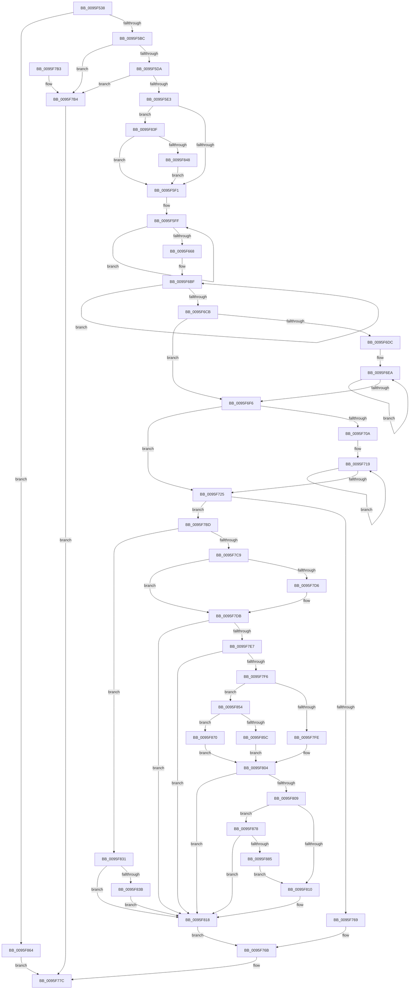

# PfSnCheckActionsNeeded

- RVA: `0x0095F538`–`0x0095F887` (길이 `847` bytes)
- VA: `0x000000014095F538`
- 실행 섹션: `PAGE`
- PDB 이름 있음: `예`; PDB Function 태그: `아니요`
- unwind 정보 RVA: `0x00093024`
- 디코드: `229`개 명령, `847/847` bytes 표시
- 미해석 바이트: `0` (있으면 어셈블리에 `.byte`로 보존)

> 이 문서는 커널 이미지의 기계어와 PDB 기호를 분석해 생성했습니다. 4번과 5번은 함수 원형과 자료형을 바이너리 사용 방식에서 추정한 C 해석이며 원본 소스 복구 결과는 아닙니다.

## 1. Dependencies

- 직접 호출 지점: **10**; 고유 호출 대상: **10**
- 직접 호출자로 확인된 함수: **1**
- RIP 상대 이미지 참조: **5**

### Outgoing calls
- `0x0095F58E` → [memset](../../text/6C/memset_function_006C6C40.md) (function, `0x006C6C40`)
- `0x0095F5BF` → [PsGetPagePriorityThread](../../text/3C/PsGetPagePriorityThread_function_003C3E80.md) (function, `0x003C3E80`)
- `0x0095F5C6` → [KeQueryHeteroCpuPolicyThread](../../text/48/KeQueryHeteroCpuPolicyThread_function_00488A70.md) (function, `0x00488A70`)
- `0x0095F6AC` → [MmQueryMemoryListInformation](../../text/3B/MmQueryMemoryListInformation_function_003B9EDC.md) (function, `0x003B9EDC`)
- `0x0095F732` → [MmQueryTransitionPagesMadeColdCount](../../text/49/MmQueryTransitionPagesMadeColdCount_function_0049C770.md) (function, `0x0049C770`)
- `0x0095F741` → [PfResourceExclusiveAcquire](../../text/4A/PfResourceExclusiveAcquire_function_004A8F90.md) (function, `0x004A8F90`)
- `0x0095F75C` → [PfSnPrefetchCacheEntryGet](PfSnPrefetchCacheEntryGet_function_0095F890.md) (function, `0x0095F890`)
- `0x0095F772` → [ExReleaseResourceLite](../../text/25/ExReleaseResourceLite_function_0025FA10.md) (function, `0x0025FA10`)
- `0x0095F777` → [KeLeaveCriticalRegion](../../text/25/KeLeaveCriticalRegion_function_0025D8B0.md) (function, `0x0025D8B0`)
- `0x0095F793` → [_security_check_cookie](../../text/6A/_security_check_cookie_function_006AC640.md) (function, `0x006AC640`)

### Direct callers
- [PfSnBeginScenario](PfSnBeginScenario_function_0095EFC0.md) at `0x0095F070`

### Static image references
- `0x0095F554` → RVA `0x00E0A740` (`.data`; read)
- `0x0095F593` → RVA `0x00E670A0` (`.data`; read)
- `0x0095F5E3` → RVA `0x00E67360` (`.data`; read)
- `0x0095F737` → RVA `0x00E672F0` (`.data`; read)
- `0x0095F755` → RVA `0x00E672C8` (`.data`; read)

## 2. Other-region calls and transfers

- 다른 실행 섹션으로 향하는 call: **9**
  - `0x0095F58E` → [memset](../../text/6C/memset_function_006C6C40.md) (`PAGE` → `.text`)
  - `0x0095F5BF` → [PsGetPagePriorityThread](../../text/3C/PsGetPagePriorityThread_function_003C3E80.md) (`PAGE` → `.text`)
  - `0x0095F5C6` → [KeQueryHeteroCpuPolicyThread](../../text/48/KeQueryHeteroCpuPolicyThread_function_00488A70.md) (`PAGE` → `.text`)
  - `0x0095F6AC` → [MmQueryMemoryListInformation](../../text/3B/MmQueryMemoryListInformation_function_003B9EDC.md) (`PAGE` → `.text`)
  - `0x0095F732` → [MmQueryTransitionPagesMadeColdCount](../../text/49/MmQueryTransitionPagesMadeColdCount_function_0049C770.md) (`PAGE` → `.text`)
  - `0x0095F741` → [PfResourceExclusiveAcquire](../../text/4A/PfResourceExclusiveAcquire_function_004A8F90.md) (`PAGE` → `.text`)
  - `0x0095F772` → [ExReleaseResourceLite](../../text/25/ExReleaseResourceLite_function_0025FA10.md) (`PAGE` → `.text`)
  - `0x0095F777` → [KeLeaveCriticalRegion](../../text/25/KeLeaveCriticalRegion_function_0025D8B0.md) (`PAGE` → `.text`)
  - `0x0095F793` → [_security_check_cookie](../../text/6A/_security_check_cookie_function_006AC640.md) (`PAGE` → `.text`)
- 별도 외부 분기/꼬리 이동을 확인하지 못했습니다.

## 3. Assembly (complete function range)

```asm
0095F538  48 89 5C 24 10                  mov qword ptr [rsp + 0x10], rbx
0095F53D  55                              push rbp
0095F53E  56                              push rsi
0095F53F  57                              push rdi
0095F540  41 54                           push r12
0095F542  41 55                           push r13
0095F544  41 56                           push r14
0095F546  41 57                           push r15
0095F548  48 8D 6C 24 D0                  lea rbp, [rsp - 0x30]
0095F54D  48 81 EC 30 01 00 00            sub rsp, 0x130
0095F554  48 8B 05 E5 B1 4A 00            mov rax, qword ptr [rip + 0x4ab1e5]
0095F55B  48 33 C4                        xor rax, rsp
0095F55E  48 89 45 20                     mov qword ptr [rbp + 0x20], rax
0095F562  48 8B 85 90 00 00 00            mov rax, qword ptr [rbp + 0x90]
0095F569  4D 8B F0                        mov r14, r8
0095F56C  44 8B FA                        mov r15d, edx
0095F56F  48 89 4C 24 50                  mov qword ptr [rsp + 0x50], rcx
0095F574  4C 8B E1                        mov r12, rcx
0095F577  48 89 44 24 60                  mov qword ptr [rsp + 0x60], rax
0095F57C  33 D2                           xor edx, edx
0095F57E  4C 89 4C 24 58                  mov qword ptr [rsp + 0x58], r9
0095F583  41 B8 B0 00 00 00               mov r8d, 0xb0
0095F589  48 8D 4C 24 70                  lea rcx, [rsp + 0x70]
0095F58E  E8 AD 76 D6 FF                  call 0x1406c6c40
0095F593  8B 05 07 7B 50 00               mov eax, dword ptr [rip + 0x507b07]
0095F599  45 33 C0                        xor r8d, r8d
0095F59C  44 89 44 24 38                  mov dword ptr [rsp + 0x38], r8d
0095F5A1  44 89 44 24 34                  mov dword ptr [rsp + 0x34], r8d
0095F5A6  44 89 44 24 30                  mov dword ptr [rsp + 0x30], r8d
0095F5AB  41 8D 78 03                     lea edi, [r8 + 3]
0095F5AF  8D 77 14                        lea esi, [rdi + 0x14]
0095F5B2  8B DF                           mov ebx, edi
0095F5B4  A8 08                           test al, 8
0095F5B6  0F 85 A8 02 00 00               jne 0x14095f864
0095F5BC  49 8B CE                        mov rcx, r14
0095F5BF  E8 BC 48 A6 FF                  call 0x1403c3e80
0095F5C4  8B D0                           mov edx, eax
0095F5C6  E8 A5 94 B2 FF                  call 0x140488a70
0095F5CB  44 8B E8                        mov r13d, eax
0095F5CE  41 8D 45 FF                     lea eax, [r13 - 1]
0095F5D2  3B D0                           cmp edx, eax
0095F5D4  0F 86 DA 01 00 00               jbe 0x14095f7b4
0095F5DA  44 3B E8                        cmp r13d, eax
0095F5DD  0F 86 D1 01 00 00               jbe 0x14095f7b4
0095F5E3  8B 05 77 7D 50 00               mov eax, dword ptr [rip + 0x507d77]
0095F5E9  A8 10                           test al, 0x10
0095F5EB  0F 85 4E 02 00 00               jne 0x14095f83f
0095F5F1  4D 8B CC                        mov r9, r12
0095F5F4  B9 2F CB 04 00                  mov ecx, 0x4cb2f
0095F5F9  41 BA 08 00 00 00               mov r10d, 8
0095F5FF  41 0F B6 01                     movzx eax, byte ptr [r9]
0095F603  4D 8D 49 08                     lea r9, [r9 + 8]
0095F607  48 6B C9 25                     imul rcx, rcx, 0x25
0095F60B  48 03 C8                        add rcx, rax
0095F60E  41 0F B6 41 F9                  movzx eax, byte ptr [r9 - 7]
0095F613  48 6B D1 25                     imul rdx, rcx, 0x25
0095F617  48 03 D0                        add rdx, rax
0095F61A  41 0F B6 41 FA                  movzx eax, byte ptr [r9 - 6]
0095F61F  48 6B CA 25                     imul rcx, rdx, 0x25
0095F623  48 03 C8                        add rcx, rax
0095F626  41 0F B6 41 FB                  movzx eax, byte ptr [r9 - 5]
0095F62B  48 6B D1 25                     imul rdx, rcx, 0x25
0095F62F  48 03 D0                        add rdx, rax
0095F632  41 0F B6 41 FC                  movzx eax, byte ptr [r9 - 4]
0095F637  48 6B CA 25                     imul rcx, rdx, 0x25
0095F63B  48 03 C8                        add rcx, rax
0095F63E  41 0F B6 41 FD                  movzx eax, byte ptr [r9 - 3]
0095F643  48 6B D1 25                     imul rdx, rcx, 0x25
0095F647  48 03 D0                        add rdx, rax
0095F64A  41 0F B6 41 FE                  movzx eax, byte ptr [r9 - 2]
0095F64F  48 6B CA 25                     imul rcx, rdx, 0x25
0095F653  48 03 C8                        add rcx, rax
0095F656  41 0F B6 41 FF                  movzx eax, byte ptr [r9 - 1]
0095F65B  48 6B C9 25                     imul rcx, rcx, 0x25
0095F65F  48 03 C8                        add rcx, rax
0095F662  49 83 EA 01                     sub r10, 1
0095F666  75 97                           jne 0x14095f5ff
0095F668  48 89 4C 24 48                  mov qword ptr [rsp + 0x48], rcx
0095F66D  48 8D 54 24 70                  lea rdx, [rsp + 0x70]
0095F672  48 B8 20 03 00 00 80 F7 FF FF   movabs rax, 0xfffff78000000320
0095F67C  48 B9 04 00 00 00 80 F7 FF FF   movabs rcx, 0xfffff78000000004
0095F686  41 B8 B0 00 00 00               mov r8d, 0xb0
0095F68C  48 8B 00                        mov rax, qword ptr [rax]
0095F68F  8B 09                           mov ecx, dword ptr [rcx]
0095F691  48 0F AF C8                     imul rcx, rax
0095F695  48 8D 44 24 38                  lea rax, [rsp + 0x38]
0095F69A  48 C1 E9 18                     shr rcx, 0x18
0095F69E  48 89 4C 24 40                  mov qword ptr [rsp + 0x40], rcx
0095F6A3  48 83 C9 FF                     or rcx, 0xffffffffffffffff
0095F6A7  48 89 44 24 20                  mov qword ptr [rsp + 0x20], rax
0095F6AC  E8 2B A8 A5 FF                  call 0x1403b9edc
0095F6B1  45 33 FF                        xor r15d, r15d
0095F6B4  48 8D 45 D8                     lea rax, [rbp - 0x28]
0095F6B8  45 8D 47 08                     lea r8d, [r15 + 8]
0095F6BC  41 8B C8                        mov ecx, r8d
0095F6BF  4C 03 38                        add r15, qword ptr [rax]
0095F6C2  49 03 C0                        add rax, r8
0095F6C5  48 83 E9 01                     sub rcx, 1
0095F6C9  75 F4                           jne 0x14095f6bf
0095F6CB  49 C1 E7 0C                     shl r15, 0xc
0095F6CF  45 33 F6                        xor r14d, r14d
0095F6D2  49 C1 EF 12                     shr r15, 0x12
0095F6D6  41 83 FD 07                     cmp r13d, 7
0095F6DA  77 1A                           ja 0x14095f6f6
0095F6DC  48 8D 4D D8                     lea rcx, [rbp - 0x28]
0095F6E0  41 8B D0                        mov edx, r8d
0095F6E3  4A 8D 0C E9                     lea rcx, [rcx + r13*8]
0095F6E7  41 2B D5                        sub edx, r13d
0095F6EA  4C 03 31                        add r14, qword ptr [rcx]
0095F6ED  49 03 C8                        add rcx, r8
0095F6F0  48 83 EA 01                     sub rdx, 1
0095F6F4  75 F4                           jne 0x14095f6ea
0095F6F6  49 C1 E6 0C                     shl r14, 0xc
0095F6FA  41 8D 4D FF                     lea ecx, [r13 - 1]
0095F6FE  49 C1 EE 12                     shr r14, 0x12
0095F702  45 33 E4                        xor r12d, r12d
0095F705  83 F9 07                        cmp ecx, 7
0095F708  77 1B                           ja 0x14095f725
0095F70A  41 8B C0                        mov eax, r8d
0095F70D  48 8D 55 D8                     lea rdx, [rbp - 0x28]
0095F711  2B C1                           sub eax, ecx
0095F713  48 8D 14 CA                     lea rdx, [rdx + rcx*8]
0095F717  8B C8                           mov ecx, eax
0095F719  4C 03 22                        add r12, qword ptr [rdx]
0095F71C  49 03 D0                        add rdx, r8
0095F71F  48 83 E9 01                     sub rcx, 1
0095F723  75 F4                           jne 0x14095f719
0095F725  49 C1 E4 0C                     shl r12, 0xc
0095F729  48 8D 4C 24 34                  lea rcx, [rsp + 0x34]
0095F72E  49 C1 EC 12                     shr r12, 0x12
0095F732  E8 39 D0 B3 FF                  call 0x14049c770
0095F737  48 8D 0D B2 7B 50 00            lea rcx, [rip + 0x507bb2]
0095F73E  44 8B E8                        mov r13d, eax
0095F741  E8 4A 98 B4 FF                  call 0x1404a8f90
0095F746  4C 8B 44 24 48                  mov r8, qword ptr [rsp + 0x48]
0095F74B  4C 8D 4C 24 30                  lea r9, [rsp + 0x30]
0095F750  48 8B 54 24 50                  mov rdx, qword ptr [rsp + 0x50]
0095F755  48 8D 0D 6C 7B 50 00            lea rcx, [rip + 0x507b6c]
0095F75C  E8 2F 01 00 00                  call 0x14095f890
0095F761  48 8B C8                        mov rcx, rax
0095F764  48 85 C0                        test rax, rax
0095F767  75 54                           jne 0x14095f7bd
0095F769  8B F7                           mov esi, edi
0095F76B  48 8D 0D 7E 7B 50 00            lea rcx, [rip + 0x507b7e]
0095F772  E8 99 02 90 FF                  call 0x14025fa10
0095F777  E8 34 E1 8F FF                  call 0x14025d8b0
0095F77C  48 8B 44 24 58                  mov rax, qword ptr [rsp + 0x58]
0095F781  89 38                           mov dword ptr [rax], edi
0095F783  48 8B 44 24 60                  mov rax, qword ptr [rsp + 0x60]
0095F788  89 30                           mov dword ptr [rax], esi
0095F78A  8B C3                           mov eax, ebx
0095F78C  48 8B 4D 20                     mov rcx, qword ptr [rbp + 0x20]
0095F790  48 33 CC                        xor rcx, rsp
0095F793  E8 A8 CE D4 FF                  call 0x1406ac640
0095F798  48 8B 9C 24 78 01 00 00         mov rbx, qword ptr [rsp + 0x178]
0095F7A0  48 81 C4 30 01 00 00            add rsp, 0x130
0095F7A7  41 5F                           pop r15
0095F7A9  41 5E                           pop r14
0095F7AB  41 5D                           pop r13
0095F7AD  41 5C                           pop r12
0095F7AF  5F                              pop rdi
0095F7B0  5E                              pop rsi
0095F7B1  5D                              pop rbp
0095F7B2  C3                              ret
0095F7B3  CC                              int3
0095F7B4  BF 02 00 00 00                  mov edi, 2
0095F7B9  8B F7                           mov esi, edi
0095F7BB  EB BF                           jmp 0x14095f77c
0095F7BD  83 7C 24 30 00                  cmp dword ptr [rsp + 0x30], 0
0095F7C2  4C 8B 44 24 40                  mov r8, qword ptr [rsp + 0x40]
0095F7C7  75 68                           jne 0x14095f831
0095F7C9  41 8B D0                        mov edx, r8d
0095F7CC  2B 50 70                        sub edx, dword ptr [rax + 0x70]
0095F7CF  8B 40 74                        mov eax, dword ptr [rax + 0x74]
0095F7D2  3B D0                           cmp edx, eax
0095F7D4  73 05                           jae 0x14095f7db
0095F7D6  83 E3 FE                        and ebx, 0xfffffffe
0095F7D9  3B D0                           cmp edx, eax
0095F7DB  1B FF                           sbb edi, edi
0095F7DD  F7 DF                           neg edi
0095F7DF  83 C7 04                        add edi, 4
0095F7E2  83 FB 02                        cmp ebx, 2
0095F7E5  72 31                           jb 0x14095f818
0095F7E7  8B 05 B3 78 50 00               mov eax, dword ptr [rip + 0x5078b3]
0095F7ED  BE 04 00 00 00                  mov esi, 4
0095F7F2  A8 02                           test al, 2
0095F7F4  75 22                           jne 0x14095f818
0095F7F6  81 FA 40 77 1B 00               cmp edx, 0x1b7740
0095F7FC  73 56                           jae 0x14095f854
0095F7FE  41 8B C6                        mov eax, r14d
0095F801  2B 41 60                        sub eax, dword ptr [rcx + 0x60]
0095F804  83 F8 01                        cmp eax, 1
0095F807  73 0F                           jae 0x14095f818
0095F809  83 7C 24 34 00                  cmp dword ptr [rsp + 0x34], 0
0095F80E  75 68                           jne 0x14095f878
0095F810  83 E3 FD                        and ebx, 0xfffffffd
0095F813  BE 07 00 00 00                  mov esi, 7
0095F818  44 89 41 70                     mov dword ptr [rcx + 0x70], r8d
0095F81C  44 89 71 60                     mov dword ptr [rcx + 0x60], r14d
0095F820  44 89 61 64                     mov dword ptr [rcx + 0x64], r12d
0095F824  44 89 79 68                     mov dword ptr [rcx + 0x68], r15d
0095F828  44 89 69 6C                     mov dword ptr [rcx + 0x6c], r13d
0095F82C  E9 3A FF FF FF                  jmp 0x14095f76b
0095F831  BF 0D 00 00 00                  mov edi, 0xd
0095F836  83 FB 02                        cmp ebx, 2
0095F839  72 DD                           jb 0x14095f818
0095F83B  8B F7                           mov esi, edi
0095F83D  EB D9                           jmp 0x14095f818
0095F83F  45 85 FF                        test r15d, r15d
0095F842  0F 85 A9 FD FF FF               jne 0x14095f5f1
0095F848  41 8D 5F 01                     lea ebx, [r15 + 1]
0095F84C  8D 73 0D                        lea esi, [rbx + 0xd]
0095F84F  E9 9D FD FF FF                  jmp 0x14095f5f1
0095F854  81 FA 80 EE 36 00               cmp edx, 0x36ee80
0095F85A  73 14                           jae 0x14095f870
0095F85C  41 8B C4                        mov eax, r12d
0095F85F  2B 41 64                        sub eax, dword ptr [rcx + 0x64]
0095F862  EB A0                           jmp 0x14095f804
0095F864  BE 16 00 00 00                  mov esi, 0x16
0095F869  8B FE                           mov edi, esi
0095F86B  E9 0C FF FF FF                  jmp 0x14095f77c
0095F870  41 8B C7                        mov eax, r15d
0095F873  2B 41 68                        sub eax, dword ptr [rcx + 0x68]
0095F876  EB 8C                           jmp 0x14095f804
0095F878  41 8B C5                        mov eax, r13d
0095F87B  2B 41 6C                        sub eax, dword ptr [rcx + 0x6c]
0095F87E  3D 00 01 00 00                  cmp eax, 0x100
0095F883  73 93                           jae 0x14095f818
0095F885  EB 89                           jmp 0x14095f810
```

## 4. C-style interpretation (structured pseudocode)

```c
__int64 __fastcall PfSnCheckActionsNeeded(__int64 a1, int a2, __int64 a3, __int64 a4, __int64 a5)
{
    __int64 result;
    __int64 v_r10;
    __int64 v_r12;
    __int64 v_r14;
    __int64 v_r15;
    __int64 v_rbx;
    __int64 v_rdi;
    __int64 v_rsp;
    unsigned __int64 v_stack_m108;
    unsigned __int64 v_stack_m110;
    unsigned __int64 v_stack_m118;
    unsigned __int64 v_stack_m120;
    unsigned __int64 v_stack_m128;
    unsigned int v_stack_m130;
    unsigned int v_stack_m134;
    unsigned int v_stack_m138;
    unsigned __int64 v_stack_m148;
    unsigned __int64 v_stack_m48;
    unsigned __int64 v_stack_m68;
    unsigned __int64 v_stack_m90;
    unsigned __int64 v_stack_mF8;
    unsigned __int64 v_stack_p10;
    unsigned int v_stack_p30;
    unsigned int v_stack_p34;
    unsigned __int64 v_stack_p40;

    v_stack_p10 = v_rbx;
    v_rsp = (v_rsp) - (304);
    result = (*(unsigned __int64 *)(v_rip + 4895205)) ^ (v_rsp);
    v_stack_m48 = result;
    v_stack_m118 = a1;
    v_stack_m108 = a5;
    a2 = 0;
    v_stack_m110 = a4;
    result = memset(v_stack_mF8, a2, 176, a4);
    a3 = 0;
    v_stack_m130 = 0;
    v_stack_m134 = 0;
    v_stack_m138 = 0;
    if ((((unsigned __int8)((unsigned int)(*(unsigned int *)(v_rip + 5274375)))) & (8)) != 0) goto loc_0095F864;
    result = PsGetPagePriorityThread(0, a2, a3, a4);
    result = KeQueryHeteroCpuPolicyThread(0, (unsigned int)((unsigned int)(result)), a3, a4);
    if (((unsigned int)((unsigned int)((unsigned int)(result)))) <= ((unsigned int)((unsigned int)((unsigned int)(result)) - 1))) goto loc_0095F7B4;
    if (((unsigned int)((unsigned int)((unsigned int)(result)))) <= ((unsigned int)((unsigned int)((unsigned int)(result)) - 1))) goto loc_0095F7B4;
    if ((((unsigned __int8)((unsigned int)(*(unsigned int *)(v_rip + 5274999)))) & (16)) != 0) goto loc_0095F83F;
loc_0095F5F1:
loc_0095F5FF:
    a1 = ((unsigned int)(0x4CB2FULL)) * ((unsigned int)(0x4CB2FULL));
    a1 = (a1) + (*(unsigned __int8 *)(a1));
    a2 = ((unsigned int)((unsigned int)(result))) * (a1);
    a2 = (a2) + (*(unsigned __int8 *)(a1 + 8 - 7));
    a1 = (a1) * (a2);
    a1 = (a1) + (*(unsigned __int8 *)(a1 + 8 - 6));
    a2 = (a2) * (a1);
    a2 = (a2) + (*(unsigned __int8 *)(a1 + 8 - 5));
    a1 = (a1) * (a2);
    a1 = (a1) + (*(unsigned __int8 *)(a1 + 8 - 4));
    a2 = (a2) * (a1);
    a2 = (a2) + (*(unsigned __int8 *)(a1 + 8 - 3));
    a1 = (a1) * (a2);
    a1 = (a1) + (*(unsigned __int8 *)(a1 + 8 - 2));
    a1 = (a1) * (a1);
    a1 = (a1) + (*(unsigned __int8 *)(a1 + 8 - 1));
    v_r10 = (8) - (1);
    if (condition_is_not_equal) goto loc_0095F5FF;
    v_stack_m120 = a1;
    a1 = ((unsigned int)(*(unsigned int *)(a1))) * (*(unsigned __int64 *)(*(unsigned __int8 *)(a1 + 8 - 1)));
    a1 = (a1) >> (24);
    v_stack_m128 = a1;
    a1 = (a1) | (-1);
    v_stack_m148 = v_stack_m130;
    result = MmQueryMemoryListInformation(a1, v_stack_mF8, 176, a1 + 8);
    v_r15 = 0;
loc_0095F6BF:
    v_r15 = (v_r15) + (*(unsigned __int64 *)(v_stack_m90));
    result = (v_stack_m90) + (v_r15 + 8);
    a1 = ((unsigned int)((unsigned int)(v_r15 + 8))) - (1);
    if (condition_is_not_equal) goto loc_0095F6BF;
    v_r15 = (v_r15) << (12);
    v_r14 = 0;
    v_r15 = (v_r15) >> (18);
    if (((unsigned int)((unsigned int)((unsigned int)(result)))) > 7) goto loc_0095F6F6;
    a2 = (unsigned int)(((unsigned int)((unsigned int)(v_r15 + 8))) - ((unsigned int)((unsigned int)((unsigned int)(result)))));
loc_0095F6EA:
    v_r14 = (v_r14) + (*(unsigned __int64 *)(v_stack_m90 + (unsigned int)((unsigned int)(result)) * 8));
    a1 = (v_stack_m90 + (unsigned int)((unsigned int)(result)) * 8) + (v_r15 + 8);
    a2 = (a2) - (1);
    if (condition_is_not_equal) goto loc_0095F6EA;
loc_0095F6F6:
    v_r14 = (v_r14) << (12);
    v_r14 = (v_r14) >> (18);
    v_r12 = 0;
    if (((unsigned int)((unsigned int)((unsigned int)(result)) - 1)) > 7) goto loc_0095F725;
    result = (unsigned int)(((unsigned int)((unsigned int)(v_r15 + 8))) - ((unsigned int)((unsigned int)((unsigned int)(result)) - 1)));
loc_0095F719:
    v_r12 = (v_r12) + (*(unsigned __int64 *)(v_stack_m90 + (unsigned int)((unsigned int)(result)) - 1 * 8));
    a2 = (v_stack_m90 + (unsigned int)((unsigned int)(result)) - 1 * 8) + (v_r15 + 8);
    a1 = ((unsigned int)((unsigned int)(result))) - (1);
    if (condition_is_not_equal) goto loc_0095F719;
loc_0095F725:
    v_r12 = (v_r12) << (12);
    v_r12 = (v_r12) >> (18);
    result = MmQueryTransitionPagesMadeColdCount(v_stack_m134, a2, v_r15 + 8, a1 + 8);
    result = PfResourceExclusiveAcquire(v_rip + 5274546, a2, v_r15 + 8, a1 + 8);
    result = PfSnPrefetchCacheEntryGet(v_rip + 5274476, v_stack_m118, v_stack_m120, v_stack_m138);
    if (result != 0) goto loc_0095F7BD;
loc_0095F76B:
    result = ExReleaseResourceLite(v_rip + 5274494, v_stack_m118, v_stack_m120, v_stack_m138);
    result = KeLeaveCriticalRegion(v_rip + 5274494, v_stack_m118, v_stack_m120, v_stack_m138);
loc_0095F77C:
    *(unsigned int *)(v_stack_m110) = (unsigned int)(a3 + 3);
    *(unsigned int *)(v_stack_m108) = (unsigned int)((unsigned int)((unsigned int)(a3 + 3)));
    a1 = (v_stack_m48) ^ (v_rsp);
    result = _security_check_cookie(a1, v_stack_m118, v_stack_m120, v_stack_m138);
    v_rsp = (v_rsp) + (304);
    return result;
loc_0095F7B4:
    goto loc_0095F77C;
loc_0095F7BD:
    if (v_stack_p30 != 0) goto loc_0095F831;
    a2 = (unsigned int)(((unsigned int)((unsigned int)(v_stack_p40))) - (*(unsigned int *)(result + 112)));
    v_rbx = v_stack_p10;
    if (a2 < ((unsigned int)((unsigned int)(*(unsigned int *)(result + 116))))) {
        v_rbx = (unsigned int)((v_stack_p10) & (0xFFFFFFFEULL));
    }
    v_rdi = (unsigned int)(-(2));
    v_rdi = (unsigned int)((v_rdi) + (4));
    if (((unsigned int)(v_rbx)) < 2) goto loc_0095F818;
    if ((((unsigned __int8)((unsigned int)(*(unsigned int *)(v_rip + 5273779)))) & (2)) != 0) goto loc_0095F818;
    if (a2 >= 0x1B7740ULL) goto loc_0095F854;
    result = (unsigned int)(((unsigned int)((unsigned int)(v_r14))) - (*(unsigned int *)(a1 + 96)));
loc_0095F804:
    if (((unsigned int)(result)) >= 1) goto loc_0095F818;
    if (v_stack_p34 != 0) goto loc_0095F878;
loc_0095F810:
    v_rbx = (unsigned int)((v_rbx) & (0xFFFFFFFDULL));
loc_0095F818:
    *(unsigned int *)(a1 + 112) = (unsigned int)(v_stack_p40);
    *(unsigned int *)(a1 + 96) = (unsigned int)(v_r14);
    *(unsigned int *)(a1 + 100) = (unsigned int)(v_r12);
    *(unsigned int *)(a1 + 104) = (unsigned int)(v_r15);
    *(unsigned int *)(a1 + 108) = (unsigned int)((unsigned int)((unsigned int)(result)));
    goto loc_0095F76B;
loc_0095F831:
    if (((unsigned int)(v_rbx)) < 2) goto loc_0095F818;
    goto loc_0095F818;
loc_0095F83F:
    if ((unsigned int)(v_r15) != 0) goto loc_0095F5F1;
    goto loc_0095F5F1;
loc_0095F854:
    if (a2 >= 0x36EE80ULL) goto loc_0095F870;
    result = (unsigned int)(((unsigned int)((unsigned int)(v_r12))) - (*(unsigned int *)(a1 + 100)));
    goto loc_0095F804;
loc_0095F864:
    goto loc_0095F77C;
loc_0095F870:
    result = (unsigned int)(((unsigned int)((unsigned int)(v_r15))) - (*(unsigned int *)(a1 + 104)));
    goto loc_0095F804;
loc_0095F878:
    result = (unsigned int)(((unsigned int)((unsigned int)((unsigned int)((unsigned int)(result))))) - (*(unsigned int *)(a1 + 108)));
    if (((unsigned int)(result)) >= 256) goto loc_0095F818;
    goto loc_0095F810;
}
```

## 5. (Beta) C Style

```c
int64_t PfSnCheckActionsNeeded(void *Arg1, int32_t Arg2, int64_t Arg3, int64_t Arg4, int64_t Arg5)
{
    uint8_t *arg1 = (uint8_t *)Arg1;

    int64_t result;
    int64_t local_r10;
    int64_t local_r12;
    int64_t local_r14;
    int64_t local_r15;
    int64_t local_rbx;
    int64_t local_rdi;
    int64_t local_rsp;
    uint64_t v_stack_m108;
    uint64_t v_stack_m110;
    uint64_t v_stack_m118;
    uint64_t v_stack_m120;
    uint64_t v_stack_m128;
    uint32_t v_stack_m130;
    uint32_t v_stack_m134;
    uint32_t v_stack_m138;
    uint64_t v_stack_m148;
    uint64_t v_stack_m48;
    uint64_t v_stack_m68;
    uint64_t v_stack_m90;
    uint64_t v_stack_mF8;
    uint64_t v_stack_p10;
    uint32_t v_stack_p30;
    uint32_t v_stack_p34;
    uint64_t v_stack_p40;

    v_stack_p10 = local_rbx;
    local_rsp = (local_rsp) - (304);
    result = (*(uint64_t *)(v_rip + 0x4AB1E5)) ^ (local_rsp);
    v_stack_m48 = result;
    v_stack_m118 = Arg1;
    v_stack_m108 = Arg5;
    Arg2 = 0;
    v_stack_m110 = Arg4;
    result = memset(v_stack_mF8, Arg2, 176, Arg4);
    Arg3 = 0;
    v_stack_m130 = 0;
    v_stack_m134 = 0;
    v_stack_m138 = 0;
    if ((((uint8_t)((uint32_t)(*(uint32_t *)(v_rip + 0x507B07)))) & (8)) != 0) goto loc_0095F864;
    result = PsGetPagePriorityThread(0, Arg2, Arg3, Arg4);
    result = KeQueryHeteroCpuPolicyThread(0, (uint32_t)((uint32_t)(result)), Arg3, Arg4);
    if (((uint32_t)((uint32_t)((uint32_t)(result)))) <= ((uint32_t)((uint32_t)((uint32_t)(result)) - 1))) goto loc_0095F7B4;
    if (((uint32_t)((uint32_t)((uint32_t)(result)))) <= ((uint32_t)((uint32_t)((uint32_t)(result)) - 1))) goto loc_0095F7B4;
    if ((((uint8_t)((uint32_t)(*(uint32_t *)(v_rip + 0x507D77)))) & (16)) != 0) goto loc_0095F83F;
loc_0095F5F1:
loc_0095F5FF:
    Arg1 = ((uint32_t)(0x4CB2FULL)) * ((uint32_t)(0x4CB2FULL));
    Arg1 = (Arg1) + (*(uint8_t *)(arg1));
    Arg2 = ((uint32_t)((uint32_t)(result))) * (Arg1);
    Arg2 = (Arg2) + (*(uint8_t *)(arg1 + 0x8 - 0x7));
    Arg1 = (Arg1) * (Arg2);
    Arg1 = (Arg1) + (*(uint8_t *)(arg1 + 0x8 - 0x6));
    Arg2 = (Arg2) * (Arg1);
    Arg2 = (Arg2) + (*(uint8_t *)(arg1 + 0x8 - 0x5));
    Arg1 = (Arg1) * (Arg2);
    Arg1 = (Arg1) + (*(uint8_t *)(arg1 + 0x8 - 0x4));
    Arg2 = (Arg2) * (Arg1);
    Arg2 = (Arg2) + (*(uint8_t *)(arg1 + 0x8 - 0x3));
    Arg1 = (Arg1) * (Arg2);
    Arg1 = (Arg1) + (*(uint8_t *)(arg1 + 0x8 - 0x2));
    Arg1 = (Arg1) * (Arg1);
    Arg1 = (Arg1) + (*(uint8_t *)(arg1 + 0x8 - 0x1));
    local_r10 = (8) - (1);
    if (condition_is_not_equal) goto loc_0095F5FF;
    v_stack_m120 = Arg1;
    Arg1 = ((uint32_t)(*(uint32_t *)(arg1))) * (*(uint64_t *)(*(uint8_t *)(arg1 + 0x8 - 0x1)));
    Arg1 = (Arg1) >> (24);
    v_stack_m128 = Arg1;
    Arg1 = (Arg1) | (-1);
    v_stack_m148 = v_stack_m130;
    result = MmQueryMemoryListInformation(Arg1, v_stack_mF8, 176, Arg1 + 8);
    local_r15 = 0;
loc_0095F6BF:
    local_r15 = (local_r15) + (*(uint64_t *)(v_stack_m90));
    result = (v_stack_m90) + (local_r15 + 8);
    Arg1 = ((uint32_t)((uint32_t)(local_r15 + 8))) - (1);
    if (condition_is_not_equal) goto loc_0095F6BF;
    local_r15 = (local_r15) << (12);
    local_r14 = 0;
    local_r15 = (local_r15) >> (18);
    if (((uint32_t)((uint32_t)((uint32_t)(result)))) > 7) goto loc_0095F6F6;
    Arg2 = (uint32_t)(((uint32_t)((uint32_t)(local_r15 + 8))) - ((uint32_t)((uint32_t)((uint32_t)(result)))));
loc_0095F6EA:
    local_r14 = (local_r14) + (*(uint64_t *)(v_stack_m90 + (uint32_t)((uint32_t)(result)) * 8));
    Arg1 = (v_stack_m90 + (uint32_t)((uint32_t)(result)) * 8) + (local_r15 + 8);
    Arg2 = (Arg2) - (1);
    if (condition_is_not_equal) goto loc_0095F6EA;
loc_0095F6F6:
    local_r14 = (local_r14) << (12);
    local_r14 = (local_r14) >> (18);
    local_r12 = 0;
    if (((uint32_t)((uint32_t)((uint32_t)(result)) - 1)) > 7) goto loc_0095F725;
    result = (uint32_t)(((uint32_t)((uint32_t)(local_r15 + 8))) - ((uint32_t)((uint32_t)((uint32_t)(result)) - 1)));
loc_0095F719:
    local_r12 = (local_r12) + (*(uint64_t *)(v_stack_m90 + (uint32_t)((uint32_t)(result)) - 0x1 * 8));
    Arg2 = (v_stack_m90 + (uint32_t)((uint32_t)(result)) - 1 * 8) + (local_r15 + 8);
    Arg1 = ((uint32_t)((uint32_t)(result))) - (1);
    if (condition_is_not_equal) goto loc_0095F719;
loc_0095F725:
    local_r12 = (local_r12) << (12);
    local_r12 = (local_r12) >> (18);
    result = MmQueryTransitionPagesMadeColdCount(v_stack_m134, Arg2, local_r15 + 8, Arg1 + 8);
    result = PfResourceExclusiveAcquire(v_rip + 5274546, Arg2, local_r15 + 8, Arg1 + 8);
    result = PfSnPrefetchCacheEntryGet(v_rip + 5274476, v_stack_m118, v_stack_m120, v_stack_m138);
    if (result != 0) goto loc_0095F7BD;
loc_0095F76B:
    result = ExReleaseResourceLite(v_rip + 5274494, v_stack_m118, v_stack_m120, v_stack_m138);
    result = KeLeaveCriticalRegion(v_rip + 5274494, v_stack_m118, v_stack_m120, v_stack_m138);
loc_0095F77C:
    *(uint32_t *)(v_stack_m110) = (uint32_t)(Arg3 + 3);
    *(uint32_t *)(v_stack_m108) = (uint32_t)((uint32_t)((uint32_t)(Arg3 + 3)));
    Arg1 = (v_stack_m48) ^ (local_rsp);
    result = _security_check_cookie(Arg1, v_stack_m118, v_stack_m120, v_stack_m138);
    local_rsp = (local_rsp) + (304);
    return result;
loc_0095F7B4:
    goto loc_0095F77C;
loc_0095F7BD:
    if (v_stack_p30 != 0) goto loc_0095F831;
    Arg2 = (uint32_t)(((uint32_t)((uint32_t)(v_stack_p40))) - (*(uint32_t *)(result + 0x70)));
    local_rbx = v_stack_p10;
    if (Arg2 < ((uint32_t)((uint32_t)(*(uint32_t *)(result + 0x74))))) {
        local_rbx = (uint32_t)((v_stack_p10) & (0xFFFFFFFEULL));
    }
    local_rdi = (uint32_t)(-(2));
    local_rdi = (uint32_t)((local_rdi) + (4));
    if (((uint32_t)(local_rbx)) < 2) goto loc_0095F818;
    if ((((uint8_t)((uint32_t)(*(uint32_t *)(v_rip + 0x5078B3)))) & (2)) != 0) goto loc_0095F818;
    if (Arg2 >= 0x1B7740ULL) goto loc_0095F854;
    result = (uint32_t)(((uint32_t)((uint32_t)(local_r14))) - (*(uint32_t *)(arg1 + 0x60)));
loc_0095F804:
    if (((uint32_t)(result)) >= 1) goto loc_0095F818;
    if (v_stack_p34 != 0) goto loc_0095F878;
loc_0095F810:
    local_rbx = (uint32_t)((local_rbx) & (0xFFFFFFFDULL));
loc_0095F818:
    *(uint32_t *)(arg1 + 0x70) = (uint32_t)(v_stack_p40);
    *(uint32_t *)(arg1 + 0x60) = (uint32_t)(local_r14);
    *(uint32_t *)(arg1 + 0x64) = (uint32_t)(local_r12);
    *(uint32_t *)(arg1 + 0x68) = (uint32_t)(local_r15);
    *(uint32_t *)(arg1 + 0x6C) = (uint32_t)((uint32_t)((uint32_t)(result)));
    goto loc_0095F76B;
loc_0095F831:
    if (((uint32_t)(local_rbx)) < 2) goto loc_0095F818;
    goto loc_0095F818;
loc_0095F83F:
    if ((uint32_t)(local_r15) != 0) goto loc_0095F5F1;
    goto loc_0095F5F1;
loc_0095F854:
    if (Arg2 >= 0x36EE80ULL) goto loc_0095F870;
    result = (uint32_t)(((uint32_t)((uint32_t)(local_r12))) - (*(uint32_t *)(arg1 + 0x64)));
    goto loc_0095F804;
loc_0095F864:
    goto loc_0095F77C;
loc_0095F870:
    result = (uint32_t)(((uint32_t)((uint32_t)(local_r15))) - (*(uint32_t *)(arg1 + 0x68)));
    goto loc_0095F804;
loc_0095F878:
    result = (uint32_t)(((uint32_t)((uint32_t)((uint32_t)((uint32_t)(result))))) - (*(uint32_t *)(arg1 + 0x6C)));
    if (((uint32_t)(result)) >= 256) goto loc_0095F818;
    goto loc_0095F810;
}
```

### 관측된 메모리 오프셋

구조체 형식이 확인되지 않은 접근은 인자 기준의 오프셋으로만 기록했습니다.

| 기준 인자 | 오프셋 표현 | 폭 (bit) | 접근 |
|---|---:|---:|---|
| `Arg1` | `- 0x7` | `8` | `R` |
| `Arg1` | `- 0x6` | `8` | `R` |
| `Arg1` | `- 0x5` | `8` | `R` |
| `Arg1` | `- 0x4` | `8` | `R` |
| `Arg1` | `- 0x3` | `8` | `R` |
| `Arg1` | `- 0x2` | `8` | `R` |
| `Arg1` | `- 0x1` | `8` | `R` |
| `Arg1` | `+ 0x0` | `8` | `R` |
| `Arg1` | `+ 0x8` | `64` | `R` |

## 6. Execution-region graph

[열기: 2D/3D 그래프와 함수 탐색 컨트롤 패널](../../../control-panel.html?section=page&rva=0x0095F538&view=graph)

- 2D 그래프는 위에서 아래로 흐르고, 3D 그래프는 빈 공간을 드래그해 회전합니다. Shift+드래그는 이동, 휠은 확대·축소, 함수 노드 선택은 대상 보고서 이동입니다.

### Static fallback


