# PfSnCheckModernApp

- RVA: `0x0095FFF8`–`0x00960305` (길이 `781` bytes)
- VA: `0x000000014095FFF8`
- 실행 섹션: `PAGE`
- PDB 이름 있음: `예`; PDB Function 태그: `아니요`
- unwind 정보 RVA: `0x000930C8`
- 디코드: `222`개 명령, `781/781` bytes 표시
- 미해석 바이트: `0` (있으면 어셈블리에 `.byte`로 보존)

> 이 문서는 커널 이미지의 기계어와 PDB 기호를 분석해 생성했습니다. 4번과 5번은 함수 원형과 자료형을 바이너리 사용 방식에서 추정한 C 해석이며 원본 소스 복구 결과는 아닙니다.

## 1. Dependencies

- 직접 호출 지점: **4**; 고유 호출 대상: **4**
- 직접 호출자로 확인된 함수: **2**
- RIP 상대 이미지 참조: **1**

### Outgoing calls
- `0x00960044` → [PsReferencePrimaryTokenWithTag](../../text/20/PsReferencePrimaryTokenWithTag_function_0020FF80.md) (function, `0x0020FF80`)
- `0x00960072` → [RtlQueryPackageIdentity](../../text/45/RtlQueryPackageIdentity_function_0045C390.md) (function, `0x0045C390`)
- `0x009600A0` → [ObFastDereferenceObject](../../text/3E/ObFastDereferenceObject_function_003ED5F0.md) (function, `0x003ED5F0`)
- `0x009600B2` → [_security_check_cookie](../../text/6A/_security_check_cookie_function_006AC640.md) (function, `0x006AC640`)

### Direct callers
- [PfSnBeginAppLaunch](PfSnBeginAppLaunch_function_0095EC44.md) at `0x0095EDB7`
- [PfSnCalculateScenarioNameAndHash](PfSnCalculateScenarioNameAndHash_function_0095FD18.md) at `0x0095FE16`

### Static image references
- `0x0096000C` → RVA `0x00E0A740` (`.data`; read)

## 2. Other-region calls and transfers

- 다른 실행 섹션으로 향하는 call: **4**
  - `0x00960044` → [PsReferencePrimaryTokenWithTag](../../text/20/PsReferencePrimaryTokenWithTag_function_0020FF80.md) (`PAGE` → `.text`)
  - `0x00960072` → [RtlQueryPackageIdentity](../../text/45/RtlQueryPackageIdentity_function_0045C390.md) (`PAGE` → `.text`)
  - `0x009600A0` → [ObFastDereferenceObject](../../text/3E/ObFastDereferenceObject_function_003ED5F0.md) (`PAGE` → `.text`)
  - `0x009600B2` → [_security_check_cookie](../../text/6A/_security_check_cookie_function_006AC640.md) (`PAGE` → `.text`)
- 별도 외부 분기/꼬리 이동을 확인하지 못했습니다.

## 3. Assembly (complete function range)

```asm
0095FFF8  40 53                           push rbx
0095FFFA  55                              push rbp
0095FFFB  56                              push rsi
0095FFFC  57                              push rdi
0095FFFD  41 54                           push r12
0095FFFF  41 55                           push r13
00960001  41 56                           push r14
00960003  41 57                           push r15
00960005  48 81 EC E8 00 00 00            sub rsp, 0xe8
0096000C  48 8B 05 2D A7 4A 00            mov rax, qword ptr [rip + 0x4aa72d]
00960013  48 33 C4                        xor rax, rsp
00960016  48 89 84 24 D0 00 00 00         mov qword ptr [rsp + 0xd0], rax
0096001E  65 48 8B 04 25 88 01 00 00      mov rax, qword ptr gs:[0x188]
00960027  4C 8B EA                        mov r13, rdx
0096002A  4C 8B E1                        mov r12, rcx
0096002D  BA 44 66 6C 74                  mov edx, 0x746c6644
00960032  49 8B F9                        mov rdi, r9
00960035  49 8B D8                        mov rbx, r8
00960038  33 ED                           xor ebp, ebp
0096003A  4C 8B B0 B8 00 00 00            mov r14, qword ptr [rax + 0xb8]
00960041  49 8B CE                        mov rcx, r14
00960044  E8 37 FF 8A FF                  call 0x14020ff80
00960049  48 21 6C 24 28                  and qword ptr [rsp + 0x28], rbp
0096004E  4C 8D 4C 24 40                  lea r9, [rsp + 0x40]
00960053  4C 8B F8                        mov r15, rax
00960056  48 C7 44 24 30 82 00 00 00      mov qword ptr [rsp + 0x30], 0x82
0096005F  48 8D 44 24 30                  lea rax, [rsp + 0x30]
00960064  49 8B CF                        mov rcx, r15
00960067  4C 8B C7                        mov r8, rdi
0096006A  48 89 44 24 20                  mov qword ptr [rsp + 0x20], rax
0096006F  48 8B D3                        mov rdx, rbx
00960072  E8 19 C3 AF FF                  call 0x14045c390
00960077  8B F0                           mov esi, eax
00960079  85 C0                           test eax, eax
0096007B  79 4F                           jns 0x1409600cc
0096007D  33 FF                           xor edi, edi
0096007F  3D 25 02 00 C0                  cmp eax, 0xc0000225
00960084  75 0A                           jne 0x140960090
00960086  41 89 6D 00                     mov dword ptr [r13], ebp
0096008A  33 F6                           xor esi, esi
0096008C  41 89 3C 24                     mov dword ptr [r12], edi
00960090  49 8D 8E 48 02 00 00            lea rcx, [r14 + 0x248]
00960097  41 B8 44 66 6C 74               mov r8d, 0x746c6644
0096009D  49 8B D7                        mov rdx, r15
009600A0  E8 4B D5 A8 FF                  call 0x1403ed5f0
009600A5  8B C6                           mov eax, esi
009600A7  48 8B 8C 24 D0 00 00 00         mov rcx, qword ptr [rsp + 0xd0]
009600AF  48 33 CC                        xor rcx, rsp
009600B2  E8 89 C5 D4 FF                  call 0x1406ac640
009600B7  48 81 C4 E8 00 00 00            add rsp, 0xe8
009600BE  41 5F                           pop r15
009600C0  41 5E                           pop r14
009600C2  41 5D                           pop r13
009600C4  41 5C                           pop r12
009600C6  5F                              pop rdi
009600C7  5E                              pop rsi
009600C8  5D                              pop rbp
009600C9  5B                              pop rbx
009600CA  C3                              ret
009600CB  CC                              int3
009600CC  4C 8B 17                        mov r10, qword ptr [rdi]
009600CF  41 B8 2F CB 04 00               mov r8d, 0x4cb2f
009600D5  49 83 EA 02                     sub r10, 2
009600D9  45 8B C8                        mov r9d, r8d
009600DC  BF 01 00 00 00                  mov edi, 1
009600E1  49 83 FA 08                     cmp r10, 8
009600E5  7C 71                           jl 0x140960158
009600E7  4D 8B DA                        mov r11, r10
009600EA  49 C1 EB 03                     shr r11, 3
009600EE  49 8B C3                        mov rax, r11
009600F1  48 F7 D8                        neg rax
009600F4  4D 8D 14 C2                     lea r10, [r10 + rax*8]
009600F8  0F B6 03                        movzx eax, byte ptr [rbx]
009600FB  49 6B C9 25                     imul rcx, r9, 0x25
009600FF  48 03 C8                        add rcx, rax
00960102  0F B6 43 01                     movzx eax, byte ptr [rbx + 1]
00960106  48 6B D1 25                     imul rdx, rcx, 0x25
0096010A  48 03 D0                        add rdx, rax
0096010D  0F B6 43 02                     movzx eax, byte ptr [rbx + 2]
00960111  48 6B CA 25                     imul rcx, rdx, 0x25
00960115  48 03 C8                        add rcx, rax
00960118  0F B6 43 03                     movzx eax, byte ptr [rbx + 3]
0096011C  48 6B D1 25                     imul rdx, rcx, 0x25
00960120  48 03 D0                        add rdx, rax
00960123  0F B6 43 04                     movzx eax, byte ptr [rbx + 4]
00960127  48 6B CA 25                     imul rcx, rdx, 0x25
0096012B  48 03 C8                        add rcx, rax
0096012E  0F B6 43 05                     movzx eax, byte ptr [rbx + 5]
00960132  48 6B D1 25                     imul rdx, rcx, 0x25
00960136  48 03 D0                        add rdx, rax
00960139  0F B6 43 06                     movzx eax, byte ptr [rbx + 6]
0096013D  48 6B CA 25                     imul rcx, rdx, 0x25
00960141  48 03 C8                        add rcx, rax
00960144  0F B6 43 07                     movzx eax, byte ptr [rbx + 7]
00960148  4C 6B C9 25                     imul r9, rcx, 0x25
0096014C  48 83 C3 08                     add rbx, 8
00960150  4C 03 C8                        add r9, rax
00960153  4C 2B DF                        sub r11, rdi
00960156  75 A0                           jne 0x1409600f8
00960158  4C 2B D7                        sub r10, rdi
0096015B  74 16                           je 0x140960173
0096015D  4C 2B D7                        sub r10, rdi
00960160  0F 85 D4 00 00 00               jne 0x14096023a
00960166  0F B6 03                        movzx eax, byte ptr [rbx]
00960169  4D 6B C9 25                     imul r9, r9, 0x25
0096016D  4C 03 C8                        add r9, rax
00960170  48 03 DF                        add rbx, rdi
00960173  0F B6 03                        movzx eax, byte ptr [rbx]
00960176  4D 6B C9 25                     imul r9, r9, 0x25
0096017A  4C 03 C8                        add r9, rax
0096017D  4C 8B 5C 24 30                  mov r11, qword ptr [rsp + 0x30]
00960182  4C 8D 54 24 40                  lea r10, [rsp + 0x40]
00960187  49 83 C3 FE                     add r11, -2
0096018B  49 83 FB 08                     cmp r11, 8
0096018F  7C 79                           jl 0x14096020a
00960191  49 8B DB                        mov rbx, r11
00960194  48 C1 EB 03                     shr rbx, 3
00960198  48 8B C3                        mov rax, rbx
0096019B  48 F7 D8                        neg rax
0096019E  4D 8D 1C C3                     lea r11, [r11 + rax*8]
009601A2  41 0F B6 02                     movzx eax, byte ptr [r10]
009601A6  49 6B C8 25                     imul rcx, r8, 0x25
009601AA  48 03 C8                        add rcx, rax
009601AD  41 0F B6 42 01                  movzx eax, byte ptr [r10 + 1]
009601B2  48 6B D1 25                     imul rdx, rcx, 0x25
009601B6  48 03 D0                        add rdx, rax
009601B9  41 0F B6 42 02                  movzx eax, byte ptr [r10 + 2]
009601BE  48 6B CA 25                     imul rcx, rdx, 0x25
009601C2  48 03 C8                        add rcx, rax
009601C5  41 0F B6 42 03                  movzx eax, byte ptr [r10 + 3]
009601CA  48 6B D1 25                     imul rdx, rcx, 0x25
009601CE  48 03 D0                        add rdx, rax
009601D1  41 0F B6 42 04                  movzx eax, byte ptr [r10 + 4]
009601D6  48 6B CA 25                     imul rcx, rdx, 0x25
009601DA  48 03 C8                        add rcx, rax
009601DD  41 0F B6 42 05                  movzx eax, byte ptr [r10 + 5]
009601E2  48 6B D1 25                     imul rdx, rcx, 0x25
009601E6  48 03 D0                        add rdx, rax
009601E9  41 0F B6 42 06                  movzx eax, byte ptr [r10 + 6]
009601EE  48 6B CA 25                     imul rcx, rdx, 0x25
009601F2  48 03 C8                        add rcx, rax
009601F5  41 0F B6 42 07                  movzx eax, byte ptr [r10 + 7]
009601FA  4C 6B C1 25                     imul r8, rcx, 0x25
009601FE  49 83 C2 08                     add r10, 8
00960202  4C 03 C0                        add r8, rax
00960205  48 2B DF                        sub rbx, rdi
00960208  75 98                           jne 0x1409601a2
0096020A  4C 2B DF                        sub r11, rdi
0096020D  74 17                           je 0x140960226
0096020F  4C 2B DF                        sub r11, rdi
00960212  0F 85 85 00 00 00               jne 0x14096029d
00960218  41 0F B6 02                     movzx eax, byte ptr [r10]
0096021C  4D 6B C0 25                     imul r8, r8, 0x25
00960220  4C 03 C0                        add r8, rax
00960223  4C 03 D7                        add r10, rdi
00960226  41 0F B6 02                     movzx eax, byte ptr [r10]
0096022A  4D 6B C0 25                     imul r8, r8, 0x25
0096022E  4C 03 C0                        add r8, rax
00960231  4B 8D 2C 08                     lea rbp, [r8 + r9]
00960235  E9 4C FE FF FF                  jmp 0x140960086
0096023A  4C 2B D7                        sub r10, rdi
0096023D  74 4C                           je 0x14096028b
0096023F  4C 2B D7                        sub r10, rdi
00960242  74 3A                           je 0x14096027e
00960244  4C 2B D7                        sub r10, rdi
00960247  74 28                           je 0x140960271
00960249  4C 2B D7                        sub r10, rdi
0096024C  74 16                           je 0x140960264
0096024E  4C 3B D7                        cmp r10, rdi
00960251  0F 85 26 FF FF FF               jne 0x14096017d
00960257  0F B6 03                        movzx eax, byte ptr [rbx]
0096025A  4D 6B C9 25                     imul r9, r9, 0x25
0096025E  4C 03 C8                        add r9, rax
00960261  48 03 DF                        add rbx, rdi
00960264  0F B6 03                        movzx eax, byte ptr [rbx]
00960267  4D 6B C9 25                     imul r9, r9, 0x25
0096026B  4C 03 C8                        add r9, rax
0096026E  48 03 DF                        add rbx, rdi
00960271  0F B6 03                        movzx eax, byte ptr [rbx]
00960274  4D 6B C9 25                     imul r9, r9, 0x25
00960278  4C 03 C8                        add r9, rax
0096027B  48 03 DF                        add rbx, rdi
0096027E  0F B6 03                        movzx eax, byte ptr [rbx]
00960281  4D 6B C9 25                     imul r9, r9, 0x25
00960285  4C 03 C8                        add r9, rax
00960288  48 03 DF                        add rbx, rdi
0096028B  0F B6 03                        movzx eax, byte ptr [rbx]
0096028E  4D 6B C9 25                     imul r9, r9, 0x25
00960292  4C 03 C8                        add r9, rax
00960295  48 03 DF                        add rbx, rdi
00960298  E9 C9 FE FF FF                  jmp 0x140960166
0096029D  4C 2B DF                        sub r11, rdi
009602A0  74 50                           je 0x1409602f2
009602A2  4C 2B DF                        sub r11, rdi
009602A5  74 3D                           je 0x1409602e4
009602A7  4C 2B DF                        sub r11, rdi
009602AA  74 2A                           je 0x1409602d6
009602AC  4C 2B DF                        sub r11, rdi
009602AF  74 17                           je 0x1409602c8
009602B1  4C 3B DF                        cmp r11, rdi
009602B4  0F 85 77 FF FF FF               jne 0x140960231
009602BA  41 0F B6 02                     movzx eax, byte ptr [r10]
009602BE  4D 6B C0 25                     imul r8, r8, 0x25
009602C2  4C 03 C0                        add r8, rax
009602C5  4C 03 D7                        add r10, rdi
009602C8  41 0F B6 02                     movzx eax, byte ptr [r10]
009602CC  4D 6B C0 25                     imul r8, r8, 0x25
009602D0  4C 03 C0                        add r8, rax
009602D3  4C 03 D7                        add r10, rdi
009602D6  41 0F B6 02                     movzx eax, byte ptr [r10]
009602DA  4D 6B C0 25                     imul r8, r8, 0x25
009602DE  4C 03 C0                        add r8, rax
009602E1  4C 03 D7                        add r10, rdi
009602E4  41 0F B6 02                     movzx eax, byte ptr [r10]
009602E8  4D 6B C0 25                     imul r8, r8, 0x25
009602EC  4C 03 C0                        add r8, rax
009602EF  4C 03 D7                        add r10, rdi
009602F2  41 0F B6 02                     movzx eax, byte ptr [r10]
009602F6  4D 6B C0 25                     imul r8, r8, 0x25
009602FA  4C 03 C0                        add r8, rax
009602FD  4C 03 D7                        add r10, rdi
00960300  E9 13 FF FF FF                  jmp 0x140960218
```

## 4. C-style interpretation (structured pseudocode)

```c
__int64 __fastcall PfSnCheckModernApp(__int64 a1, __int64 a2, __int64 a3, __int64 a4)
{
    __int64 result;
    __int64 v_r10;
    __int64 v_r11;
    __int64 v_rbp;
    __int64 v_rbx;
    __int64 v_rdi;
    __int64 v_rsi;
    __int64 v_rsp;
    unsigned __int64 v_stack_m100;
    unsigned __int64 v_stack_m108;
    unsigned __int64 v_stack_m58;
    unsigned __int64 v_stack_mE8;
    unsigned __int64 v_stack_mF8;
    unsigned __int64 v_stack_p30;
    unsigned __int64 v_stack_p40;

    v_rsp = (v_rsp) - (232);
    result = (*(unsigned __int64 *)(v_rip + 4892461)) ^ (v_rsp);
    v_stack_m58 = result;
    v_rbp = 0;
    result = PsReferencePrimaryTokenWithTag(*(unsigned __int64 *)(*(unsigned __int64 *)(gs_base + (0 + 392)) + 184), (unsigned int)(0x746C6644ULL), a3, a4);
    v_stack_mF8 = 130;
    v_stack_m108 = v_stack_mF8;
    result = RtlQueryPackageIdentity(result, a3, a4, v_stack_mE8);
    if (!sign_flag) goto loc_009600CC;
    v_rdi = 0;
    v_rsi = (unsigned int)((unsigned int)(result));
    if (((unsigned int)(result)) == 0xC0000225ULL) {
        *(unsigned int *)(a2) = 0;
        v_rsi = 0;
        *(unsigned int *)(a1) = 0;
    }
    result = ObFastDereferenceObject(*(unsigned __int64 *)(*(unsigned __int64 *)(gs_base + (0 + 392)) + 184) + 584, result, (unsigned int)(0x746C6644ULL), v_stack_mE8);
    a1 = (v_stack_m58) ^ (v_rsp);
    result = _security_check_cookie(a1, result, (unsigned int)(0x746C6644ULL), v_stack_mE8);
    v_rsp = (v_rsp) + (232);
    return result;
loc_009600CC:
    v_r10 = (*(unsigned __int64 *)(v_rdi)) - (2);
    if (v_r10 < 8) goto loc_00960158;
    v_r11 = (v_r10) >> (3);
    result = -(v_r11);
loc_009600F8:
    a1 = (a1) * ((unsigned int)((unsigned int)((unsigned int)(0x4CB2FULL))));
    a1 = (a1) + (*(unsigned __int8 *)(a3));
    a2 = (result) * (a1);
    a2 = (a2) + (*(unsigned __int8 *)(a3 + 1));
    a1 = (a1) * (a2);
    a1 = (a1) + (*(unsigned __int8 *)(a3 + 2));
    a2 = (a2) * (a1);
    a2 = (a2) + (*(unsigned __int8 *)(a3 + 3));
    a1 = (a1) * (a2);
    a1 = (a1) + (*(unsigned __int8 *)(a3 + 4));
    a2 = (a2) * (a1);
    a2 = (a2) + (*(unsigned __int8 *)(a3 + 5));
    a1 = (a1) * (a2);
    a1 = (a1) + (*(unsigned __int8 *)(a3 + 6));
    a4 = ((unsigned int)((unsigned int)((unsigned int)(0x4CB2FULL)))) * (a1);
    v_rbx = (a3) + (8);
    a4 = (a4) + (*(unsigned __int8 *)(a3 + 7));
    v_r11 = (v_r11) - (1);
    if (condition_is_not_equal) goto loc_009600F8;
loc_00960158:
    v_r10 = (v_r10 + result * 8) - (1);
    if (condition_is_equal) goto loc_00960173;
    v_r10 = (v_r10) - (1);
    if (condition_is_not_equal) goto loc_0096023A;
loc_00960166:
    a4 = (a4) * (a4);
    a4 = (a4) + (*(unsigned __int8 *)(v_rbx));
    v_rbx = (v_rbx) + (1);
loc_00960173:
    a4 = (a4) * (a4);
    a4 = (a4) + (*(unsigned __int8 *)(v_rbx));
loc_0096017D:
    v_r11 = (v_stack_p30) + (-2);
    if (v_r11 < 8) goto loc_0096020A;
    v_rbx = (v_r11) >> (3);
    result = -(v_rbx);
loc_009601A2:
    a1 = (a1) * ((unsigned int)(0x4CB2FULL));
    a1 = (a1) + (*(unsigned __int8 *)(v_stack_p40));
    a2 = (a2) * (a1);
    a2 = (a2) + (*(unsigned __int8 *)(v_stack_p40 + 1));
    a1 = (a1) * (a2);
    a1 = (a1) + (*(unsigned __int8 *)(v_stack_p40 + 2));
    a2 = (a2) * (a1);
    a2 = (a2) + (*(unsigned __int8 *)(v_stack_p40 + 3));
    a1 = (a1) * (a2);
    a1 = (a1) + (*(unsigned __int8 *)(v_stack_p40 + 4));
    a2 = (a2) * (a1);
    a2 = (a2) + (*(unsigned __int8 *)(v_stack_p40 + 5));
    a1 = (a1) * (a2);
    a1 = (a1) + (*(unsigned __int8 *)(v_stack_p40 + 6));
    a3 = ((unsigned int)(0x4CB2FULL)) * (a1);
    v_r10 = (v_stack_p40) + (8);
    a3 = (a3) + (*(unsigned __int8 *)(v_stack_p40 + 7));
    v_rbx = (v_rbx) - (1);
    if (condition_is_not_equal) goto loc_009601A2;
loc_0096020A:
    v_r11 = (v_r11 + result * 8) - (1);
    if (condition_is_equal) goto loc_00960226;
    v_r11 = (v_r11) - (1);
    if (condition_is_not_equal) goto loc_0096029D;
loc_00960218:
    a3 = (a3) * (a3);
    a3 = (a3) + (*(unsigned __int8 *)(v_r10));
    v_r10 = (v_r10) + (1);
loc_00960226:
    a3 = (a3) * (a3);
    a3 = (a3) + (*(unsigned __int8 *)(v_r10));
loc_00960231:
    goto loc_00960086;
loc_0096023A:
    v_r10 = (v_r10) - (1);
    if (condition_is_equal) goto loc_0096028B;
    v_r10 = (v_r10) - (1);
    if (condition_is_equal) goto loc_0096027E;
    v_r10 = (v_r10) - (1);
    if (condition_is_equal) goto loc_00960271;
    v_r10 = (v_r10) - (1);
    if (condition_is_equal) goto loc_00960264;
    if (v_r10 != 1) goto loc_0096017D;
    a4 = (a4) * (a4);
    a4 = (a4) + (*(unsigned __int8 *)(v_rbx));
    v_rbx = (v_rbx) + (1);
loc_00960264:
    a4 = (a4) * (a4);
    a4 = (a4) + (*(unsigned __int8 *)(v_rbx));
    v_rbx = (v_rbx) + (1);
loc_00960271:
    a4 = (a4) * (a4);
    a4 = (a4) + (*(unsigned __int8 *)(v_rbx));
    v_rbx = (v_rbx) + (1);
loc_0096027E:
    a4 = (a4) * (a4);
    a4 = (a4) + (*(unsigned __int8 *)(v_rbx));
    v_rbx = (v_rbx) + (1);
loc_0096028B:
    a4 = (a4) * (a4);
    a4 = (a4) + (*(unsigned __int8 *)(v_rbx));
    v_rbx = (v_rbx) + (1);
    goto loc_00960166;
loc_0096029D:
    v_r11 = (v_r11) - (1);
    if (condition_is_equal) goto loc_009602F2;
    v_r11 = (v_r11) - (1);
    if (condition_is_equal) goto loc_009602E4;
    v_r11 = (v_r11) - (1);
    if (condition_is_equal) goto loc_009602D6;
    v_r11 = (v_r11) - (1);
    if (condition_is_equal) goto loc_009602C8;
    if (v_r11 != 1) goto loc_00960231;
    a3 = (a3) * (a3);
    a3 = (a3) + (*(unsigned __int8 *)(v_r10));
    v_r10 = (v_r10) + (1);
loc_009602C8:
    a3 = (a3) * (a3);
    a3 = (a3) + (*(unsigned __int8 *)(v_r10));
    v_r10 = (v_r10) + (1);
loc_009602D6:
    a3 = (a3) * (a3);
    a3 = (a3) + (*(unsigned __int8 *)(v_r10));
    v_r10 = (v_r10) + (1);
loc_009602E4:
    a3 = (a3) * (a3);
    a3 = (a3) + (*(unsigned __int8 *)(v_r10));
    v_r10 = (v_r10) + (1);
loc_009602F2:
    a3 = (a3) * (a3);
    a3 = (a3) + (*(unsigned __int8 *)(v_r10));
    v_r10 = (v_r10) + (1);
    goto loc_00960218;
}
```

## 5. (Beta) C Style

```c
int64_t PfSnCheckModernApp(void *Arg1, void *Arg2, void *Arg3, void *Arg4)
{
    uint8_t *arg1 = (uint8_t *)Arg1;
    uint8_t *arg2 = (uint8_t *)Arg2;
    uint8_t *arg3 = (uint8_t *)Arg3;
    uint8_t *arg4 = (uint8_t *)Arg4;

    int64_t result;
    int64_t local_r10;
    int64_t local_r11;
    int64_t local_rbp;
    int64_t local_rbx;
    int64_t local_rdi;
    int64_t local_rsi;
    int64_t local_rsp;
    uint64_t v_stack_m100;
    uint64_t v_stack_m108;
    uint64_t v_stack_m58;
    uint64_t v_stack_mE8;
    uint64_t v_stack_mF8;
    uint64_t v_stack_p30;
    uint64_t v_stack_p40;

    local_rsp = (local_rsp) - (232);
    result = (*(uint64_t *)(v_rip + 0x4AA72D)) ^ (local_rsp);
    v_stack_m58 = result;
    local_rbp = 0;
    result = PsReferencePrimaryTokenWithTag(*(uint64_t *)(*(uint64_t *)(gs_base + (0 + 0x188)) + 0xB8), (uint32_t)(0x746C6644ULL), Arg3, Arg4);
    v_stack_mF8 = 130;
    v_stack_m108 = v_stack_mF8;
    result = RtlQueryPackageIdentity(result, Arg3, Arg4, v_stack_mE8);
    if (!sign_flag) goto loc_009600CC;
    local_rdi = 0;
    local_rsi = (uint32_t)((uint32_t)(result));
    if (((uint32_t)(result)) == 0xC0000225ULL) {
        *(uint32_t *)(arg2) = 0;
        local_rsi = 0;
        *(uint32_t *)(arg1) = 0;
    }
    result = ObFastDereferenceObject(*(uint64_t *)(*(uint64_t *)(gs_base + (0 + 0x188)) + 0xB8) + 584, result, (uint32_t)(0x746C6644ULL), v_stack_mE8);
    Arg1 = (v_stack_m58) ^ (local_rsp);
    result = _security_check_cookie(Arg1, result, (uint32_t)(0x746C6644ULL), v_stack_mE8);
    local_rsp = (local_rsp) + (232);
    return result;
loc_009600CC:
    local_r10 = (*(uint64_t *)(local_rdi)) - (2);
    if (local_r10 < 8) goto loc_00960158;
    local_r11 = (local_r10) >> (3);
    result = -(local_r11);
loc_009600F8:
    Arg1 = (Arg1) * ((uint32_t)((uint32_t)((uint32_t)(0x4CB2FULL))));
    Arg1 = (Arg1) + (*(uint8_t *)(arg3));
    Arg2 = (result) * (Arg1);
    Arg2 = (Arg2) + (*(uint8_t *)(arg3 + 0x1));
    Arg1 = (Arg1) * (Arg2);
    Arg1 = (Arg1) + (*(uint8_t *)(arg3 + 0x2));
    Arg2 = (Arg2) * (Arg1);
    Arg2 = (Arg2) + (*(uint8_t *)(arg3 + 0x3));
    Arg1 = (Arg1) * (Arg2);
    Arg1 = (Arg1) + (*(uint8_t *)(arg3 + 0x4));
    Arg2 = (Arg2) * (Arg1);
    Arg2 = (Arg2) + (*(uint8_t *)(arg3 + 0x5));
    Arg1 = (Arg1) * (Arg2);
    Arg1 = (Arg1) + (*(uint8_t *)(arg3 + 0x6));
    Arg4 = ((uint32_t)((uint32_t)((uint32_t)(0x4CB2FULL)))) * (Arg1);
    local_rbx = (Arg3) + (8);
    Arg4 = (Arg4) + (*(uint8_t *)(arg3 + 0x7));
    local_r11 = (local_r11) - (1);
    if (condition_is_not_equal) goto loc_009600F8;
loc_00960158:
    local_r10 = (local_r10 + result * 8) - (1);
    if (condition_is_equal) goto loc_00960173;
    local_r10 = (local_r10) - (1);
    if (condition_is_not_equal) goto loc_0096023A;
loc_00960166:
    Arg4 = (Arg4) * (Arg4);
    Arg4 = (Arg4) + (*(uint8_t *)(local_rbx));
    local_rbx = (local_rbx) + (1);
loc_00960173:
    Arg4 = (Arg4) * (Arg4);
    Arg4 = (Arg4) + (*(uint8_t *)(local_rbx));
loc_0096017D:
    local_r11 = (v_stack_p30) + (-2);
    if (local_r11 < 8) goto loc_0096020A;
    local_rbx = (local_r11) >> (3);
    result = -(local_rbx);
loc_009601A2:
    Arg1 = (Arg1) * ((uint32_t)(0x4CB2FULL));
    Arg1 = (Arg1) + (*(uint8_t *)(v_stack_p40));
    Arg2 = (Arg2) * (Arg1);
    Arg2 = (Arg2) + (*(uint8_t *)(v_stack_p40 + 0x1));
    Arg1 = (Arg1) * (Arg2);
    Arg1 = (Arg1) + (*(uint8_t *)(v_stack_p40 + 0x2));
    Arg2 = (Arg2) * (Arg1);
    Arg2 = (Arg2) + (*(uint8_t *)(v_stack_p40 + 0x3));
    Arg1 = (Arg1) * (Arg2);
    Arg1 = (Arg1) + (*(uint8_t *)(v_stack_p40 + 0x4));
    Arg2 = (Arg2) * (Arg1);
    Arg2 = (Arg2) + (*(uint8_t *)(v_stack_p40 + 0x5));
    Arg1 = (Arg1) * (Arg2);
    Arg1 = (Arg1) + (*(uint8_t *)(v_stack_p40 + 0x6));
    Arg3 = ((uint32_t)(0x4CB2FULL)) * (Arg1);
    local_r10 = (v_stack_p40) + (8);
    Arg3 = (Arg3) + (*(uint8_t *)(v_stack_p40 + 0x7));
    local_rbx = (local_rbx) - (1);
    if (condition_is_not_equal) goto loc_009601A2;
loc_0096020A:
    local_r11 = (local_r11 + result * 8) - (1);
    if (condition_is_equal) goto loc_00960226;
    local_r11 = (local_r11) - (1);
    if (condition_is_not_equal) goto loc_0096029D;
loc_00960218:
    Arg3 = (Arg3) * (Arg3);
    Arg3 = (Arg3) + (*(uint8_t *)(local_r10));
    local_r10 = (local_r10) + (1);
loc_00960226:
    Arg3 = (Arg3) * (Arg3);
    Arg3 = (Arg3) + (*(uint8_t *)(local_r10));
loc_00960231:
    goto loc_00960086;
loc_0096023A:
    local_r10 = (local_r10) - (1);
    if (condition_is_equal) goto loc_0096028B;
    local_r10 = (local_r10) - (1);
    if (condition_is_equal) goto loc_0096027E;
    local_r10 = (local_r10) - (1);
    if (condition_is_equal) goto loc_00960271;
    local_r10 = (local_r10) - (1);
    if (condition_is_equal) goto loc_00960264;
    if (local_r10 != 1) goto loc_0096017D;
    Arg4 = (Arg4) * (Arg4);
    Arg4 = (Arg4) + (*(uint8_t *)(local_rbx));
    local_rbx = (local_rbx) + (1);
loc_00960264:
    Arg4 = (Arg4) * (Arg4);
    Arg4 = (Arg4) + (*(uint8_t *)(local_rbx));
    local_rbx = (local_rbx) + (1);
loc_00960271:
    Arg4 = (Arg4) * (Arg4);
    Arg4 = (Arg4) + (*(uint8_t *)(local_rbx));
    local_rbx = (local_rbx) + (1);
loc_0096027E:
    Arg4 = (Arg4) * (Arg4);
    Arg4 = (Arg4) + (*(uint8_t *)(local_rbx));
    local_rbx = (local_rbx) + (1);
loc_0096028B:
    Arg4 = (Arg4) * (Arg4);
    Arg4 = (Arg4) + (*(uint8_t *)(local_rbx));
    local_rbx = (local_rbx) + (1);
    goto loc_00960166;
loc_0096029D:
    local_r11 = (local_r11) - (1);
    if (condition_is_equal) goto loc_009602F2;
    local_r11 = (local_r11) - (1);
    if (condition_is_equal) goto loc_009602E4;
    local_r11 = (local_r11) - (1);
    if (condition_is_equal) goto loc_009602D6;
    local_r11 = (local_r11) - (1);
    if (condition_is_equal) goto loc_009602C8;
    if (local_r11 != 1) goto loc_00960231;
    Arg3 = (Arg3) * (Arg3);
    Arg3 = (Arg3) + (*(uint8_t *)(local_r10));
    local_r10 = (local_r10) + (1);
loc_009602C8:
    Arg3 = (Arg3) * (Arg3);
    Arg3 = (Arg3) + (*(uint8_t *)(local_r10));
    local_r10 = (local_r10) + (1);
loc_009602D6:
    Arg3 = (Arg3) * (Arg3);
    Arg3 = (Arg3) + (*(uint8_t *)(local_r10));
    local_r10 = (local_r10) + (1);
loc_009602E4:
    Arg3 = (Arg3) * (Arg3);
    Arg3 = (Arg3) + (*(uint8_t *)(local_r10));
    local_r10 = (local_r10) + (1);
loc_009602F2:
    Arg3 = (Arg3) * (Arg3);
    Arg3 = (Arg3) + (*(uint8_t *)(local_r10));
    local_r10 = (local_r10) + (1);
    goto loc_00960218;
}
```

### 관측된 메모리 오프셋

구조체 형식이 확인되지 않은 접근은 인자 기준의 오프셋으로만 기록했습니다.

| 기준 인자 | 오프셋 표현 | 폭 (bit) | 접근 |
|---|---:|---:|---|
| `Arg1` | `+ 0x0` | `32` | `W` |
| `Arg2` | `+ 0x0` | `32` | `W` |
| `Arg3` | `+ 0x0` | `8` | `R` |
| `Arg3` | `+ 0x1` | `8` | `R` |
| `Arg3` | `+ 0x2` | `8` | `R` |
| `Arg3` | `+ 0x3` | `8` | `R` |
| `Arg3` | `+ 0x4` | `8` | `R` |
| `Arg3` | `+ 0x5` | `8` | `R` |
| `Arg3` | `+ 0x6` | `8` | `R` |
| `Arg3` | `+ 0x7` | `8` | `R` |
| `Arg4` | `+ 0x0` | `64` | `R` |

## 6. Execution-region graph

[열기: 2D/3D 그래프와 함수 탐색 컨트롤 패널](../../../control-panel.html?section=page&rva=0x0095FFF8&view=graph)

- 2D 그래프는 위에서 아래로 흐르고, 3D 그래프는 빈 공간을 드래그해 회전합니다. Shift+드래그는 이동, 휠은 확대·축소, 함수 노드 선택은 대상 보고서 이동입니다.

### Static fallback

```mermaid
flowchart TD
  bb_0095FFF8[BB_0095FFF8]
  bb_0096007D[BB_0096007D]
  bb_00960086[BB_00960086]
  bb_00960090[BB_00960090]
  bb_009600CB[BB_009600CB]
  bb_009600CC[BB_009600CC]
  bb_009600E7[BB_009600E7]
  bb_009600F8[BB_009600F8]
  bb_00960158[BB_00960158]
  bb_0096015D[BB_0096015D]
  bb_00960166[BB_00960166]
  bb_00960173[BB_00960173]
  bb_0096017D[BB_0096017D]
  bb_00960191[BB_00960191]
  bb_009601A2[BB_009601A2]
  bb_0096020A[BB_0096020A]
  bb_0096020F[BB_0096020F]
  bb_00960218[BB_00960218]
  bb_00960226[BB_00960226]
  bb_00960231[BB_00960231]
  bb_0096023A[BB_0096023A]
  bb_0096023F[BB_0096023F]
  bb_00960244[BB_00960244]
  bb_00960249[BB_00960249]
  bb_0096024E[BB_0096024E]
  bb_00960257[BB_00960257]
  bb_00960264[BB_00960264]
  bb_00960271[BB_00960271]
  bb_0096027E[BB_0096027E]
  bb_0096028B[BB_0096028B]
  bb_0096029D[BB_0096029D]
  bb_009602A2[BB_009602A2]
  bb_009602A7[BB_009602A7]
  bb_009602AC[BB_009602AC]
  bb_009602B1[BB_009602B1]
  bb_009602BA[BB_009602BA]
  bb_009602C8[BB_009602C8]
  bb_009602D6[BB_009602D6]
  bb_009602E4[BB_009602E4]
  bb_009602F2[BB_009602F2]
  bb_0095FFF8 -->|branch| bb_009600CC
  bb_0095FFF8 -->|fallthrough| bb_0096007D
  bb_0096007D -->|branch| bb_00960090
  bb_0096007D -->|fallthrough| bb_00960086
  bb_00960086 -->|flow| bb_00960090
  bb_009600CB -->|flow| bb_009600CC
  bb_009600CC -->|branch| bb_00960158
  bb_009600CC -->|fallthrough| bb_009600E7
  bb_009600E7 -->|flow| bb_009600F8
  bb_009600F8 -->|branch| bb_009600F8
  bb_009600F8 -->|fallthrough| bb_00960158
  bb_00960158 -->|branch| bb_00960173
  bb_00960158 -->|fallthrough| bb_0096015D
  bb_0096015D -->|branch| bb_0096023A
  bb_0096015D -->|fallthrough| bb_00960166
  bb_00960166 -->|flow| bb_00960173
  bb_00960173 -->|flow| bb_0096017D
  bb_0096017D -->|branch| bb_0096020A
  bb_0096017D -->|fallthrough| bb_00960191
  bb_00960191 -->|flow| bb_009601A2
  bb_009601A2 -->|branch| bb_009601A2
  bb_009601A2 -->|fallthrough| bb_0096020A
  bb_0096020A -->|branch| bb_00960226
  bb_0096020A -->|fallthrough| bb_0096020F
  bb_0096020F -->|branch| bb_0096029D
  bb_0096020F -->|fallthrough| bb_00960218
  bb_00960218 -->|flow| bb_00960226
  bb_00960226 -->|flow| bb_00960231
  bb_00960231 -->|branch| bb_00960086
  bb_0096023A -->|branch| bb_0096028B
  bb_0096023A -->|fallthrough| bb_0096023F
  bb_0096023F -->|branch| bb_0096027E
  bb_0096023F -->|fallthrough| bb_00960244
  bb_00960244 -->|branch| bb_00960271
  bb_00960244 -->|fallthrough| bb_00960249
  bb_00960249 -->|branch| bb_00960264
  bb_00960249 -->|fallthrough| bb_0096024E
  bb_0096024E -->|branch| bb_0096017D
  bb_0096024E -->|fallthrough| bb_00960257
  bb_00960257 -->|flow| bb_00960264
  bb_00960264 -->|flow| bb_00960271
  bb_00960271 -->|flow| bb_0096027E
  bb_0096027E -->|flow| bb_0096028B
  bb_0096028B -->|branch| bb_00960166
  bb_0096029D -->|branch| bb_009602F2
  bb_0096029D -->|fallthrough| bb_009602A2
  bb_009602A2 -->|branch| bb_009602E4
  bb_009602A2 -->|fallthrough| bb_009602A7
  bb_009602A7 -->|branch| bb_009602D6
  bb_009602A7 -->|fallthrough| bb_009602AC
  bb_009602AC -->|branch| bb_009602C8
  bb_009602AC -->|fallthrough| bb_009602B1
  bb_009602B1 -->|branch| bb_00960231
  bb_009602B1 -->|fallthrough| bb_009602BA
  bb_009602BA -->|flow| bb_009602C8
  bb_009602C8 -->|flow| bb_009602D6
  bb_009602D6 -->|flow| bb_009602E4
  bb_009602E4 -->|flow| bb_009602F2
  bb_009602F2 -->|branch| bb_00960218
```


