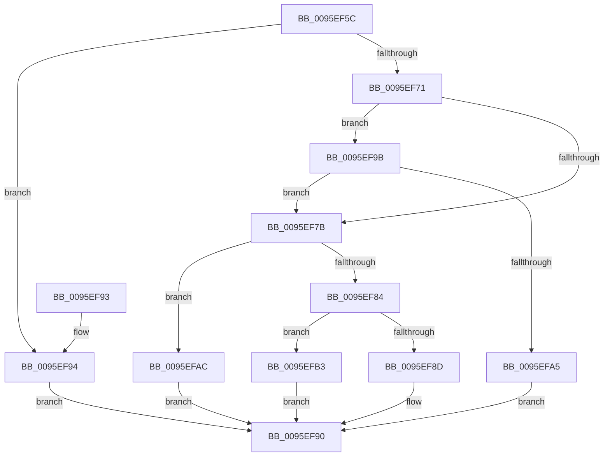

# PfSnCheckScenario

- RVA: `0x0095EF5C`–`0x0095EFBA` (길이 `94` bytes)
- VA: `0x000000014095EF5C`
- 실행 섹션: `PAGE`
- PDB 이름 있음: `예`; PDB Function 태그: `아니요`
- unwind 정보 RVA: `0x000DB714`
- 디코드: `28`개 명령, `94/94` bytes 표시
- 미해석 바이트: `0` (있으면 어셈블리에 `.byte`로 보존)

> 이 문서는 커널 이미지의 기계어와 PDB 기호를 분석해 생성했습니다. 4번과 5번은 함수 원형과 자료형을 바이너리 사용 방식에서 추정한 C 해석이며 원본 소스 복구 결과는 아닙니다.

## 1. Dependencies

- 직접 호출 지점: **0**; 고유 호출 대상: **0**
- 직접 호출자로 확인된 함수: **3**
- RIP 상대 이미지 참조: **5**

### Outgoing calls
- 직접 디코드된 call 명령이 없습니다.

### Direct callers
- [PfSnSetAltPrefetchParam](../75/PfSnSetAltPrefetchParam_function_00752424.md) at `0x00752549`
- [PfSnBeginAppLaunch](PfSnBeginAppLaunch_function_0095EC44.md) at `0x0095ECCE`
- [PfSnOperationProcess](../96/PfSnOperationProcess_function_009615A4.md) at `0x0096162F`

### Static image references
- `0x0095EF5F` → RVA `0x00E66F10` (`.data`; read)
- `0x0095EF71` → RVA `0x00E67360` (`.data`; read)
- `0x0095EF7B` → RVA `0x00E672B4` (`.data`; read)
- `0x0095EF84` → RVA `0x00E671E8` (`.data`; read)
- `0x0095EF9B` → RVA `0x00E670A0` (`.data`; read)

## 2. Other-region calls and transfers

- 다른 실행 섹션으로 향하는 call: **0**
- 별도 외부 분기/꼬리 이동을 확인하지 못했습니다.

## 3. Assembly (complete function range)

```asm
0095EF5C  48 63 C1                        movsxd rax, ecx
0095EF5F  4C 8D 05 AA 7F 50 00            lea r8, [rip + 0x507faa]
0095EF66  33 C9                           xor ecx, ecx
0095EF68  45 8B 04 80                     mov r8d, dword ptr [r8 + rax*4]
0095EF6C  45 85 C0                        test r8d, r8d
0095EF6F  74 23                           je 0x14095ef94
0095EF71  8B 05 E9 83 50 00               mov eax, dword ptr [rip + 0x5083e9]
0095EF77  A8 01                           test al, 1
0095EF79  75 20                           jne 0x14095ef9b
0095EF7B  83 3D 32 83 50 00 01            cmp dword ptr [rip + 0x508332], 1
0095EF82  74 28                           je 0x14095efac
0095EF84  48 39 0D 5D 82 50 00            cmp qword ptr [rip + 0x50825d], rcx
0095EF8B  74 26                           je 0x14095efb3
0095EF8D  44 89 02                        mov dword ptr [rdx], r8d
0095EF90  8B C1                           mov eax, ecx
0095EF92  C3                              ret
0095EF93  CC                              int3
0095EF94  B9 A9 01 00 C0                  mov ecx, 0xc00001a9
0095EF99  EB F5                           jmp 0x14095ef90
0095EF9B  8B 05 FF 80 50 00               mov eax, dword ptr [rip + 0x5080ff]
0095EFA1  A8 01                           test al, 1
0095EFA3  75 D6                           jne 0x14095ef7b
0095EFA5  B9 63 00 00 C0                  mov ecx, 0xc0000063
0095EFAA  EB E4                           jmp 0x14095ef90
0095EFAC  B9 10 02 00 C0                  mov ecx, 0xc0000210
0095EFB1  EB DD                           jmp 0x14095ef90
0095EFB3  B9 B9 02 00 C0                  mov ecx, 0xc00002b9
0095EFB8  EB D6                           jmp 0x14095ef90
```

## 4. C-style interpretation (structured pseudocode)

```c
__int64 __fastcall PfSnCheckScenario(int a1, __int64 a2)
{
    a1 = 0;
    if ((unsigned int)((unsigned int)(*(unsigned int *)(v_rip + 5275562 + (int)(a1) * 4))) == 0) goto loc_0095EF94;
    if ((((unsigned __int8)((unsigned int)(*(unsigned int *)(v_rip + 5276649)))) & (1)) != 0) goto loc_0095EF9B;
loc_0095EF7B:
    if ((*(unsigned int *)(v_rip + 5276466)) == 1) goto loc_0095EFAC;
    if ((*(unsigned __int64 *)(v_rip + 5276253)) == 0) goto loc_0095EFB3;
    *(unsigned int *)(a2) = (unsigned int)((unsigned int)(*(unsigned int *)(v_rip + 5275562 + (int)(a1) * 4)));
loc_0095EF90:
    return 0;
loc_0095EF94:
    goto loc_0095EF90;
loc_0095EF9B:
    if ((((unsigned __int8)((unsigned int)(*(unsigned int *)(v_rip + 5275903)))) & (1)) != 0) goto loc_0095EF7B;
    goto loc_0095EF90;
loc_0095EFAC:
    goto loc_0095EF90;
loc_0095EFB3:
    goto loc_0095EF90;
}
```

## 5. (Beta) C Style

```c
int64_t PfSnCheckScenario(int32_t Arg1, void *Arg2)
{
    uint8_t *arg2 = (uint8_t *)Arg2;

    Arg1 = 0;
    if ((uint32_t)((uint32_t)(*(uint32_t *)(v_rip + 0x507FAA + (int32_t)(Arg1) * 4))) == 0) goto loc_0095EF94;
    if ((((uint8_t)((uint32_t)(*(uint32_t *)(v_rip + 0x5083E9)))) & (1)) != 0) goto loc_0095EF9B;
loc_0095EF7B:
    if ((*(uint32_t *)(v_rip + 0x508332)) == 1) goto loc_0095EFAC;
    if ((*(uint64_t *)(v_rip + 0x50825D)) == 0) goto loc_0095EFB3;
    *(uint32_t *)(arg2) = (uint32_t)((uint32_t)(*(uint32_t *)(v_rip + 0x507FAA + (int32_t)(Arg1) * 4)));
loc_0095EF90:
    return 0;
loc_0095EF94:
    goto loc_0095EF90;
loc_0095EF9B:
    if ((((uint8_t)((uint32_t)(*(uint32_t *)(v_rip + 0x5080FF)))) & (1)) != 0) goto loc_0095EF7B;
    goto loc_0095EF90;
loc_0095EFAC:
    goto loc_0095EF90;
loc_0095EFB3:
    goto loc_0095EF90;
}
```

### 관측된 메모리 오프셋

구조체 형식이 확인되지 않은 접근은 인자 기준의 오프셋으로만 기록했습니다.

| 기준 인자 | 오프셋 표현 | 폭 (bit) | 접근 |
|---|---:|---:|---|
| `Arg2` | `+ 0x0` | `32` | `W` |

## 6. Execution-region graph

[열기: 2D/3D 그래프와 함수 탐색 컨트롤 패널](../../../control-panel.html?section=page&rva=0x0095EF5C&view=graph)

- 2D 그래프는 위에서 아래로 흐르고, 3D 그래프는 빈 공간을 드래그해 회전합니다. Shift+드래그는 이동, 휠은 확대·축소, 함수 노드 선택은 대상 보고서 이동입니다.

### Static fallback


