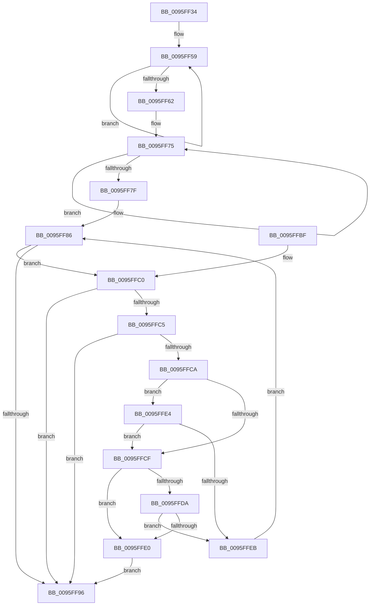

# PfSnIsHostingApplication

- RVA: `0x0095FF34`–`0x0095FFF1` (길이 `189` bytes)
- VA: `0x000000014095FF34`
- 실행 섹션: `PAGE`
- PDB 이름 있음: `예`; PDB Function 태그: `아니요`
- unwind 정보 RVA: `0x000930AC`
- 디코드: `56`개 명령, `189/189` bytes 표시
- 미해석 바이트: `0` (있으면 어셈블리에 `.byte`로 보존)

> 이 문서는 커널 이미지의 기계어와 PDB 기호를 분석해 생성했습니다. 4번과 5번은 함수 원형과 자료형을 바이너리 사용 방식에서 추정한 C 해석이며 원본 소스 복구 결과는 아닙니다.

## 1. Dependencies

- 직접 호출 지점: **3**; 고유 호출 대상: **3**
- 직접 호출자로 확인된 함수: **2**
- RIP 상대 이미지 참조: **2**

### Outgoing calls
- `0x0095FF69` → [FsRtlAcquirePushLockShared](../../text/48/FsRtlAcquirePushLockShared_function_0048B034.md) (function, `0x0048B034`)
- `0x0095FF89` → [wcsstr](../../text/50/wcsstr_function_00501F80.md) (function, `0x00501F80`)
- `0x0095FF9D` → [PfLockSharedRelease](../../text/48/PfLockSharedRelease_function_0048DF24.md) (function, `0x0048DF24`)

### Direct callers
- [PfSnBeginAppLaunch](PfSnBeginAppLaunch_function_0095EC44.md) at `0x0095ED82`
- [PfSnCalculateScenarioNameAndHash](PfSnCalculateScenarioNameAndHash_function_0095FD18.md) at `0x0095FDDD`

### Static image references
- `0x0095FF62` → RVA `0x00E670A8` (`.data`; read)
- `0x0095FF6E` → RVA `0x00E66FA0` (`.data`; read)

## 2. Other-region calls and transfers

- 다른 실행 섹션으로 향하는 call: **3**
  - `0x0095FF69` → [FsRtlAcquirePushLockShared](../../text/48/FsRtlAcquirePushLockShared_function_0048B034.md) (`PAGE` → `.text`)
  - `0x0095FF89` → [wcsstr](../../text/50/wcsstr_function_00501F80.md) (`PAGE` → `.text`)
  - `0x0095FF9D` → [PfLockSharedRelease](../../text/48/PfLockSharedRelease_function_0048DF24.md) (`PAGE` → `.text`)
- 별도 외부 분기/꼬리 이동을 확인하지 못했습니다.

## 3. Assembly (complete function range)

```asm
0095FF34  48 8B C4                        mov rax, rsp
0095FF37  48 89 58 08                     mov qword ptr [rax + 8], rbx
0095FF3B  48 89 68 10                     mov qword ptr [rax + 0x10], rbp
0095FF3F  48 89 70 18                     mov qword ptr [rax + 0x18], rsi
0095FF43  48 89 78 20                     mov qword ptr [rax + 0x20], rdi
0095FF47  41 56                           push r14
0095FF49  48 83 EC 20                     sub rsp, 0x20
0095FF4D  48 83 CF FF                     or rdi, 0xffffffffffffffff
0095FF51  48 8B E9                        mov rbp, rcx
0095FF54  48 8B F7                        mov rsi, rdi
0095FF57  33 DB                           xor ebx, ebx
0095FF59  48 FF C6                        inc rsi
0095FF5C  66 39 1C 71                     cmp word ptr [rcx + rsi*2], bx
0095FF60  75 F7                           jne 0x14095ff59
0095FF62  48 8D 0D 3F 71 50 00            lea rcx, [rip + 0x50713f]
0095FF69  E8 C6 B0 B2 FF                  call 0x14048b034
0095FF6E  4C 8D 35 2B 70 50 00            lea r14, [rip + 0x50702b]
0095FF75  48 FF C7                        inc rdi
0095FF78  66 41 39 1C 7E                  cmp word ptr [r14 + rdi*2], bx
0095FF7D  75 F6                           jne 0x14095ff75
0095FF7F  49 8D 3C 7E                     lea rdi, [r14 + rdi*2]
0095FF83  49 8B CE                        mov rcx, r14
0095FF86  48 8B D5                        mov rdx, rbp
0095FF89  E8 F2 1F BA FF                  call 0x140501f80
0095FF8E  48 8B C8                        mov rcx, rax
0095FF91  48 85 C0                        test rax, rax
0095FF94  75 2A                           jne 0x14095ffc0
0095FF96  48 8D 0D 0B 71 50 00            lea rcx, [rip + 0x50710b]
0095FF9D  E8 82 DF B2 FF                  call 0x14048df24
0095FFA2  48 8B 6C 24 38                  mov rbp, qword ptr [rsp + 0x38]
0095FFA7  8A C3                           mov al, bl
0095FFA9  48 8B 5C 24 30                  mov rbx, qword ptr [rsp + 0x30]
0095FFAE  48 8B 74 24 40                  mov rsi, qword ptr [rsp + 0x40]
0095FFB3  48 8B 7C 24 48                  mov rdi, qword ptr [rsp + 0x48]
0095FFB8  48 83 C4 20                     add rsp, 0x20
0095FFBC  41 5E                           pop r14
0095FFBE  C3                              ret
0095FFBF  CC                              int3
0095FFC0  49 3B CE                        cmp rcx, r14
0095FFC3  72 D1                           jb 0x14095ff96
0095FFC5  48 3B CF                        cmp rcx, rdi
0095FFC8  73 CC                           jae 0x14095ff96
0095FFCA  49 3B CE                        cmp rcx, r14
0095FFCD  75 15                           jne 0x14095ffe4
0095FFCF  8B C6                           mov eax, esi
0095FFD1  48 8D 14 41                     lea rdx, [rcx + rax*2]
0095FFD5  48 3B D7                        cmp rdx, rdi
0095FFD8  74 06                           je 0x14095ffe0
0095FFDA  66 83 3A 2C                     cmp word ptr [rdx], 0x2c
0095FFDE  75 0B                           jne 0x14095ffeb
0095FFE0  B3 01                           mov bl, 1
0095FFE2  EB B2                           jmp 0x14095ff96
0095FFE4  66 83 79 FE 2C                  cmp word ptr [rcx - 2], 0x2c
0095FFE9  74 E4                           je 0x14095ffcf
0095FFEB  48 83 C1 02                     add rcx, 2
0095FFEF  EB 95                           jmp 0x14095ff86
```

## 4. C-style interpretation (structured pseudocode)

```c
__int64 __fastcall PfSnIsHostingApplication(__int64 a1)
{
    __int64 result;
    __int64 v_rbx;
    __int64 v_rdi;
    __int64 v_rsi;
    __int64 v_rsp;
    unsigned __int64 v_stack_p10;
    unsigned __int64 v_stack_p18;
    unsigned __int64 v_stack_p20;
    unsigned __int64 v_stack_p8;

    *(unsigned __int64 *)(v_rsp + 8) = v_rbx;
    *(unsigned __int64 *)(v_rsp + 16) = v_rbp;
    *(unsigned __int64 *)(v_rsp + 24) = v_rsi;
    *(unsigned __int64 *)(v_rsp + 32) = v_rdi;
    v_rsp = (v_rsp) - (32);
    v_rdi = (v_rdi) | (-1);
    v_rbx = 0;
loc_0095FF59:
    v_rsi = (v_rdi) + 1;
    if ((*(unsigned __int16 *)(a1 + v_rsi * 2)) != 0) goto loc_0095FF59;
    result = FsRtlAcquirePushLockShared(v_rip + 5271871, a2, a3, a4);
loc_0095FF75:
    v_rdi = (v_rdi) + 1;
    if ((*(unsigned __int16 *)(v_rip + 5271595 + v_rdi * 2)) != 0) goto loc_0095FF75;
loc_0095FF86:
    result = wcsstr(v_rip + 5271595, a1, a3, a4);
    if (result != 0) goto loc_0095FFC0;
loc_0095FF96:
    result = PfLockSharedRelease(v_rip + 5271819, a1, a3, a4);
    v_rsp = (v_rsp) + (32);
    return 0;
loc_0095FFC0:
    if ((v_rip + 5271819) < (v_rip + 5271595)) goto loc_0095FF96;
    if ((v_rip + 5271819) >= v_stack_p20) goto loc_0095FF96;
    if ((v_rip + 5271819) != (v_rip + 5271595)) goto loc_0095FFE4;
loc_0095FFCF:
    if ((v_rip + 5271819 + (unsigned int)((unsigned int)(v_stack_p18)) * 2) == v_stack_p20) goto loc_0095FFE0;
    if ((*(unsigned __int16 *)(v_rip + 5271819 + (unsigned int)((unsigned int)(v_stack_p18)) * 2)) != 44) goto loc_0095FFEB;
loc_0095FFE0:
    goto loc_0095FF96;
loc_0095FFE4:
    if ((*(unsigned __int16 *)(v_rip + 5271819 - 2)) == 44) goto loc_0095FFCF;
loc_0095FFEB:
    a1 = (v_rip + 5271819) + (2);
    goto loc_0095FF86;
}
```

## 5. (Beta) C Style

```c
int64_t PfSnIsHostingApplication(void *Arg1)
{
    uint8_t *arg1 = (uint8_t *)Arg1;

    int64_t result;
    int64_t local_rbx;
    int64_t local_rdi;
    int64_t local_rsi;
    int64_t local_rsp;
    uint64_t v_stack_p10;
    uint64_t v_stack_p18;
    uint64_t v_stack_p20;
    uint64_t v_stack_p8;

    *(uint64_t *)(local_rsp + 0x8) = local_rbx;
    *(uint64_t *)(local_rsp + 0x10) = local_rbp;
    *(uint64_t *)(local_rsp + 0x18) = local_rsi;
    *(uint64_t *)(local_rsp + 0x20) = local_rdi;
    local_rsp = (local_rsp) - (32);
    local_rdi = (local_rdi) | (-1);
    local_rbx = 0;
loc_0095FF59:
    local_rsi = (local_rdi) + 1;
    if ((*(uint16_t *)(arg1 + local_rsi * 2)) != 0) goto loc_0095FF59;
    result = FsRtlAcquirePushLockShared(v_rip + 5271871, a2, a3, a4);
loc_0095FF75:
    local_rdi = (local_rdi) + 1;
    if ((*(uint16_t *)(v_rip + 0x50702B + local_rdi * 2)) != 0) goto loc_0095FF75;
loc_0095FF86:
    result = wcsstr(v_rip + 5271595, Arg1, a3, a4);
    if (result != 0) goto loc_0095FFC0;
loc_0095FF96:
    result = PfLockSharedRelease(v_rip + 5271819, Arg1, a3, a4);
    local_rsp = (local_rsp) + (32);
    return 0;
loc_0095FFC0:
    if ((v_rip + 5271819) < (v_rip + 5271595)) goto loc_0095FF96;
    if ((v_rip + 5271819) >= v_stack_p20) goto loc_0095FF96;
    if ((v_rip + 5271819) != (v_rip + 5271595)) goto loc_0095FFE4;
loc_0095FFCF:
    if ((v_rip + 5271819 + (uint32_t)((uint32_t)(v_stack_p18)) * 2) == v_stack_p20) goto loc_0095FFE0;
    if ((*(uint16_t *)(v_rip + 0x50710B + (uint32_t)((uint32_t)(v_stack_p18)) * 2)) != 44) goto loc_0095FFEB;
loc_0095FFE0:
    goto loc_0095FF96;
loc_0095FFE4:
    if ((*(uint16_t *)(v_rip + 0x50710B - 0x2)) == 44) goto loc_0095FFCF;
loc_0095FFEB:
    Arg1 = (v_rip + 5271819) + (2);
    goto loc_0095FF86;
}
```

### 관측된 메모리 오프셋

구조체 형식이 확인되지 않은 접근은 인자 기준의 오프셋으로만 기록했습니다.

| 기준 인자 | 오프셋 표현 | 폭 (bit) | 접근 |
|---|---:|---:|---|
| `Arg1` | `+ 0x0 + rsi*2` | `16` | `R` |

## 6. Execution-region graph

[열기: 2D/3D 그래프와 함수 탐색 컨트롤 패널](../../../control-panel.html?section=page&rva=0x0095FF34&view=graph)

- 2D 그래프는 위에서 아래로 흐르고, 3D 그래프는 빈 공간을 드래그해 회전합니다. Shift+드래그는 이동, 휠은 확대·축소, 함수 노드 선택은 대상 보고서 이동입니다.

### Static fallback


