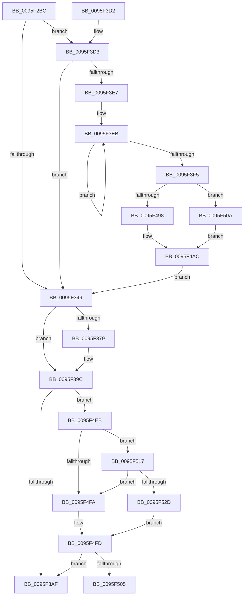

# PfSnLogScenarioDecision

- RVA: `0x0095F2BC`–`0x0095F52F` (길이 `627` bytes)
- VA: `0x000000014095F2BC`
- 실행 섹션: `PAGE`
- PDB 이름 있음: `예`; PDB Function 태그: `예`
- unwind 정보 RVA: `0x00092FF0`
- 디코드: `145`개 명령, `627/627` bytes 표시
- 미해석 바이트: `0` (있으면 어셈블리에 `.byte`로 보존)

> 이 문서는 커널 이미지의 기계어와 PDB 기호를 분석해 생성했습니다. 4번과 5번은 함수 원형과 자료형을 바이너리 사용 방식에서 추정한 C 해석이며 원본 소스 복구 결과는 아닙니다.

## 1. Dependencies

- 직접 호출 지점: **5**; 고유 호출 대상: **5**
- 직접 호출자로 확인된 함수: **2**
- RIP 상대 이미지 참조: **6**

### Outgoing calls
- `0x0095F308` → [memset](../../text/6C/memset_function_006C6C40.md) (function, `0x006C6C40`)
- `0x0095F35D` → [EtwQueryProcessTelemetryInfo](../8A/EtwQueryProcessTelemetryInfo_function_008A51A0.md) (function, `0x008A51A0`)
- `0x0095F3B9` → [_security_check_cookie](../../text/6A/_security_check_cookie_function_006AC640.md) (function, `0x006AC640`)
- `0x0095F3DA` → [EtwEventEnabled](../../text/39/EtwEventEnabled_function_00392450.md) (function, `0x00392450`)
- `0x0095F4E1` → [EtwWrite](../../text/41/EtwWrite_function_0041C720.md) (function, `0x0041C720`)

### Direct callers
- [PfSnBeginAppLaunch](PfSnBeginAppLaunch_function_0095EC44.md) at `0x0095EF0B`
- [PfSnBeginScenario](PfSnBeginScenario_function_0095EFC0.md) at `0x0095F11E`

### Static image references
- `0x0095F2DC` → RVA `0x00E0A740` (`.data`; read)
- `0x0095F30D` → RVA `0x00E67358` (`.data`; read)
- `0x0095F3A2` → RVA `0x00E074D8` (`.data`; read)
- `0x0095F3D3` → RVA `0x000125F8` (`.rdata`; read)
- `0x0095F4F1` → RVA `0x00E074E8` (`.data`; reference)
- `0x0095F517` → RVA `0x00E074F0` (`.data`; read)

## 2. Other-region calls and transfers

- 다른 실행 섹션으로 향하는 call: **4**
  - `0x0095F308` → [memset](../../text/6C/memset_function_006C6C40.md) (`PAGE` → `.text`)
  - `0x0095F3B9` → [_security_check_cookie](../../text/6A/_security_check_cookie_function_006AC640.md) (`PAGE` → `.text`)
  - `0x0095F3DA` → [EtwEventEnabled](../../text/39/EtwEventEnabled_function_00392450.md) (`PAGE` → `.text`)
  - `0x0095F4E1` → [EtwWrite](../../text/41/EtwWrite_function_0041C720.md) (`PAGE` → `.text`)
- call이 아닌 외부 분기/꼬리 이동: **1**
  - `0x0095F505` → [sub_00B27D04](../B2/Unknown_function_00B27D04.md) (`tail-transfer`)

## 3. Assembly (complete function range)

```asm
0095F2BC  44 89 44 24 18                  mov dword ptr [rsp + 0x18], r8d
0095F2C1  55                              push rbp
0095F2C2  53                              push rbx
0095F2C3  56                              push rsi
0095F2C4  57                              push rdi
0095F2C5  41 54                           push r12
0095F2C7  41 55                           push r13
0095F2C9  41 56                           push r14
0095F2CB  41 57                           push r15
0095F2CD  48 8D AC 24 E8 FE FF FF         lea rbp, [rsp - 0x118]
0095F2D5  48 81 EC 18 02 00 00            sub rsp, 0x218
0095F2DC  48 8B 05 5D B4 4A 00            mov rax, qword ptr [rip + 0x4ab45d]
0095F2E3  48 33 C4                        xor rax, rsp
0095F2E6  48 89 85 00 01 00 00            mov qword ptr [rbp + 0x100], rax
0095F2ED  48 8B BD 98 01 00 00            mov rdi, qword ptr [rbp + 0x198]
0095F2F4  48 8B F2                        mov rsi, rdx
0095F2F7  33 D2                           xor edx, edx
0095F2F9  4C 8B F1                        mov r14, rcx
0095F2FC  48 8D 4C 24 70                  lea rcx, [rsp + 0x70]
0095F301  41 8B D9                        mov ebx, r9d
0095F304  44 8D 42 60                     lea r8d, [rdx + 0x60]
0095F308  E8 33 79 D6 FF                  call 0x1406c6c40
0095F30D  48 8B 0D 44 80 50 00            mov rcx, qword ptr [rip + 0x508044]
0095F314  45 33 ED                        xor r13d, r13d
0095F317  44 8B BD 88 01 00 00            mov r15d, dword ptr [rbp + 0x188]
0095F31E  44 8B A5 80 01 00 00            mov r12d, dword ptr [rbp + 0x180]
0095F325  66 44 89 6C 24 38               mov word ptr [rsp + 0x38], r13w
0095F32B  66 44 89 6C 24 3C               mov word ptr [rsp + 0x3c], r13w
0095F331  44 88 6C 24 30                  mov byte ptr [rsp + 0x30], r13b
0095F336  44 88 6C 24 31                  mov byte ptr [rsp + 0x31], r13b
0095F33B  44 89 6C 24 40                  mov dword ptr [rsp + 0x40], r13d
0095F340  48 85 C9                        test rcx, rcx
0095F343  0F 85 8A 00 00 00               jne 0x14095f3d3
0095F349  45 33 C9                        xor r9d, r9d
0095F34C  4C 89 6C 24 20                  mov qword ptr [rsp + 0x20], r13
0095F351  48 8D 54 24 70                  lea rdx, [rsp + 0x70]
0095F356  49 8B CE                        mov rcx, r14
0095F359  45 8D 41 60                     lea r8d, [r9 + 0x60]
0095F35D  E8 3E 5E F4 FF                  call 0x1408a51a0
0095F362  3D 05 00 00 80                  cmp eax, 0x80000005
0095F367  41 8B CD                        mov ecx, r13d
0095F36A  0F 57 C0                        xorps xmm0, xmm0
0095F36D  0F 45 C8                        cmovne ecx, eax
0095F370  0F 11 44 24 58                  movups xmmword ptr [rsp + 0x58], xmm0
0095F375  85 C9                           test ecx, ecx
0095F377  78 23                           js 0x14095f39c
0095F379  8B 44 24 74                     mov eax, dword ptr [rsp + 0x74]
0095F37D  89 44 24 58                     mov dword ptr [rsp + 0x58], eax
0095F381  0F B7 45 A8                     movzx eax, word ptr [rbp - 0x58]
0095F385  66 89 44 24 5C                  mov word ptr [rsp + 0x5c], ax
0095F38A  0F B7 45 AC                     movzx eax, word ptr [rbp - 0x54]
0095F38E  66 89 44 24 5E                  mov word ptr [rsp + 0x5e], ax
0095F393  48 8B 45 80                     mov rax, qword ptr [rbp - 0x80]
0095F397  48 89 44 24 60                  mov qword ptr [rsp + 0x60], rax
0095F39C  41 BA 04 00 00 00               mov r10d, 4
0095F3A2  44 39 15 2F 81 4A 00            cmp dword ptr [rip + 0x4a812f], r10d
0095F3A9  0F 87 3C 01 00 00               ja 0x14095f4eb
0095F3AF  48 8B 8D 00 01 00 00            mov rcx, qword ptr [rbp + 0x100]
0095F3B6  48 33 CC                        xor rcx, rsp
0095F3B9  E8 82 D2 D4 FF                  call 0x1406ac640
0095F3BE  48 81 C4 18 02 00 00            add rsp, 0x218
0095F3C5  41 5F                           pop r15
0095F3C7  41 5E                           pop r14
0095F3C9  41 5D                           pop r13
0095F3CB  41 5C                           pop r12
0095F3CD  5F                              pop rdi
0095F3CE  5E                              pop rsi
0095F3CF  5B                              pop rbx
0095F3D0  5D                              pop rbp
0095F3D1  C3                              ret
0095F3D2  CC                              int3
0095F3D3  48 8D 15 1E 32 6B FF            lea rdx, [rip - 0x94cde2]
0095F3DA  E8 71 30 A3 FF                  call 0x140392450
0095F3DF  84 C0                           test al, al
0095F3E1  0F 84 62 FF FF FF               je 0x14095f349
0095F3E7  48 83 C8 FF                     or rax, 0xffffffffffffffff
0095F3EB  48 FF C0                        inc rax
0095F3EE  66 44 39 2C 46                  cmp word ptr [rsi + rax*2], r13w
0095F3F3  75 F6                           jne 0x14095f3eb
0095F3F5  66 89 44 24 38                  mov word ptr [rsp + 0x38], ax
0095F3FA  48 8D 4C 24 38                  lea rcx, [rsp + 0x38]
0095F3FF  0F B7 C0                        movzx eax, ax
0095F402  03 C0                           add eax, eax
0095F404  48 89 4D D0                     mov qword ptr [rbp - 0x30], rcx
0095F408  89 45 E8                        mov dword ptr [rbp - 0x18], eax
0095F40B  48 8D 46 3C                     lea rax, [rsi + 0x3c]
0095F40F  48 89 45 F0                     mov qword ptr [rbp - 0x10], rax
0095F413  48 8D 85 70 01 00 00            lea rax, [rbp + 0x170]
0095F41A  48 89 45 00                     mov qword ptr [rbp], rax
0095F41E  48 8D 44 24 3C                  lea rax, [rsp + 0x3c]
0095F423  48 89 45 10                     mov qword ptr [rbp + 0x10], rax
0095F427  48 8D 44 24 30                  lea rax, [rsp + 0x30]
0095F42C  48 89 45 20                     mov qword ptr [rbp + 0x20], rax
0095F430  48 8D 44 24 31                  lea rax, [rsp + 0x31]
0095F435  48 89 45 30                     mov qword ptr [rbp + 0x30], rax
0095F439  48 8D 85 90 01 00 00            lea rax, [rbp + 0x190]
0095F440  48 89 45 40                     mov qword ptr [rbp + 0x40], rax
0095F444  48 C7 45 D8 02 00 00 00         mov qword ptr [rbp - 0x28], 2
0095F44C  48 89 75 E0                     mov qword ptr [rbp - 0x20], rsi
0095F450  44 89 6D EC                     mov dword ptr [rbp - 0x14], r13d
0095F454  48 C7 45 F8 04 00 00 00         mov qword ptr [rbp - 8], 4
0095F45C  48 C7 45 08 04 00 00 00         mov qword ptr [rbp + 8], 4
0095F464  66 89 5C 24 3C                  mov word ptr [rsp + 0x3c], bx
0095F469  48 C7 45 18 02 00 00 00         mov qword ptr [rbp + 0x18], 2
0095F471  44 88 64 24 30                  mov byte ptr [rsp + 0x30], r12b
0095F476  48 C7 45 28 01 00 00 00         mov qword ptr [rbp + 0x28], 1
0095F47E  44 88 7C 24 31                  mov byte ptr [rsp + 0x31], r15b
0095F483  48 C7 45 38 01 00 00 00         mov qword ptr [rbp + 0x38], 1
0095F48B  48 C7 45 48 04 00 00 00         mov qword ptr [rbp + 0x48], 4
0095F493  48 85 FF                        test rdi, rdi
0095F496  78 72                           js 0x14095f50a
0095F498  48 B8 BD 42 7A E5 D5 94 BF D6   movabs rax, 0xd6bf94d5e57a42bd
0095F4A2  48 F7 E7                        mul rdi
0095F4A5  48 8B C2                        mov rax, rdx
0095F4A8  48 C1 E8 17                     shr rax, 0x17
0095F4AC  48 8B 0D A5 7E 50 00            mov rcx, qword ptr [rip + 0x507ea5]
0095F4B3  48 8D 15 3E 31 6B FF            lea rdx, [rip - 0x94cec2]
0095F4BA  89 44 24 40                     mov dword ptr [rsp + 0x40], eax
0095F4BE  41 B9 09 00 00 00               mov r9d, 9
0095F4C4  48 8D 44 24 40                  lea rax, [rsp + 0x40]
0095F4C9  48 C7 45 58 04 00 00 00         mov qword ptr [rbp + 0x58], 4
0095F4D1  48 89 45 50                     mov qword ptr [rbp + 0x50], rax
0095F4D5  45 33 C0                        xor r8d, r8d
0095F4D8  48 8D 45 D0                     lea rax, [rbp - 0x30]
0095F4DC  48 89 44 24 20                  mov qword ptr [rsp + 0x20], rax
0095F4E1  E8 3A D2 AB FF                  call 0x14041c720
0095F4E6  E9 5E FE FF FF                  jmp 0x14095f349
0095F4EB  41 B9 01 00 00 00               mov r9d, 1
0095F4F1  44 84 0D F0 7F 4A 00            test byte ptr [rip + 0x4a7ff0], r9b
0095F4F8  75 1D                           jne 0x14095f517
0095F4FA  41 8A C5                        mov al, r13b
0095F4FD  84 C0                           test al, al
0095F4FF  0F 84 AA FE FF FF               je 0x14095f3af
0095F505  E9 FA 87 1C 00                  jmp 0x140b27d04
0095F50A  48 8D 47 01                     lea rax, [rdi + 1]
0095F50E  48 F7 D8                        neg rax
0095F511  1B C0                           sbb eax, eax
0095F513  FF C8                           dec eax
0095F515  EB 95                           jmp 0x14095f4ac
0095F517  48 8B 05 D2 7F 4A 00            mov rax, qword ptr [rip + 0x4a7fd2]
0095F51E  49 23 C1                        and rax, r9
0095F521  48 3B 05 C8 7F 4A 00            cmp rax, qword ptr [rip + 0x4a7fc8]
0095F528  41 8A C1                        mov al, r9b
0095F52B  75 CD                           jne 0x14095f4fa
0095F52D  EB CE                           jmp 0x14095f4fd
```

## 4. C-style interpretation (structured pseudocode)

```c
__int64 __fastcall PfSnLogScenarioDecision(__int64 a1, __int64 a2, int a3, int a4, unsigned int a5, unsigned int a6, __int64 a7, __int64 a8)
{
    __int64 result;
    __int64 v_r13;
    __int64 v_rsp;
    unsigned __int64 v_stack_m100;
    unsigned __int64 v_stack_m108;
    unsigned __int64 v_stack_m110;
    unsigned __int64 v_stack_m118;
    unsigned __int64 v_stack_m120;
    unsigned __int64 v_stack_m128;
    unsigned __int64 v_stack_m130;
    unsigned __int64 v_stack_m138;
    unsigned __int64 v_stack_m140;
    unsigned __int64 v_stack_m148;
    unsigned __int64 v_stack_m150;
    unsigned __int64 v_stack_m158;
    unsigned __int64 v_stack_m160;
    unsigned __int64 v_stack_m168;
    unsigned int v_stack_m16C;
    unsigned int v_stack_m170;
    unsigned __int64 v_stack_m178;
    unsigned __int64 v_stack_m180;
    unsigned __int64 v_stack_m188;
    unsigned __int16 v_stack_m1AC;
    unsigned __int16 v_stack_m1B0;
    unsigned __int64 v_stack_m1D8;
    unsigned int v_stack_m1E4;
    unsigned __int64 v_stack_m1E8;
    unsigned __int64 v_stack_m1F8;
    unsigned __int16 v_stack_m1FA;
    unsigned __int16 v_stack_m1FC;
    unsigned __int64 v_stack_m200;
    unsigned int v_stack_m218;
    unsigned __int16 v_stack_m21C;
    unsigned __int16 v_stack_m220;
    unsigned __int8 v_stack_m227;
    unsigned __int8 v_stack_m228;
    unsigned __int64 v_stack_m238;
    unsigned __int64 v_stack_m58;
    unsigned int v_stack_p18;
    unsigned __int64 v_stack_p20;
    unsigned __int64 v_stack_p30;
    unsigned __int64 v_stack_p31;
    unsigned __int16 v_stack_p38;
    unsigned __int64 v_stack_p3C;
    unsigned int v_stack_p40;

    v_stack_p18 = a3;
    v_rsp = (v_rsp) - (536);
    result = (*(unsigned __int64 *)(v_rip + 4895837)) ^ (v_rsp);
    v_stack_m58 = result;
    a2 = 0;
    result = memset(v_stack_m1E8, a2, a2 + 96, a4);
    v_r13 = 0;
    v_stack_m220 = 0;
    v_stack_m21C = 0;
    v_stack_m228 = 0;
    v_stack_m227 = 0;
    v_stack_m218 = 0;
    if (*(unsigned __int64 *)(v_rip + 5275716) != 0) goto loc_0095F3D3;
loc_0095F349:
    a4 = 0;
    v_stack_m238 = 0;
    result = EtwQueryProcessTelemetryInfo(a1, v_stack_m1E8, a4 + 96, a4);
    a1 = 0;
    if (((unsigned int)(result)) != 0x80000005ULL) { a1 = (unsigned int)(result); }
    v_stack_m200 = v_xmm0;
    if (!(sign_flag)) {
        result = v_stack_m1E4;
        v_stack_m200 = (unsigned int)(result);
        result = v_stack_m1B0;
        v_stack_m1FC = (unsigned __int16)(result);
        result = v_stack_m1AC;
        v_stack_m1FA = (unsigned __int16)(result);
        result = v_stack_m1D8;
        v_stack_m1F8 = result;
    }
    if ((*(unsigned int *)(v_rip + 4882735)) > 4) goto loc_0095F4EB;
loc_0095F3AF:
    a1 = (v_stack_m58) ^ (v_rsp);
    result = _security_check_cookie(a1, v_stack_m1E8, a4 + 96, a4);
    v_rsp = (v_rsp) + (536);
    return result;
loc_0095F3D3:
    result = EtwEventEnabled(a1, v_rip - 9752034, a4 + 96, a4);
    if ((unsigned __int8)(result) == 0) goto loc_0095F349;
    result = (result) | (-1);
loc_0095F3EB:
    result = (result) + 1;
    if ((*(unsigned __int16 *)(a2 + result * 2)) != 0) goto loc_0095F3EB;
    v_stack_p38 = (unsigned __int16)(result);
    result = (unsigned int)(((unsigned __int16)(result)) + ((unsigned int)((unsigned __int16)(result))));
    v_stack_m188 = v_stack_p38;
    v_stack_m170 = (unsigned int)(result);
    v_stack_m168 = a2 + 60;
    v_stack_m158 = v_stack_p18;
    v_stack_m148 = v_stack_p3C;
    v_stack_m138 = v_stack_p30;
    v_stack_m128 = v_stack_p31;
    v_stack_m118 = a7;
    v_stack_m180 = 2;
    v_stack_m178 = 0;
    v_stack_m16C = 0;
    v_stack_m160 = 4;
    v_stack_m150 = 4;
    v_stack_p3C = (unsigned __int16)((unsigned int)(a4));
    v_stack_m140 = 2;
    v_stack_p30 = (unsigned __int8)((unsigned int)(a5));
    v_stack_m130 = 1;
    v_stack_p31 = (unsigned __int8)((unsigned int)(a6));
    v_stack_m120 = 1;
    v_stack_m110 = 4;
    if (sign_flag) goto loc_0095F50A;
    result = (v_rip - 9752034) >> (23);
loc_0095F4AC:
    v_stack_p40 = (unsigned int)(result);
    v_stack_m100 = 4;
    v_stack_m108 = v_stack_p40;
    a3 = 0;
    v_stack_p20 = v_stack_m188;
    result = EtwWrite(*(unsigned __int64 *)(v_rip + 5275301), v_rip - 9752258, a3, 9);
    goto loc_0095F349;
loc_0095F4EB:
    if (((*(unsigned __int8 *)(v_rip + 4882416)) & (1)) != 0) goto loc_0095F517;
loc_0095F4FA:
loc_0095F4FD:
    if (0 == 0) goto loc_0095F3AF;
loc_0095F50A:
    result = -(a8 + 1);
    result = (unsigned int)((result) - 1);
    goto loc_0095F4AC;
loc_0095F517:
    result = (*(unsigned __int64 *)(v_rip + 4882386)) & (1);
    if (result != (*(unsigned __int64 *)(v_rip + 4882376))) goto loc_0095F4FA;
    goto loc_0095F4FD;
}
```

## 5. (Beta) C Style

```c
int64_t PfSnLogScenarioDecision(int64_t Arg1, void *Arg2, int32_t Arg3, int32_t Arg4, uint32_t Arg5, uint32_t Arg6, int64_t Arg7, int64_t Arg8)
{
    uint8_t *arg2 = (uint8_t *)Arg2;

    int64_t result;
    int64_t local_r13;
    int64_t local_rsp;
    uint64_t v_stack_m100;
    uint64_t v_stack_m108;
    uint64_t v_stack_m110;
    uint64_t v_stack_m118;
    uint64_t v_stack_m120;
    uint64_t v_stack_m128;
    uint64_t v_stack_m130;
    uint64_t v_stack_m138;
    uint64_t v_stack_m140;
    uint64_t v_stack_m148;
    uint64_t v_stack_m150;
    uint64_t v_stack_m158;
    uint64_t v_stack_m160;
    uint64_t v_stack_m168;
    uint32_t v_stack_m16C;
    uint32_t v_stack_m170;
    uint64_t v_stack_m178;
    uint64_t v_stack_m180;
    uint64_t v_stack_m188;
    uint16_t v_stack_m1AC;
    uint16_t v_stack_m1B0;
    uint64_t v_stack_m1D8;
    uint32_t v_stack_m1E4;
    uint64_t v_stack_m1E8;
    uint64_t v_stack_m1F8;
    uint16_t v_stack_m1FA;
    uint16_t v_stack_m1FC;
    uint64_t v_stack_m200;
    uint32_t v_stack_m218;
    uint16_t v_stack_m21C;
    uint16_t v_stack_m220;
    uint8_t v_stack_m227;
    uint8_t v_stack_m228;
    uint64_t v_stack_m238;
    uint64_t v_stack_m58;
    uint32_t v_stack_p18;
    uint64_t v_stack_p20;
    uint64_t v_stack_p30;
    uint64_t v_stack_p31;
    uint16_t v_stack_p38;
    uint64_t v_stack_p3C;
    uint32_t v_stack_p40;

    v_stack_p18 = Arg3;
    local_rsp = (local_rsp) - (536);
    result = (*(uint64_t *)(v_rip + 0x4AB45D)) ^ (local_rsp);
    v_stack_m58 = result;
    Arg2 = 0;
    result = memset(v_stack_m1E8, Arg2, Arg2 + 96, Arg4);
    local_r13 = 0;
    v_stack_m220 = 0;
    v_stack_m21C = 0;
    v_stack_m228 = 0;
    v_stack_m227 = 0;
    v_stack_m218 = 0;
    if (*(uint64_t *)(v_rip + 0x508044) != 0) goto loc_0095F3D3;
loc_0095F349:
    Arg4 = 0;
    v_stack_m238 = 0;
    result = EtwQueryProcessTelemetryInfo(Arg1, v_stack_m1E8, Arg4 + 96, Arg4);
    Arg1 = 0;
    if (((uint32_t)(result)) != 0x80000005ULL) { Arg1 = (uint32_t)(result); }
    v_stack_m200 = v_xmm0;
    if (!(sign_flag)) {
        result = v_stack_m1E4;
        v_stack_m200 = (uint32_t)(result);
        result = v_stack_m1B0;
        v_stack_m1FC = (uint16_t)(result);
        result = v_stack_m1AC;
        v_stack_m1FA = (uint16_t)(result);
        result = v_stack_m1D8;
        v_stack_m1F8 = result;
    }
    if ((*(uint32_t *)(v_rip + 0x4A812F)) > 4) goto loc_0095F4EB;
loc_0095F3AF:
    Arg1 = (v_stack_m58) ^ (local_rsp);
    result = _security_check_cookie(Arg1, v_stack_m1E8, Arg4 + 96, Arg4);
    local_rsp = (local_rsp) + (536);
    return result;
loc_0095F3D3:
    result = EtwEventEnabled(Arg1, v_rip - 9752034, Arg4 + 96, Arg4);
    if ((uint8_t)(result) == 0) goto loc_0095F349;
    result = (result) | (-1);
loc_0095F3EB:
    result = (result) + 1;
    if ((*(uint16_t *)(arg2 + result * 2)) != 0) goto loc_0095F3EB;
    v_stack_p38 = (uint16_t)(result);
    result = (uint32_t)(((uint16_t)(result)) + ((uint32_t)((uint16_t)(result))));
    v_stack_m188 = v_stack_p38;
    v_stack_m170 = (uint32_t)(result);
    v_stack_m168 = Arg2 + 60;
    v_stack_m158 = v_stack_p18;
    v_stack_m148 = v_stack_p3C;
    v_stack_m138 = v_stack_p30;
    v_stack_m128 = v_stack_p31;
    v_stack_m118 = Arg7;
    v_stack_m180 = 2;
    v_stack_m178 = 0;
    v_stack_m16C = 0;
    v_stack_m160 = 4;
    v_stack_m150 = 4;
    v_stack_p3C = (uint16_t)((uint32_t)(Arg4));
    v_stack_m140 = 2;
    v_stack_p30 = (uint8_t)((uint32_t)(Arg5));
    v_stack_m130 = 1;
    v_stack_p31 = (uint8_t)((uint32_t)(Arg6));
    v_stack_m120 = 1;
    v_stack_m110 = 4;
    if (sign_flag) goto loc_0095F50A;
    result = (v_rip - 9752034) >> (23);
loc_0095F4AC:
    v_stack_p40 = (uint32_t)(result);
    v_stack_m100 = 4;
    v_stack_m108 = v_stack_p40;
    Arg3 = 0;
    v_stack_p20 = v_stack_m188;
    result = EtwWrite(*(uint64_t *)(v_rip + 0x507EA5), v_rip - 9752258, Arg3, 9);
    goto loc_0095F349;
loc_0095F4EB:
    if (((*(uint8_t *)(v_rip + 0x4A7FF0)) & (1)) != 0) goto loc_0095F517;
loc_0095F4FA:
loc_0095F4FD:
    if (0 == 0) goto loc_0095F3AF;
loc_0095F50A:
    result = -(Arg8 + 1);
    result = (uint32_t)((result) - 1);
    goto loc_0095F4AC;
loc_0095F517:
    result = (*(uint64_t *)(v_rip + 0x4A7FD2)) & (1);
    if (result != (*(uint64_t *)(v_rip + 0x4A7FC8))) goto loc_0095F4FA;
    goto loc_0095F4FD;
}
```

### 관측된 메모리 오프셋

구조체 형식이 확인되지 않은 접근은 인자 기준의 오프셋으로만 기록했습니다.

| 기준 인자 | 오프셋 표현 | 폭 (bit) | 접근 |
|---|---:|---:|---|
| `Arg2` | `+ 0x0 + rax*2` | `16` | `R` |
| `Arg2` | `+ 0x3C` | `64` | `R` |

## 6. Execution-region graph

[열기: 2D/3D 그래프와 함수 탐색 컨트롤 패널](../../../control-panel.html?section=page&rva=0x0095F2BC&view=graph)

- 2D 그래프는 위에서 아래로 흐르고, 3D 그래프는 빈 공간을 드래그해 회전합니다. Shift+드래그는 이동, 휠은 확대·축소, 함수 노드 선택은 대상 보고서 이동입니다.

### Static fallback


