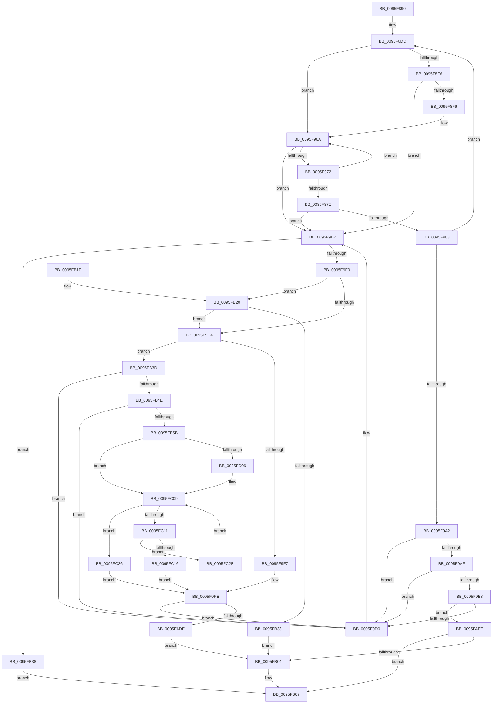

# PfSnPrefetchCacheEntryGet

- RVA: `0x0095F890`–`0x0095FC33` (길이 `931` bytes)
- VA: `0x000000014095F890`
- 실행 섹션: `PAGE`
- PDB 이름 있음: `예`; PDB Function 태그: `아니요`
- unwind 정보 RVA: `0x0009304C`
- 디코드: `258`개 명령, `931/931` bytes 표시
- 미해석 바이트: `0` (있으면 어셈블리에 `.byte`로 보존)

> 이 문서는 커널 이미지의 기계어와 PDB 기호를 분석해 생성했습니다. 4번과 5번은 함수 원형과 자료형을 바이너리 사용 방식에서 추정한 C 해석이며 원본 소스 복구 결과는 아닙니다.

## 1. Dependencies

- 직접 호출 지점: **3**; 고유 호출 대상: **3**
- 직접 호출자로 확인된 함수: **2**
- RIP 상대 이미지 참조: **0**

### Outgoing calls
- `0x0095F98D` → [memcmp](../../text/6C/memcmp_function_006C6B10.md) (function, `0x006C6B10`)
- `0x0095FA07` → [memset](../../text/6C/memset_function_006C6C40.md) (function, `0x006C6C40`)
- `0x0095FB23` → [PfSnPrefetchCacheCtxStart](../AC/PfSnPrefetchCacheCtxStart_function_00AC85C0.md) (function, `0x00AC85C0`)

### Direct callers
- [PfSnCheckActionsNeeded](PfSnCheckActionsNeeded_function_0095F538.md) at `0x0095F75C`
- [PfSnPrefetchCacheEntryUpdate](../96/PfSnPrefetchCacheEntryUpdate_function_00961234.md) at `0x00961330`

### Static image references
- 디코드된 RIP-relative 메모리 참조가 없습니다.

## 2. Other-region calls and transfers

- 다른 실행 섹션으로 향하는 call: **2**
  - `0x0095F98D` → [memcmp](../../text/6C/memcmp_function_006C6B10.md) (`PAGE` → `.text`)
  - `0x0095FA07` → [memset](../../text/6C/memset_function_006C6C40.md) (`PAGE` → `.text`)
- 별도 외부 분기/꼬리 이동을 확인하지 못했습니다.

## 3. Assembly (complete function range)

```asm
0095F890  48 89 5C 24 20                  mov qword ptr [rsp + 0x20], rbx
0095F895  4C 89 44 24 18                  mov qword ptr [rsp + 0x18], r8
0095F89A  48 89 54 24 10                  mov qword ptr [rsp + 0x10], rdx
0095F89F  55                              push rbp
0095F8A0  56                              push rsi
0095F8A1  57                              push rdi
0095F8A2  41 54                           push r12
0095F8A4  41 55                           push r13
0095F8A6  41 56                           push r14
0095F8A8  41 57                           push r15
0095F8AA  48 83 EC 20                     sub rsp, 0x20
0095F8AE  44 8B 61 04                     mov r12d, dword ptr [rcx + 4]
0095F8B2  45 33 D2                        xor r10d, r10d
0095F8B5  48 8B F9                        mov rdi, rcx
0095F8B8  49 83 CD FF                     or r13, 0xffffffffffffffff
0095F8BC  41 8B CC                        mov ecx, r12d
0095F8BF  4D 8B F5                        mov r14, r13
0095F8C2  83 E1 1F                        and ecx, 0x1f
0095F8C5  4D 8B F9                        mov r15, r9
0095F8C8  49 D3 E6                        shl r14, cl
0095F8CB  41 8D 72 01                     lea esi, [r10 + 1]
0095F8CF  49 8B EE                        mov rbp, r14
0095F8D2  41 8B DA                        mov ebx, r10d
0095F8D5  49 23 E8                        and rbp, r8
0095F8D8  48 89 6C 24 60                  mov qword ptr [rsp + 0x60], rbp
0095F8DD  48 85 DB                        test rbx, rbx
0095F8E0  0F 85 84 00 00 00               jne 0x14095f96a
0095F8E6  45 8B CC                        mov r9d, r12d
0095F8E9  41 C1 E9 05                     shr r9d, 5
0095F8ED  45 85 C9                        test r9d, r9d
0095F8F0  0F 84 E1 00 00 00               je 0x14095f9d7
0095F8F6  40 0F B6 C5                     movzx eax, bpl
0095F8FA  48 05 CB 5D B1 00               add rax, 0xb15dcb
0095F900  48 6B C8 25                     imul rcx, rax, 0x25
0095F904  0F B6 44 24 61                  movzx eax, byte ptr [rsp + 0x61]
0095F909  48 03 C8                        add rcx, rax
0095F90C  0F B6 44 24 62                  movzx eax, byte ptr [rsp + 0x62]
0095F911  48 6B D1 25                     imul rdx, rcx, 0x25
0095F915  48 03 D0                        add rdx, rax
0095F918  0F B6 44 24 63                  movzx eax, byte ptr [rsp + 0x63]
0095F91D  48 6B CA 25                     imul rcx, rdx, 0x25
0095F921  48 03 C8                        add rcx, rax
0095F924  0F B6 44 24 64                  movzx eax, byte ptr [rsp + 0x64]
0095F929  48 6B D1 25                     imul rdx, rcx, 0x25
0095F92D  48 03 D0                        add rdx, rax
0095F930  0F B6 44 24 65                  movzx eax, byte ptr [rsp + 0x65]
0095F935  48 6B CA 25                     imul rcx, rdx, 0x25
0095F939  48 03 C8                        add rcx, rax
0095F93C  0F B6 44 24 66                  movzx eax, byte ptr [rsp + 0x66]
0095F941  48 6B D1 25                     imul rdx, rcx, 0x25
0095F945  41 8D 49 FF                     lea ecx, [r9 - 1]
0095F949  48 03 D0                        add rdx, rax
0095F94C  0F B6 44 24 67                  movzx eax, byte ptr [rsp + 0x67]
0095F951  4C 6B C2 25                     imul r8, rdx, 0x25
0095F955  48 8B 54 24 68                  mov rdx, qword ptr [rsp + 0x68]
0095F95A  49 03 C0                        add rax, r8
0095F95D  8B C0                           mov eax, eax
0095F95F  48 23 C8                        and rcx, rax
0095F962  48 8B 47 08                     mov rax, qword ptr [rdi + 8]
0095F966  48 8D 1C C8                     lea rbx, [rax + rcx*8]
0095F96A  48 8B 1B                        mov rbx, qword ptr [rbx]
0095F96D  40 84 DE                        test sil, bl
0095F970  75 65                           jne 0x14095f9d7
0095F972  48 8B 43 08                     mov rax, qword ptr [rbx + 8]
0095F976  49 23 C6                        and rax, r14
0095F979  48 3B E8                        cmp rbp, rax
0095F97C  75 EC                           jne 0x14095f96a
0095F97E  48 85 DB                        test rbx, rbx
0095F981  74 54                           je 0x14095f9d7
0095F983  48 8D 4B 20                     lea rcx, [rbx + 0x20]
0095F987  41 B8 40 00 00 00               mov r8d, 0x40
0095F98D  E8 7E 71 D6 FF                  call 0x1406c6b10
0095F992  48 8B 54 24 68                  mov rdx, qword ptr [rsp + 0x68]
0095F997  45 33 D2                        xor r10d, r10d
0095F99A  85 C0                           test eax, eax
0095F99C  0F 85 3B FF FF FF               jne 0x14095f8dd
0095F9A2  48 8D 43 10                     lea rax, [rbx + 0x10]
0095F9A6  48 8B 08                        mov rcx, qword ptr [rax]
0095F9A9  48 39 41 08                     cmp qword ptr [rcx + 8], rax
0095F9AD  75 21                           jne 0x14095f9d0
0095F9AF  48 8B 50 08                     mov rdx, qword ptr [rax + 8]
0095F9B3  48 39 02                        cmp qword ptr [rdx], rax
0095F9B6  75 18                           jne 0x14095f9d0
0095F9B8  48 89 0A                        mov qword ptr [rdx], rcx
0095F9BB  48 83 C7 10                     add rdi, 0x10
0095F9BF  48 89 51 08                     mov qword ptr [rcx + 8], rdx
0095F9C3  48 8B 4F 08                     mov rcx, qword ptr [rdi + 8]
0095F9C7  48 39 39                        cmp qword ptr [rcx], rdi
0095F9CA  0F 84 1E 01 00 00               je 0x14095faee
0095F9D0  B9 03 00 00 00                  mov ecx, 3
0095F9D5  CD 29                           int 0x29
0095F9D7  4D 85 FF                        test r15, r15
0095F9DA  0F 84 58 01 00 00               je 0x14095fb38
0095F9E0  4C 39 57 08                     cmp qword ptr [rdi + 8], r10
0095F9E4  0F 84 36 01 00 00               je 0x14095fb20
0095F9EA  48 8B 5F 20                     mov rbx, qword ptr [rdi + 0x20]
0095F9EE  48 85 DB                        test rbx, rbx
0095F9F1  0F 84 46 01 00 00               je 0x14095fb3d
0095F9F7  48 8B 03                        mov rax, qword ptr [rbx]
0095F9FA  48 89 47 20                     mov qword ptr [rdi + 0x20], rax
0095F9FE  33 D2                           xor edx, edx
0095FA00  48 8B CB                        mov rcx, rbx
0095FA03  44 8D 42 78                     lea r8d, [rdx + 0x78]
0095FA07  E8 34 72 D6 FF                  call 0x1406c6c40
0095FA0C  48 8B 44 24 68                  mov rax, qword ptr [rsp + 0x68]
0095FA11  0F 10 00                        movups xmm0, xmmword ptr [rax]
0095FA14  0F 11 43 20                     movups xmmword ptr [rbx + 0x20], xmm0
0095FA18  0F 10 48 10                     movups xmm1, xmmword ptr [rax + 0x10]
0095FA1C  0F 11 4B 30                     movups xmmword ptr [rbx + 0x30], xmm1
0095FA20  0F 10 40 20                     movups xmm0, xmmword ptr [rax + 0x20]
0095FA24  0F 11 43 40                     movups xmmword ptr [rbx + 0x40], xmm0
0095FA28  0F 10 48 30                     movups xmm1, xmmword ptr [rax + 0x30]
0095FA2C  48 8B 44 24 70                  mov rax, qword ptr [rsp + 0x70]
0095FA31  48 89 43 08                     mov qword ptr [rbx + 8], rax
0095FA35  0F 11 4B 50                     movups xmmword ptr [rbx + 0x50], xmm1
0095FA39  8B 4F 04                        mov ecx, dword ptr [rdi + 4]
0095FA3C  44 8B C1                        mov r8d, ecx
0095FA3F  83 E1 1F                        and ecx, 0x1f
0095FA42  41 C1 E8 05                     shr r8d, 5
0095FA46  49 D3 E5                        shl r13, cl
0095FA49  4C 23 E8                        and r13, rax
0095FA4C  4C 89 6C 24 70                  mov qword ptr [rsp + 0x70], r13
0095FA51  41 0F B6 C5                     movzx eax, r13b
0095FA55  48 05 CB 5D B1 00               add rax, 0xb15dcb
0095FA5B  48 6B C8 25                     imul rcx, rax, 0x25
0095FA5F  0F B6 44 24 71                  movzx eax, byte ptr [rsp + 0x71]
0095FA64  48 03 C8                        add rcx, rax
0095FA67  0F B6 44 24 72                  movzx eax, byte ptr [rsp + 0x72]
0095FA6C  48 6B D1 25                     imul rdx, rcx, 0x25
0095FA70  48 03 D0                        add rdx, rax
0095FA73  0F B6 44 24 73                  movzx eax, byte ptr [rsp + 0x73]
0095FA78  48 6B CA 25                     imul rcx, rdx, 0x25
0095FA7C  48 03 C8                        add rcx, rax
0095FA7F  0F B6 44 24 74                  movzx eax, byte ptr [rsp + 0x74]
0095FA84  48 6B D1 25                     imul rdx, rcx, 0x25
0095FA88  48 03 D0                        add rdx, rax
0095FA8B  0F B6 44 24 75                  movzx eax, byte ptr [rsp + 0x75]
0095FA90  48 6B CA 25                     imul rcx, rdx, 0x25
0095FA94  48 03 C8                        add rcx, rax
0095FA97  0F B6 44 24 76                  movzx eax, byte ptr [rsp + 0x76]
0095FA9C  48 6B D1 25                     imul rdx, rcx, 0x25
0095FAA0  48 03 D0                        add rdx, rax
0095FAA3  0F B6 44 24 77                  movzx eax, byte ptr [rsp + 0x77]
0095FAA8  48 6B CA 25                     imul rcx, rdx, 0x25
0095FAAC  41 8D 50 FF                     lea edx, [r8 - 1]
0095FAB0  48 03 C1                        add rax, rcx
0095FAB3  48 8B 4F 08                     mov rcx, qword ptr [rdi + 8]
0095FAB7  8B C0                           mov eax, eax
0095FAB9  48 23 D0                        and rdx, rax
0095FABC  48 8B 04 D1                     mov rax, qword ptr [rcx + rdx*8]
0095FAC0  48 89 03                        mov qword ptr [rbx], rax
0095FAC3  48 8D 43 10                     lea rax, [rbx + 0x10]
0095FAC7  48 89 1C D1                     mov qword ptr [rcx + rdx*8], rbx
0095FACB  01 37                           add dword ptr [rdi], esi
0095FACD  48 83 C7 10                     add rdi, 0x10
0095FAD1  48 8B 4F 08                     mov rcx, qword ptr [rdi + 8]
0095FAD5  48 39 39                        cmp qword ptr [rcx], rdi
0095FAD8  0F 85 F2 FE FF FF               jne 0x14095f9d0
0095FADE  48 89 38                        mov qword ptr [rax], rdi
0095FAE1  48 89 48 08                     mov qword ptr [rax + 8], rcx
0095FAE5  48 89 01                        mov qword ptr [rcx], rax
0095FAE8  48 89 47 08                     mov qword ptr [rdi + 8], rax
0095FAEC  EB 16                           jmp 0x14095fb04
0095FAEE  48 89 38                        mov qword ptr [rax], rdi
0095FAF1  48 89 48 08                     mov qword ptr [rax + 8], rcx
0095FAF5  48 89 01                        mov qword ptr [rcx], rax
0095FAF8  48 89 47 08                     mov qword ptr [rdi + 8], rax
0095FAFC  41 8B F2                        mov esi, r10d
0095FAFF  4D 85 FF                        test r15, r15
0095FB02  74 03                           je 0x14095fb07
0095FB04  41 89 37                        mov dword ptr [r15], esi
0095FB07  48 8B C3                        mov rax, rbx
0095FB0A  48 8B 5C 24 78                  mov rbx, qword ptr [rsp + 0x78]
0095FB0F  48 83 C4 20                     add rsp, 0x20
0095FB13  41 5F                           pop r15
0095FB15  41 5E                           pop r14
0095FB17  41 5D                           pop r13
0095FB19  41 5C                           pop r12
0095FB1B  5F                              pop rdi
0095FB1C  5E                              pop rsi
0095FB1D  5D                              pop rbp
0095FB1E  C3                              ret
0095FB1F  CC                              int3
0095FB20  48 8B CF                        mov rcx, rdi
0095FB23  E8 98 8A 16 00                  call 0x140ac85c0
0095FB28  45 33 D2                        xor r10d, r10d
0095FB2B  85 C0                           test eax, eax
0095FB2D  0F 89 B7 FE FF FF               jns 0x14095f9ea
0095FB33  41 8B DA                        mov ebx, r10d
0095FB36  EB CC                           jmp 0x14095fb04
0095FB38  49 8B DA                        mov rbx, r10
0095FB3B  EB CA                           jmp 0x14095fb07
0095FB3D  48 8D 47 10                     lea rax, [rdi + 0x10]
0095FB41  48 8B 18                        mov rbx, qword ptr [rax]
0095FB44  48 39 43 08                     cmp qword ptr [rbx + 8], rax
0095FB48  0F 85 82 FE FF FF               jne 0x14095f9d0
0095FB4E  48 8B 0B                        mov rcx, qword ptr [rbx]
0095FB51  48 39 59 08                     cmp qword ptr [rcx + 8], rbx
0095FB55  0F 85 75 FE FF FF               jne 0x14095f9d0
0095FB5B  48 89 08                        mov qword ptr [rax], rcx
0095FB5E  48 83 C3 F0                     add rbx, -0x10
0095FB62  48 89 41 08                     mov qword ptr [rcx + 8], rax
0095FB66  49 8B C5                        mov rax, r13
0095FB69  44 8B 4F 04                     mov r9d, dword ptr [rdi + 4]
0095FB6D  41 8B C9                        mov ecx, r9d
0095FB70  83 E1 1F                        and ecx, 0x1f
0095FB73  41 C1 E9 05                     shr r9d, 5
0095FB77  48 D3 E0                        shl rax, cl
0095FB7A  48 23 43 08                     and rax, qword ptr [rbx + 8]
0095FB7E  48 89 44 24 60                  mov qword ptr [rsp + 0x60], rax
0095FB83  0F B6 C0                        movzx eax, al
0095FB86  48 05 CB 5D B1 00               add rax, 0xb15dcb
0095FB8C  48 6B C8 25                     imul rcx, rax, 0x25
0095FB90  0F B6 44 24 61                  movzx eax, byte ptr [rsp + 0x61]
0095FB95  48 03 C8                        add rcx, rax
0095FB98  0F B6 44 24 62                  movzx eax, byte ptr [rsp + 0x62]
0095FB9D  48 6B D1 25                     imul rdx, rcx, 0x25
0095FBA1  48 03 D0                        add rdx, rax
0095FBA4  0F B6 44 24 63                  movzx eax, byte ptr [rsp + 0x63]
0095FBA9  48 6B CA 25                     imul rcx, rdx, 0x25
0095FBAD  48 03 C8                        add rcx, rax
0095FBB0  0F B6 44 24 64                  movzx eax, byte ptr [rsp + 0x64]
0095FBB5  48 6B D1 25                     imul rdx, rcx, 0x25
0095FBB9  48 03 D0                        add rdx, rax
0095FBBC  0F B6 44 24 65                  movzx eax, byte ptr [rsp + 0x65]
0095FBC1  48 6B CA 25                     imul rcx, rdx, 0x25
0095FBC5  48 03 C8                        add rcx, rax
0095FBC8  0F B6 44 24 66                  movzx eax, byte ptr [rsp + 0x66]
0095FBCD  48 6B D1 25                     imul rdx, rcx, 0x25
0095FBD1  41 8D 49 FF                     lea ecx, [r9 - 1]
0095FBD5  48 03 D0                        add rdx, rax
0095FBD8  0F B6 44 24 67                  movzx eax, byte ptr [rsp + 0x67]
0095FBDD  4C 6B C2 25                     imul r8, rdx, 0x25
0095FBE1  49 03 C0                        add rax, r8
0095FBE4  8B C0                           mov eax, eax
0095FBE6  48 23 C8                        and rcx, rax
0095FBE9  48 8B 47 08                     mov rax, qword ptr [rdi + 8]
0095FBED  48 8D 14 C8                     lea rdx, [rax + rcx*8]
0095FBF1  48 8B 03                        mov rax, qword ptr [rbx]
0095FBF4  48 B9 02 00 00 00 00 00 00 80   movabs rcx, 0x8000000000000002
0095FBFE  48 23 C1                        and rax, rcx
0095FC01  48 3B C1                        cmp rax, rcx
0095FC04  75 03                           jne 0x14095fc09
0095FC06  49 8B 02                        mov rax, qword ptr [r10]
0095FC09  48 8B 02                        mov rax, qword ptr [rdx]
0095FC0C  40 84 C6                        test sil, al
0095FC0F  75 15                           jne 0x14095fc26
0095FC11  48 3B C3                        cmp rax, rbx
0095FC14  75 18                           jne 0x14095fc2e
0095FC16  48 8B 03                        mov rax, qword ptr [rbx]
0095FC19  48 89 02                        mov qword ptr [rdx], rax
0095FC1C  FF 0F                           dec dword ptr [rdi]
0095FC1E  48 09 0B                        or qword ptr [rbx], rcx
0095FC21  E9 D8 FD FF FF                  jmp 0x14095f9fe
0095FC26  49 8B 02                        mov rax, qword ptr [r10]
0095FC29  E9 D0 FD FF FF                  jmp 0x14095f9fe
0095FC2E  48 8B D0                        mov rdx, rax
0095FC31  EB D6                           jmp 0x14095fc09
```

## 4. C-style interpretation (structured pseudocode)

```c
__int64 __fastcall PfSnPrefetchCacheEntryGet(__int64 a1, __int64 a2, __int64 a3, __int64 a4)
{
    __int64 result;
    __int64 v_r10;
    __int64 v_r13;
    __int64 v_r14;
    __int64 v_rbp;
    __int64 v_rbx;
    __int64 v_rdi;
    __int64 v_rsp;
    unsigned __int64 v_stack_p10;
    unsigned __int64 v_stack_p18;
    unsigned __int8 v_stack_p19;
    unsigned __int8 v_stack_p1A;
    unsigned __int8 v_stack_p1B;
    unsigned __int8 v_stack_p1C;
    unsigned __int8 v_stack_p1D;
    unsigned __int8 v_stack_p1E;
    unsigned __int8 v_stack_p1F;
    unsigned __int64 v_stack_p20;
    unsigned __int64 v_stack_p60;
    unsigned __int8 v_stack_p61;
    unsigned __int8 v_stack_p62;
    unsigned __int8 v_stack_p63;
    unsigned __int8 v_stack_p64;
    unsigned __int8 v_stack_p65;
    unsigned __int8 v_stack_p66;
    unsigned __int8 v_stack_p67;
    unsigned __int64 v_stack_p8;
    unsigned __int8 v_stack_p9;
    unsigned __int8 v_stack_pA;
    unsigned __int8 v_stack_pB;
    unsigned __int8 v_stack_pC;
    unsigned __int8 v_stack_pD;
    unsigned __int8 v_stack_pE;
    unsigned __int8 v_stack_pF;

    v_stack_p20 = v_rbx;
    v_stack_p18 = a3;
    v_stack_p10 = a2;
    v_rsp = (v_rsp) - (32);
    v_r10 = 0;
    v_r13 = (v_r13) | (-1);
    a1 = (unsigned int)(((unsigned int)((unsigned int)((unsigned int)(*(unsigned int *)(a1 + 4))))) & (31));
    v_r14 = (v_r13) << ((unsigned __int8)(a1));
    v_rbp = (v_r14) & (a3);
    v_stack_p8 = v_rbp;
loc_0095F8DD:
    if (0 != 0) goto loc_0095F96A;
    a4 = (unsigned int)(((unsigned int)((unsigned int)((unsigned int)(*(unsigned int *)(a1 + 4))))) >> (5));
    if ((unsigned int)(a4) == 0) goto loc_0095F9D7;
    result = ((unsigned __int8)(v_rbp)) + (0xB15DCBULL);
    a1 = (a1) * (result);
    a1 = (a1) + (v_stack_p9);
    a2 = (a2) * (a1);
    a2 = (a2) + (v_stack_pA);
    a1 = (a1) * (a2);
    a1 = (a1) + (v_stack_pB);
    a2 = (a2) * (a1);
    a2 = (a2) + (v_stack_pC);
    a1 = (a1) * (a2);
    a1 = (a1) + (v_stack_pD);
    a2 = (a2) * (a1);
    a2 = (a2) + (v_stack_pE);
    a3 = (a3) * (a2);
    result = (v_stack_pF) + (a3);
    a1 = (a4 - 1) & ((unsigned int)((unsigned int)(result)));
loc_0095F96A:
    if ((((unsigned __int8)(v_r10 + 1)) & ((unsigned __int8)(*(unsigned __int64 *)(*(unsigned __int64 *)(a1 + 8) + a1 * 8)))) != 0) goto loc_0095F9D7;
    result = (*(unsigned __int64 *)(*(unsigned __int64 *)(*(unsigned __int64 *)(a1 + 8) + a1 * 8) + 8)) & (v_r14);
    if (v_rbp != result) goto loc_0095F96A;
    if (*(unsigned __int64 *)(*(unsigned __int64 *)(a1 + 8) + a1 * 8) == 0) goto loc_0095F9D7;
    result = memcmp(*(unsigned __int64 *)(*(unsigned __int64 *)(a1 + 8) + a1 * 8) + 32, v_stack_p10, 64, a4);
    v_r10 = 0;
    if ((unsigned int)(result) != 0) goto loc_0095F8DD;
    if ((*(unsigned __int64 *)(*(unsigned __int64 *)(*(unsigned __int64 *)(*(unsigned __int64 *)(a1 + 8) + a1 * 8) + 16) + 8)) != (*(unsigned __int64 *)(*(unsigned __int64 *)(a1 + 8) + a1 * 8) + 16)) goto loc_0095F9D0;
    if ((*(unsigned __int64 *)(*(unsigned __int64 *)(*(unsigned __int64 *)(*(unsigned __int64 *)(a1 + 8) + a1 * 8) + 16 + 8))) != (*(unsigned __int64 *)(*(unsigned __int64 *)(a1 + 8) + a1 * 8) + 16)) goto loc_0095F9D0;
    *(unsigned __int64 *)(*(unsigned __int64 *)(*(unsigned __int64 *)(*(unsigned __int64 *)(a1 + 8) + a1 * 8) + 16 + 8)) = *(unsigned __int64 *)(*(unsigned __int64 *)(*(unsigned __int64 *)(a1 + 8) + a1 * 8) + 16);
    v_rdi = (a1) + (16);
    *(unsigned __int64 *)(*(unsigned __int64 *)(*(unsigned __int64 *)(*(unsigned __int64 *)(a1 + 8) + a1 * 8) + 16) + 8) = *(unsigned __int64 *)(*(unsigned __int64 *)(*(unsigned __int64 *)(a1 + 8) + a1 * 8) + 16 + 8);
    if ((*(unsigned __int64 *)(*(unsigned __int64 *)(v_rdi + 8))) == v_rdi) goto loc_0095FAEE;
loc_0095F9D0:
loc_0095F9D7:
    if (a4 == 0) goto loc_0095FB38;
    if ((*(unsigned __int64 *)(v_rdi + 8)) == 0) goto loc_0095FB20;
loc_0095F9EA:
    if (*(unsigned __int64 *)(v_rdi + 32) == 0) goto loc_0095FB3D;
    *(unsigned __int64 *)(v_rdi + 32) = *(unsigned __int64 *)(*(unsigned __int64 *)(v_rdi + 32));
loc_0095F9FE:
    a2 = 0;
    result = memset(*(unsigned __int64 *)(v_rdi + 32), a2, a2 + 120, a4);
    *(unsigned __int64 *)(*(unsigned __int64 *)(v_rdi + 32) + 32) = v_xmm0;
    *(unsigned __int64 *)(*(unsigned __int64 *)(v_rdi + 32) + 48) = v_xmm1;
    *(unsigned __int64 *)(*(unsigned __int64 *)(v_rdi + 32) + 64) = v_xmm0;
    *(unsigned __int64 *)(*(unsigned __int64 *)(v_rdi + 32) + 8) = v_stack_p18;
    *(unsigned __int64 *)(*(unsigned __int64 *)(v_rdi + 32) + 80) = v_xmm1;
    a1 = (unsigned int)(((unsigned int)(*(unsigned int *)(v_rdi + 4))) & (31));
    a3 = (unsigned int)(((unsigned int)((unsigned int)((unsigned int)(*(unsigned int *)(v_rdi + 4))))) >> (5));
    v_r13 = (v_r13) << ((unsigned __int8)(a1));
    v_r13 = (v_r13) & (v_stack_p18);
    v_stack_p18 = v_r13;
    result = ((unsigned __int8)(v_r13)) + (0xB15DCBULL);
    a1 = (a1) * (result);
    a1 = (a1) + (v_stack_p19);
    a2 = (a2) * (a1);
    a2 = (a2) + (v_stack_p1A);
    a1 = (a1) * (a2);
    a1 = (a1) + (v_stack_p1B);
    a2 = (a2) * (a1);
    a2 = (a2) + (v_stack_p1C);
    a1 = (a1) * (a2);
    a1 = (a1) + (v_stack_p1D);
    a2 = (a2) * (a1);
    a2 = (a2) + (v_stack_p1E);
    a1 = (a1) * (a2);
    result = (v_stack_p1F) + (a1);
    a2 = (a3 - 1) & ((unsigned int)((unsigned int)(result)));
    *(unsigned __int64 *)(*(unsigned __int64 *)(v_rdi + 32)) = *(unsigned __int64 *)(*(unsigned __int64 *)(v_rdi + 8) + a2 * 8);
    *(unsigned __int64 *)(*(unsigned __int64 *)(v_rdi + 8) + a2 * 8) = *(unsigned __int64 *)(v_rdi + 32);
    v_rdi = (v_rdi) + (16);
    if ((*(unsigned __int64 *)(*(unsigned __int64 *)(v_rdi + 8))) != v_rdi) goto loc_0095F9D0;
    *(unsigned __int64 *)(*(unsigned __int64 *)(v_rdi + 32) + 16) = v_rdi;
    *(unsigned __int64 *)(*(unsigned __int64 *)(v_rdi + 32) + 16 + 8) = *(unsigned __int64 *)(v_rdi + 8);
    *(unsigned __int64 *)(*(unsigned __int64 *)(v_rdi + 8)) = *(unsigned __int64 *)(v_rdi + 32) + 16;
    *(unsigned __int64 *)(v_rdi + 8) = *(unsigned __int64 *)(v_rdi + 32) + 16;
    goto loc_0095FB04;
loc_0095FAEE:
    *(unsigned __int64 *)(*(unsigned __int64 *)(v_rdi + 32) + 16) = v_rdi;
    *(unsigned __int64 *)(*(unsigned __int64 *)(v_rdi + 32) + 16 + 8) = *(unsigned __int64 *)(v_rdi + 8);
    *(unsigned __int64 *)(*(unsigned __int64 *)(v_rdi + 8)) = *(unsigned __int64 *)(v_rdi + 32) + 16;
    *(unsigned __int64 *)(v_rdi + 8) = *(unsigned __int64 *)(v_rdi + 32) + 16;
    if (a4 != 0) {
        *(unsigned int *)(a4) = 0;
    }
    v_rsp = (v_rsp) + (32);
    return *(unsigned __int64 *)(v_rdi + 32);
loc_0095FB20:
    result = PfSnPrefetchCacheCtxStart(v_rdi, a2, a3, a4);
    v_r10 = 0;
    if (!sign_flag) goto loc_0095F9EA;
    goto loc_0095FB04;
loc_0095FB38:
    goto loc_0095FB07;
loc_0095FB3D:
    if ((*(unsigned __int64 *)(*(unsigned __int64 *)(v_rdi + 16) + 8)) != (v_rdi + 16)) goto loc_0095F9D0;
    if ((*(unsigned __int64 *)(*(unsigned __int64 *)(*(unsigned __int64 *)(v_rdi + 16)) + 8)) != (*(unsigned __int64 *)(v_rdi + 16))) goto loc_0095F9D0;
    *(unsigned __int64 *)(v_rdi + 16) = *(unsigned __int64 *)(*(unsigned __int64 *)(v_rdi + 16));
    v_rbx = (*(unsigned __int64 *)(v_rdi + 16)) + (-16);
    *(unsigned __int64 *)(*(unsigned __int64 *)(*(unsigned __int64 *)(v_rdi + 16)) + 8) = v_rdi + 16;
    a1 = (unsigned int)(((unsigned int)((unsigned int)((unsigned int)(*(unsigned int *)(v_rdi + 4))))) & (31));
    a4 = (unsigned int)(((unsigned int)(*(unsigned int *)(v_rdi + 4))) >> (5));
    result = (v_r13) << ((unsigned __int8)(a1));
    result = (result) & (*(unsigned __int64 *)(v_rbx + 8));
    v_stack_p60 = result;
    result = ((unsigned __int8)(result)) + (0xB15DCBULL);
    a1 = (a1) * (result);
    a1 = (a1) + (v_stack_p61);
    a2 = (a2) * (a1);
    a2 = (a2) + (v_stack_p62);
    a1 = (a1) * (a2);
    a1 = (a1) + (v_stack_p63);
    a2 = (a2) * (a1);
    a2 = (a2) + (v_stack_p64);
    a1 = (a1) * (a2);
    a1 = (a1) + (v_stack_p65);
    a2 = (a2) * (a1);
    a2 = (a2) + (v_stack_p66);
    a3 = (a3) * (a2);
    result = (v_stack_p67) + (a3);
    a1 = (a4 - 1) & ((unsigned int)((unsigned int)(result)));
    result = (*(unsigned __int64 *)(v_rbx)) & (a1);
    if (result == a1) {
        result = *(unsigned __int64 *)(v_r10);
    }
    if (((0) & ((unsigned __int8)(*(unsigned __int64 *)(*(unsigned __int64 *)(v_rdi + 8) + a1 * 8)))) != 0) goto loc_0095FC26;
    if ((*(unsigned __int64 *)(*(unsigned __int64 *)(v_rdi + 8) + a1 * 8)) != v_rbx) goto loc_0095FC2E;
    *(unsigned __int64 *)(*(unsigned __int64 *)(v_rdi + 8) + a1 * 8) = *(unsigned __int64 *)(v_rbx);
    goto loc_0095F9FE;
loc_0095FC26:
    goto loc_0095F9FE;
loc_0095FC2E:
    goto loc_0095FC09;
}
```

## 5. (Beta) C Style

```c
int64_t PfSnPrefetchCacheEntryGet(void *Arg1, int64_t Arg2, int64_t Arg3, int64_t Arg4)
{
    uint8_t *arg1 = (uint8_t *)Arg1;

    int64_t result;
    int64_t local_r10;
    int64_t local_r13;
    int64_t local_r14;
    int64_t local_rbp;
    int64_t local_rbx;
    int64_t local_rdi;
    int64_t local_rsp;
    uint64_t v_stack_p10;
    uint64_t v_stack_p18;
    uint8_t v_stack_p19;
    uint8_t v_stack_p1A;
    uint8_t v_stack_p1B;
    uint8_t v_stack_p1C;
    uint8_t v_stack_p1D;
    uint8_t v_stack_p1E;
    uint8_t v_stack_p1F;
    uint64_t v_stack_p20;
    uint64_t v_stack_p60;
    uint8_t v_stack_p61;
    uint8_t v_stack_p62;
    uint8_t v_stack_p63;
    uint8_t v_stack_p64;
    uint8_t v_stack_p65;
    uint8_t v_stack_p66;
    uint8_t v_stack_p67;
    uint64_t v_stack_p8;
    uint8_t v_stack_p9;
    uint8_t v_stack_pA;
    uint8_t v_stack_pB;
    uint8_t v_stack_pC;
    uint8_t v_stack_pD;
    uint8_t v_stack_pE;
    uint8_t v_stack_pF;

    v_stack_p20 = local_rbx;
    v_stack_p18 = Arg3;
    v_stack_p10 = Arg2;
    local_rsp = (local_rsp) - (32);
    local_r10 = 0;
    local_r13 = (local_r13) | (-1);
    Arg1 = (uint32_t)(((uint32_t)((uint32_t)((uint32_t)(*(uint32_t *)(arg1 + 0x4))))) & (31));
    local_r14 = (local_r13) << ((uint8_t)(Arg1));
    local_rbp = (local_r14) & (Arg3);
    v_stack_p8 = local_rbp;
loc_0095F8DD:
    if (0 != 0) goto loc_0095F96A;
    Arg4 = (uint32_t)(((uint32_t)((uint32_t)((uint32_t)(*(uint32_t *)(arg1 + 0x4))))) >> (5));
    if ((uint32_t)(Arg4) == 0) goto loc_0095F9D7;
    result = ((uint8_t)(local_rbp)) + (0xB15DCBULL);
    Arg1 = (Arg1) * (result);
    Arg1 = (Arg1) + (v_stack_p9);
    Arg2 = (Arg2) * (Arg1);
    Arg2 = (Arg2) + (v_stack_pA);
    Arg1 = (Arg1) * (Arg2);
    Arg1 = (Arg1) + (v_stack_pB);
    Arg2 = (Arg2) * (Arg1);
    Arg2 = (Arg2) + (v_stack_pC);
    Arg1 = (Arg1) * (Arg2);
    Arg1 = (Arg1) + (v_stack_pD);
    Arg2 = (Arg2) * (Arg1);
    Arg2 = (Arg2) + (v_stack_pE);
    Arg3 = (Arg3) * (Arg2);
    result = (v_stack_pF) + (Arg3);
    Arg1 = (Arg4 - 1) & ((uint32_t)((uint32_t)(result)));
loc_0095F96A:
    if ((((uint8_t)(local_r10 + 1)) & ((uint8_t)(*(uint64_t *)(*(uint64_t *)(arg1 + 0x8) + arg1 * 8)))) != 0) goto loc_0095F9D7;
    result = (*(uint64_t *)(*(uint64_t *)(*(uint64_t *)(arg1 + 0x8) + arg1 * 8) + 0x8)) & (local_r14);
    if (local_rbp != result) goto loc_0095F96A;
    if (*(uint64_t *)(*(uint64_t *)(arg1 + 0x8) + arg1 * 8) == 0) goto loc_0095F9D7;
    result = memcmp(*(uint64_t *)(*(uint64_t *)(arg1 + 0x8) + arg1 * 8) + 32, v_stack_p10, 64, Arg4);
    local_r10 = 0;
    if ((uint32_t)(result) != 0) goto loc_0095F8DD;
    if ((*(uint64_t *)(*(uint64_t *)(*(uint64_t *)(*(uint64_t *)(arg1 + 0x8) + arg1 * 8) + 0x10) + 0x8)) != (*(uint64_t *)(*(uint64_t *)(arg1 + 0x8) + arg1 * 8) + 16)) goto loc_0095F9D0;
    if ((*(uint64_t *)(*(uint64_t *)(*(uint64_t *)(*(uint64_t *)(arg1 + 0x8) + arg1 * 8) + 0x10 + 0x8))) != (*(uint64_t *)(*(uint64_t *)(arg1 + 0x8) + arg1 * 8) + 16)) goto loc_0095F9D0;
    *(uint64_t *)(*(uint64_t *)(*(uint64_t *)(*(uint64_t *)(arg1 + 0x8) + arg1 * 8) + 0x10 + 0x8)) = *(uint64_t *)(*(uint64_t *)(*(uint64_t *)(arg1 + 0x8) + arg1 * 8) + 0x10);
    local_rdi = (Arg1) + (16);
    *(uint64_t *)(*(uint64_t *)(*(uint64_t *)(*(uint64_t *)(arg1 + 0x8) + arg1 * 8) + 0x10) + 0x8) = *(uint64_t *)(*(uint64_t *)(*(uint64_t *)(arg1 + 0x8) + arg1 * 8) + 0x10 + 0x8);
    if ((*(uint64_t *)(*(uint64_t *)(local_rdi + 0x8))) == local_rdi) goto loc_0095FAEE;
loc_0095F9D0:
loc_0095F9D7:
    if (Arg4 == 0) goto loc_0095FB38;
    if ((*(uint64_t *)(local_rdi + 0x8)) == 0) goto loc_0095FB20;
loc_0095F9EA:
    if (*(uint64_t *)(local_rdi + 0x20) == 0) goto loc_0095FB3D;
    *(uint64_t *)(local_rdi + 0x20) = *(uint64_t *)(*(uint64_t *)(local_rdi + 0x20));
loc_0095F9FE:
    Arg2 = 0;
    result = memset(*(uint64_t *)(local_rdi + 0x20), Arg2, Arg2 + 120, Arg4);
    *(uint64_t *)(*(uint64_t *)(local_rdi + 0x20) + 0x20) = v_xmm0;
    *(uint64_t *)(*(uint64_t *)(local_rdi + 0x20) + 0x30) = v_xmm1;
    *(uint64_t *)(*(uint64_t *)(local_rdi + 0x20) + 0x40) = v_xmm0;
    *(uint64_t *)(*(uint64_t *)(local_rdi + 0x20) + 0x8) = v_stack_p18;
    *(uint64_t *)(*(uint64_t *)(local_rdi + 0x20) + 0x50) = v_xmm1;
    Arg1 = (uint32_t)(((uint32_t)(*(uint32_t *)(local_rdi + 0x4))) & (31));
    Arg3 = (uint32_t)(((uint32_t)((uint32_t)((uint32_t)(*(uint32_t *)(local_rdi + 0x4))))) >> (5));
    local_r13 = (local_r13) << ((uint8_t)(Arg1));
    local_r13 = (local_r13) & (v_stack_p18);
    v_stack_p18 = local_r13;
    result = ((uint8_t)(local_r13)) + (0xB15DCBULL);
    Arg1 = (Arg1) * (result);
    Arg1 = (Arg1) + (v_stack_p19);
    Arg2 = (Arg2) * (Arg1);
    Arg2 = (Arg2) + (v_stack_p1A);
    Arg1 = (Arg1) * (Arg2);
    Arg1 = (Arg1) + (v_stack_p1B);
    Arg2 = (Arg2) * (Arg1);
    Arg2 = (Arg2) + (v_stack_p1C);
    Arg1 = (Arg1) * (Arg2);
    Arg1 = (Arg1) + (v_stack_p1D);
    Arg2 = (Arg2) * (Arg1);
    Arg2 = (Arg2) + (v_stack_p1E);
    Arg1 = (Arg1) * (Arg2);
    result = (v_stack_p1F) + (Arg1);
    Arg2 = (Arg3 - 1) & ((uint32_t)((uint32_t)(result)));
    *(uint64_t *)(*(uint64_t *)(local_rdi + 0x20)) = *(uint64_t *)(*(uint64_t *)(local_rdi + 0x8) + Arg2 * 8);
    *(uint64_t *)(*(uint64_t *)(local_rdi + 0x8) + Arg2 * 8) = *(uint64_t *)(local_rdi + 0x20);
    local_rdi = (local_rdi) + (16);
    if ((*(uint64_t *)(*(uint64_t *)(local_rdi + 0x8))) != local_rdi) goto loc_0095F9D0;
    *(uint64_t *)(*(uint64_t *)(local_rdi + 0x20) + 0x10) = local_rdi;
    *(uint64_t *)(*(uint64_t *)(local_rdi + 0x20) + 0x10 + 0x8) = *(uint64_t *)(local_rdi + 0x8);
    *(uint64_t *)(*(uint64_t *)(local_rdi + 0x8)) = *(uint64_t *)(local_rdi + 0x20) + 16;
    *(uint64_t *)(local_rdi + 0x8) = *(uint64_t *)(local_rdi + 0x20) + 16;
    goto loc_0095FB04;
loc_0095FAEE:
    *(uint64_t *)(*(uint64_t *)(local_rdi + 0x20) + 0x10) = local_rdi;
    *(uint64_t *)(*(uint64_t *)(local_rdi + 0x20) + 0x10 + 0x8) = *(uint64_t *)(local_rdi + 0x8);
    *(uint64_t *)(*(uint64_t *)(local_rdi + 0x8)) = *(uint64_t *)(local_rdi + 0x20) + 16;
    *(uint64_t *)(local_rdi + 0x8) = *(uint64_t *)(local_rdi + 0x20) + 16;
    if (Arg4 != 0) {
        *(uint32_t *)(Arg4) = 0;
    }
    local_rsp = (local_rsp) + (32);
    return *(uint64_t *)(local_rdi + 0x20);
loc_0095FB20:
    result = PfSnPrefetchCacheCtxStart(local_rdi, Arg2, Arg3, Arg4);
    local_r10 = 0;
    if (!sign_flag) goto loc_0095F9EA;
    goto loc_0095FB04;
loc_0095FB38:
    goto loc_0095FB07;
loc_0095FB3D:
    if ((*(uint64_t *)(*(uint64_t *)(local_rdi + 0x10) + 0x8)) != (local_rdi + 16)) goto loc_0095F9D0;
    if ((*(uint64_t *)(*(uint64_t *)(*(uint64_t *)(local_rdi + 0x10)) + 0x8)) != (*(uint64_t *)(local_rdi + 0x10))) goto loc_0095F9D0;
    *(uint64_t *)(local_rdi + 0x10) = *(uint64_t *)(*(uint64_t *)(local_rdi + 0x10));
    local_rbx = (*(uint64_t *)(local_rdi + 0x10)) + (-16);
    *(uint64_t *)(*(uint64_t *)(*(uint64_t *)(local_rdi + 0x10)) + 0x8) = local_rdi + 16;
    Arg1 = (uint32_t)(((uint32_t)((uint32_t)((uint32_t)(*(uint32_t *)(local_rdi + 0x4))))) & (31));
    Arg4 = (uint32_t)(((uint32_t)(*(uint32_t *)(local_rdi + 0x4))) >> (5));
    result = (local_r13) << ((uint8_t)(Arg1));
    result = (result) & (*(uint64_t *)(local_rbx + 0x8));
    v_stack_p60 = result;
    result = ((uint8_t)(result)) + (0xB15DCBULL);
    Arg1 = (Arg1) * (result);
    Arg1 = (Arg1) + (v_stack_p61);
    Arg2 = (Arg2) * (Arg1);
    Arg2 = (Arg2) + (v_stack_p62);
    Arg1 = (Arg1) * (Arg2);
    Arg1 = (Arg1) + (v_stack_p63);
    Arg2 = (Arg2) * (Arg1);
    Arg2 = (Arg2) + (v_stack_p64);
    Arg1 = (Arg1) * (Arg2);
    Arg1 = (Arg1) + (v_stack_p65);
    Arg2 = (Arg2) * (Arg1);
    Arg2 = (Arg2) + (v_stack_p66);
    Arg3 = (Arg3) * (Arg2);
    result = (v_stack_p67) + (Arg3);
    Arg1 = (Arg4 - 1) & ((uint32_t)((uint32_t)(result)));
    result = (*(uint64_t *)(local_rbx)) & (Arg1);
    if (result == Arg1) {
        result = *(uint64_t *)(local_r10);
    }
    if (((0) & ((uint8_t)(*(uint64_t *)(*(uint64_t *)(local_rdi + 0x8) + arg1 * 8)))) != 0) goto loc_0095FC26;
    if ((*(uint64_t *)(*(uint64_t *)(local_rdi + 0x8) + arg1 * 8)) != local_rbx) goto loc_0095FC2E;
    *(uint64_t *)(*(uint64_t *)(local_rdi + 0x8) + arg1 * 8) = *(uint64_t *)(local_rbx);
    goto loc_0095F9FE;
loc_0095FC26:
    goto loc_0095F9FE;
loc_0095FC2E:
    goto loc_0095FC09;
}
```

### 관측된 메모리 오프셋

구조체 형식이 확인되지 않은 접근은 인자 기준의 오프셋으로만 기록했습니다.

| 기준 인자 | 오프셋 표현 | 폭 (bit) | 접근 |
|---|---:|---:|---|
| `Arg1` | `+ 0x0` | `32` | `R/W` |
| `Arg1` | `+ 0x0` | `64` | `R` |
| `Arg1` | `+ 0x0` | `64` | `W` |
| `Arg1` | `+ 0x4` | `32` | `R` |
| `Arg1` | `+ 0x8` | `64` | `R` |
| `Arg1` | `+ 0x8` | `64` | `W` |
| `Arg1` | `+ 0x10` | `64` | `R` |
| `Arg1` | `+ 0x20` | `64` | `R` |
| `Arg1` | `+ 0x20` | `64` | `W` |

## 6. Execution-region graph

[열기: 2D/3D 그래프와 함수 탐색 컨트롤 패널](../../../control-panel.html?section=page&rva=0x0095F890&view=graph)

- 2D 그래프는 위에서 아래로 흐르고, 3D 그래프는 빈 공간을 드래그해 회전합니다. Shift+드래그는 이동, 휠은 확대·축소, 함수 노드 선택은 대상 보고서 이동입니다.

### Static fallback


