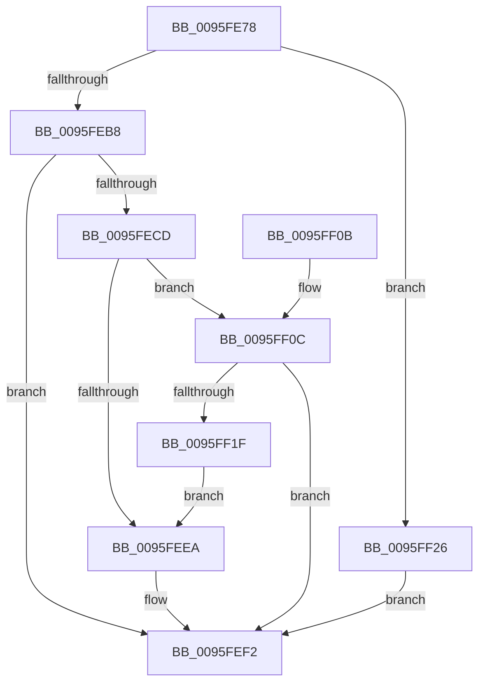

# PfSnScanCommandLine

- RVA: `0x0095FE78`–`0x0095FF2D` (길이 `181` bytes)
- VA: `0x000000014095FE78`
- 실행 섹션: `PAGE`
- PDB 이름 있음: `예`; PDB Function 태그: `아니요`
- unwind 정보 RVA: `0x00093090`
- 디코드: `55`개 명령, `181/181` bytes 표시
- 미해석 바이트: `0` (있으면 어셈블리에 `.byte`로 보존)

> 이 문서는 커널 이미지의 기계어와 PDB 기호를 분석해 생성했습니다. 4번과 5번은 함수 원형과 자료형을 바이너리 사용 방식에서 추정한 C 해석이며 원본 소스 복구 결과는 아닙니다.

## 1. Dependencies

- 직접 호출 지점: **4**; 고유 호출 대상: **4**
- 직접 호출자로 확인된 함수: **2**
- RIP 상대 이미지 참조: **0**

### Outgoing calls
- `0x0095FEAE` → [PfSnGetUnsafeProcessParameters](../96/PfSnGetUnsafeProcessParameters_function_00960878.md) (function, `0x00960878`)
- `0x0095FEC4` → [PfSnCaptureParamBlockString](../96/PfSnCaptureParamBlockString_function_009608DC.md) (function, `0x009608DC`)
- `0x0095FED7` → [PfSnParsePrefetchParam](../96/PfSnParsePrefetchParam_function_0096092C.md) (function, `0x0096092C`)
- `0x0095FF16` → [PfSnHashUnsafeUnicodeString](../A7/PfSnHashUnsafeUnicodeString_function_00A701F0.md) (function, `0x00A701F0`)

### Direct callers
- [PfSnBeginAppLaunch](PfSnBeginAppLaunch_function_0095EC44.md) at `0x0095ED95`
- [PfSnCalculateScenarioNameAndHash](PfSnCalculateScenarioNameAndHash_function_0095FD18.md) at `0x0095FDF0`

### Static image references
- 디코드된 RIP-relative 메모리 참조가 없습니다.

## 2. Other-region calls and transfers

- 다른 실행 섹션으로 향하는 call: **0**
- 별도 외부 분기/꼬리 이동을 확인하지 못했습니다.

## 3. Assembly (complete function range)

```asm
0095FE78  48 8B C4                        mov rax, rsp
0095FE7B  48 89 58 08                     mov qword ptr [rax + 8], rbx
0095FE7F  48 89 68 10                     mov qword ptr [rax + 0x10], rbp
0095FE83  48 89 70 18                     mov qword ptr [rax + 0x18], rsi
0095FE87  57                              push rdi
0095FE88  41 56                           push r14
0095FE8A  41 57                           push r15
0095FE8C  48 83 EC 40                     sub rsp, 0x40
0095FE90  45 33 FF                        xor r15d, r15d
0095FE93  0F 57 C0                        xorps xmm0, xmm0
0095FE96  0F 11 40 D0                     movups xmmword ptr [rax - 0x30], xmm0
0095FE9A  4C 89 78 C8                     mov qword ptr [rax - 0x38], r15
0095FE9E  41 8B DF                        mov ebx, r15d
0095FEA1  44 89 78 20                     mov dword ptr [rax + 0x20], r15d
0095FEA5  41 8B E8                        mov ebp, r8d
0095FEA8  48 8B F2                        mov rsi, rdx
0095FEAB  4C 8B F1                        mov r14, rcx
0095FEAE  E8 C5 09 00 00                  call 0x140960878
0095FEB3  48 85 C0                        test rax, rax
0095FEB6  74 6E                           je 0x14095ff26
0095FEB8  48 8D 50 70                     lea rdx, [rax + 0x70]
0095FEBC  48 8B C8                        mov rcx, rax
0095FEBF  4C 8D 44 24 28                  lea r8, [rsp + 0x28]
0095FEC4  E8 13 0A 00 00                  call 0x1409608dc
0095FEC9  85 C0                           test eax, eax
0095FECB  78 25                           js 0x14095fef2
0095FECD  48 8D 54 24 78                  lea rdx, [rsp + 0x78]
0095FED2  48 8D 4C 24 28                  lea rcx, [rsp + 0x28]
0095FED7  E8 50 0A 00 00                  call 0x14096092c
0095FEDC  8B 7C 24 78                     mov edi, dword ptr [rsp + 0x78]
0095FEE0  85 C0                           test eax, eax
0095FEE2  41 0F 48 FF                     cmovs edi, r15d
0095FEE6  85 ED                           test ebp, ebp
0095FEE8  75 22                           jne 0x14095ff0c
0095FEEA  41 89 1E                        mov dword ptr [r14], ebx
0095FEED  41 8B C7                        mov eax, r15d
0095FEF0  89 3E                           mov dword ptr [rsi], edi
0095FEF2  48 8B 5C 24 60                  mov rbx, qword ptr [rsp + 0x60]
0095FEF7  48 8B 6C 24 68                  mov rbp, qword ptr [rsp + 0x68]
0095FEFC  48 8B 74 24 70                  mov rsi, qword ptr [rsp + 0x70]
0095FF01  48 83 C4 40                     add rsp, 0x40
0095FF05  41 5F                           pop r15
0095FF07  41 5E                           pop r14
0095FF09  5F                              pop rdi
0095FF0A  C3                              ret
0095FF0B  CC                              int3
0095FF0C  48 8D 54 24 20                  lea rdx, [rsp + 0x20]
0095FF11  48 8D 4C 24 28                  lea rcx, [rsp + 0x28]
0095FF16  E8 D5 02 11 00                  call 0x140a701f0
0095FF1B  85 C0                           test eax, eax
0095FF1D  78 D3                           js 0x14095fef2
0095FF1F  48 8B 5C 24 20                  mov rbx, qword ptr [rsp + 0x20]
0095FF24  EB C4                           jmp 0x14095feea
0095FF26  B8 89 01 00 C0                  mov eax, 0xc0000189
0095FF2B  EB C5                           jmp 0x14095fef2
```

## 4. C-style interpretation (structured pseudocode)

```c
__int64 __fastcall PfSnScanCommandLine(__int64 a1, __int64 a2, int a3)
{
    __int64 result;
    __int64 v_r15;
    __int64 v_rdi;
    __int64 v_rsp;
    unsigned __int64 v_stack_m30;
    unsigned __int64 v_stack_p10;
    unsigned __int64 v_stack_p18;
    unsigned __int64 v_stack_p20;
    unsigned __int64 v_stack_p28;
    unsigned __int64 v_stack_p8;

    *(unsigned __int64 *)(v_rsp + 8) = v_rbx;
    *(unsigned __int64 *)(v_rsp + 16) = v_rbp;
    *(unsigned __int64 *)(v_rsp + 24) = v_rsi;
    v_rsp = (v_rsp) - (64);
    v_r15 = 0;
    *(unsigned __int64 *)(v_rsp - 48) = v_xmm0;
    *(unsigned __int64 *)(v_rsp - 56) = 0;
    *(unsigned int *)(v_rsp + 32) = 0;
    result = PfSnGetUnsafeProcessParameters(a1, a2, a3, a4);
    if (result == 0) goto loc_0095FF26;
    result = PfSnCaptureParamBlockString(result, result + 112, v_stack_m30, a4);
    if (sign_flag) goto loc_0095FEF2;
    result = PfSnParsePrefetchParam(v_stack_m30, v_stack_p20, v_stack_m30, a4);
    v_rdi = (unsigned int)(v_stack_p20);
    if (sign_flag) { v_rdi = 0; }
    if ((unsigned int)((unsigned int)(a3)) != 0) goto loc_0095FF0C;
loc_0095FEEA:
    *(unsigned int *)(a1) = 0;
    *(unsigned int *)(a2) = (unsigned int)(v_rdi);
loc_0095FEF2:
    v_rsp = (v_rsp) + (64);
    return 0;
loc_0095FF0C:
    result = PfSnHashUnsafeUnicodeString(v_stack_p28, v_stack_p20, v_stack_m30, a4);
    if (sign_flag) goto loc_0095FEF2;
    goto loc_0095FEEA;
loc_0095FF26:
    goto loc_0095FEF2;
}
```

## 5. (Beta) C Style

```c
int64_t PfSnScanCommandLine(void *Arg1, void *Arg2, int32_t Arg3)
{
    uint8_t *arg1 = (uint8_t *)Arg1;
    uint8_t *arg2 = (uint8_t *)Arg2;

    int64_t result;
    int64_t local_r15;
    int64_t local_rdi;
    int64_t local_rsp;
    uint64_t v_stack_m30;
    uint64_t v_stack_p10;
    uint64_t v_stack_p18;
    uint64_t v_stack_p20;
    uint64_t v_stack_p28;
    uint64_t v_stack_p8;

    *(uint64_t *)(local_rsp + 0x8) = local_rbx;
    *(uint64_t *)(local_rsp + 0x10) = local_rbp;
    *(uint64_t *)(local_rsp + 0x18) = local_rsi;
    local_rsp = (local_rsp) - (64);
    local_r15 = 0;
    *(uint64_t *)(local_rsp - 0x30) = v_xmm0;
    *(uint64_t *)(local_rsp - 0x38) = 0;
    *(uint32_t *)(local_rsp + 0x20) = 0;
    result = PfSnGetUnsafeProcessParameters(Arg1, Arg2, Arg3, a4);
    if (result == 0) goto loc_0095FF26;
    result = PfSnCaptureParamBlockString(result, result + 112, v_stack_m30, a4);
    if (sign_flag) goto loc_0095FEF2;
    result = PfSnParsePrefetchParam(v_stack_m30, v_stack_p20, v_stack_m30, a4);
    local_rdi = (uint32_t)(v_stack_p20);
    if (sign_flag) { local_rdi = 0; }
    if ((uint32_t)((uint32_t)(Arg3)) != 0) goto loc_0095FF0C;
loc_0095FEEA:
    *(uint32_t *)(arg1) = 0;
    *(uint32_t *)(arg2) = (uint32_t)(local_rdi);
loc_0095FEF2:
    local_rsp = (local_rsp) + (64);
    return 0;
loc_0095FF0C:
    result = PfSnHashUnsafeUnicodeString(v_stack_p28, v_stack_p20, v_stack_m30, a4);
    if (sign_flag) goto loc_0095FEF2;
    goto loc_0095FEEA;
loc_0095FF26:
    goto loc_0095FEF2;
}
```

### 관측된 메모리 오프셋

구조체 형식이 확인되지 않은 접근은 인자 기준의 오프셋으로만 기록했습니다.

| 기준 인자 | 오프셋 표현 | 폭 (bit) | 접근 |
|---|---:|---:|---|
| `Arg1` | `+ 0x0` | `32` | `W` |
| `Arg2` | `+ 0x0` | `32` | `W` |

## 6. Execution-region graph

[열기: 2D/3D 그래프와 함수 탐색 컨트롤 패널](../../../control-panel.html?section=page&rva=0x0095FE78&view=graph)

- 2D 그래프는 위에서 아래로 흐르고, 3D 그래프는 빈 공간을 드래그해 회전합니다. Shift+드래그는 이동, 휠은 확대·축소, 함수 노드 선택은 대상 보고서 이동입니다.

### Static fallback


