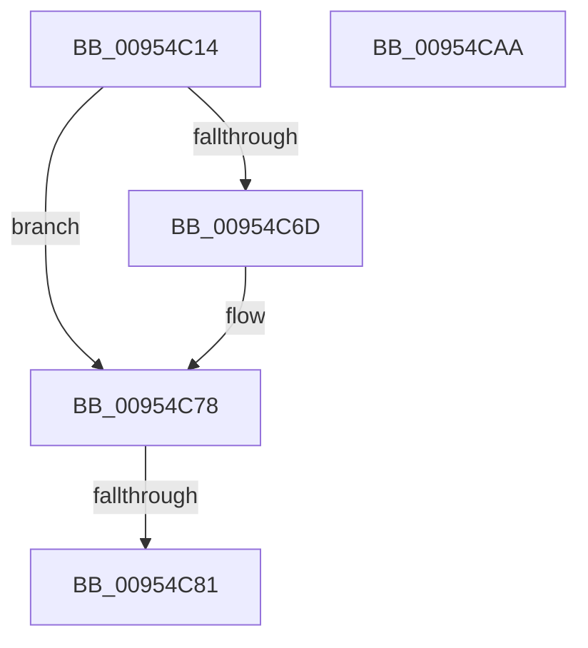

# PiDcHandleCustomDeviceEvent

- RVA: `0x00954C14`–`0x00954CAB` (길이 `151` bytes)
- VA: `0x0000000140954C14`
- 실행 섹션: `PAGE`
- PDB 이름 있음: `예`; PDB Function 태그: `예`
- unwind 정보 RVA: `0x0009226C`
- 디코드: `37`개 명령, `151/151` bytes 표시
- 미해석 바이트: `0` (있으면 어셈블리에 `.byte`로 보존)

> 이 문서는 커널 이미지의 기계어와 PDB 기호를 분석해 생성했습니다. 4번과 5번은 함수 원형과 자료형을 바이너리 사용 방식에서 추정한 C 해석이며 원본 소스 복구 결과는 아닙니다.

## 1. Dependencies

- 직접 호출 지점: **1**; 고유 호출 대상: **1**
- 직접 호출자로 확인된 함수: **1**
- RIP 상대 이미지 참조: **3**

### Outgoing calls
- `0x00954C8D` → [_security_check_cookie](../../text/6A/_security_check_cookie_function_006AC640.md) (function, `0x006AC640`)

### Direct callers
- [PnpProcessCustomDeviceEvent](PnpProcessCustomDeviceEvent_function_00954734.md) at `0x00954757`

### Static image references
- `0x00954C31` → RVA `0x00E0A740` (`.data`; read)
- `0x00954C64` → RVA `0x00012330` (`.rdata`; read)
- `0x00954C71` → RVA `0x00012338` (`.rdata`; read)

## 2. Other-region calls and transfers

- 다른 실행 섹션으로 향하는 call: **1**
  - `0x00954C8D` → [_security_check_cookie](../../text/6A/_security_check_cookie_function_006AC640.md) (`PAGE` → `.text`)
- call이 아닌 외부 분기/꼬리 이동: **1**
  - `0x00954C7B` → [sub_00B266CA](../B2/Unknown_function_00B266CA.md) (`tail-transfer`)

## 3. Assembly (complete function range)

```asm
00954C14  48 89 5C 24 10                  mov qword ptr [rsp + 0x10], rbx
00954C19  48 89 74 24 18                  mov qword ptr [rsp + 0x18], rsi
00954C1E  55                              push rbp
00954C1F  57                              push rdi
00954C20  41 56                           push r14
00954C22  48 8D AC 24 50 FF FF FF         lea rbp, [rsp - 0xb0]
00954C2A  48 81 EC B0 01 00 00            sub rsp, 0x1b0
00954C31  48 8B 05 08 5B 4B 00            mov rax, qword ptr [rip + 0x4b5b08]
00954C38  48 33 C4                        xor rax, rsp
00954C3B  48 89 85 A0 00 00 00            mov qword ptr [rbp + 0xa0], rax
00954C42  33 DB                           xor ebx, ebx
00954C44  48 8B F9                        mov rdi, rcx
00954C47  48 21 5C 24 48                  and qword ptr [rsp + 0x48], rbx
00954C4C  21 5C 24 40                     and dword ptr [rsp + 0x40], ebx
00954C50  21 5C 24 44                     and dword ptr [rsp + 0x44], ebx
00954C54  48 8B 89 A8 00 00 00            mov rcx, qword ptr [rcx + 0xa8]
00954C5B  48 21 5C 24 50                  and qword ptr [rsp + 0x50], rbx
00954C60  48 8B 41 04                     mov rax, qword ptr [rcx + 4]
00954C64  48 2B 05 C5 D6 6B FF            sub rax, qword ptr [rip - 0x94293b]
00954C6B  75 0B                           jne 0x140954c78
00954C6D  48 8B 41 0C                     mov rax, qword ptr [rcx + 0xc]
00954C71  48 2B 05 C0 D6 6B FF            sub rax, qword ptr [rip - 0x942940]
00954C78  48 85 C0                        test rax, rax
00954C7B  0F 84 49 1A 1D 00               je 0x140b266ca
00954C81  8B C3                           mov eax, ebx
00954C83  48 8B 8D A0 00 00 00            mov rcx, qword ptr [rbp + 0xa0]
00954C8A  48 33 CC                        xor rcx, rsp
00954C8D  E8 AE 79 D5 FF                  call 0x1406ac640
00954C92  4C 8D 9C 24 B0 01 00 00         lea r11, [rsp + 0x1b0]
00954C9A  49 8B 5B 28                     mov rbx, qword ptr [r11 + 0x28]
00954C9E  49 8B 73 30                     mov rsi, qword ptr [r11 + 0x30]
00954CA2  49 8B E3                        mov rsp, r11
00954CA5  41 5E                           pop r14
00954CA7  5F                              pop rdi
00954CA8  5D                              pop rbp
00954CA9  C3                              ret
00954CAA  CC                              int3
```

## 4. C-style interpretation (structured pseudocode)

```c
__int64 __fastcall PiDcHandleCustomDeviceEvent(__int64 a1)
{
    __int64 result;
    __int64 v_rbx;
    __int64 v_rsp;
    unsigned __int64 v_stack_m178;
    unsigned __int64 v_stack_m18;
    unsigned __int64 v_stack_m180;
    unsigned int v_stack_m184;
    unsigned int v_stack_m188;
    unsigned __int64 v_stack_m28;
    unsigned __int64 v_stack_mC8;
    unsigned __int64 v_stack_p10;
    unsigned __int64 v_stack_p18;

    v_stack_p10 = v_rbx;
    v_stack_p18 = v_rsi;
    v_rsp = (v_rsp) - (432);
    result = (*(unsigned __int64 *)(v_rip + 4938504)) ^ (v_rsp);
    v_stack_m28 = result;
    v_rbx = 0;
    result = (*(unsigned __int64 *)(*(unsigned __int64 *)(a1 + 168) + 4)) - (*(unsigned __int64 *)(v_rip - 9709883));
    if (!(condition_is_not_equal)) {
        result = *(unsigned __int64 *)(*(unsigned __int64 *)(a1 + 168) + 12);
        result = (result) - (*(unsigned __int64 *)(v_rip - 9709888));
    }
    a1 = (v_stack_m28) ^ (v_rsp);
    result = _security_check_cookie(a1, a2, a3, a4);
    return result;
}
```

## 5. (Beta) C Style

```c
int64_t PiDcHandleCustomDeviceEvent(void *Arg1)
{
    uint8_t *arg1 = (uint8_t *)Arg1;

    int64_t result;
    int64_t local_rbx;
    int64_t local_rsp;
    uint64_t v_stack_m178;
    uint64_t v_stack_m18;
    uint64_t v_stack_m180;
    uint32_t v_stack_m184;
    uint32_t v_stack_m188;
    uint64_t v_stack_m28;
    uint64_t v_stack_mC8;
    uint64_t v_stack_p10;
    uint64_t v_stack_p18;

    v_stack_p10 = local_rbx;
    v_stack_p18 = local_rsi;
    local_rsp = (local_rsp) - (432);
    result = (*(uint64_t *)(v_rip + 0x4B5B08)) ^ (local_rsp);
    v_stack_m28 = result;
    local_rbx = 0;
    result = (*(uint64_t *)(*(uint64_t *)(arg1 + 0xA8) + 0x4)) - (*(uint64_t *)(v_rip - 0x94293B));
    if (!(condition_is_not_equal)) {
        result = *(uint64_t *)(*(uint64_t *)(arg1 + 0xA8) + 0xC);
        result = (result) - (*(uint64_t *)(v_rip - 0x942940));
    }
    Arg1 = (v_stack_m28) ^ (local_rsp);
    result = _security_check_cookie(Arg1, a2, a3, a4);
    return result;
}
```

### 관측된 메모리 오프셋

구조체 형식이 확인되지 않은 접근은 인자 기준의 오프셋으로만 기록했습니다.

| 기준 인자 | 오프셋 표현 | 폭 (bit) | 접근 |
|---|---:|---:|---|
| `Arg1` | `+ 0xA8` | `64` | `R` |

## 6. Execution-region graph

[열기: 2D/3D 그래프와 함수 탐색 컨트롤 패널](../../../control-panel.html?section=page&rva=0x00954C14&view=graph)

- 2D 그래프는 위에서 아래로 흐르고, 3D 그래프는 빈 공간을 드래그해 회전합니다. Shift+드래그는 이동, 휠은 확대·축소, 함수 노드 선택은 대상 보고서 이동입니다.

### Static fallback


