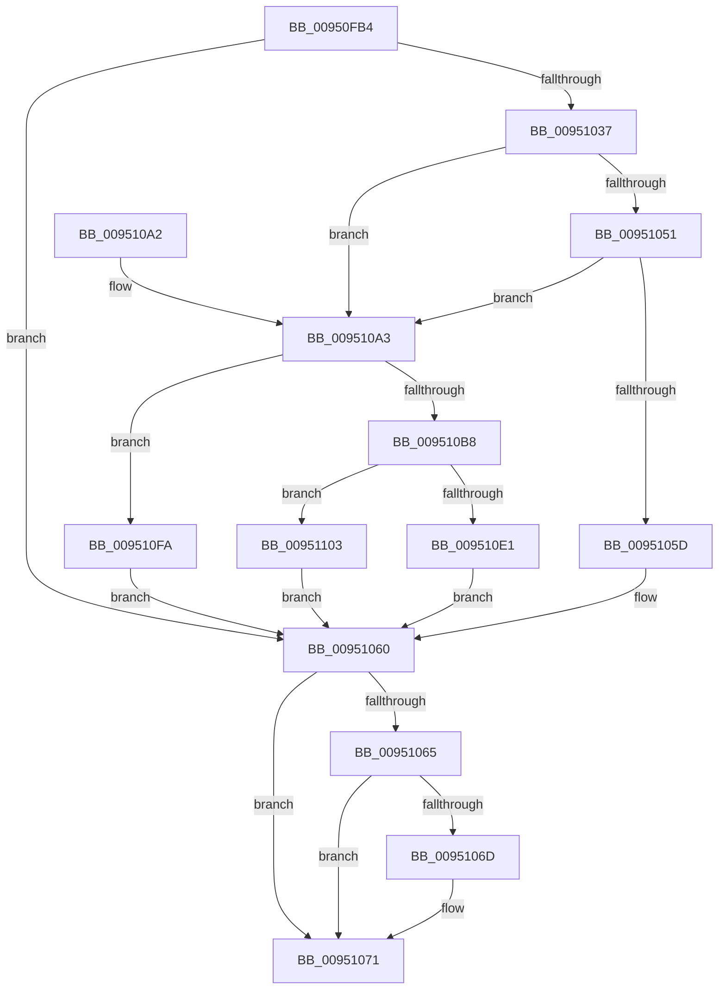

# PiDmAddCacheReferenceForObject

- RVA: `0x00950FB4`–`0x00951113` (길이 `351` bytes)
- VA: `0x0000000140950FB4`
- 실행 섹션: `PAGE`
- PDB 이름 있음: `예`; PDB Function 태그: `아니요`
- unwind 정보 RVA: `0x00091CB8`
- 디코드: `103`개 명령, `351/351` bytes 표시
- 미해석 바이트: `0` (있으면 어셈블리에 `.byte`로 보존)

> 이 문서는 커널 이미지의 기계어와 PDB 기호를 분석해 생성했습니다. 4번과 5번은 함수 원형과 자료형을 바이너리 사용 방식에서 추정한 C 해석이며 원본 소스 복구 결과는 아닙니다.

## 1. Dependencies

- 직접 호출 지점: **10**; 고유 호출 대상: **10**
- 직접 호출자로 확인된 함수: **6**
- RIP 상대 이미지 참조: **1**

### Outgoing calls
- `0x00950FF7` → [memset](../../text/6C/memset_function_006C6C40.md) (function, `0x006C6C40`)
- `0x00951012` → [PiDmGetObjectManagerForObjectType](PiDmGetObjectManagerForObjectType_function_00951140.md) (function, `0x00951140`)
- `0x0095101D` → [PiDmObjectManagerAcquireExclusiveLock](PiDmObjectManagerAcquireExclusiveLock_function_00951334.md) (function, `0x00951334`)
- `0x0095102C` → [PiDmInitializeComparisonObject](PiDmInitializeComparisonObject_function_009511D0.md) (function, `0x009511D0`)
- `0x00951047` → [RtlLookupElementGenericTableFullAvl](../../text/3E/RtlLookupElementGenericTableFullAvl_function_003EF460.md) (function, `0x003EF460`)
- `0x00951074` → [PiDmObjectManagerReleaseLock](PiDmObjectManagerReleaseLock_function_0095111C.md) (function, `0x0095111C`)
- `0x00951082` → [_security_check_cookie](../../text/6A/_security_check_cookie_function_006AC640.md) (function, `0x006AC640`)
- `0x009510AD` → [PiDmObjectCreate](../94/PiDmObjectCreate_function_0094F5CC.md) (function, `0x0094F5CC`)
- `0x009510D7` → [RtlInsertElementGenericTableFullAvl](../../text/3E/RtlInsertElementGenericTableFullAvl_function_003EED00.md) (function, `0x003EED00`)
- `0x009510E5` → [PiDmObjectRelease](../8E/PiDmObjectRelease_function_008E4F70.md) (function, `0x008E4F70`)

### Direct callers
- [PiPnpRtlEnsureObjectCached](../72/PiPnpRtlEnsureObjectCached_function_0072F928.md) at `0x0072F993`
- [PiDmListInitEnumCallback](../73/PiDmListInitEnumCallback_function_007302E0.md) at `0x0073040D`
- [PiPnpRtlCmActionCallback](../8E/PiPnpRtlCmActionCallback_function_008EF110.md) at `0x008EF41F`
- [IopRegisterDeviceInterface](IopRegisterDeviceInterface_function_009501B0.md) at `0x00950342`
- [IopRegisterDeviceInterface](IopRegisterDeviceInterface_function_009501B0.md) at `0x00950362`
- [IopRegisterDeviceInterface](IopRegisterDeviceInterface_function_009501B0.md) at `0x00950416`
- [IopProcessSetInterfaceState](IopProcessSetInterfaceState_function_00950964.md) at `0x00950C2E`
- [PiPnpRtlGatherInstallerClassChangeInfo](../AD/PiPnpRtlGatherInstallerClassChangeInfo_function_00AD26FC.md) at `0x00AD276C`

### Static image references
- `0x00950FD0` → RVA `0x00E0A740` (`.data`; read)

## 2. Other-region calls and transfers

- 다른 실행 섹션으로 향하는 call: **4**
  - `0x00950FF7` → [memset](../../text/6C/memset_function_006C6C40.md) (`PAGE` → `.text`)
  - `0x00951047` → [RtlLookupElementGenericTableFullAvl](../../text/3E/RtlLookupElementGenericTableFullAvl_function_003EF460.md) (`PAGE` → `.text`)
  - `0x00951082` → [_security_check_cookie](../../text/6A/_security_check_cookie_function_006AC640.md) (`PAGE` → `.text`)
  - `0x009510D7` → [RtlInsertElementGenericTableFullAvl](../../text/3E/RtlInsertElementGenericTableFullAvl_function_003EED00.md) (`PAGE` → `.text`)
- 별도 외부 분기/꼬리 이동을 확인하지 못했습니다.

## 3. Assembly (complete function range)

```asm
00950FB4  48 89 5C 24 20                  mov qword ptr [rsp + 0x20], rbx
00950FB9  55                              push rbp
00950FBA  56                              push rsi
00950FBB  57                              push rdi
00950FBC  41 54                           push r12
00950FBE  41 55                           push r13
00950FC0  41 56                           push r14
00950FC2  41 57                           push r15
00950FC4  48 8D 6C 24 D9                  lea rbp, [rsp - 0x27]
00950FC9  48 81 EC D0 00 00 00            sub rsp, 0xd0
00950FD0  48 8B 05 69 97 4B 00            mov rax, qword ptr [rip + 0x4b9769]
00950FD7  48 33 C4                        xor rax, rsp
00950FDA  48 89 45 17                     mov qword ptr [rbp + 0x17], rax
00950FDE  33 DB                           xor ebx, ebx
00950FE0  4D 8B F0                        mov r14, r8
00950FE3  4C 8B EA                        mov r13, rdx
00950FE6  48 89 5D A7                     mov qword ptr [rbp - 0x59], rbx
00950FEA  44 8B E1                        mov r12d, ecx
00950FED  33 D2                           xor edx, edx
00950FEF  48 8D 4D AF                     lea rcx, [rbp - 0x51]
00950FF3  44 8D 43 68                     lea r8d, [rbx + 0x68]
00950FF7  E8 44 5C D7 FF                  call 0x1406c6c40
00950FFC  48 8D 45 A7                     lea rax, [rbp - 0x59]
00951000  48 89 5D 97                     mov qword ptr [rbp - 0x69], rbx
00951004  41 8B CC                        mov ecx, r12d
00951007  48 89 45 9F                     mov qword ptr [rbp - 0x61], rax
0095100B  89 5D 8F                        mov dword ptr [rbp - 0x71], ebx
0095100E  48 89 5D 87                     mov qword ptr [rbp - 0x79], rbx
00951012  E8 29 01 00 00                  call 0x140951140
00951017  48 8B C8                        mov rcx, rax
0095101A  4C 8B F8                        mov r15, rax
0095101D  E8 12 03 00 00                  call 0x140951334
00951022  4C 8D 45 A7                     lea r8, [rbp - 0x59]
00951026  41 8B D4                        mov edx, r12d
00951029  49 8B CD                        mov rcx, r13
0095102C  E8 9F 01 00 00                  call 0x1409511d0
00951031  8B F8                           mov edi, eax
00951033  85 C0                           test eax, eax
00951035  78 29                           js 0x140951060
00951037  4C 8D 4D 8F                     lea r9, [rbp - 0x71]
0095103B  4C 8D 45 97                     lea r8, [rbp - 0x69]
0095103F  48 8D 55 9F                     lea rdx, [rbp - 0x61]
00951043  49 8D 4F 68                     lea rcx, [r15 + 0x68]
00951047  E8 14 E4 A9 FF                  call 0x1403ef460
0095104C  48 85 C0                        test rax, rax
0095104F  74 52                           je 0x1409510a3
00951051  48 8B 18                        mov rbx, qword ptr [rax]
00951054  48 89 5D 87                     mov qword ptr [rbp - 0x79], rbx
00951058  48 85 DB                        test rbx, rbx
0095105B  74 46                           je 0x1409510a3
0095105D  FF 43 0C                        inc dword ptr [rbx + 0xc]
00951060  4D 85 F6                        test r14, r14
00951063  74 0C                           je 0x140951071
00951065  49 89 1E                        mov qword ptr [r14], rbx
00951068  48 85 DB                        test rbx, rbx
0095106B  74 04                           je 0x140951071
0095106D  F0 FF 43 08                     lock inc dword ptr [rbx + 8]
00951071  49 8B CF                        mov rcx, r15
00951074  E8 A3 00 00 00                  call 0x14095111c
00951079  8B C7                           mov eax, edi
0095107B  48 8B 4D 17                     mov rcx, qword ptr [rbp + 0x17]
0095107F  48 33 CC                        xor rcx, rsp
00951082  E8 B9 B5 D5 FF                  call 0x1406ac640
00951087  48 8B 9C 24 28 01 00 00         mov rbx, qword ptr [rsp + 0x128]
0095108F  48 81 C4 D0 00 00 00            add rsp, 0xd0
00951096  41 5F                           pop r15
00951098  41 5E                           pop r14
0095109A  41 5D                           pop r13
0095109C  41 5C                           pop r12
0095109E  5F                              pop rdi
0095109F  5E                              pop rsi
009510A0  5D                              pop rbp
009510A1  C3                              ret
009510A2  CC                              int3
009510A3  4C 8D 45 87                     lea r8, [rbp - 0x79]
009510A7  49 8B D5                        mov rdx, r13
009510AA  41 8B CC                        mov ecx, r12d
009510AD  E8 1A E5 FF FF                  call 0x14094f5cc
009510B2  8B F8                           mov edi, eax
009510B4  85 C0                           test eax, eax
009510B6  78 42                           js 0x1409510fa
009510B8  8B 45 8F                        mov eax, dword ptr [rbp - 0x71]
009510BB  48 8D 55 87                     lea rdx, [rbp - 0x79]
009510BF  89 44 24 28                     mov dword ptr [rsp + 0x28], eax
009510C3  49 8D 4F 68                     lea rcx, [r15 + 0x68]
009510C7  48 8B 45 97                     mov rax, qword ptr [rbp - 0x69]
009510CB  45 33 C9                        xor r9d, r9d
009510CE  48 89 44 24 20                  mov qword ptr [rsp + 0x20], rax
009510D3  45 8D 41 08                     lea r8d, [r9 + 8]
009510D7  E8 24 DC A9 FF                  call 0x1403eed00
009510DC  48 85 C0                        test rax, rax
009510DF  75 22                           jne 0x140951103
009510E1  48 8B 4D 87                     mov rcx, qword ptr [rbp - 0x79]
009510E5  E8 86 3E F9 FF                  call 0x1408e4f70
009510EA  33 DB                           xor ebx, ebx
009510EC  BF 9A 00 00 C0                  mov edi, 0xc000009a
009510F1  48 89 5D 87                     mov qword ptr [rbp - 0x79], rbx
009510F5  E9 66 FF FF FF                  jmp 0x140951060
009510FA  48 8B 5D 87                     mov rbx, qword ptr [rbp - 0x79]
009510FE  E9 5D FF FF FF                  jmp 0x140951060
00951103  48 8B 5D 87                     mov rbx, qword ptr [rbp - 0x79]
00951107  C7 43 0C 01 00 00 00            mov dword ptr [rbx + 0xc], 1
0095110E  E9 4D FF FF FF                  jmp 0x140951060
```

## 4. C-style interpretation (structured pseudocode)

```c
__int64 __fastcall PiDmAddCacheReferenceForObject(int a1, __int64 a2, __int64 a3)
{
    __int64 result;
    __int64 v_rbx;
    __int64 v_rsp;
    unsigned __int64 v_stack_m48;
    unsigned __int64 v_stack_m5F;
    unsigned __int64 v_stack_mB0;
    unsigned __int64 v_stack_mB8;
    unsigned __int64 v_stack_mC0;
    unsigned __int64 v_stack_mC8;
    unsigned int v_stack_mD0;
    unsigned __int64 v_stack_mD8;
    unsigned __int64 v_stack_p20;
    unsigned int v_stack_p28;

    v_stack_p20 = v_rbx;
    v_rsp = (v_rsp) - (208);
    result = (*(unsigned __int64 *)(v_rip + 4953961)) ^ (v_rsp);
    v_stack_m48 = result;
    v_rbx = 0;
    v_stack_mB8 = 0;
    a2 = 0;
    result = memset(v_stack_mB0, a2, v_rbx + 104, a4);
    v_stack_mC8 = 0;
    v_stack_mC0 = v_stack_mB8;
    v_stack_mD0 = 0;
    v_stack_mD8 = 0;
    result = PiDmGetObjectManagerForObjectType((unsigned int)((unsigned int)((unsigned int)(a1))), a2, v_rbx + 104, a4);
    result = PiDmObjectManagerAcquireExclusiveLock(result, a2, v_rbx + 104, a4);
    result = PiDmInitializeComparisonObject(0, (unsigned int)((unsigned int)((unsigned int)(a1))), v_stack_mB8, a4);
    if (sign_flag) goto loc_00951060;
    result = RtlLookupElementGenericTableFullAvl(result + 104, v_stack_mC0, v_stack_mC8, v_stack_mD0);
    if (result == 0) goto loc_009510A3;
    v_stack_mD8 = *(unsigned __int64 *)(result);
    if (*(unsigned __int64 *)(result) == 0) goto loc_009510A3;
loc_00951060:
    if (a3 == 0) goto loc_00951071;
    *(unsigned __int64 *)(a3) = *(unsigned __int64 *)(result);
    if (*(unsigned __int64 *)(result) != 0) {
    }
    result = PiDmObjectManagerReleaseLock(result, v_stack_mC0, v_stack_mC8, v_stack_mD0);
    a1 = (v_stack_m48) ^ (v_rsp);
    result = _security_check_cookie(a1, v_stack_mC0, v_stack_mC8, v_stack_mD0);
    v_rsp = (v_rsp) + (208);
    return result;
loc_009510A3:
    result = PiDmObjectCreate((unsigned int)((unsigned int)((unsigned int)(a1))), 0, v_stack_mD8, v_stack_mD0);
    if (sign_flag) goto loc_009510FA;
    v_stack_p28 = (unsigned int)((unsigned int)(v_stack_mD0));
    a4 = 0;
    v_stack_p20 = v_stack_mC8;
    result = RtlInsertElementGenericTableFullAvl(result + 104, v_stack_mD8, a4 + 8, a4);
    if (result != 0) goto loc_00951103;
    result = PiDmObjectRelease(v_stack_mD8, v_stack_mD8, a4 + 8, a4);
    v_rbx = 0;
    v_stack_mD8 = 0;
    goto loc_00951060;
loc_009510FA:
    goto loc_00951060;
loc_00951103:
    *(unsigned int *)(v_stack_mD8 + 12) = 1;
    goto loc_00951060;
}
```

## 5. (Beta) C Style

```c
int64_t PiDmAddCacheReferenceForObject(int32_t Arg1, int64_t Arg2, int64_t Arg3)
{
    int64_t result;
    int64_t local_rbx;
    int64_t local_rsp;
    uint64_t v_stack_m48;
    uint64_t v_stack_m5F;
    uint64_t v_stack_mB0;
    uint64_t v_stack_mB8;
    uint64_t v_stack_mC0;
    uint64_t v_stack_mC8;
    uint32_t v_stack_mD0;
    uint64_t v_stack_mD8;
    uint64_t v_stack_p20;
    uint32_t v_stack_p28;

    v_stack_p20 = local_rbx;
    local_rsp = (local_rsp) - (208);
    result = (*(uint64_t *)(v_rip + 0x4B9769)) ^ (local_rsp);
    v_stack_m48 = result;
    local_rbx = 0;
    v_stack_mB8 = 0;
    Arg2 = 0;
    result = memset(v_stack_mB0, Arg2, local_rbx + 104, a4);
    v_stack_mC8 = 0;
    v_stack_mC0 = v_stack_mB8;
    v_stack_mD0 = 0;
    v_stack_mD8 = 0;
    result = PiDmGetObjectManagerForObjectType((uint32_t)((uint32_t)((uint32_t)(Arg1))), Arg2, local_rbx + 104, a4);
    result = PiDmObjectManagerAcquireExclusiveLock(result, Arg2, local_rbx + 104, a4);
    result = PiDmInitializeComparisonObject(0, (uint32_t)((uint32_t)((uint32_t)(Arg1))), v_stack_mB8, a4);
    if (sign_flag) goto loc_00951060;
    result = RtlLookupElementGenericTableFullAvl(result + 104, v_stack_mC0, v_stack_mC8, v_stack_mD0);
    if (result == 0) goto loc_009510A3;
    v_stack_mD8 = *(uint64_t *)(result);
    if (*(uint64_t *)(result) == 0) goto loc_009510A3;
loc_00951060:
    if (Arg3 == 0) goto loc_00951071;
    *(uint64_t *)(Arg3) = *(uint64_t *)(result);
    if (*(uint64_t *)(result) != 0) {
    }
    result = PiDmObjectManagerReleaseLock(result, v_stack_mC0, v_stack_mC8, v_stack_mD0);
    Arg1 = (v_stack_m48) ^ (local_rsp);
    result = _security_check_cookie(Arg1, v_stack_mC0, v_stack_mC8, v_stack_mD0);
    local_rsp = (local_rsp) + (208);
    return result;
loc_009510A3:
    result = PiDmObjectCreate((uint32_t)((uint32_t)((uint32_t)(Arg1))), 0, v_stack_mD8, v_stack_mD0);
    if (sign_flag) goto loc_009510FA;
    v_stack_p28 = (uint32_t)((uint32_t)(v_stack_mD0));
    a4 = 0;
    v_stack_p20 = v_stack_mC8;
    result = RtlInsertElementGenericTableFullAvl(result + 104, v_stack_mD8, a4 + 8, a4);
    if (result != 0) goto loc_00951103;
    result = PiDmObjectRelease(v_stack_mD8, v_stack_mD8, a4 + 8, a4);
    local_rbx = 0;
    v_stack_mD8 = 0;
    goto loc_00951060;
loc_009510FA:
    goto loc_00951060;
loc_00951103:
    *(uint32_t *)(v_stack_mD8 + 0xC) = 1;
    goto loc_00951060;
}
```

## 6. Execution-region graph

[열기: 2D/3D 그래프와 함수 탐색 컨트롤 패널](../../../control-panel.html?section=page&rva=0x00950FB4&view=graph)

- 2D 그래프는 위에서 아래로 흐르고, 3D 그래프는 빈 공간을 드래그해 회전합니다. Shift+드래그는 이동, 휠은 확대·축소, 함수 노드 선택은 대상 보고서 이동입니다.

### Static fallback


