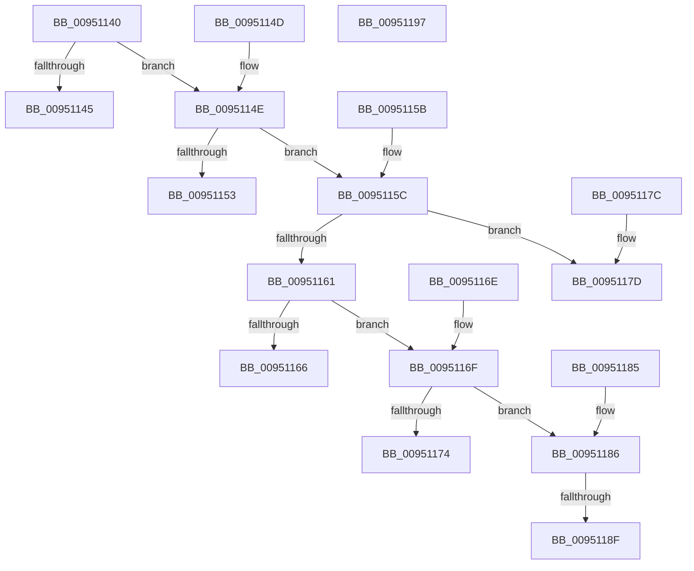

# PiDmGetObjectManagerForObjectType

- RVA: `0x00951140`–`0x00951198` (길이 `88` bytes)
- VA: `0x0000000140951140`
- 실행 섹션: `PAGE`
- PDB 이름 있음: `예`; PDB Function 태그: `예`
- unwind 정보 RVA: `0x000DB714`
- 디코드: `30`개 명령, `88/88` bytes 표시
- 미해석 바이트: `0` (있으면 어셈블리에 `.byte`로 보존)

> 이 문서는 커널 이미지의 기계어와 PDB 기호를 분석해 생성했습니다. 4번과 5번은 함수 원형과 자료형을 바이너리 사용 방식에서 추정한 C 해석이며 원본 소스 복구 결과는 아닙니다.

## 1. Dependencies

- 직접 호출 지점: **0**; 고유 호출 대상: **0**
- 직접 호출자로 확인된 함수: **8**
- RIP 상대 이미지 참조: **6**

### Outgoing calls
- 직접 디코드된 call 명령이 없습니다.

### Direct callers
- [PiDmListRemoveObject](../70/PiDmListRemoveObject_function_007045E8.md) at `0x0070460F`
- [PiDmListRemoveList](../73/PiDmListRemoveList_function_00730474.md) at `0x00730495`
- [PiDqQueryAppendActionEntry](../8D/PiDqQueryAppendActionEntry_function_008DEB34.md) at `0x008DEB9F`
- [PiDmEnumObjectsWithCallback](../8E/PiDmEnumObjectsWithCallback_function_008E3920.md) at `0x008E3988`
- [PiDmListAddList](../94/PiDmListAddList_function_0094F4F8.md) at `0x0094F519`
- [PiDmListAddObject](PiDmListAddObject_function_00950128.md) at `0x0095014F`
- [PiDmRemoveCacheReferenceForObject](PiDmRemoveCacheReferenceForObject_function_00950F24.md) at `0x00950F3D`
- [PiDmAddCacheReferenceForObject](PiDmAddCacheReferenceForObject_function_00950FB4.md) at `0x00951012`

### Static image references
- `0x00951145` → RVA `0x00F8B7A0` (`.data`; read)
- `0x00951153` → RVA `0x00F8B880` (`.data`; read)
- `0x00951166` → RVA `0x00F8B6C0` (`.data`; read)
- `0x00951174` → RVA `0x00F8B5E0` (`.data`; read)
- `0x0095117D` → RVA `0x00F8B500` (`.data`; read)
- `0x0095118F` → RVA `0x00F8B420` (`.data`; read)

## 2. Other-region calls and transfers

- 다른 실행 섹션으로 향하는 call: **0**
- call이 아닌 외부 분기/꼬리 이동: **1**
  - `0x00951189` → `0x00B26246` (`tail-transfer`)

## 3. Assembly (complete function range)

```asm
00951140  83 F9 03                        cmp ecx, 3
00951143  75 09                           jne 0x14095114e
00951145  48 8D 05 54 A6 63 00            lea rax, [rip + 0x63a654]
0095114C  C3                              ret
0095114D  CC                              int3
0095114E  83 E9 01                        sub ecx, 1
00951151  75 09                           jne 0x14095115c
00951153  48 8D 05 26 A7 63 00            lea rax, [rip + 0x63a726]
0095115A  C3                              ret
0095115B  CC                              int3
0095115C  83 E9 01                        sub ecx, 1
0095115F  74 1C                           je 0x14095117d
00951161  83 E9 02                        sub ecx, 2
00951164  75 09                           jne 0x14095116f
00951166  48 8D 05 53 A5 63 00            lea rax, [rip + 0x63a553]
0095116D  C3                              ret
0095116E  CC                              int3
0095116F  83 E9 01                        sub ecx, 1
00951172  75 12                           jne 0x140951186
00951174  48 8D 05 65 A4 63 00            lea rax, [rip + 0x63a465]
0095117B  C3                              ret
0095117C  CC                              int3
0095117D  48 8D 05 7C A3 63 00            lea rax, [rip + 0x63a37c]
00951184  C3                              ret
00951185  CC                              int3
00951186  83 F9 01                        cmp ecx, 1
00951189  0F 85 B7 50 1D 00               jne 0x140b26246
0095118F  48 8D 05 8A A2 63 00            lea rax, [rip + 0x63a28a]
00951196  C3                              ret
00951197  CC                              int3
```

## 4. C-style interpretation (structured pseudocode)

```c
__int64 __fastcall PiDmGetObjectManagerForObjectType(int a1)
{
    if (a1 != 3) goto loc_0095114E;
    return v_rip + 6530644;
loc_0095114E:
    a1 = (unsigned int)((a1) - (1));
    if (condition_is_not_equal) goto loc_0095115C;
    return v_rip + 6530854;
loc_0095115C:
    a1 = (unsigned int)((a1) - (1));
    if (condition_is_equal) goto loc_0095117D;
    a1 = (unsigned int)((a1) - (2));
    if (condition_is_not_equal) goto loc_0095116F;
    return v_rip + 6530387;
loc_0095116F:
    a1 = (unsigned int)((a1) - (1));
    if (condition_is_not_equal) goto loc_00951186;
    return v_rip + 6530149;
loc_0095117D:
    return v_rip + 6529916;
loc_00951186:
    return v_rip + 6529674;
}
```

## 5. (Beta) C Style

```c
int64_t PiDmGetObjectManagerForObjectType(int32_t Arg1)
{
    if (Arg1 != 3) goto loc_0095114E;
    return v_rip + 6530644;
loc_0095114E:
    Arg1 = (uint32_t)((Arg1) - (1));
    if (condition_is_not_equal) goto loc_0095115C;
    return v_rip + 6530854;
loc_0095115C:
    Arg1 = (uint32_t)((Arg1) - (1));
    if (condition_is_equal) goto loc_0095117D;
    Arg1 = (uint32_t)((Arg1) - (2));
    if (condition_is_not_equal) goto loc_0095116F;
    return v_rip + 6530387;
loc_0095116F:
    Arg1 = (uint32_t)((Arg1) - (1));
    if (condition_is_not_equal) goto loc_00951186;
    return v_rip + 6530149;
loc_0095117D:
    return v_rip + 6529916;
loc_00951186:
    return v_rip + 6529674;
}
```

## 6. Execution-region graph

[열기: 2D/3D 그래프와 함수 탐색 컨트롤 패널](../../../control-panel.html?section=page&rva=0x00951140&view=graph)

- 2D 그래프는 위에서 아래로 흐르고, 3D 그래프는 빈 공간을 드래그해 회전합니다. Shift+드래그는 이동, 휠은 확대·축소, 함수 노드 선택은 대상 보고서 이동입니다.

### Static fallback


