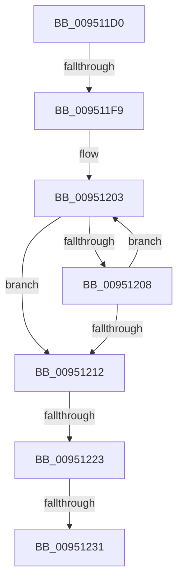

# PiDmInitializeComparisonObject

- RVA: `0x009511D0`–`0x0095123B` (길이 `107` bytes)
- VA: `0x00000001409511D0`
- 실행 섹션: `PAGE`
- PDB 이름 있음: `예`; PDB Function 태그: `아니요`
- unwind 정보 RVA: `0x00091CE0`
- 디코드: `30`개 명령, `107/107` bytes 표시
- 미해석 바이트: `0` (있으면 어셈블리에 `.byte`로 보존)

> 이 문서는 커널 이미지의 기계어와 PDB 기호를 분석해 생성했습니다. 4번과 5번은 함수 원형과 자료형을 바이너리 사용 방식에서 추정한 C 해석이며 원본 소스 복구 결과는 아닙니다.

## 1. Dependencies

- 직접 호출 지점: **0**; 고유 호출 대상: **0**
- 직접 호출자로 확인된 함수: **1**
- RIP 상대 이미지 참조: **0**

### Outgoing calls
- 직접 디코드된 call 명령이 없습니다.

### Direct callers
- [PiDmAddCacheReferenceForObject](PiDmAddCacheReferenceForObject_function_00950FB4.md) at `0x0095102C`

### Static image references
- 디코드된 RIP-relative 메모리 참조가 없습니다.

## 2. Other-region calls and transfers

- 다른 실행 섹션으로 향하는 call: **0**
- call이 아닌 외부 분기/꼬리 이동: **4**
  - `0x009511F3` → [sub_009512F9 + 0x17](Unknown_function_009512F9.md) (`tail-transfer`)
  - `0x0095121D` → [sub_009512F9 + 0x17](Unknown_function_009512F9.md) (`tail-transfer`)
  - `0x0095122B` → [sub_009512BF](Unknown_function_009512BF.md) (`tail-transfer`)
  - `0x00951235` → [sub_009512F9](Unknown_function_009512F9.md) (`tail-transfer`)

## 3. Assembly (complete function range)

```asm
009511D0  40 56                           push rsi
009511D2  48 83 EC 30                     sub rsp, 0x30
009511D6  33 F6                           xor esi, esi
009511D8  49 89 48 10                     mov qword ptr [r8 + 0x10], rcx
009511DC  41 89 50 1C                     mov dword ptr [r8 + 0x1c], edx
009511E0  0F 57 C0                        xorps xmm0, xmm0
009511E3  44 8B CA                        mov r9d, edx
009511E6  4C 8B D1                        mov r10, rcx
009511E9  8B C6                           mov eax, esi
009511EB  0F 11 44 24 20                  movups xmmword ptr [rsp + 0x20], xmm0
009511F0  48 85 C9                        test rcx, rcx
009511F3  0F 84 17 01 00 00               je 0x140951310
009511F9  BA FF 7F 00 00                  mov edx, 0x7fff
009511FE  49 8B C2                        mov rax, r10
00951201  8B CA                           mov ecx, edx
00951203  66 39 30                        cmp word ptr [rax], si
00951206  74 0A                           je 0x140951212
00951208  48 83 C0 02                     add rax, 2
0095120C  48 83 E9 01                     sub rcx, 1
00951210  75 F1                           jne 0x140951203
00951212  48 85 C9                        test rcx, rcx
00951215  B8 0D 00 00 C0                  mov eax, 0xc000000d
0095121A  0F 45 C6                        cmovne eax, esi
0095121D  0F 84 ED 00 00 00               je 0x140951310
00951223  48 2B D1                        sub rdx, rcx
00951226  66 03 D2                        add dx, dx
00951229  85 C0                           test eax, eax
0095122B  0F 88 8E 00 00 00               js 0x1409512bf
00951231  41 83 F9 03                     cmp r9d, 3
00951235  0F 84 BE 00 00 00               je 0x1409512f9
```

## 4. C-style interpretation (structured pseudocode)

```c
__int64 __fastcall PiDmInitializeComparisonObject(__int64 a1, int a2, __int64 a3)
{
    __int64 result;
    __int64 v_rsi;
    __int64 v_rsp;
    unsigned __int64 v_stack_m18;

    v_rsp = (v_rsp) - (48);
    v_rsi = 0;
    *(unsigned __int64 *)(a3 + 16) = a1;
    *(unsigned int *)(a3 + 28) = a2;
    v_stack_m18 = v_xmm0;
loc_00951203:
    if ((*(unsigned __int16 *)(a1)) == 0) goto loc_00951212;
    result = (a1) + (2);
    a1 = ((unsigned int)((unsigned int)((unsigned int)(0x7FFFULL)))) - (1);
    if (condition_is_not_equal) goto loc_00951203;
loc_00951212:
    result = (unsigned int)(0xC000000DULL);
    if (a1 != 0) { result = 0; }
    a2 = ((unsigned int)(0x7FFFULL)) - (a1);
    a2 = (unsigned __int16)((a2) + ((unsigned __int16)(a2)));
}
```

## 5. (Beta) C Style

```c
int64_t PiDmInitializeComparisonObject(void *Arg1, int32_t Arg2, void *Arg3)
{
    uint8_t *arg1 = (uint8_t *)Arg1;
    uint8_t *arg3 = (uint8_t *)Arg3;

    int64_t result;
    int64_t local_rsi;
    int64_t local_rsp;
    uint64_t v_stack_m18;

    local_rsp = (local_rsp) - (48);
    local_rsi = 0;
    *(void **)(arg3 + 0x10) = Arg1;
    *(uint32_t *)(arg3 + 0x1C) = Arg2;
    v_stack_m18 = v_xmm0;
loc_00951203:
    if ((*(uint16_t *)(arg1)) == 0) goto loc_00951212;
    result = (Arg1) + (2);
    Arg1 = ((uint32_t)((uint32_t)((uint32_t)(0x7FFFULL)))) - (1);
    if (condition_is_not_equal) goto loc_00951203;
loc_00951212:
    result = (uint32_t)(0xC000000DULL);
    if (Arg1 != NULL) { result = 0; }
    Arg2 = ((uint32_t)(0x7FFFULL)) - (Arg1);
    Arg2 = (uint16_t)((Arg2) + ((uint16_t)(Arg2)));
}
```

### 관측된 메모리 오프셋

구조체 형식이 확인되지 않은 접근은 인자 기준의 오프셋으로만 기록했습니다.

| 기준 인자 | 오프셋 표현 | 폭 (bit) | 접근 |
|---|---:|---:|---|
| `Arg1` | `+ 0x0` | `16` | `R` |
| `Arg3` | `+ 0x10` | `64` | `W` |
| `Arg3` | `+ 0x1C` | `32` | `W` |

## 6. Execution-region graph

[열기: 2D/3D 그래프와 함수 탐색 컨트롤 패널](../../../control-panel.html?section=page&rva=0x009511D0&view=graph)

- 2D 그래프는 위에서 아래로 흐르고, 3D 그래프는 빈 공간을 드래그해 회전합니다. Shift+드래그는 이동, 휠은 확대·축소, 함수 노드 선택은 대상 보고서 이동입니다.

### Static fallback


