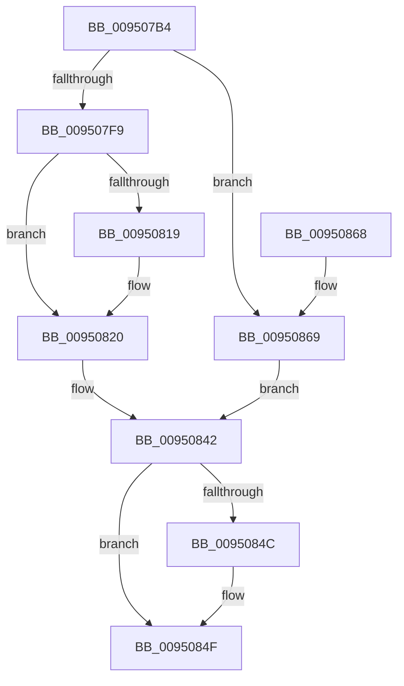

# PiDmListAddObjectWorker

- RVA: `0x009507B4`–`0x0095086E` (길이 `186` bytes)
- VA: `0x00000001409507B4`
- 실행 섹션: `PAGE`
- PDB 이름 있음: `예`; PDB Function 태그: `아니요`
- unwind 정보 RVA: `0x00091C44`
- 디코드: `54`개 명령, `186/186` bytes 표시
- 미해석 바이트: `0` (있으면 어셈블리에 `.byte`로 보존)

> 이 문서는 커널 이미지의 기계어와 PDB 기호를 분석해 생성했습니다. 4번과 5번은 함수 원형과 자료형을 바이너리 사용 방식에서 추정한 C 해석이며 원본 소스 복구 결과는 아닙니다.

## 1. Dependencies

- 직접 호출 지점: **3**; 고유 호출 대상: **3**
- 직접 호출자로 확인된 함수: **2**
- RIP 상대 이미지 참조: **1**

### Outgoing calls
- `0x009507FF` → [PiDmObjectManagerAcquireExclusiveLock](PiDmObjectManagerAcquireExclusiveLock_function_00951334.md) (function, `0x00951334`)
- `0x0095080B` → [PiDmObjectManagerReleaseLock](PiDmObjectManagerReleaseLock_function_0095111C.md) (function, `0x0095111C`)
- `0x0095083D` → [PiDmListUpdateAggregationCountWorker](../A8/PiDmListUpdateAggregationCountWorker_function_00A88848.md) (function, `0x00A88848`)

### Direct callers
- [PiDmListAddList](../94/PiDmListAddList_function_0094F4F8.md) at `0x0094F5A5`
- [PiDmListAddObject](PiDmListAddObject_function_00950128.md) at `0x00950177`

### Static image references
- `0x009507D2` → RVA `0x000018A0` (`.rdata`; read)

## 2. Other-region calls and transfers

- 다른 실행 섹션으로 향하는 call: **0**
- 별도 외부 분기/꼬리 이동을 확인하지 못했습니다.

## 3. Assembly (complete function range)

```asm
009507B4  48 89 5C 24 08                  mov qword ptr [rsp + 8], rbx
009507B9  48 89 6C 24 10                  mov qword ptr [rsp + 0x10], rbp
009507BE  48 89 74 24 18                  mov qword ptr [rsp + 0x18], rsi
009507C3  57                              push rdi
009507C4  41 56                           push r14
009507C6  41 57                           push r15
009507C8  48 83 EC 20                     sub rsp, 0x20
009507CC  48 63 C1                        movsxd rax, ecx
009507CF  48 8B EA                        mov rbp, rdx
009507D2  48 8D 15 C7 10 6B FF            lea rdx, [rip - 0x94ef39]
009507D9  4D 8B F9                        mov r15, r9
009507DC  4D 8B F0                        mov r14, r8
009507DF  48 8D 0C 80                     lea rcx, [rax + rax*4]
009507E3  48 8B 7C CA 18                  mov rdi, qword ptr [rdx + rcx*8 + 0x18]
009507E8  48 8B 5C CA 08                  mov rbx, qword ptr [rdx + rcx*8 + 8]
009507ED  49 03 F9                        add rdi, r9
009507F0  49 03 D8                        add rbx, r8
009507F3  48 83 3F 00                     cmp qword ptr [rdi], 0
009507F7  75 70                           jne 0x140950869
009507F9  48 8B CD                        mov rcx, rbp
009507FC  40 32 F6                        xor sil, sil
009507FF  E8 30 0B 00 00                  call 0x140951334
00950804  41 FF 46 0C                     inc dword ptr [r14 + 0xc]
00950808  48 8B CD                        mov rcx, rbp
0095080B  E8 0C 09 00 00                  call 0x14095111c
00950810  48 8B 43 08                     mov rax, qword ptr [rbx + 8]
00950814  48 39 18                        cmp qword ptr [rax], rbx
00950817  74 07                           je 0x140950820
00950819  B9 03 00 00 00                  mov ecx, 3
0095081E  CD 29                           int 0x29
00950820  48 89 1F                        mov qword ptr [rdi], rbx
00950823  41 B8 01 00 00 00               mov r8d, 1
00950829  48 89 47 08                     mov qword ptr [rdi + 8], rax
0095082D  49 8B D7                        mov rdx, r15
00950830  48 89 38                        mov qword ptr [rax], rdi
00950833  49 8B CE                        mov rcx, r14
00950836  48 89 7B 08                     mov qword ptr [rbx + 8], rdi
0095083A  FF 43 10                        inc dword ptr [rbx + 0x10]
0095083D  E8 06 80 13 00                  call 0x140a88848
00950842  48 8B 44 24 60                  mov rax, qword ptr [rsp + 0x60]
00950847  48 85 C0                        test rax, rax
0095084A  74 03                           je 0x14095084f
0095084C  40 88 30                        mov byte ptr [rax], sil
0095084F  48 8B 5C 24 40                  mov rbx, qword ptr [rsp + 0x40]
00950854  48 8B 6C 24 48                  mov rbp, qword ptr [rsp + 0x48]
00950859  48 8B 74 24 50                  mov rsi, qword ptr [rsp + 0x50]
0095085E  48 83 C4 20                     add rsp, 0x20
00950862  41 5F                           pop r15
00950864  41 5E                           pop r14
00950866  5F                              pop rdi
00950867  C3                              ret
00950868  CC                              int3
00950869  40 B6 01                        mov sil, 1
0095086C  EB D4                           jmp 0x140950842
```

## 4. C-style interpretation (structured pseudocode)

```c
__int64 __fastcall PiDmListAddObjectWorker(int a1, __int64 a2, __int64 a3, __int64 a4, __int64 a5)
{
    __int64 result;
    __int64 v_rbx;
    __int64 v_rdi;
    __int64 v_rsi;
    __int64 v_rsp;
    unsigned __int64 v_stack_p10;
    unsigned __int64 v_stack_p18;
    unsigned __int64 v_stack_p8;

    v_stack_p8 = v_rbx;
    v_stack_p10 = v_rbp;
    v_stack_p18 = v_rsi;
    v_rsp = (v_rsp) - (32);
    v_rdi = (*(unsigned __int64 *)(v_rip - 9760569 + (int)(a1) + (int)(a1) * 4 * 8 + 24)) + (a4);
    v_rbx = (*(unsigned __int64 *)(v_rip - 9760569 + (int)(a1) + (int)(a1) * 4 * 8 + 8)) + (a3);
    if ((*(unsigned __int64 *)(v_rdi)) != 0) goto loc_00950869;
    v_rsi = 0;
    result = PiDmObjectManagerAcquireExclusiveLock(a2, v_rip - 9760569, a3, a4);
    result = PiDmObjectManagerReleaseLock(a2, v_rip - 9760569, a3, a4);
    if ((*(unsigned __int64 *)(*(unsigned __int64 *)(v_rbx + 8))) != v_rbx) {
        a1 = 3;
    }
    *(unsigned __int64 *)(v_rdi) = v_rbx;
    *(unsigned __int64 *)(v_rdi + 8) = *(unsigned __int64 *)(v_rbx + 8);
    *(unsigned __int64 *)(*(unsigned __int64 *)(v_rbx + 8)) = v_rdi;
    *(unsigned __int64 *)(v_rbx + 8) = v_rdi;
    result = PiDmListUpdateAggregationCountWorker(a3, a4, 1, a4);
loc_00950842:
    if (a5 != 0) {
        *(unsigned __int8 *)(a5) = 0;
    }
    v_rsp = (v_rsp) + (32);
    return a5;
loc_00950869:
    goto loc_00950842;
}
```

## 5. (Beta) C Style

```c
int64_t PiDmListAddObjectWorker(void *Arg1, int64_t Arg2, void *Arg3, int64_t Arg4, int64_t Arg5)
{
    uint8_t *arg1 = (uint8_t *)Arg1;
    uint8_t *arg3 = (uint8_t *)Arg3;

    int64_t result;
    int64_t local_rbx;
    int64_t local_rdi;
    int64_t local_rsi;
    int64_t local_rsp;
    uint64_t v_stack_p10;
    uint64_t v_stack_p18;
    uint64_t v_stack_p8;

    v_stack_p8 = local_rbx;
    v_stack_p10 = local_rbp;
    v_stack_p18 = local_rsi;
    local_rsp = (local_rsp) - (32);
    local_rdi = (*(uint64_t *)(v_rip - 0x94EF39 + (int32_t)(arg1) + (int32_t)(arg1) * 4 * 8 + 0x18)) + (Arg4);
    local_rbx = (*(uint64_t *)(v_rip - 0x94EF39 + (int32_t)(arg1) + (int32_t)(arg1) * 4 * 8 + 0x8)) + (Arg3);
    if ((*(uint64_t *)(local_rdi)) != 0) goto loc_00950869;
    local_rsi = 0;
    result = PiDmObjectManagerAcquireExclusiveLock(Arg2, v_rip - 9760569, Arg3, Arg4);
    result = PiDmObjectManagerReleaseLock(Arg2, v_rip - 9760569, Arg3, Arg4);
    if ((*(uint64_t *)(*(uint64_t *)(local_rbx + 0x8))) != local_rbx) {
        Arg1 = 3;
    }
    *(uint64_t *)(local_rdi) = local_rbx;
    *(uint64_t *)(local_rdi + 0x8) = *(uint64_t *)(local_rbx + 0x8);
    *(uint64_t *)(*(uint64_t *)(local_rbx + 0x8)) = local_rdi;
    *(uint64_t *)(local_rbx + 0x8) = local_rdi;
    result = PiDmListUpdateAggregationCountWorker(Arg3, Arg4, 1, Arg4);
loc_00950842:
    if (Arg5 != 0) {
        *(uint8_t *)(Arg5) = 0;
    }
    local_rsp = (local_rsp) + (32);
    return Arg5;
loc_00950869:
    goto loc_00950842;
}
```

### 관측된 메모리 오프셋

구조체 형식이 확인되지 않은 접근은 인자 기준의 오프셋으로만 기록했습니다.

| 기준 인자 | 오프셋 표현 | 폭 (bit) | 접근 |
|---|---:|---:|---|
| `Arg1` | `+ 0x0 + rax*4` | `64` | `R` |
| `Arg3` | `+ 0xC` | `32` | `R/W` |

## 6. Execution-region graph

[열기: 2D/3D 그래프와 함수 탐색 컨트롤 패널](../../../control-panel.html?section=page&rva=0x009507B4&view=graph)

- 2D 그래프는 위에서 아래로 흐르고, 3D 그래프는 빈 공간을 드래그해 회전합니다. Shift+드래그는 이동, 휠은 확대·축소, 함수 노드 선택은 대상 보고서 이동입니다.

### Static fallback


