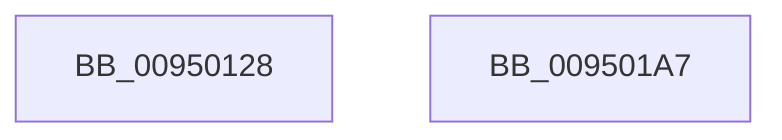

# PiDmListAddObject

- RVA: `0x00950128`–`0x009501A8` (길이 `128` bytes)
- VA: `0x0000000140950128`
- 실행 섹션: `PAGE`
- PDB 이름 있음: `예`; PDB Function 태그: `아니요`
- unwind 정보 RVA: `0x0005D7BC`
- 디코드: `36`개 명령, `128/128` bytes 표시
- 미해석 바이트: `0` (있으면 어셈블리에 `.byte`로 보존)

> 이 문서는 커널 이미지의 기계어와 PDB 기호를 분석해 생성했습니다. 4번과 5번은 함수 원형과 자료형을 바이너리 사용 방식에서 추정한 C 해석이며 원본 소스 복구 결과는 아닙니다.

## 1. Dependencies

- 직접 호출 지점: **6**; 고유 호출 대상: **5**
- 직접 호출자로 확인된 함수: **4**
- RIP 상대 이미지 참조: **0**

### Outgoing calls
- `0x0095014F` → [PiDmGetObjectManagerForObjectType](PiDmGetObjectManagerForObjectType_function_00951140.md) (function, `0x00951140`)
- `0x0095015A` → [CmpLockSiloKeyLockTrackerExclusive](../8F/CmpLockSiloKeyLockTrackerExclusive_function_008F9EF8.md) (function, `0x008F9EF8`)
- `0x00950162` → [PiDmObjectAcquireSharedLock](../8E/PiDmObjectAcquireSharedLock_function_008E38B8.md) (function, `0x008E38B8`)
- `0x00950177` → [PiDmListAddObjectWorker](PiDmListAddObjectWorker_function_009507B4.md) (function, `0x009507B4`)
- `0x0095017F` → [PiDmObjectReleaseLock](../8E/PiDmObjectReleaseLock_function_008E5584.md) (function, `0x008E5584`)
- `0x00950187` → [PiDmObjectReleaseLock](../8E/PiDmObjectReleaseLock_function_008E5584.md) (function, `0x008E5584`)

### Direct callers
- [PiDmListInitEnumCallback](../73/PiDmListInitEnumCallback_function_007302E0.md) at `0x00730428`
- [PiPnpRtlCmActionCallback](../8E/PiPnpRtlCmActionCallback_function_008EF110.md) at `0x008EF6B3`
- [PiPnpRtlCmActionCallback](../8E/PiPnpRtlCmActionCallback_function_008EF110.md) at `0x008EF75F`
- [IopRegisterDeviceInterface](IopRegisterDeviceInterface_function_009501B0.md) at `0x00950446`
- [IopRegisterDeviceInterface](IopRegisterDeviceInterface_function_009501B0.md) at `0x009505A7`
- [IopRegisterDeviceInterface](IopRegisterDeviceInterface_function_009501B0.md) at `0x009505C7`
- [sub_00B1DC0E](../B1/Unknown_function_00B1DC0E.md) at `0x00B1DF26`

### Static image references
- 디코드된 RIP-relative 메모리 참조가 없습니다.

## 2. Other-region calls and transfers

- 다른 실행 섹션으로 향하는 call: **0**
- 별도 외부 분기/꼬리 이동을 확인하지 못했습니다.

## 3. Assembly (complete function range)

```asm
00950128  48 8B C4                        mov rax, rsp
0095012B  48 89 58 08                     mov qword ptr [rax + 8], rbx
0095012F  48 89 68 10                     mov qword ptr [rax + 0x10], rbp
00950133  48 89 70 18                     mov qword ptr [rax + 0x18], rsi
00950137  48 89 78 20                     mov qword ptr [rax + 0x20], rdi
0095013B  41 56                           push r14
0095013D  48 83 EC 30                     sub rsp, 0x30
00950141  8B F1                           mov esi, ecx
00950143  49 8B F9                        mov rdi, r9
00950146  8B 4A 1C                        mov ecx, dword ptr [rdx + 0x1c]
00950149  49 8B E8                        mov rbp, r8
0095014C  4C 8B F2                        mov r14, rdx
0095014F  E8 EC 0F 00 00                  call 0x140951140
00950154  48 8B CA                        mov rcx, rdx
00950157  48 8B D8                        mov rbx, rax
0095015A  E8 99 9D FA FF                  call 0x1408f9ef8
0095015F  48 8B CD                        mov rcx, rbp
00950162  E8 51 37 F9 FF                  call 0x1408e38b8
00950167  4C 8B CD                        mov r9, rbp
0095016A  48 89 7C 24 20                  mov qword ptr [rsp + 0x20], rdi
0095016F  4D 8B C6                        mov r8, r14
00950172  48 8B D3                        mov rdx, rbx
00950175  8B CE                           mov ecx, esi
00950177  E8 38 06 00 00                  call 0x1409507b4
0095017C  48 8B CD                        mov rcx, rbp
0095017F  E8 00 54 F9 FF                  call 0x1408e5584
00950184  49 8B CE                        mov rcx, r14
00950187  E8 F8 53 F9 FF                  call 0x1408e5584
0095018C  48 8B 5C 24 40                  mov rbx, qword ptr [rsp + 0x40]
00950191  48 8B 6C 24 48                  mov rbp, qword ptr [rsp + 0x48]
00950196  48 8B 74 24 50                  mov rsi, qword ptr [rsp + 0x50]
0095019B  48 8B 7C 24 58                  mov rdi, qword ptr [rsp + 0x58]
009501A0  48 83 C4 30                     add rsp, 0x30
009501A4  41 5E                           pop r14
009501A6  C3                              ret
009501A7  CC                              int3
```

## 4. C-style interpretation (structured pseudocode)

```c
__int64 __fastcall PiDmListAddObject(int a1, __int64 a2, __int64 a3, __int64 a4)
{
    __int64 result;
    __int64 v_rsp;
    unsigned __int64 v_stack_m18;
    unsigned __int64 v_stack_p10;
    unsigned __int64 v_stack_p18;
    unsigned __int64 v_stack_p20;
    unsigned __int64 v_stack_p8;

    *(unsigned __int64 *)(v_rsp + 8) = v_rbx;
    *(unsigned __int64 *)(v_rsp + 16) = v_rbp;
    *(unsigned __int64 *)(v_rsp + 24) = v_rsi;
    *(unsigned __int64 *)(v_rsp + 32) = v_rdi;
    v_rsp = (v_rsp) - (48);
    result = PiDmGetObjectManagerForObjectType((unsigned int)(*(unsigned int *)(a2 + 28)), a2, a3, a4);
    result = CmpLockSiloKeyLockTrackerExclusive(a2, a2, a3, a4);
    result = PiDmObjectAcquireSharedLock(a3, a2, a3, a4);
    v_stack_m18 = a4;
    result = PiDmListAddObjectWorker((unsigned int)((unsigned int)((unsigned int)(a1))), result, a2, a3);
    result = PiDmObjectReleaseLock(a3, result, a2, a3);
    result = PiDmObjectReleaseLock(a2, result, a2, a3);
    v_rsp = (v_rsp) + (48);
    return result;
}
```

## 5. (Beta) C Style

```c
int64_t PiDmListAddObject(int32_t Arg1, void *Arg2, int64_t Arg3, int64_t Arg4)
{
    uint8_t *arg2 = (uint8_t *)Arg2;

    int64_t result;
    int64_t local_rsp;
    uint64_t v_stack_m18;
    uint64_t v_stack_p10;
    uint64_t v_stack_p18;
    uint64_t v_stack_p20;
    uint64_t v_stack_p8;

    *(uint64_t *)(local_rsp + 0x8) = local_rbx;
    *(uint64_t *)(local_rsp + 0x10) = local_rbp;
    *(uint64_t *)(local_rsp + 0x18) = local_rsi;
    *(uint64_t *)(local_rsp + 0x20) = local_rdi;
    local_rsp = (local_rsp) - (48);
    result = PiDmGetObjectManagerForObjectType((uint32_t)(*(uint32_t *)(arg2 + 0x1C)), Arg2, Arg3, Arg4);
    result = CmpLockSiloKeyLockTrackerExclusive(Arg2, Arg2, Arg3, Arg4);
    result = PiDmObjectAcquireSharedLock(Arg3, Arg2, Arg3, Arg4);
    v_stack_m18 = Arg4;
    result = PiDmListAddObjectWorker((uint32_t)((uint32_t)((uint32_t)(Arg1))), result, Arg2, Arg3);
    result = PiDmObjectReleaseLock(Arg3, result, Arg2, Arg3);
    result = PiDmObjectReleaseLock(Arg2, result, Arg2, Arg3);
    local_rsp = (local_rsp) + (48);
    return result;
}
```

### 관측된 메모리 오프셋

구조체 형식이 확인되지 않은 접근은 인자 기준의 오프셋으로만 기록했습니다.

| 기준 인자 | 오프셋 표현 | 폭 (bit) | 접근 |
|---|---:|---:|---|
| `Arg2` | `+ 0x1C` | `32` | `R` |

## 6. Execution-region graph

[열기: 2D/3D 그래프와 함수 탐색 컨트롤 패널](../../../control-panel.html?section=page&rva=0x00950128&view=graph)

- 2D 그래프는 위에서 아래로 흐르고, 3D 그래프는 빈 공간을 드래그해 회전합니다. Shift+드래그는 이동, 휠은 확대·축소, 함수 노드 선택은 대상 보고서 이동입니다.

### Static fallback


