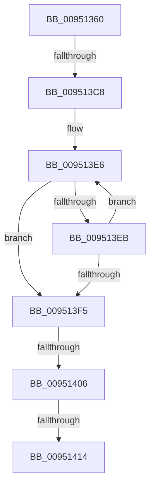

# PiDmLookupObject

- RVA: `0x00951360`–`0x0095141E` (길이 `190` bytes)
- VA: `0x0000000140951360`
- 실행 섹션: `PAGE`
- PDB 이름 있음: `예`; PDB Function 태그: `아니요`
- unwind 정보 RVA: `0x00091D7C`
- 디코드: `46`개 명령, `190/190` bytes 표시
- 미해석 바이트: `0` (있으면 어셈블리에 `.byte`로 보존)

> 이 문서는 커널 이미지의 기계어와 PDB 기호를 분석해 생성했습니다. 4번과 5번은 함수 원형과 자료형을 바이너리 사용 방식에서 추정한 C 해석이며 원본 소스 복구 결과는 아닙니다.

## 1. Dependencies

- 직접 호출 지점: **0**; 고유 호출 대상: **0**
- 직접 호출자로 확인된 함수: **5**
- RIP 상대 이미지 참조: **1**

### Outgoing calls
- 직접 디코드된 call 명령이 없습니다.

### Direct callers
- [PiPnpRtlCmActionCallback](../8E/PiPnpRtlCmActionCallback_function_008EF110.md) at `0x008EF576`
- [IopRegisterDeviceInterface](IopRegisterDeviceInterface_function_009501B0.md) at `0x0095030C`
- [IopRegisterDeviceInterface](IopRegisterDeviceInterface_function_009501B0.md) at `0x009506C6`
- [PiPnpRtlApplyMandatoryDeviceContainerFilters](PiPnpRtlApplyMandatoryDeviceContainerFilters_function_00950874.md) at `0x009508CE`
- [IopProcessSetInterfaceState](IopProcessSetInterfaceState_function_00950964.md) at `0x00950D4B`
- [PiDmRemoveCacheReferenceForObject](PiDmRemoveCacheReferenceForObject_function_00950F24.md) at `0x00950F53`

### Static image references
- `0x0095136F` → RVA `0x00E0A740` (`.data`; read)

## 2. Other-region calls and transfers

- 다른 실행 섹션으로 향하는 call: **0**
- call이 아닌 외부 분기/꼬리 이동: **4**
  - `0x009513C2` → [sub_009514FE](Unknown_function_009514FE.md) (`tail-transfer`)
  - `0x00951400` → [sub_009514FE + 0x1C](Unknown_function_009514FE.md) (`tail-transfer`)
  - `0x0095140E` → [sub_009514FE](Unknown_function_009514FE.md) (`tail-transfer`)
  - `0x00951418` → [sub_009514FE + 0x5](Unknown_function_009514FE.md) (`tail-transfer`)

## 3. Assembly (complete function range)

```asm
00951360  4C 8B DC                        mov r11, rsp
00951363  49 89 6B 20                     mov qword ptr [r11 + 0x20], rbp
00951367  57                              push rdi
00951368  48 81 EC C0 00 00 00            sub rsp, 0xc0
0095136F  48 8B 05 CA 93 4B 00            mov rax, qword ptr [rip + 0x4b93ca]
00951376  48 33 C4                        xor rax, rsp
00951379  48 89 84 24 B0 00 00 00         mov qword ptr [rsp + 0xb0], rax
00951381  0F 57 C0                        xorps xmm0, xmm0
00951384  33 C0                           xor eax, eax
00951386  0F 11 44 24 48                  movups xmmword ptr [rsp + 0x48], xmm0
0095138B  33 ED                           xor ebp, ebp
0095138D  4C 8B D2                        mov r10, rdx
00951390  48 89 6C 24 40                  mov qword ptr [rsp + 0x40], rbp
00951395  48 8B F9                        mov rdi, rcx
00951398  0F 11 44 24 58                  movups xmmword ptr [rsp + 0x58], xmm0
0095139D  0F 11 44 24 68                  movups xmmword ptr [rsp + 0x68], xmm0
009513A2  0F 11 44 24 78                  movups xmmword ptr [rsp + 0x78], xmm0
009513A7  49 89 43 E0                     mov qword ptr [r11 - 0x20], rax
009513AB  48 8D 44 24 40                  lea rax, [rsp + 0x40]
009513B0  48 89 44 24 20                  mov qword ptr [rsp + 0x20], rax
009513B5  41 0F 11 43 C0                  movups xmmword ptr [r11 - 0x40], xmm0
009513BA  41 0F 11 43 D0                  movups xmmword ptr [r11 - 0x30], xmm0
009513BF  48 85 D2                        test rdx, rdx
009513C2  0F 84 36 01 00 00               je 0x1409514fe
009513C8  44 8B 81 D0 00 00 00            mov r8d, dword ptr [rcx + 0xd0]
009513CF  49 8B C2                        mov rax, r10
009513D2  49 89 53 88                     mov qword ptr [r11 - 0x78], rdx
009513D6  BA FF 7F 00 00                  mov edx, 0x7fff
009513DB  8B CA                           mov ecx, edx
009513DD  45 89 43 94                     mov dword ptr [r11 - 0x6c], r8d
009513E1  0F 11 44 24 28                  movups xmmword ptr [rsp + 0x28], xmm0
009513E6  66 39 28                        cmp word ptr [rax], bp
009513E9  74 0A                           je 0x1409513f5
009513EB  48 83 C0 02                     add rax, 2
009513EF  48 83 E9 01                     sub rcx, 1
009513F3  75 F1                           jne 0x1409513e6
009513F5  48 85 C9                        test rcx, rcx
009513F8  B8 0D 00 00 C0                  mov eax, 0xc000000d
009513FD  0F 45 C5                        cmovne eax, ebp
00951400  0F 84 14 01 00 00               je 0x14095151a
00951406  48 2B D1                        sub rdx, rcx
00951409  66 03 D2                        add dx, dx
0095140C  85 C0                           test eax, eax
0095140E  0F 88 EA 00 00 00               js 0x1409514fe
00951414  41 83 F8 03                     cmp r8d, 3
00951418  0F 84 E5 00 00 00               je 0x140951503
```

## 4. C-style interpretation (structured pseudocode)

```c
__int64 __fastcall PiDmLookupObject(__int64 a1, __int64 a2)
{
    __int64 result;
    __int64 v_rbp;
    __int64 v_rsp;
    unsigned __int64 v_stack_m18;
    unsigned __int64 v_stack_m50;
    unsigned __int64 v_stack_m60;
    unsigned __int64 v_stack_m70;
    unsigned __int64 v_stack_m80;
    unsigned __int64 v_stack_m88;
    unsigned __int64 v_stack_mA0;
    unsigned __int64 v_stack_mA8;

    *(unsigned __int64 *)(v_rsp + 32) = v_rbp;
    v_rsp = (v_rsp) - (192);
    result = (*(unsigned __int64 *)(v_rip + 4953034)) ^ (v_rsp);
    v_stack_m18 = result;
    result = 0;
    v_stack_m80 = v_xmm0;
    v_rbp = 0;
    v_stack_m88 = 0;
    v_stack_m70 = v_xmm0;
    v_stack_m60 = v_xmm0;
    v_stack_m50 = v_xmm0;
    *(unsigned __int64 *)(v_rsp - 32) = 0;
    v_stack_mA8 = v_stack_m88;
    *(unsigned __int64 *)(v_rsp - 64) = v_xmm0;
    *(unsigned __int64 *)(v_rsp - 48) = v_xmm0;
    *(unsigned __int64 *)(v_rsp - 120) = a2;
    *(unsigned int *)(v_rsp - 108) = (unsigned int)((unsigned int)(*(unsigned int *)(a1 + 208)));
    v_stack_mA0 = v_xmm0;
loc_009513E6:
    if ((*(unsigned __int16 *)(a2)) == 0) goto loc_009513F5;
    result = (a2) + (2);
    a1 = ((unsigned int)((unsigned int)((unsigned int)(0x7FFFULL)))) - (1);
    if (condition_is_not_equal) goto loc_009513E6;
loc_009513F5:
    result = (unsigned int)(0xC000000DULL);
    if (a1 != 0) { result = 0; }
    a2 = ((unsigned int)(0x7FFFULL)) - (a1);
    a2 = (unsigned __int16)((a2) + ((unsigned __int16)(a2)));
}
```

## 5. (Beta) C Style

```c
int64_t PiDmLookupObject(void *Arg1, void *Arg2)
{
    uint8_t *arg1 = (uint8_t *)Arg1;
    uint8_t *arg2 = (uint8_t *)Arg2;

    int64_t result;
    int64_t local_rbp;
    int64_t local_rsp;
    uint64_t v_stack_m18;
    uint64_t v_stack_m50;
    uint64_t v_stack_m60;
    uint64_t v_stack_m70;
    uint64_t v_stack_m80;
    uint64_t v_stack_m88;
    uint64_t v_stack_mA0;
    uint64_t v_stack_mA8;

    *(uint64_t *)(local_rsp + 0x20) = local_rbp;
    local_rsp = (local_rsp) - (192);
    result = (*(uint64_t *)(v_rip + 0x4B93CA)) ^ (local_rsp);
    v_stack_m18 = result;
    result = 0;
    v_stack_m80 = v_xmm0;
    local_rbp = 0;
    v_stack_m88 = 0;
    v_stack_m70 = v_xmm0;
    v_stack_m60 = v_xmm0;
    v_stack_m50 = v_xmm0;
    *(uint64_t *)(local_rsp - 0x20) = 0;
    v_stack_mA8 = v_stack_m88;
    *(uint64_t *)(local_rsp - 0x40) = v_xmm0;
    *(uint64_t *)(local_rsp - 0x30) = v_xmm0;
    *(void **)(local_rsp - 0x78) = Arg2;
    *(uint32_t *)(local_rsp - 0x6C) = (uint32_t)((uint32_t)(*(uint32_t *)(arg1 + 0xD0)));
    v_stack_mA0 = v_xmm0;
loc_009513E6:
    if ((*(uint16_t *)(arg2)) == 0) goto loc_009513F5;
    result = (Arg2) + (2);
    Arg1 = ((uint32_t)((uint32_t)((uint32_t)(0x7FFFULL)))) - (1);
    if (condition_is_not_equal) goto loc_009513E6;
loc_009513F5:
    result = (uint32_t)(0xC000000DULL);
    if (Arg1 != NULL) { result = 0; }
    Arg2 = ((uint32_t)(0x7FFFULL)) - (Arg1);
    Arg2 = (uint16_t)((Arg2) + ((uint16_t)(Arg2)));
}
```

### 관측된 메모리 오프셋

구조체 형식이 확인되지 않은 접근은 인자 기준의 오프셋으로만 기록했습니다.

| 기준 인자 | 오프셋 표현 | 폭 (bit) | 접근 |
|---|---:|---:|---|
| `Arg1` | `+ 0xD0` | `32` | `R` |
| `Arg2` | `+ 0x0` | `16` | `R` |

## 6. Execution-region graph

[열기: 2D/3D 그래프와 함수 탐색 컨트롤 패널](../../../control-panel.html?section=page&rva=0x00951360&view=graph)

- 2D 그래프는 위에서 아래로 흐르고, 3D 그래프는 빈 공간을 드래그해 회전합니다. Shift+드래그는 이동, 휠은 확대·축소, 함수 노드 선택은 대상 보고서 이동입니다.

### Static fallback


