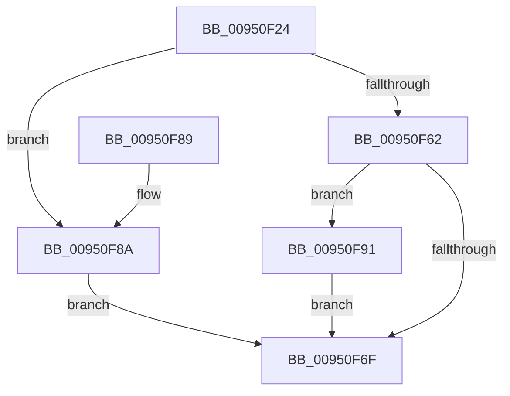

# PiDmRemoveCacheReferenceForObject

- RVA: `0x00950F24`–`0x00950FAB` (길이 `135` bytes)
- VA: `0x0000000140950F24`
- 실행 섹션: `PAGE`
- PDB 이름 있음: `예`; PDB Function 태그: `아니요`
- unwind 정보 RVA: `0x00091CA4`
- 디코드: `38`개 명령, `135/135` bytes 표시
- 미해석 바이트: `0` (있으면 어셈블리에 `.byte`로 보존)

> 이 문서는 커널 이미지의 기계어와 PDB 기호를 분석해 생성했습니다. 4번과 5번은 함수 원형과 자료형을 바이너리 사용 방식에서 추정한 C 해석이며 원본 소스 복구 결과는 아닙니다.

## 1. Dependencies

- 직접 호출 지점: **6**; 고유 호출 대상: **6**
- 직접 호출자로 확인된 함수: **7**
- RIP 상대 이미지 참조: **0**

### Outgoing calls
- `0x00950F3D` → [PiDmGetObjectManagerForObjectType](PiDmGetObjectManagerForObjectType_function_00951140.md) (function, `0x00951140`)
- `0x00950F48` → [PiDmObjectManagerAcquireExclusiveLock](PiDmObjectManagerAcquireExclusiveLock_function_00951334.md) (function, `0x00951334`)
- `0x00950F53` → [PiDmLookupObject](PiDmLookupObject_function_00951360.md) (function, `0x00951360`)
- `0x00950F72` → [PiDmObjectManagerReleaseLock](PiDmObjectManagerReleaseLock_function_0095111C.md) (function, `0x0095111C`)
- `0x00950F9A` → [RtlDeleteElementGenericTableAvl](../../text/3E/RtlDeleteElementGenericTableAvl_function_003EE750.md) (function, `0x003EE750`)
- `0x00950FA4` → [PiDmObjectRelease](../8E/PiDmObjectRelease_function_008E4F70.md) (function, `0x008E4F70`)

### Direct callers
- [PiPnpRtlFreeInstallerClassChangeInfo](../70/PiPnpRtlFreeInstallerClassChangeInfo_function_00704564.md) at `0x0070459C`
- [PiDmListInitEnumCallback](../73/PiDmListInitEnumCallback_function_007302E0.md) at `0x00730439`
- [PiPnpRtlCmActionCallback](../8E/PiPnpRtlCmActionCallback_function_008EF110.md) at `0x008EF5E2`
- [PiPnpRtlObjectEventWorker](../8F/PiPnpRtlObjectEventWorker_function_008F8630.md) at `0x008F8942`
- [IopRegisterDeviceInterface](IopRegisterDeviceInterface_function_009501B0.md) at `0x0095052B`
- [IopRegisterDeviceInterface](IopRegisterDeviceInterface_function_009501B0.md) at `0x00950545`
- [IopRegisterDeviceInterface](IopRegisterDeviceInterface_function_009501B0.md) at `0x0095055E`
- [IopProcessSetInterfaceState](IopProcessSetInterfaceState_function_00950964.md) at `0x00950D22`
- [sub_00B1DC0E](../B1/Unknown_function_00B1DC0E.md) at `0x00B1DEC3`

### Static image references
- 디코드된 RIP-relative 메모리 참조가 없습니다.

## 2. Other-region calls and transfers

- 다른 실행 섹션으로 향하는 call: **1**
  - `0x00950F9A` → [RtlDeleteElementGenericTableAvl](../../text/3E/RtlDeleteElementGenericTableAvl_function_003EE750.md) (`PAGE` → `.text`)
- 별도 외부 분기/꼬리 이동을 확인하지 못했습니다.

## 3. Assembly (complete function range)

```asm
00950F24  48 89 5C 24 08                  mov qword ptr [rsp + 8], rbx
00950F29  48 89 74 24 10                  mov qword ptr [rsp + 0x10], rsi
00950F2E  4C 89 44 24 18                  mov qword ptr [rsp + 0x18], r8
00950F33  57                              push rdi
00950F34  48 83 EC 20                     sub rsp, 0x20
00950F38  48 8B DA                        mov rbx, rdx
00950F3B  33 FF                           xor edi, edi
00950F3D  E8 FE 01 00 00                  call 0x140951140
00950F42  48 8B C8                        mov rcx, rax
00950F45  48 8B F0                        mov rsi, rax
00950F48  E8 E7 03 00 00                  call 0x140951334
00950F4D  48 8B D3                        mov rdx, rbx
00950F50  48 8B CE                        mov rcx, rsi
00950F53  E8 08 04 00 00                  call 0x140951360
00950F58  48 89 44 24 40                  mov qword ptr [rsp + 0x40], rax
00950F5D  48 85 C0                        test rax, rax
00950F60  74 28                           je 0x140950f8a
00950F62  FF 48 0C                        dec dword ptr [rax + 0xc]
00950F65  48 8B 44 24 40                  mov rax, qword ptr [rsp + 0x40]
00950F6A  39 78 0C                        cmp dword ptr [rax + 0xc], edi
00950F6D  74 22                           je 0x140950f91
00950F6F  48 8B CE                        mov rcx, rsi
00950F72  E8 A5 01 00 00                  call 0x14095111c
00950F77  48 8B 5C 24 30                  mov rbx, qword ptr [rsp + 0x30]
00950F7C  8B C7                           mov eax, edi
00950F7E  48 8B 74 24 38                  mov rsi, qword ptr [rsp + 0x38]
00950F83  48 83 C4 20                     add rsp, 0x20
00950F87  5F                              pop rdi
00950F88  C3                              ret
00950F89  CC                              int3
00950F8A  BF 34 00 00 C0                  mov edi, 0xc0000034
00950F8F  EB DE                           jmp 0x140950f6f
00950F91  48 8D 4E 68                     lea rcx, [rsi + 0x68]
00950F95  48 8D 54 24 40                  lea rdx, [rsp + 0x40]
00950F9A  E8 B1 D7 A9 FF                  call 0x1403ee750
00950F9F  48 8B 4C 24 40                  mov rcx, qword ptr [rsp + 0x40]
00950FA4  E8 C7 3F F9 FF                  call 0x1408e4f70
00950FA9  EB C4                           jmp 0x140950f6f
```

## 4. C-style interpretation (structured pseudocode)

```c
__int64 __fastcall PiDmRemoveCacheReferenceForObject(__int64 a1, __int64 a2, __int64 a3)
{
    __int64 result;
    __int64 v_rdi;
    __int64 v_rsp;
    unsigned __int64 v_stack_p10;
    unsigned __int64 v_stack_p18;
    unsigned __int64 v_stack_p40;
    unsigned __int64 v_stack_p8;

    v_stack_p8 = v_rbx;
    v_stack_p10 = v_rsi;
    v_stack_p18 = a3;
    v_rsp = (v_rsp) - (32);
    v_rdi = 0;
    result = PiDmGetObjectManagerForObjectType(a1, a2, a3, a4);
    result = PiDmObjectManagerAcquireExclusiveLock(result, a2, a3, a4);
    result = PiDmLookupObject(result, a2, a3, a4);
    v_stack_p18 = result;
    if (result == 0) goto loc_00950F8A;
    if ((*(unsigned int *)(v_stack_p18 + 12)) == 0) goto loc_00950F91;
loc_00950F6F:
    result = PiDmObjectManagerReleaseLock(result, a2, a3, a4);
    v_rsp = (v_rsp) + (32);
    return 0;
loc_00950F8A:
    goto loc_00950F6F;
loc_00950F91:
    result = RtlDeleteElementGenericTableAvl(v_stack_p10 + 104, v_stack_p40, a3, a4);
    result = PiDmObjectRelease(v_stack_p40, v_stack_p40, a3, a4);
    goto loc_00950F6F;
}
```

## 5. (Beta) C Style

```c
int64_t PiDmRemoveCacheReferenceForObject(int64_t Arg1, int64_t Arg2, int64_t Arg3)
{
    int64_t result;
    int64_t local_rdi;
    int64_t local_rsp;
    uint64_t v_stack_p10;
    uint64_t v_stack_p18;
    uint64_t v_stack_p40;
    uint64_t v_stack_p8;

    v_stack_p8 = local_rbx;
    v_stack_p10 = local_rsi;
    v_stack_p18 = Arg3;
    local_rsp = (local_rsp) - (32);
    local_rdi = 0;
    result = PiDmGetObjectManagerForObjectType(Arg1, Arg2, Arg3, a4);
    result = PiDmObjectManagerAcquireExclusiveLock(result, Arg2, Arg3, a4);
    result = PiDmLookupObject(result, Arg2, Arg3, a4);
    v_stack_p18 = result;
    if (result == 0) goto loc_00950F8A;
    if ((*(uint32_t *)(v_stack_p18 + 0xC)) == 0) goto loc_00950F91;
loc_00950F6F:
    result = PiDmObjectManagerReleaseLock(result, Arg2, Arg3, a4);
    local_rsp = (local_rsp) + (32);
    return 0;
loc_00950F8A:
    goto loc_00950F6F;
loc_00950F91:
    result = RtlDeleteElementGenericTableAvl(v_stack_p10 + 104, v_stack_p40, Arg3, a4);
    result = PiDmObjectRelease(v_stack_p40, v_stack_p40, Arg3, a4);
    goto loc_00950F6F;
}
```

## 6. Execution-region graph

[열기: 2D/3D 그래프와 함수 탐색 컨트롤 패널](../../../control-panel.html?section=page&rva=0x00950F24&view=graph)

- 2D 그래프는 위에서 아래로 흐르고, 3D 그래프는 빈 공간을 드래그해 회전합니다. Shift+드래그는 이동, 휠은 확대·축소, 함수 노드 선택은 대상 보고서 이동입니다.

### Static fallback


