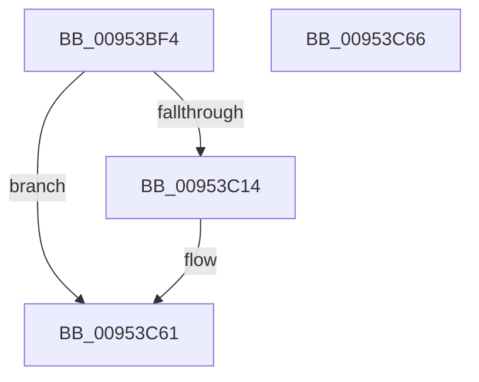

# PiPdcActivate

- RVA: `0x00953BF4`–`0x00953C67` (길이 `115` bytes)
- VA: `0x0000000140953BF4`
- 실행 섹션: `PAGE`
- PDB 이름 있음: `예`; PDB Function 태그: `아니요`
- unwind 정보 RVA: `0x0006C9B8`
- 디코드: `27`개 명령, `115/115` bytes 표시
- 미해석 바이트: `0` (있으면 어셈블리에 `.byte`로 보존)

> 이 문서는 커널 이미지의 기계어와 PDB 기호를 분석해 생성했습니다. 4번과 5번은 함수 원형과 자료형을 바이너리 사용 방식에서 추정한 C 해석이며 원본 소스 복구 결과는 아닙니다.

## 1. Dependencies

- 직접 호출 지점: **1**; 고유 호출 대상: **1**
- 직접 호출자로 확인된 함수: **2**
- RIP 상대 이미지 참조: **1**

### Outgoing calls
- `0x00953C54` → [Pdcv2ActivationClientActivate](Pdcv2ActivationClientActivate_function_00953C70.md) (function, `0x00953C70`)

### Direct callers
- [IopProcessInvalidateBusRelationsRequest](IopProcessInvalidateBusRelationsRequest_function_009539A8.md) at `0x00953A23`
- [PnpActivatePdcForDeviceEvent](PnpActivatePdcForDeviceEvent_function_00953A9C.md) at `0x00953AEF`

### Static image references
- `0x00953C00` → RVA `0x00F8A8F8` (`.data`; read)

## 2. Other-region calls and transfers

- 다른 실행 섹션으로 향하는 call: **0**
- 별도 외부 분기/꼬리 이동을 확인하지 못했습니다.

## 3. Assembly (complete function range)

```asm
00953BF4  4C 8B DC                        mov r11, rsp
00953BF7  48 83 EC 78                     sub rsp, 0x78
00953BFB  33 C0                           xor eax, eax
00953BFD  4C 8B C1                        mov r8, rcx
00953C00  48 8B 0D F1 6C 63 00            mov rcx, qword ptr [rip + 0x636cf1]
00953C07  41 89 43 18                     mov dword ptr [r11 + 0x18], eax
00953C0B  49 89 43 20                     mov qword ptr [r11 + 0x20], rax
00953C0F  48 85 C9                        test rcx, rcx
00953C12  74 4D                           je 0x140953c61
00953C14  49 8D 43 18                     lea rax, [r11 + 0x18]
00953C18  C7 44 24 40 01 00 00 00         mov dword ptr [rsp + 0x40], 1
00953C20  49 89 43 C0                     mov qword ptr [r11 - 0x40], rax
00953C24  0F 57 C0                        xorps xmm0, xmm0
00953C27  F3 0F 7F 44 24 58               movdqu xmmword ptr [rsp + 0x58], xmm0
00953C2D  C7 44 24 44 3C 00 00 00         mov dword ptr [rsp + 0x44], 0x3c
00953C35  49 8D 43 20                     lea rax, [r11 + 0x20]
00953C39  49 89 43 B8                     mov qword ptr [r11 - 0x48], rax
00953C3D  4D 89 43 A8                     mov qword ptr [r11 - 0x58], r8
00953C41  45 33 C0                        xor r8d, r8d
00953C44  49 89 53 D8                     mov qword ptr [r11 - 0x28], rdx
00953C48  49 8D 53 C8                     lea rdx, [r11 - 0x38]
00953C4C  49 C7 43 D0 02 00 00 00         mov qword ptr [r11 - 0x30], 2
00953C54  E8 17 00 00 00                  call 0x140953c70
00953C59  48 8B 84 24 98 00 00 00         mov rax, qword ptr [rsp + 0x98]
00953C61  48 83 C4 78                     add rsp, 0x78
00953C65  C3                              ret
00953C66  CC                              int3
```

## 4. C-style interpretation (structured pseudocode)

```c
__int64 __fastcall PiPdcActivate(__int64 a1, __int64 a2)
{
    __int64 result;
    __int64 v_rsp;
    unsigned __int64 v_stack_m20;
    unsigned int v_stack_m34;
    unsigned int v_stack_m38;
    unsigned __int64 v_stack_p20;

    v_rsp = (v_rsp) - (120);
    result = 0;
    *(unsigned int *)(v_rsp + 24) = 0;
    *(unsigned __int64 *)(v_rsp + 32) = 0;
    if (*(unsigned __int64 *)(v_rip + 6515953) != 0) {
        result = v_rsp + 24;
        v_stack_m38 = 1;
        *(unsigned __int64 *)(v_rsp - 64) = result;
        v_stack_m20 = v_xmm0;
        v_stack_m34 = 60;
        result = v_rsp + 32;
        *(unsigned __int64 *)(v_rsp - 72) = result;
        *(unsigned __int64 *)(v_rsp - 88) = a1;
        a3 = 0;
        *(unsigned __int64 *)(v_rsp - 40) = a2;
        a2 = v_rsp - 56;
        *(unsigned __int64 *)(v_rsp - 48) = 2;
        result = Pdcv2ActivationClientActivate(*(unsigned __int64 *)(v_rip + 6515953), a2, a3, a4);
        result = v_stack_p20;
    }
    v_rsp = (v_rsp) + (120);
    return result;
}
```

## 5. (Beta) C Style

```c
int64_t PiPdcActivate(int64_t Arg1, int64_t Arg2)
{
    int64_t result;
    int64_t local_rsp;
    uint64_t v_stack_m20;
    uint32_t v_stack_m34;
    uint32_t v_stack_m38;
    uint64_t v_stack_p20;

    local_rsp = (local_rsp) - (120);
    result = 0;
    *(uint32_t *)(local_rsp + 0x18) = 0;
    *(uint64_t *)(local_rsp + 0x20) = 0;
    if (*(uint64_t *)(v_rip + 0x636CF1) != 0) {
        result = local_rsp + 24;
        v_stack_m38 = 1;
        *(uint64_t *)(local_rsp - 0x40) = result;
        v_stack_m20 = v_xmm0;
        v_stack_m34 = 60;
        result = local_rsp + 32;
        *(uint64_t *)(local_rsp - 0x48) = result;
        *(uint64_t *)(local_rsp - 0x58) = Arg1;
        a3 = 0;
        *(uint64_t *)(local_rsp - 0x28) = Arg2;
        Arg2 = local_rsp - 56;
        *(uint64_t *)(local_rsp - 0x30) = 2;
        result = Pdcv2ActivationClientActivate(*(uint64_t *)(v_rip + 0x636CF1), Arg2, a3, a4);
        result = v_stack_p20;
    }
    local_rsp = (local_rsp) + (120);
    return result;
}
```

## 6. Execution-region graph

[열기: 2D/3D 그래프와 함수 탐색 컨트롤 패널](../../../control-panel.html?section=page&rva=0x00953BF4&view=graph)

- 2D 그래프는 위에서 아래로 흐르고, 3D 그래프는 빈 공간을 드래그해 회전합니다. Shift+드래그는 이동, 휠은 확대·축소, 함수 노드 선택은 대상 보고서 이동입니다.

### Static fallback


