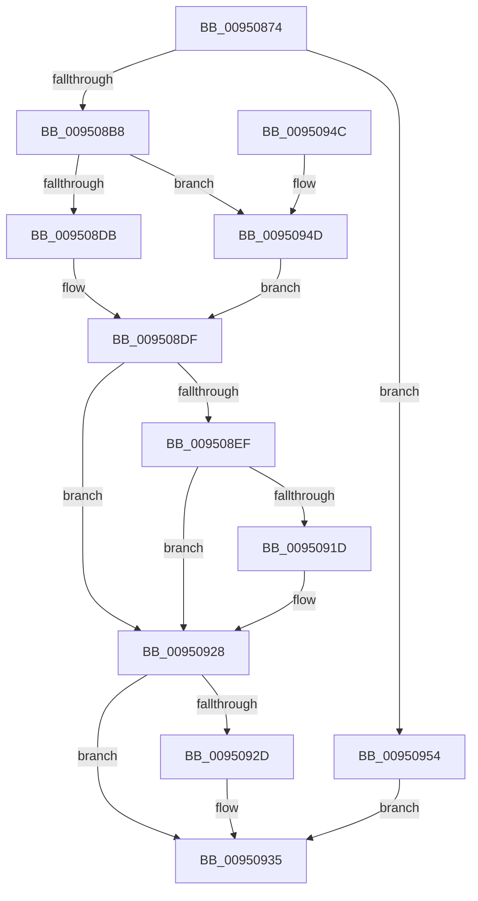

# PiPnpRtlApplyMandatoryDeviceContainerFilters

- RVA: `0x00950874`–`0x0095095E` (길이 `234` bytes)
- VA: `0x0000000140950874`
- 실행 섹션: `PAGE`
- PDB 이름 있음: `예`; PDB Function 태그: `아니요`
- unwind 정보 RVA: `0x00091C60`
- 디코드: `63`개 명령, `234/234` bytes 표시
- 미해석 바이트: `0` (있으면 어셈블리에 `.byte`로 보존)

> 이 문서는 커널 이미지의 기계어와 PDB 기호를 분석해 생성했습니다. 4번과 5번은 함수 원형과 자료형을 바이너리 사용 방식에서 추정한 C 해석이며 원본 소스 복구 결과는 아닙니다.

## 1. Dependencies

- 직접 호출 지점: **6**; 고유 호출 대상: **6**
- 직접 호출자로 확인된 함수: **1**
- RIP 상대 이미지 참조: **3**

### Outgoing calls
- `0x009508AB` → [wcsicmp](../../text/50/wcsicmp_function_00500080.md) (function, `0x00500080`)
- `0x009508BF` → [PiDmObjectManagerAcquireSharedLock](PiDmObjectManagerAcquireSharedLock_function_009511A0.md) (function, `0x009511A0`)
- `0x009508CE` → [PiDmLookupObject](PiDmLookupObject_function_00951360.md) (function, `0x00951360`)
- `0x009508E6` → [PiDmObjectManagerReleaseLock](PiDmObjectManagerReleaseLock_function_0095111C.md) (function, `0x0095111C`)
- `0x00950912` → [PiDmListEnumObjectsWithCallback](../8E/PiDmListEnumObjectsWithCallback_function_008E3B60.md) (function, `0x008E3B60`)
- `0x00950930` → [PiDmObjectRelease](../8E/PiDmObjectRelease_function_008E4F70.md) (function, `0x008E4F70`)

### Direct callers
- [PiPnpRtlApplyMandatoryFilters](../8E/PiPnpRtlApplyMandatoryFilters_function_008E5C80.md) at `0x008E5E72`

### Static image references
- `0x00950891` → RVA `0x00AFE270` (` ?? ::NNGAKEGL::`string'`; read)
- `0x009508B8` → RVA `0x00F8B5E0` (`.data`; read)
- `0x009508F9` → RVA `0x00A76760` (`PiPnpRtlApplyMandatoryDeviceContainerFiltersCallback`; read)

## 2. Other-region calls and transfers

- 다른 실행 섹션으로 향하는 call: **1**
  - `0x009508AB` → [wcsicmp](../../text/50/wcsicmp_function_00500080.md) (`PAGE` → `.text`)
- 별도 외부 분기/꼬리 이동을 확인하지 못했습니다.

## 3. Assembly (complete function range)

```asm
00950874  4C 8B DC                        mov r11, rsp
00950877  49 89 5B 08                     mov qword ptr [r11 + 8], rbx
0095087B  49 89 6B 10                     mov qword ptr [r11 + 0x10], rbp
0095087F  49 89 73 18                     mov qword ptr [r11 + 0x18], rsi
00950883  57                              push rdi
00950884  48 83 EC 40                     sub rsp, 0x40
00950888  48 8B DA                        mov rbx, rdx
0095088B  0F 57 C0                        xorps xmm0, xmm0
0095088E  48 8B E9                        mov rbp, rcx
00950891  48 8D 15 D8 D9 1A 00            lea rdx, [rip + 0x1ad9d8]
00950898  33 C0                           xor eax, eax
0095089A  48 8B CB                        mov rcx, rbx
0095089D  0F 11 44 24 20                  movups xmmword ptr [rsp + 0x20], xmm0
009508A2  49 89 43 E8                     mov qword ptr [r11 - 0x18], rax
009508A6  49 8B F1                        mov rsi, r9
009508A9  33 FF                           xor edi, edi
009508AB  E8 D0 F7 BA FF                  call 0x140500080
009508B0  85 C0                           test eax, eax
009508B2  0F 84 9C 00 00 00               je 0x140950954
009508B8  48 8D 0D 21 AD 63 00            lea rcx, [rip + 0x63ad21]
009508BF  E8 DC 08 00 00                  call 0x1409511a0
009508C4  48 8B D3                        mov rdx, rbx
009508C7  48 8D 0D 12 AD 63 00            lea rcx, [rip + 0x63ad12]
009508CE  E8 8D 0A 00 00                  call 0x140951360
009508D3  48 8B D8                        mov rbx, rax
009508D6  48 85 C0                        test rax, rax
009508D9  74 72                           je 0x14095094d
009508DB  F0 FF 40 08                     lock inc dword ptr [rax + 8]
009508DF  48 8D 0D FA AC 63 00            lea rcx, [rip + 0x63acfa]
009508E6  E8 31 08 00 00                  call 0x14095111c
009508EB  85 FF                           test edi, edi
009508ED  78 39                           js 0x140950928
009508EF  4C 8D 4C 24 20                  lea r9, [rsp + 0x20]
009508F4  48 89 6C 24 20                  mov qword ptr [rsp + 0x20], rbp
009508F9  4C 8D 05 60 5E 12 00            lea r8, [rip + 0x125e60]
00950900  48 89 74 24 28                  mov qword ptr [rsp + 0x28], rsi
00950905  48 8B D3                        mov rdx, rbx
00950908  C6 44 24 30 00                  mov byte ptr [rsp + 0x30], 0
0095090D  B9 03 00 00 00                  mov ecx, 3
00950912  E8 49 32 F9 FF                  call 0x1408e3b60
00950917  8B F8                           mov edi, eax
00950919  85 C0                           test eax, eax
0095091B  78 0B                           js 0x140950928
0095091D  48 8B 54 24 70                  mov rdx, qword ptr [rsp + 0x70]
00950922  8A 4C 24 30                     mov cl, byte ptr [rsp + 0x30]
00950926  88 0A                           mov byte ptr [rdx], cl
00950928  48 85 DB                        test rbx, rbx
0095092B  74 08                           je 0x140950935
0095092D  48 8B CB                        mov rcx, rbx
00950930  E8 3B 46 F9 FF                  call 0x1408e4f70
00950935  48 8B 5C 24 50                  mov rbx, qword ptr [rsp + 0x50]
0095093A  8B C7                           mov eax, edi
0095093C  48 8B 6C 24 58                  mov rbp, qword ptr [rsp + 0x58]
00950941  48 8B 74 24 60                  mov rsi, qword ptr [rsp + 0x60]
00950946  48 83 C4 40                     add rsp, 0x40
0095094A  5F                              pop rdi
0095094B  C3                              ret
0095094C  CC                              int3
0095094D  BF 34 00 00 C0                  mov edi, 0xc0000034
00950952  EB 8B                           jmp 0x1409508df
00950954  48 8B 44 24 70                  mov rax, qword ptr [rsp + 0x70]
00950959  C6 00 01                        mov byte ptr [rax], 1
0095095C  EB D7                           jmp 0x140950935
```

## 4. C-style interpretation (structured pseudocode)

```c
__int64 __fastcall PiPnpRtlApplyMandatoryDeviceContainerFilters(__int64 a1, __int64 a2, __int64 a3, __int64 a4, __int64 a5)
{
    __int64 result;
    __int64 v_rdi;
    __int64 v_rsp;
    unsigned __int8 v_stack_m18;
    unsigned __int64 v_stack_m20;
    unsigned __int64 v_stack_m28;
    unsigned __int64 v_stack_p10;
    unsigned __int64 v_stack_p18;
    unsigned __int64 v_stack_p8;

    *(unsigned __int64 *)(v_rsp + 8) = v_rbx;
    *(unsigned __int64 *)(v_rsp + 16) = v_rbp;
    *(unsigned __int64 *)(v_rsp + 24) = v_rsi;
    v_rsp = (v_rsp) - (64);
    result = 0;
    v_stack_m28 = v_xmm0;
    *(unsigned __int64 *)(v_rsp - 24) = 0;
    v_rdi = 0;
    result = wcsicmp(a2, v_rip + 1759704, a3, a4);
    if ((unsigned int)(result) == 0) goto loc_00950954;
    result = PiDmObjectManagerAcquireSharedLock(v_rip + 6532385, v_rip + 1759704, a3, a4);
    result = PiDmLookupObject(v_rip + 6532370, a2, a3, a4);
    if (result == 0) goto loc_0095094D;
loc_009508DF:
    result = PiDmObjectManagerReleaseLock(v_rip + 6532346, a2, a3, a4);
    if (sign_flag) goto loc_00950928;
    v_stack_m28 = a1;
    v_stack_m20 = a4;
    v_stack_m18 = 0;
    result = PiDmListEnumObjectsWithCallback(3, result, v_rip + 1203808, v_stack_m28);
    if (!(sign_flag)) {
        a2 = a5;
        a1 = v_stack_m18;
        *(unsigned __int8 *)(a2) = (unsigned __int8)(a1);
    }
    if (result != 0) {
        a1 = result;
        result = PiDmObjectRelease(a1, a2, v_rip + 1203808, v_stack_m28);
    }
    v_rsp = (v_rsp) + (64);
    return (unsigned int)((unsigned int)((unsigned int)((unsigned int)(result))));
loc_0095094D:
    goto loc_009508DF;
loc_00950954:
    *(unsigned __int8 *)(a5) = 1;
    goto loc_00950935;
}
```

## 5. (Beta) C Style

```c
int64_t PiPnpRtlApplyMandatoryDeviceContainerFilters(int64_t Arg1, int64_t Arg2, int64_t Arg3, int64_t Arg4, void *Arg5)
{
    uint8_t *arg5 = (uint8_t *)Arg5;

    int64_t result;
    int64_t local_rdi;
    int64_t local_rsp;
    uint8_t v_stack_m18;
    uint64_t v_stack_m20;
    uint64_t v_stack_m28;
    uint64_t v_stack_p10;
    uint64_t v_stack_p18;
    uint64_t v_stack_p8;

    *(uint64_t *)(local_rsp + 0x8) = local_rbx;
    *(uint64_t *)(local_rsp + 0x10) = local_rbp;
    *(uint64_t *)(local_rsp + 0x18) = local_rsi;
    local_rsp = (local_rsp) - (64);
    result = 0;
    v_stack_m28 = v_xmm0;
    *(uint64_t *)(local_rsp - 0x18) = 0;
    local_rdi = 0;
    result = wcsicmp(Arg2, v_rip + 1759704, Arg3, Arg4);
    if ((uint32_t)(result) == 0) goto loc_00950954;
    result = PiDmObjectManagerAcquireSharedLock(v_rip + 6532385, v_rip + 1759704, Arg3, Arg4);
    result = PiDmLookupObject(v_rip + 6532370, Arg2, Arg3, Arg4);
    if (result == 0) goto loc_0095094D;
loc_009508DF:
    result = PiDmObjectManagerReleaseLock(v_rip + 6532346, Arg2, Arg3, Arg4);
    if (sign_flag) goto loc_00950928;
    v_stack_m28 = Arg1;
    v_stack_m20 = Arg4;
    v_stack_m18 = 0;
    result = PiDmListEnumObjectsWithCallback(3, result, v_rip + 1203808, v_stack_m28);
    if (!(sign_flag)) {
        Arg2 = Arg5;
        Arg1 = v_stack_m18;
        *(uint8_t *)(Arg2) = (uint8_t)(Arg1);
    }
    if (result != 0) {
        Arg1 = result;
        result = PiDmObjectRelease(Arg1, Arg2, v_rip + 1203808, v_stack_m28);
    }
    local_rsp = (local_rsp) + (64);
    return (uint32_t)((uint32_t)((uint32_t)((uint32_t)(result))));
loc_0095094D:
    goto loc_009508DF;
loc_00950954:
    *(uint8_t *)(arg5) = 1;
    goto loc_00950935;
}
```

### 관측된 메모리 오프셋

구조체 형식이 확인되지 않은 접근은 인자 기준의 오프셋으로만 기록했습니다.

| 기준 인자 | 오프셋 표현 | 폭 (bit) | 접근 |
|---|---:|---:|---|
| `Arg5` | `+ 0x0` | `8` | `W` |

## 6. Execution-region graph

[열기: 2D/3D 그래프와 함수 탐색 컨트롤 패널](../../../control-panel.html?section=page&rva=0x00950874&view=graph)

- 2D 그래프는 위에서 아래로 흐르고, 3D 그래프는 빈 공간을 드래그해 회전합니다. Shift+드래그는 이동, 휠은 확대·축소, 함수 노드 선택은 대상 보고서 이동입니다.

### Static fallback


