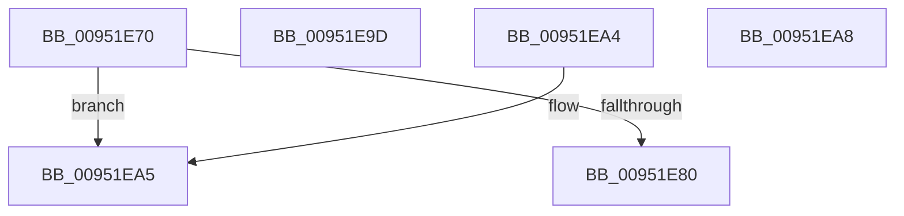

# PipCanEnableInterfaces

- RVA: `0x00951E70`–`0x00951ECA` (길이 `90` bytes)
- VA: `0x0000000140951E70`
- 실행 섹션: `PAGE`
- PDB 이름 있음: `예`; PDB Function 태그: `아니요`
- unwind 정보 RVA: `0x000DB714`
- 디코드: `36`개 명령, `90/90` bytes 표시
- 미해석 바이트: `2` (있으면 어셈블리에 `.byte`로 보존)

> 이 문서는 커널 이미지의 기계어와 PDB 기호를 분석해 생성했습니다. 4번과 5번은 함수 원형과 자료형을 바이너리 사용 방식에서 추정한 C 해석이며 원본 소스 복구 결과는 아닙니다.

## 1. Dependencies

- 직접 호출 지점: **0**; 고유 호출 대상: **0**
- 직접 호출자로 확인된 함수: **1**
- RIP 상대 이미지 참조: **1**

### Outgoing calls
- 직접 디코드된 call 명령이 없습니다.

### Direct callers
- [IopProcessSetInterfaceState](IopProcessSetInterfaceState_function_00950964.md) at `0x00950EA7`

### Static image references
- `0x00951E80` → RVA `0x00000000` (`image boundary/outside`; read)

## 2. Other-region calls and transfers

- 다른 실행 섹션으로 향하는 call: **0**
- 별도 외부 분기/꼬리 이동을 확인하지 못했습니다.

## 3. Assembly (complete function range)

```asm
00951E70  8B 81 2C 01 00 00               mov eax, dword ptr [rcx + 0x12c]
00951E76  05 FF FC FF FF                  add eax, 0xfffffcff
00951E7B  83 F8 15                        cmp eax, 0x15
00951E7E  77 25                           ja 0x140951ea5
00951E80  48 8D 15 79 E1 6A FF            lea rdx, [rip - 0x951e87]
00951E87  48 98                           cdqe
00951E89  0F B6 84 02 B4 1E 95 00         movzx eax, byte ptr [rdx + rax + 0x951eb4]
00951E91  8B 8C 82 AC 1E 95 00            mov ecx, dword ptr [rdx + rax*4 + 0x951eac]
00951E98  48 03 CA                        add rcx, rdx
00951E9B  FF E1                           jmp rcx
00951E9D  CC                              int3
00951E9E  CC                              int3
00951E9F  CC                              int3
00951EA0  CC                              int3
00951EA1  B0 01                           mov al, 1
00951EA3  C3                              ret
00951EA4  CC                              int3
00951EA5  32 C0                           xor al, al
00951EA7  C3                              ret
00951EA8  CC                              int3
00951EA9  0F 1F 00                        nop dword ptr [rax]
00951EAC  A5                              movsd dword ptr [rdi], dword ptr [rsi]
00951EAD  1E                              .byte 0x1e
00951EAE  95                              xchg ebp, eax
00951EAF  00 A1 1E 95 00 00               add byte ptr [rcx + 0x951e], ah
00951EB5  00 01                           add byte ptr [rcx], al
00951EB7  01 01                           add dword ptr [rcx], eax
00951EB9  01 01                           add dword ptr [rcx], eax
00951EBB  01 01                           add dword ptr [rcx], eax
00951EBD  01 01                           add dword ptr [rcx], eax
00951EBF  01 01                           add dword ptr [rcx], eax
00951EC1  01 01                           add dword ptr [rcx], eax
00951EC3  00 00                           add byte ptr [rax], al
00951EC5  01 00                           add dword ptr [rax], eax
00951EC7  00 00                           add byte ptr [rax], al
00951EC9  00                              .byte 0x00
```

## 4. C-style interpretation (structured pseudocode)

```c
__int64 __fastcall PipCanEnableInterfaces(__int64 a1)
{
    __int64 result;

    result = (unsigned int)(((unsigned int)(*(unsigned int *)(a1 + 300))) + (0xFFFFFCFFULL));
    if (((unsigned int)(result)) > 21) goto loc_00951EA5;
    a1 = ((unsigned int)(*(unsigned int *)(v_rip - 9772679 + *(unsigned __int8 *)(v_rip - 9772679 + result * 1 + 9772724) * 4 + 9772716))) + (v_rip - 9772679);
loc_00951EA5:
    result = 0;
    return result;
}
```

## 5. (Beta) C Style

```c
int64_t PipCanEnableInterfaces(void *Arg1)
{
    uint8_t *arg1 = (uint8_t *)Arg1;

    int64_t result;

    result = (uint32_t)(((uint32_t)(*(uint32_t *)(arg1 + 0x12C))) + (0xFFFFFCFFULL));
    if (((uint32_t)(result)) > 21) goto loc_00951EA5;
    Arg1 = ((uint32_t)(*(uint32_t *)(v_rip - 0x951E87 + *(uint8_t *)(v_rip - 0x951E87 + result * 1 + 0x951EB4) * 4 + 0x951EAC))) + (v_rip - 9772679);
loc_00951EA5:
    result = 0;
    return result;
}
```

### 관측된 메모리 오프셋

구조체 형식이 확인되지 않은 접근은 인자 기준의 오프셋으로만 기록했습니다.

| 기준 인자 | 오프셋 표현 | 폭 (bit) | 접근 |
|---|---:|---:|---|
| `Arg1` | `+ 0x12C` | `32` | `R` |

## 6. Execution-region graph

[열기: 2D/3D 그래프와 함수 탐색 컨트롤 패널](../../../control-panel.html?section=page&rva=0x00951E70&view=graph)

- 2D 그래프는 위에서 아래로 흐르고, 3D 그래프는 빈 공간을 드래그해 회전합니다. Shift+드래그는 이동, 휠은 확대·축소, 함수 노드 선택은 대상 보고서 이동입니다.

### Static fallback


