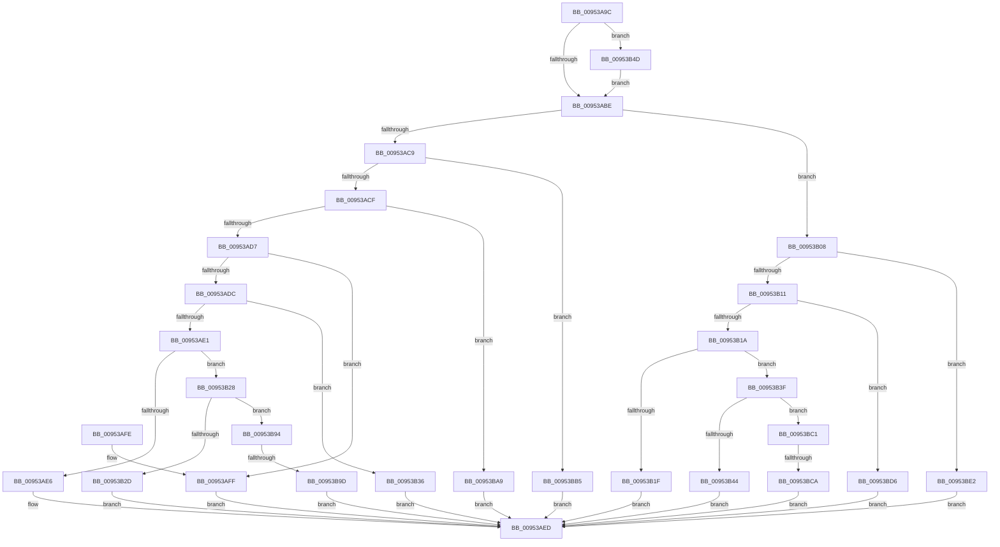

# PnpActivatePdcForDeviceEvent

- RVA: `0x00953A9C`–`0x00953BEE` (길이 `338` bytes)
- VA: `0x0000000140953A9C`
- 실행 섹션: `PAGE`
- PDB 이름 있음: `예`; PDB Function 태그: `예`
- unwind 정보 RVA: `0x0009212C`
- 디코드: `78`개 명령, `338/338` bytes 표시
- 미해석 바이트: `0` (있으면 어셈블리에 `.byte`로 보존)

> 이 문서는 커널 이미지의 기계어와 PDB 기호를 분석해 생성했습니다. 4번과 5번은 함수 원형과 자료형을 바이너리 사용 방식에서 추정한 C 해석이며 원본 소스 복구 결과는 아닙니다.

## 1. Dependencies

- 직접 호출 지점: **3**; 고유 호출 대상: **3**
- 직접 호출자로 확인된 함수: **1**
- RIP 상대 이미지 참조: **14**

### Outgoing calls
- `0x00953AEF` → [PiPdcActivate](PiPdcActivate_function_00953BF4.md) (function, `0x00953BF4`)
- `0x00953B74` → [wil_details_FeatureReporting_ReportUsageToService](../../text/53/wil_details_FeatureReporting_ReportUsageToService_function_0053E6E4.md) (function, `0x0053E6E4`)
- `0x00953B8A` → [wil_details_FeatureStateCache_TryEnableDeviceUsageFastPath](../../text/53/wil_details_FeatureStateCache_TryEnableDeviceUsageFastPath_function_0053E774.md) (function, `0x0053E774`)

### Direct callers
- [PnpDeviceEventWorker](PnpDeviceEventWorker_function_009556B0.md) at `0x009558AE`

### Static image references
- `0x00953AAB` → RVA `0x00FC4870` (`.data`; read)
- `0x00953AE6` → RVA `0x00AFFA40` (` ?? ::NNGAKEGL::`string'`; read)
- `0x00953AFF` → RVA `0x00AFF7F0` (` ?? ::NNGAKEGL::`string'`; read)
- `0x00953B1F` → RVA `0x00AFF970` (` ?? ::NNGAKEGL::`string'`; read)
- `0x00953B2D` → RVA `0x00AFFAA0` (` ?? ::NNGAKEGL::`string'`; read)
- `0x00953B36` → RVA `0x00AFF9E0` (` ?? ::NNGAKEGL::`string'`; read)
- `0x00953B44` → RVA `0x00AFFB60` (` ?? ::NNGAKEGL::`string'`; read)
- `0x00953B52` → RVA `0x000DDE48` (`.rdata`; read)
- `0x00953B9D` → RVA `0x00AFFB00` (` ?? ::NNGAKEGL::`string'`; read)
- `0x00953BA9` → RVA `0x00AFF780` (` ?? ::NNGAKEGL::`string'`; read)
- `0x00953BB5` → RVA `0x00AFF870` (` ?? ::NNGAKEGL::`string'`; read)
- `0x00953BCA` → RVA `0x00AFFBD0` (` ?? ::NNGAKEGL::`string'`; read)
- `0x00953BD6` → RVA `0x00AFF920` (` ?? ::NNGAKEGL::`string'`; read)
- `0x00953BE2` → RVA `0x00AFF8C0` (` ?? ::NNGAKEGL::`string'`; read)

## 2. Other-region calls and transfers

- 다른 실행 섹션으로 향하는 call: **2**
  - `0x00953B74` → [wil_details_FeatureReporting_ReportUsageToService](../../text/53/wil_details_FeatureReporting_ReportUsageToService_function_0053E6E4.md) (`PAGE` → `.text`)
  - `0x00953B8A` → [wil_details_FeatureStateCache_TryEnableDeviceUsageFastPath](../../text/53/wil_details_FeatureStateCache_TryEnableDeviceUsageFastPath_function_0053E774.md) (`PAGE` → `.text`)
- call이 아닌 외부 분기/꼬리 이동: **2**
  - `0x00953B97` → [sub_00B264E8](../B2/Unknown_function_00B264E8.md) (`tail-transfer`)
  - `0x00953BC4` → [sub_00B264E8](../B2/Unknown_function_00B264E8.md) (`tail-transfer`)

## 3. Assembly (complete function range)

```asm
00953A9C  40 53                           push rbx
00953A9E  48 83 EC 20                     sub rsp, 0x20
00953AA2  48 8B D9                        mov rbx, rcx
00953AA5  48 83 64 24 38 00               and qword ptr [rsp + 0x38], 0
00953AAB  8B 15 BF 0D 67 00               mov edx, dword ptr [rip + 0x670dbf]
00953AB1  89 54 24 38                     mov dword ptr [rsp + 0x38], edx
00953AB5  F6 C2 10                        test dl, 0x10
00953AB8  0F 84 8F 00 00 00               je 0x140953b4d
00953ABE  8B 8B 88 00 00 00               mov ecx, dword ptr [rbx + 0x88]
00953AC4  83 F9 06                        cmp ecx, 6
00953AC7  7F 3F                           jg 0x140953b08
00953AC9  0F 84 E6 00 00 00               je 0x140953bb5
00953ACF  85 C9                           test ecx, ecx
00953AD1  0F 84 D2 00 00 00               je 0x140953ba9
00953AD7  83 E9 01                        sub ecx, 1
00953ADA  74 23                           je 0x140953aff
00953ADC  83 E9 01                        sub ecx, 1
00953ADF  74 55                           je 0x140953b36
00953AE1  83 E9 01                        sub ecx, 1
00953AE4  75 42                           jne 0x140953b28
00953AE6  48 8D 0D 53 BF 1A 00            lea rcx, [rip + 0x1abf53]
00953AED  33 D2                           xor edx, edx
00953AEF  E8 00 01 00 00                  call 0x140953bf4
00953AF4  48 89 43 70                     mov qword ptr [rbx + 0x70], rax
00953AF8  48 83 C4 20                     add rsp, 0x20
00953AFC  5B                              pop rbx
00953AFD  C3                              ret
00953AFE  CC                              int3
00953AFF  48 8D 0D EA BC 1A 00            lea rcx, [rip + 0x1abcea]
00953B06  EB E5                           jmp 0x140953aed
00953B08  83 E9 07                        sub ecx, 7
00953B0B  0F 84 D1 00 00 00               je 0x140953be2
00953B11  83 E9 01                        sub ecx, 1
00953B14  0F 84 BC 00 00 00               je 0x140953bd6
00953B1A  83 E9 01                        sub ecx, 1
00953B1D  75 20                           jne 0x140953b3f
00953B1F  48 8D 0D 4A BE 1A 00            lea rcx, [rip + 0x1abe4a]
00953B26  EB C5                           jmp 0x140953aed
00953B28  83 E9 01                        sub ecx, 1
00953B2B  75 67                           jne 0x140953b94
00953B2D  48 8D 0D 6C BF 1A 00            lea rcx, [rip + 0x1abf6c]
00953B34  EB B7                           jmp 0x140953aed
00953B36  48 8D 0D A3 BE 1A 00            lea rcx, [rip + 0x1abea3]
00953B3D  EB AE                           jmp 0x140953aed
00953B3F  83 E9 01                        sub ecx, 1
00953B42  75 7D                           jne 0x140953bc1
00953B44  48 8D 0D 15 C0 1A 00            lea rcx, [rip + 0x1ac015]
00953B4B  EB A0                           jmp 0x140953aed
00953B4D  48 8B 44 24 38                  mov rax, qword ptr [rsp + 0x38]
00953B52  48 8D 0D EF A2 78 FF            lea rcx, [rip - 0x875d11]
00953B59  41 B9 01 00 00 00               mov r9d, 1
00953B5F  48 89 44 24 38                  mov qword ptr [rsp + 0x38], rax
00953B64  41 0B D1                        or edx, r9d
00953B67  89 54 24 38                     mov dword ptr [rsp + 0x38], edx
00953B6B  48 8B 54 24 38                  mov rdx, qword ptr [rsp + 0x38]
00953B70  45 8D 41 02                     lea r8d, [r9 + 2]
00953B74  E8 6B AB BE FF                  call 0x14053e6e4
00953B79  48 8B 4C 24 38                  mov rcx, qword ptr [rsp + 0x38]
00953B7E  4C 8D 05 C3 A2 78 FF            lea r8, [rip - 0x875d3d]
00953B85  BA 03 00 00 00                  mov edx, 3
00953B8A  E8 E5 AB BE FF                  call 0x14053e774
00953B8F  E9 2A FF FF FF                  jmp 0x140953abe
00953B94  83 F9 01                        cmp ecx, 1
00953B97  0F 85 4B 29 1D 00               jne 0x140b264e8
00953B9D  48 8D 0D 5C BF 1A 00            lea rcx, [rip + 0x1abf5c]
00953BA4  E9 44 FF FF FF                  jmp 0x140953aed
00953BA9  48 8D 0D D0 BB 1A 00            lea rcx, [rip + 0x1abbd0]
00953BB0  E9 38 FF FF FF                  jmp 0x140953aed
00953BB5  48 8D 0D B4 BC 1A 00            lea rcx, [rip + 0x1abcb4]
00953BBC  E9 2C FF FF FF                  jmp 0x140953aed
00953BC1  83 F9 01                        cmp ecx, 1
00953BC4  0F 85 1E 29 1D 00               jne 0x140b264e8
00953BCA  48 8D 0D FF BF 1A 00            lea rcx, [rip + 0x1abfff]
00953BD1  E9 17 FF FF FF                  jmp 0x140953aed
00953BD6  48 8D 0D 43 BD 1A 00            lea rcx, [rip + 0x1abd43]
00953BDD  E9 0B FF FF FF                  jmp 0x140953aed
00953BE2  48 8D 0D D7 BC 1A 00            lea rcx, [rip + 0x1abcd7]
00953BE9  E9 FF FE FF FF                  jmp 0x140953aed
```

## 4. C-style interpretation (structured pseudocode)

```c
__int64 __fastcall PnpActivatePdcForDeviceEvent(__int64 a1)
{
    __int64 result;
    __int64 v_rsp;
    unsigned __int64 v_stack_p10;
    unsigned __int64 v_stack_p38;

    v_rsp = (v_rsp) - (32);
    v_stack_p10 = (unsigned int)((unsigned int)(*(unsigned int *)(v_rip + 6753727)));
    if ((((unsigned __int8)((unsigned int)(*(unsigned int *)(v_rip + 6753727)))) & (16)) == 0) goto loc_00953B4D;
loc_00953ABE:
    if (((unsigned int)((unsigned int)(*(unsigned int *)(a1 + 136)))) > 6) goto loc_00953B08;
    if (((unsigned int)((unsigned int)(*(unsigned int *)(a1 + 136)))) == 6) goto loc_00953BB5;
    if ((unsigned int)((unsigned int)(*(unsigned int *)(a1 + 136))) == 0) goto loc_00953BA9;
    a1 = (unsigned int)(((unsigned int)(*(unsigned int *)(a1 + 136))) - (1));
    if (condition_is_equal) goto loc_00953AFF;
    a1 = (unsigned int)((a1) - (1));
    if (condition_is_equal) goto loc_00953B36;
    a1 = (unsigned int)((a1) - (1));
    if (condition_is_not_equal) goto loc_00953B28;
loc_00953AED:
    a2 = 0;
    result = PiPdcActivate(v_rip + 1752915, a2, a3, a4);
    *(unsigned __int64 *)(a1 + 112) = result;
    v_rsp = (v_rsp) + (32);
    return result;
loc_00953AFF:
    goto loc_00953AED;
loc_00953B08:
    a1 = (unsigned int)((v_rip + 1752298) - (7));
    if (condition_is_equal) goto loc_00953BE2;
    a1 = (unsigned int)((a1) - (1));
    if (condition_is_equal) goto loc_00953BD6;
    a1 = (unsigned int)((a1) - (1));
    if (condition_is_not_equal) goto loc_00953B3F;
    goto loc_00953AED;
loc_00953B28:
    a1 = (unsigned int)((v_rip + 1752650) - (1));
    if (condition_is_not_equal) goto loc_00953B94;
    goto loc_00953AED;
loc_00953B36:
    goto loc_00953AED;
loc_00953B3F:
    a1 = (unsigned int)((v_rip + 1752739) - (1));
    if (condition_is_not_equal) goto loc_00953BC1;
    goto loc_00953AED;
loc_00953B4D:
    v_stack_p38 = v_stack_p38;
    a2 = (unsigned int)((a2) | (1));
    v_stack_p38 = (unsigned int)(a2);
    result = wil_details_FeatureReporting_ReportUsageToService(v_rip - 8871185, v_stack_p38, 1 + 2, 1);
    result = wil_details_FeatureStateCache_TryEnableDeviceUsageFastPath(v_stack_p38, 3, v_rip - 8871229, 1);
    goto loc_00953ABE;
loc_00953B94:
    goto loc_00953AED;
loc_00953BA9:
    goto loc_00953AED;
loc_00953BB5:
    goto loc_00953AED;
loc_00953BC1:
    goto loc_00953AED;
loc_00953BD6:
    goto loc_00953AED;
loc_00953BE2:
    goto loc_00953AED;
}
```

## 5. (Beta) C Style

```c
int64_t PnpActivatePdcForDeviceEvent(void *Arg1)
{
    uint8_t *arg1 = (uint8_t *)Arg1;

    int64_t result;
    int64_t local_rsp;
    uint64_t v_stack_p10;
    uint64_t v_stack_p38;

    local_rsp = (local_rsp) - (32);
    v_stack_p10 = (uint32_t)((uint32_t)(*(uint32_t *)(v_rip + 0x670DBF)));
    if ((((uint8_t)((uint32_t)(*(uint32_t *)(v_rip + 0x670DBF)))) & (16)) == 0) goto loc_00953B4D;
loc_00953ABE:
    if (((uint32_t)((uint32_t)(*(uint32_t *)(arg1 + 0x88)))) > 6) goto loc_00953B08;
    if (((uint32_t)((uint32_t)(*(uint32_t *)(arg1 + 0x88)))) == 6) goto loc_00953BB5;
    if ((uint32_t)((uint32_t)(*(uint32_t *)(arg1 + 0x88))) == 0) goto loc_00953BA9;
    Arg1 = (uint32_t)(((uint32_t)(*(uint32_t *)(arg1 + 0x88))) - (1));
    if (condition_is_equal) goto loc_00953AFF;
    Arg1 = (uint32_t)((Arg1) - (1));
    if (condition_is_equal) goto loc_00953B36;
    Arg1 = (uint32_t)((Arg1) - (1));
    if (condition_is_not_equal) goto loc_00953B28;
loc_00953AED:
    a2 = 0;
    result = PiPdcActivate(v_rip + 1752915, a2, a3, a4);
    *(uint64_t *)(arg1 + 0x70) = result;
    local_rsp = (local_rsp) + (32);
    return result;
loc_00953AFF:
    goto loc_00953AED;
loc_00953B08:
    Arg1 = (uint32_t)((v_rip + 1752298) - (7));
    if (condition_is_equal) goto loc_00953BE2;
    Arg1 = (uint32_t)((Arg1) - (1));
    if (condition_is_equal) goto loc_00953BD6;
    Arg1 = (uint32_t)((Arg1) - (1));
    if (condition_is_not_equal) goto loc_00953B3F;
    goto loc_00953AED;
loc_00953B28:
    Arg1 = (uint32_t)((v_rip + 1752650) - (1));
    if (condition_is_not_equal) goto loc_00953B94;
    goto loc_00953AED;
loc_00953B36:
    goto loc_00953AED;
loc_00953B3F:
    Arg1 = (uint32_t)((v_rip + 1752739) - (1));
    if (condition_is_not_equal) goto loc_00953BC1;
    goto loc_00953AED;
loc_00953B4D:
    v_stack_p38 = v_stack_p38;
    a2 = (uint32_t)((a2) | (1));
    v_stack_p38 = (uint32_t)(a2);
    result = wil_details_FeatureReporting_ReportUsageToService(v_rip - 8871185, v_stack_p38, 1 + 2, 1);
    result = wil_details_FeatureStateCache_TryEnableDeviceUsageFastPath(v_stack_p38, 3, v_rip - 8871229, 1);
    goto loc_00953ABE;
loc_00953B94:
    goto loc_00953AED;
loc_00953BA9:
    goto loc_00953AED;
loc_00953BB5:
    goto loc_00953AED;
loc_00953BC1:
    goto loc_00953AED;
loc_00953BD6:
    goto loc_00953AED;
loc_00953BE2:
    goto loc_00953AED;
}
```

### 관측된 메모리 오프셋

구조체 형식이 확인되지 않은 접근은 인자 기준의 오프셋으로만 기록했습니다.

| 기준 인자 | 오프셋 표현 | 폭 (bit) | 접근 |
|---|---:|---:|---|
| `Arg1` | `+ 0x70` | `64` | `W` |
| `Arg1` | `+ 0x88` | `32` | `R` |

## 6. Execution-region graph

[열기: 2D/3D 그래프와 함수 탐색 컨트롤 패널](../../../control-panel.html?section=page&rva=0x00953A9C&view=graph)

- 2D 그래프는 위에서 아래로 흐르고, 3D 그래프는 빈 공간을 드래그해 회전합니다. Shift+드래그는 이동, 휠은 확대·축소, 함수 노드 선택은 대상 보고서 이동입니다.

### Static fallback


