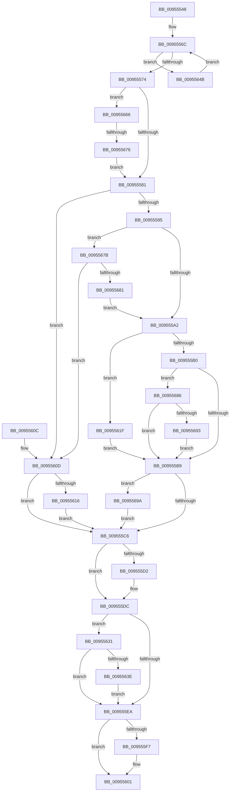

# PnpCompleteDeviceEvent

- RVA: `0x00955548`–`0x009556A8` (길이 `352` bytes)
- VA: `0x0000000140955548`
- 실행 섹션: `PAGE`
- PDB 이름 있음: `예`; PDB Function 태그: `예`
- unwind 정보 RVA: `0x000922EC`
- 디코드: `93`개 명령, `352/352` bytes 표시
- 미해석 바이트: `0` (있으면 어셈블리에 `.byte`로 보존)

> 이 문서는 커널 이미지의 기계어와 PDB 기호를 분석해 생성했습니다. 4번과 5번은 함수 원형과 자료형을 바이너리 사용 방식에서 추정한 C 해석이며 원본 소스 복구 결과는 아닙니다.

## 1. Dependencies

- 직접 호출 지점: **8**; 고유 호출 대상: **6**
- 직접 호출자로 확인된 함수: **2**
- RIP 상대 이미지 참조: **0**

### Outgoing calls
- `0x00955585` → [PiPdcDeactivate](PiPdcDeactivate_function_009552C4.md) (function, `0x009552C4`)
- `0x009555D7` → [ObfDereferenceObjectWithTag](../../text/2F/ObfDereferenceObjectWithTag_function_002F78E0.md) (function, `0x002F78E0`)
- `0x009555FC` → [ExFreePoolWithTag](../../poolcode/B8/ExFreePoolWithTag_function_00B82870.md) (function, `0x00B82870`)
- `0x00955618` → [ExFreePoolWithTag](../../poolcode/B8/ExFreePoolWithTag_function_00B82870.md) (function, `0x00B82870`)
- `0x0095562A` → [KeSetEvent](../../text/33/KeSetEvent_function_0033F310.md) (function, `0x0033F310`)
- `0x00955644` → [ExFreePoolWithTag](../../poolcode/B8/ExFreePoolWithTag_function_00B82870.md) (function, `0x00B82870`)
- `0x00955654` → [KeDelayExecutionThread](../../text/20/KeDelayExecutionThread_function_00209550.md) (function, `0x00209550`)
- `0x0095569E` → [guard_dispatch_icall](../../text/6B/guard_dispatch_icall_function_006BAAD0.md) (function, `0x006BAAD0`)

### Direct callers
- [PnpProcessCompletedEject](../72/PnpProcessCompletedEject_function_0072D090.md) at `0x0072D1C9`
- [PnpDeviceEventWorker](PnpDeviceEventWorker_function_009556B0.md) at `0x009557ED`

### Static image references
- 디코드된 RIP-relative 메모리 참조가 없습니다.

## 2. Other-region calls and transfers

- 다른 실행 섹션으로 향하는 call: **7**
  - `0x009555D7` → [ObfDereferenceObjectWithTag](../../text/2F/ObfDereferenceObjectWithTag_function_002F78E0.md) (`PAGE` → `.text`)
  - `0x009555FC` → [ExFreePoolWithTag](../../poolcode/B8/ExFreePoolWithTag_function_00B82870.md) (`PAGE` → `POOLCODE`)
  - `0x00955618` → [ExFreePoolWithTag](../../poolcode/B8/ExFreePoolWithTag_function_00B82870.md) (`PAGE` → `POOLCODE`)
  - `0x0095562A` → [KeSetEvent](../../text/33/KeSetEvent_function_0033F310.md) (`PAGE` → `.text`)
  - `0x00955644` → [ExFreePoolWithTag](../../poolcode/B8/ExFreePoolWithTag_function_00B82870.md) (`PAGE` → `POOLCODE`)
  - `0x00955654` → [KeDelayExecutionThread](../../text/20/KeDelayExecutionThread_function_00209550.md) (`PAGE` → `.text`)
  - `0x0095569E` → [guard_dispatch_icall](../../text/6B/guard_dispatch_icall_function_006BAAD0.md) (`PAGE` → `.text`)
- call이 아닌 외부 분기/꼬리 이동: **1**
  - `0x00955670` → [sub_00B269B8](../B2/Unknown_function_00B269B8.md) (`tail-transfer`)

## 3. Assembly (complete function range)

```asm
00955548  48 89 5C 24 10                  mov qword ptr [rsp + 0x10], rbx
0095554D  57                              push rdi
0095554E  48 83 EC 20                     sub rsp, 0x20
00955552  83 4C 24 34 FF                  or dword ptr [rsp + 0x34], 0xffffffff
00955557  B8 01 00 00 00                  mov eax, 1
0095555C  C7 44 24 30 C0 BD F0 FF         mov dword ptr [rsp + 0x30], 0xfff0bdc0
00955564  8B FA                           mov edi, edx
00955566  87 41 44                        xchg dword ptr [rcx + 0x44], eax
00955569  48 8B D9                        mov rbx, rcx
0095556C  85 C0                           test eax, eax
0095556E  0F 85 D7 00 00 00               jne 0x14095564b
00955574  48 8B 4B 50                     mov rcx, qword ptr [rbx + 0x50]
00955578  48 85 C9                        test rcx, rcx
0095557B  0F 85 E5 00 00 00               jne 0x140955666
00955581  48 8B 4B 70                     mov rcx, qword ptr [rbx + 0x70]
00955585  E8 3A FD FF FF                  call 0x1409552c4
0095558A  48 83 63 70 00                  and qword ptr [rbx + 0x70], 0
0095558F  80 7B 48 00                     cmp byte ptr [rbx + 0x48], 0
00955593  75 78                           jne 0x14095560d
00955595  48 8B 43 50                     mov rax, qword ptr [rbx + 0x50]
00955599  48 85 C0                        test rax, rax
0095559C  0F 85 D9 00 00 00               jne 0x14095567b
009555A2  48 83 7B 18 00                  cmp qword ptr [rbx + 0x18], 0
009555A7  48 8B 83 90 00 00 00            mov rax, qword ptr [rbx + 0x90]
009555AE  75 6F                           jne 0x14095561f
009555B0  48 85 C0                        test rax, rax
009555B3  0F 85 CD 00 00 00               jne 0x140955686
009555B9  48 8B 43 20                     mov rax, qword ptr [rbx + 0x20]
009555BD  48 85 C0                        test rax, rax
009555C0  0F 85 D4 00 00 00               jne 0x14095569a
009555C6  48 8B 8B A0 00 00 00            mov rcx, qword ptr [rbx + 0xa0]
009555CD  48 85 C9                        test rcx, rcx
009555D0  74 0A                           je 0x1409555dc
009555D2  BA 50 6E 70 56                  mov edx, 0x56706e50
009555D7  E8 04 23 9A FF                  call 0x1402f78e0
009555DC  48 8B 4B 50                     mov rcx, qword ptr [rbx + 0x50]
009555E0  BF 50 6E 70 4B                  mov edi, 0x4b706e50
009555E5  48 85 C9                        test rcx, rcx
009555E8  75 47                           jne 0x140955631
009555EA  83 C8 FF                        or eax, 0xffffffff
009555ED  F0 0F C1 43 40                  lock xadd dword ptr [rbx + 0x40], eax
009555F2  83 F8 01                        cmp eax, 1
009555F5  75 0A                           jne 0x140955601
009555F7  8B D7                           mov edx, edi
009555F9  48 8B CB                        mov rcx, rbx
009555FC  E8 6F D2 22 00                  call 0x140b82870
00955601  48 8B 5C 24 38                  mov rbx, qword ptr [rsp + 0x38]
00955606  48 83 C4 20                     add rsp, 0x20
0095560A  5F                              pop rdi
0095560B  C3                              ret
0095560C  CC                              int3
0095560D  48 8B 4B 30                     mov rcx, qword ptr [rbx + 0x30]
00955611  48 85 C9                        test rcx, rcx
00955614  74 B0                           je 0x1409555c6
00955616  33 D2                           xor edx, edx
00955618  E8 53 D2 22 00                  call 0x140b82870
0095561D  EB A7                           jmp 0x1409555c6
0095561F  89 38                           mov dword ptr [rax], edi
00955621  45 33 C0                        xor r8d, r8d
00955624  48 8B 4B 18                     mov rcx, qword ptr [rbx + 0x18]
00955628  33 D2                           xor edx, edx
0095562A  E8 E1 9C 9E FF                  call 0x14033f310
0095562F  EB 88                           jmp 0x1409555b9
00955631  83 C8 FF                        or eax, 0xffffffff
00955634  F0 0F C1 41 40                  lock xadd dword ptr [rcx + 0x40], eax
00955639  83 F8 01                        cmp eax, 1
0095563C  75 AC                           jne 0x1409555ea
0095563E  48 8B 4B 50                     mov rcx, qword ptr [rbx + 0x50]
00955642  8B D7                           mov edx, edi
00955644  E8 27 D2 22 00                  call 0x140b82870
00955649  EB 9F                           jmp 0x1409555ea
0095564B  4C 8D 44 24 30                  lea r8, [rsp + 0x30]
00955650  33 D2                           xor edx, edx
00955652  33 C9                           xor ecx, ecx
00955654  E8 F7 3E 8B FF                  call 0x140209550
00955659  B8 01 00 00 00                  mov eax, 1
0095565E  87 43 44                        xchg dword ptr [rbx + 0x44], eax
00955661  E9 06 FF FF FF                  jmp 0x14095556c
00955666  B8 01 00 00 00                  mov eax, 1
0095566B  87 41 44                        xchg dword ptr [rcx + 0x44], eax
0095566E  85 C0                           test eax, eax
00955670  0F 85 42 13 1D 00               jne 0x140b269b8
00955676  E9 06 FF FF FF                  jmp 0x140955581
0095567B  80 78 48 00                     cmp byte ptr [rax + 0x48], 0
0095567F  75 8C                           jne 0x14095560d
00955681  E9 1C FF FF FF                  jmp 0x1409555a2
00955686  83 BB 88 00 00 00 01            cmp dword ptr [rbx + 0x88], 1
0095568D  0F 85 26 FF FF FF               jne 0x1409555b9
00955693  89 38                           mov dword ptr [rax], edi
00955695  E9 1F FF FF FF                  jmp 0x1409555b9
0095569A  48 8B 4B 28                     mov rcx, qword ptr [rbx + 0x28]
0095569E  E8 2D 54 D6 FF                  call 0x1406baad0
009556A3  E9 1E FF FF FF                  jmp 0x1409555c6
```

## 4. C-style interpretation (structured pseudocode)

```c
__int64 __fastcall PnpCompleteDeviceEvent(__int64 a1, int a2, int a3)
{
    __int64 result;
    __int64 v_rsp;
    unsigned __int64 v_stack_p10;
    unsigned __int64 v_stack_p30;
    unsigned int v_stack_p8;
    unsigned int v_stack_pC;

    v_stack_p10 = v_rbx;
    v_rsp = (v_rsp) - (32);
    v_stack_p8 = 0xFFF0BDC0ULL;
loc_0095556C:
    if (1 != 0) goto loc_0095564B;
    if (*(unsigned __int64 *)(a1 + 80) != 0) goto loc_00955666;
loc_00955581:
    result = PiPdcDeactivate(*(unsigned __int64 *)(a1 + 112), a2, a3, a4);
    if ((*(unsigned __int8 *)(a1 + 72)) != 0) goto loc_0095560D;
    if (*(unsigned __int64 *)(a1 + 80) != 0) goto loc_0095567B;
loc_009555A2:
    if ((*(unsigned __int64 *)(a1 + 24)) != 0) goto loc_0095561F;
    if (*(unsigned __int64 *)(a1 + 144) != 0) goto loc_00955686;
loc_009555B9:
    if (*(unsigned __int64 *)(a1 + 32) != 0) goto loc_0095569A;
loc_009555C6:
    result = *(unsigned __int64 *)(a1 + 32);
    if (*(unsigned __int64 *)(a1 + 160) != 0) {
        a2 = 0x56706E50ULL;
        result = ObfDereferenceObjectWithTag(*(unsigned __int64 *)(a1 + 160), a2, a3, a4);
    }
    if (*(unsigned __int64 *)(a1 + 80) != 0) goto loc_00955631;
loc_009555EA:
    result = (unsigned int)((result) | (0xFFFFFFFFULL));
    if (((unsigned int)(result)) == 1) {
        a2 = (unsigned int)((unsigned int)(0x4B706E50ULL));
        a1 = a1;
        result = ExFreePoolWithTag(a1, a2, a3, a4);
    }
    v_rsp = (v_rsp) + (32);
    return result;
loc_0095560D:
    if (*(unsigned __int64 *)(v_stack_p10 + 48) == 0) goto loc_009555C6;
    a2 = 0;
    result = ExFreePoolWithTag(*(unsigned __int64 *)(v_stack_p10 + 48), a2, a3, a4);
    goto loc_009555C6;
loc_0095561F:
    *(unsigned int *)(result) = (unsigned int)((unsigned int)(0x4B706E50ULL));
    a3 = 0;
    a2 = 0;
    result = KeSetEvent(*(unsigned __int64 *)(v_stack_p10 + 24), a2, a3, a4);
    goto loc_009555B9;
loc_00955631:
    result = (unsigned int)((result) | (0xFFFFFFFFULL));
    if (((unsigned int)(result)) != 1) goto loc_009555EA;
    result = ExFreePoolWithTag(*(unsigned __int64 *)(v_stack_p10 + 80), (unsigned int)((unsigned int)((unsigned int)(0x4B706E50ULL))), a3, a4);
    goto loc_009555EA;
loc_0095564B:
    a2 = 0;
    a1 = 0;
    result = KeDelayExecutionThread(a1, a2, v_stack_p30, a4);
    goto loc_0095556C;
loc_00955666:
    goto loc_00955581;
loc_0095567B:
    if ((*(unsigned __int8 *)(1 + 72)) != 0) goto loc_0095560D;
    goto loc_009555A2;
loc_00955686:
    if ((*(unsigned int *)(v_stack_p10 + 136)) != 1) goto loc_009555B9;
    *(unsigned int *)(1) = (unsigned int)((unsigned int)(0x4B706E50ULL));
    goto loc_009555B9;
loc_0095569A:
    result = guard_dispatch_icall(*(unsigned __int64 *)(v_stack_p10 + 40), a2, v_stack_p30, a4);
    goto loc_009555C6;
}
```

## 5. (Beta) C Style

```c
int64_t PnpCompleteDeviceEvent(void *Arg1, int32_t Arg2, int32_t Arg3)
{
    uint8_t *arg1 = (uint8_t *)Arg1;

    int64_t result;
    int64_t local_rsp;
    uint64_t v_stack_p10;
    uint64_t v_stack_p30;
    uint32_t v_stack_p8;
    uint32_t v_stack_pC;

    v_stack_p10 = local_rbx;
    local_rsp = (local_rsp) - (32);
    v_stack_p8 = 0xFFF0BDC0ULL;
loc_0095556C:
    if (1 != 0) goto loc_0095564B;
    if (*(uint64_t *)(arg1 + 0x50) != 0) goto loc_00955666;
loc_00955581:
    result = PiPdcDeactivate(*(uint64_t *)(arg1 + 0x70), Arg2, Arg3, a4);
    if ((*(uint8_t *)(arg1 + 0x48)) != 0) goto loc_0095560D;
    if (*(uint64_t *)(arg1 + 0x50) != 0) goto loc_0095567B;
loc_009555A2:
    if ((*(uint64_t *)(arg1 + 0x18)) != 0) goto loc_0095561F;
    if (*(uint64_t *)(arg1 + 0x90) != 0) goto loc_00955686;
loc_009555B9:
    if (*(uint64_t *)(arg1 + 0x20) != 0) goto loc_0095569A;
loc_009555C6:
    result = *(uint64_t *)(arg1 + 0x20);
    if (*(uint64_t *)(arg1 + 0xA0) != 0) {
        Arg2 = 0x56706E50ULL;
        result = ObfDereferenceObjectWithTag(*(uint64_t *)(arg1 + 0xA0), Arg2, Arg3, a4);
    }
    if (*(uint64_t *)(arg1 + 0x50) != 0) goto loc_00955631;
loc_009555EA:
    result = (uint32_t)((result) | (0xFFFFFFFFULL));
    if (((uint32_t)(result)) == 1) {
        Arg2 = (uint32_t)((uint32_t)(0x4B706E50ULL));
        Arg1 = Arg1;
        result = ExFreePoolWithTag(Arg1, Arg2, Arg3, a4);
    }
    local_rsp = (local_rsp) + (32);
    return result;
loc_0095560D:
    if (*(uint64_t *)(v_stack_p10 + 0x30) == 0) goto loc_009555C6;
    Arg2 = 0;
    result = ExFreePoolWithTag(*(uint64_t *)(v_stack_p10 + 0x30), Arg2, Arg3, a4);
    goto loc_009555C6;
loc_0095561F:
    *(uint32_t *)(result) = (uint32_t)((uint32_t)(0x4B706E50ULL));
    Arg3 = 0;
    Arg2 = 0;
    result = KeSetEvent(*(uint64_t *)(v_stack_p10 + 0x18), Arg2, Arg3, a4);
    goto loc_009555B9;
loc_00955631:
    result = (uint32_t)((result) | (0xFFFFFFFFULL));
    if (((uint32_t)(result)) != 1) goto loc_009555EA;
    result = ExFreePoolWithTag(*(uint64_t *)(v_stack_p10 + 0x50), (uint32_t)((uint32_t)((uint32_t)(0x4B706E50ULL))), Arg3, a4);
    goto loc_009555EA;
loc_0095564B:
    Arg2 = 0;
    Arg1 = 0;
    result = KeDelayExecutionThread(Arg1, Arg2, v_stack_p30, a4);
    goto loc_0095556C;
loc_00955666:
    goto loc_00955581;
loc_0095567B:
    if ((*(uint8_t *)(1 + 0x48)) != 0) goto loc_0095560D;
    goto loc_009555A2;
loc_00955686:
    if ((*(uint32_t *)(v_stack_p10 + 0x88)) != 1) goto loc_009555B9;
    *(uint32_t *)(1) = (uint32_t)((uint32_t)(0x4B706E50ULL));
    goto loc_009555B9;
loc_0095569A:
    result = guard_dispatch_icall(*(uint64_t *)(v_stack_p10 + 0x28), Arg2, v_stack_p30, a4);
    goto loc_009555C6;
}
```

### 관측된 메모리 오프셋

구조체 형식이 확인되지 않은 접근은 인자 기준의 오프셋으로만 기록했습니다.

| 기준 인자 | 오프셋 표현 | 폭 (bit) | 접근 |
|---|---:|---:|---|
| `Arg1` | `+ 0x18` | `64` | `R` |
| `Arg1` | `+ 0x20` | `64` | `R` |
| `Arg1` | `+ 0x28` | `64` | `R` |
| `Arg1` | `+ 0x30` | `64` | `R` |
| `Arg1` | `+ 0x40` | `32` | `R/W` |
| `Arg1` | `+ 0x44` | `32` | `R/W` |
| `Arg1` | `+ 0x48` | `8` | `R` |
| `Arg1` | `+ 0x50` | `64` | `R` |
| `Arg1` | `+ 0x70` | `64` | `R` |
| `Arg1` | `+ 0x70` | `64` | `R/W` |
| `Arg1` | `+ 0x88` | `32` | `R` |
| `Arg1` | `+ 0x90` | `64` | `R` |
| `Arg1` | `+ 0xA0` | `64` | `R` |

## 6. Execution-region graph

[열기: 2D/3D 그래프와 함수 탐색 컨트롤 패널](../../../control-panel.html?section=page&rva=0x00955548&view=graph)

- 2D 그래프는 위에서 아래로 흐르고, 3D 그래프는 빈 공간을 드래그해 회전합니다. Shift+드래그는 이동, 휠은 확대·축소, 함수 노드 선택은 대상 보고서 이동입니다.

### Static fallback


